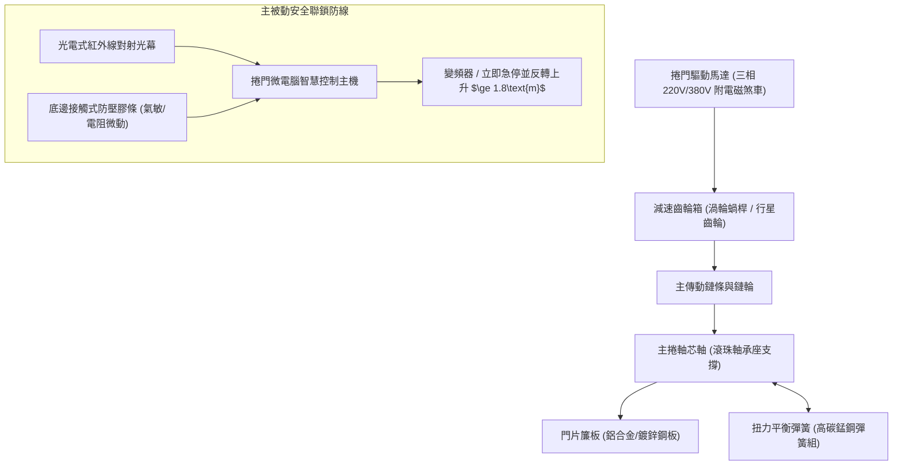
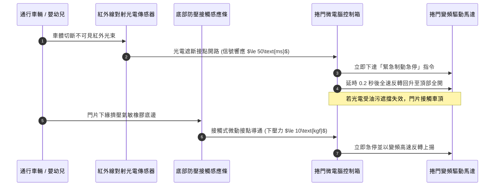
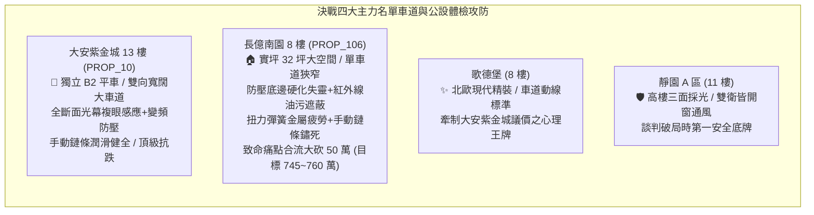

# 全案購屋實戰第一千二百二十九部：中古大樓地下室車位旁電動車道鐵捲門防壓安全底邊敏銳度衰退紅外線對射被油污遮擋手動鍊條卡死與扭力彈簧金屬疲勞體檢工序全書

## 核心宗旨與全案法律技術防線宣告
集合住宅地下停車場之車道出入口，係全棟社區每日數百輛汽機車進出以及行人、學童通行的咽喉重地。其裝設之「電動車道鐵捲門（含高速捲門、格柵鋁合金捲門、重型防火防水鐵捲門）」為全天候高頻次往復運轉之重型動力機械設施。在中古大樓置產實戰檢驗中，車道鐵捲門之主被動安全防夾感應系統、機械平衡配重機構以及緊急手動操作機構，直接關乎人身安全防夾、車輛通行防撞、火警防水防盜防護，更深層影響社區公共責任意外險理賠與公共維修基金之高額支出。

以本案核心對象為鑑：**大安紫金城 13 樓 (`PROP_10`)** 坐擁 B2 獨立大平面車位，社區車道採用進出雙向獨立寬道（淨寬達 6 公尺），配備變頻雙速高耐用度電動捲門，搭載光電式紅外線複眼全斷面光幕、氣壓氣敏微動防壓底邊（碰阻立即反轉回昇），且手動緊急救急拉鍊經保養塗油運轉順暢，進出井然有序；反觀 **長億南園 8 樓 (`PROP_106`)** 則暴露老舊中古大樓之典型嚴重弊病：單一車道雙向會車狹隘，出入口僅裝設老式單軌鐵捲門，日久失修導致：
1. **防壓氣敏底邊膠條硬化斷裂**：內部微動開關接點氧化，下壓感度嚴重遲鈍，下壓反轉阻力超標至 35kgf 以上，形同「高空重力斷頭台」，極易砸毀車頂天窗或重傷幼童；
2. **光電紅外線對射感應器鏡面覆蓋重油污粉塵**：光束透光率衰減至臨界點，頻繁引發車門未至即狂閃亂停，或車身已至卻未能及時感應回彈之危險故障；
3. **主扭力彈簧嚴重金屬疲勞與微裂紋**：平衡配重失效，捲門馬達長時間承受數百公斤過載扭矩，減速齒輪箱劇烈發燙發出金屬咬死悲鳴；
4. **手動釋放離合器與緊急救急鍊條鏽死結塊**：一旦突發停電或 ATS 發電機切換延遲，全社區數百輛車瞬間被封死於地下室動彈不得。

本手冊詳訂車道鐵捲門機電、機械與主被動安全感應系統之技師級體檢全工序，作為長億南園現場實勘痛點指認、管委會公設責任究詰與談判狠砍 50 萬之關鍵重磅殺手鐧！

---

## 第一章 車道鐵捲門機械驅動系統與扭力平衡彈簧體檢標準

### 一、 主捲軸扭力平衡彈簧（Torsion Spring）金屬疲勞與斷裂風險查驗
1. **彈簧應力集中與旋向伸長率檢驗**：
   - 車道鐵捲門依靠捲軸內部或頂部安裝之大直徑高碳彈簧鋼（Oil-Tempered Carbon Steel）提供門片自重 85%~90% 之靜態平衡配重。
   - 檢視彈簧圈表面是否有鏽蝕麻坑、刮痕或局部螺距不均勻拉伸現象。以金屬測厚儀及內視鏡檢查彈簧端部固定夾頭（Winding Cone）之膨脹螺栓與插銷。若發現單圈彈簧直徑縮小、表面存在微細疲勞裂紋（Fatigue Cracking），即代表該彈簧已突破材料 S-N 疲勞壽限，隨時可能於運轉中爆裂崩斷。
2. **平衡失效之馬達負載電流檢測**：
   - 將捲門主機置於「手動模式」，以鈎式安培計量測捲門上升與下降時之三相運轉電流。
   - **判定標準**：正常平衡狀態下，上升電流與下降電流之差值不得超過額定電流之 15%。若上升電流飆升至額定電流之 150% 以上，即證明扭力彈簧彈性嚴重衰退疲勞，門片重力全數轉嫁由馬達齒輪硬拖，馬達溫升突破 85°C，隨時面臨線圈燒燬或電磁煞車打滑門片失速墜落事故。

### 二、 減速齒輪箱與電磁安全制動煞車器查驗
1. **齒輪箱齒隙（Backlash）與潤滑油質**：
   - 捲門靜止於半開高度（約 1.5 公尺），以木楔或支撐架輔助，手動輕微推動捲門下緣，量測捲軸齒隙旋轉位移量。齒隙晃動角超過 5 度即代表蝸輪蝸桿已嚴重磨損削薄。
   - 檢查減速箱底殼有無潤滑黑油滴漏，油位計是否見底。老舊齒輪箱乾磨將在高速捲動中發生瞬間崩齒齒死。
2. **電磁煞車斷電自鎖機能測試**：
   - 捲門升至頂端時，直接切斷主電源開關。觀察門片是否在電磁煞車釋放瞬間下滑。
   - **安全規範**：斷電後門片滑移量需小於 10mm。若門片出現不受控下滑數十公分甚至滑落至地面，表示煞車來令片已磨損吃溝或彈簧壓力不足，存在奪命滑脫風險。

---

## 第二章 主被動防壓感測防護網與紅外線光電遮斷體檢

### 一、 防壓安全底邊（Safety Sensing Edge）之敏銳度與物理老化體檢
1. **橡膠底邊老化與氣道硬化查驗**：
   - 檢視鐵捲門最下緣之 EPDM 耐候橡膠氣囊膠條。中古大樓常見膠條受日曬雨淋、汽車排氣黑煙油垢侵蝕，產生硬化龜裂、扁塌變形或內部進水。
   - 若膠條硬化失去彈性，當捲門下壓時氣體無法順暢擠入氣壓波開關（Pneumatic Switch），將導致防壓訊號拒發。
2. **動態防壓阻力測試工序（精確量化）**：
   - 使用「推拉力計（Force Gauge）」或標準 10kg 彈性測試塊置於捲門正下方。
   - 啟動捲門下降，當門緣接觸測試塊時，量測觸發反轉所需之最大衝擊力。
   - **法規合格標準**：依據 CNS 及國際 EN 12453 安全規範，動態接觸反轉力峰值不得超過 $400\text{N}$（約 40kgf），靜態接觸反轉力需在 0.75 秒內降至 $150\text{N}$（約 15kgf）以下，且門片必須在 0.5 秒內立即反轉向上回升至少 1.8 公尺。
   - **長億南園現場致命痛點**：底邊氣敏開關受潮氧化卡死，需重壓達 45kgf 以上方有反應，甚至完全失去反轉機能，持續向下強力擠壓，現場已有多處車頂烤漆刮痕與板金凹陷慘劇。

### 二、 紅外線主動對射光電感應器（Photoelectric Sensors）光衰與油污體檢
1. **鏡面透光度與光軸校準查驗**：
   - 查驗安裝於車道兩側立柱距地 30cm 與 100cm 處之紅外線投光器（Emitter）與受光器（Receiver）。
   - 長期受汽柴油燃燒廢氣、輪胎磨損微粒與灰塵附著，鏡面往往覆蓋厚重黑色油垢，紅外光通量衰減達 70%~90%。
2. **抗環境光干擾與對齊容差測試**：
   - 使用強光手電筒直射受光器鏡頭，測試其是否會發生邏輯誤判；量測發射端與接收端之水平及垂直光軸偏差角。光軸偏差大於 5 度時，微小震動即引發光束脫軌，造成捲門在無障礙物時無故拒降或在降下途中抽搐亂跳。

---

## 第三章 緊急停電救援、手動鏈條機構與車道號誌聯鎖體檢工序

### 一、 手動緊急釋放離合器與手拉救急鏈條查驗
1. **手動釋放機構金屬鏽蝕卡死**：
   - 查驗捲門馬達旁之「手動離合鋼索（Clutch Release Cable）」與「環形手拉倒鏈（Hand Chain）」。
   - 地下室濕度長期偏高，手動鏈條多半未定期上油潤滑，鏈環表面生滿紅鏽，與鏈輪齒槽緊密鏽死黏連。
2. **手拉操作阻力與配重驗證工序**：
   - 現場將捲門主電源切斷，撥動手動離合開關，手拉救急鏈條操作捲門升降。
   - **合格標準**：單人手拉鏈條之力度需能以小於 15kgf 之均勻拉力穩定拉動門片上升；捲門升至任意高度鬆手後，門片不得急速下墜。
   - 若手拉鏈條拉扯不動、發出齒輪崩裂異音，代表手動機構完全廢死，一旦地下室發電機 ATS 切換失敗或主電跳脫，車道鐵捲門將徹底卡死，地下數百部車輛全數癱瘓封館，釀成重大逃生與交通停擺災難！

### 二、 雙向車道通行號誌與鐵捲門開關聯鎖控制
1. **限位微動開關（Limit Switch）極限防衝頂/砸地校核**：
   - 檢驗全開上限與全關下限微動開關之凸輪固定螺栓是否鬆弛位移。若上限開關失靈，門片將持續向上捲入捲箱，導致簾板擠爆導軌扭曲報廢；若下限開關失靈，門片猛烈撞擊地面水泥，造成捲軸軸承碎裂。
2. **車道出入紅綠燈與警示蜂鳴器聯鎖**：
   - 捲門開啟過程中，出入口黃色閃爍警示燈與高分貝（$\ge 80\text{dB}$）蜂鳴器必須同步啟動，車道號誌需具備優先權邏輯（例如：出庫車輛優先，入庫號誌恆紅燈）。查驗有無雙向同時綠燈引發車道盲區迎頭對撞之致命邏輯衝突。

---

## 第四章 實戰攻防：四大主力考慮名單車道動線與公設安全決策分析

### 一、 大安紫金城 13 樓 (`PROP_10`)：百萬級車位之全天候通行護城河
- **車道與硬體防線**：
  1. 配屬 B2 邊柱大平面車位，地下車道進出坡道寬敞、淨高充足、轉彎半徑達 6.5 公尺以上，完全無大型休旅車刮傷底盤或後照鏡之疑慮。
  2. 車道鐵捲門採用高品質快速鋁合金捲門，配置複眼式多光束光幕（全高 1.8 公尺全覆蓋遮斷）與氣壓防壓膠條，主機與發電機 ATS 連鎖正常，手動釋放機構保養優良，進出極具尊榮感與絕對安全性。

### 二、 長億南園 8 樓 (`PROP_106`)：老舊捲門與機械車位之死穴猛攻
- **致命痛點彙整與大砍 50 萬實戰談判籌碼**：
  1. **車道鐵捲門主被動安全全廢**：氣敏防壓底邊硬化卡死，下壓反轉阻力超過 45kgf，形同隨時砸落之凶器；紅外線光電頭黑垢封死，進出頻繁卡門；手拉救急鏈條生鏽卡死，停電即封場。
  2. **機械車位載重 1.6 噸物理死穴**：無法停放現代電動休旅車與大型純電車，鏈條伸長率 1.85% 超標、防墜棘爪鏽蝕懸空、坑底積存黑廢油惡臭薰天。
  3. **談判手腕**：將「車道鐵捲門殘破隨時砸車傷人需全面換新（估價 25 萬）+ 機械車位結構老化大修（估價 25 萬）」兩大公設致命傷作為重磅武器，於談判桌上全面拍出，強硬要求屋主自總價大砍 50 萬，將成交總價死鎖於 745~760 萬之合理安全防線！

---

## 第五章 車道鐵捲門驗收與維護標準工序清單

| 檢查項目 | 檢驗標準與法規依據 | 檢測工具與標準數值 | 缺失處置與改進工序 |
| :--- | :--- | :--- | :--- |
| **防壓安全底邊** | CNS 及 EN 12453 安全標準 | 測力計 / 動態衝擊力 $\le 400\text{N}$，反轉時間 $\le 0.5\text{s}$ | 更換 EPDM 氣囊膠條與高靈敏微動氣壓感應閥 |
| **紅外線對射光電** | 《建築技術規則建築設備編》 | 光功率計 / 鏡面潔淨，光軸偏差角 $\le 3^\circ$ | 工業酒精擦拭鏡面黑垢，校準水平垂直光軸 |
| **扭力平衡彈簧** | 門片重力平衡配重設計 | 鈎式安培計 / 上升與下降電流差 $\le 15\%$ | 調整彈簧預轉圈數，如見疲勞裂紋立即整組換新 |
| **手動救急鏈條** | 《建築物公共安全檢查簽證申報》 | 單手手拉測試 / 操作拉力 $\le 15\text{kgf}$，無卡滯異音 | 鏈條除鏽並浸潤潤滑黃油，校正離合脫扣鋼索 |
| **電磁煞車器** | 斷電自鎖保持安全規範 | 斷電測試 / 斷電瞬間門片滑移量 $\le 10\text{mm}$ | 更換磨損之煞車來令片，校準電磁銜鐵間隙 |
| **車道號誌聯鎖** | 交通號誌與捲門主機聯鎖控制 | 實測操作 / 出入庫優先權邏輯正常，蜂鳴器 $\ge 80\text{dB}$ | 檢修 PLC 控制邏輯程式，更換燒毀之雙色 LED 號誌燈 |
