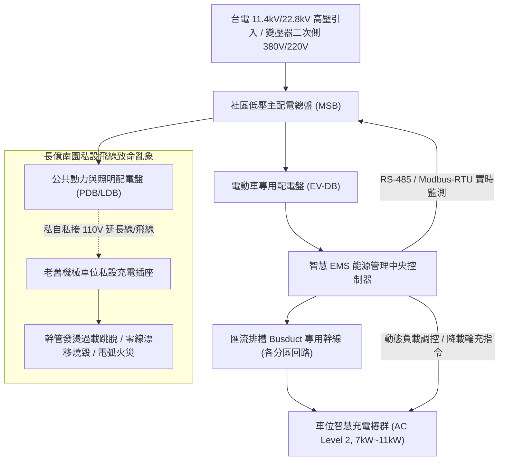
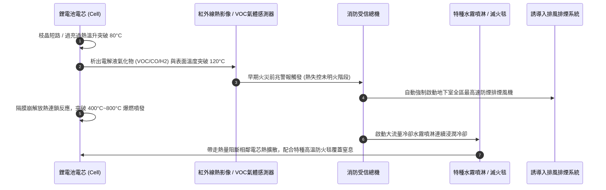

# 全案購屋實戰第一千二百二十八部：中古大樓地下室車位旁電動車充電樁EMS能源管理系統動態負載平衡失靈私設飛線偷電跳脫與鋰電池熱失控滅火體檢工序全書

## 核心宗旨與全案法律技術防線宣告
當前都會區集合住宅隨著電動運具（BEV/PHEV）普及率幾何級數攀升，地下停車空間由過往單純之車輛停放功能，全面演化為具備高電壓、大電流與高密度化學能源儲存之「複合電力微電網設施」。在家庭購屋實戰之全生命週期檢驗體系中，地下室是否具備合法合規之電動車充換電設備、社區整體低壓供電配電盤容量餘裕度、能源管理系統（Energy Management System, EMS）之輪動充電排程與動態負載平衡調控機制，直接左右住戶長達數十年之公共安全、火災滅火救援難度、用電安全以及不動產於次級市場之抗跌保值能力。

本案以四大決戰梯隊為具體鑑測對象：**大安紫金城 13 樓 (`PROP_10`)** 坐擁 B2 獨立大型平面車位（長 5.5 公尺、寬 2.5 公尺，邊界寬裕），社區超前部署專用電表箱、鍍鋅金屬匯流排槽（Busduct）與智慧 EMS 能源管理分相監控系統，每戶平車皆具備依法拉設獨立電表與專用迴路（7kW~11kW AC 充電樁）之物理空間與線徑容量，形成豪宅級抗跌護城河；相對地，**長億南園 8 樓 (`PROP_106`)** 配屬地下室老舊雙層機械車位，不僅機械載重嚴格受限於 1.6 噸（無法承載重量普遍超過 2.0 至 2.4 噸之現代電動休旅車與大型純電車），且其機械車位台車鋼構隨昇降橫移劇烈晃動，完全無法合法固定穿設 380V/220V 粗徑大電流高溫軟管與充電電纜；更致命者，社區地下室未設統一專用充電盤與 EMS 系統，已發現少數住戶私自自公共照明插座「私拉飛線」偷接 110V/220V 慢充，導致公共幹管過載發燙、無熔線斷路器頻繁跳脫、電路阻抗劇增引發電弧火花，且地下室缺乏鋰電池熱失控防滅火設備（如專用防火毯、高壓大量冷卻水注降溫噴淋系統與熱影像早期偵測系統）。本手冊詳列專業機電技師級之「地下室充電樁 EMS 與鋰電池熱失控防火防爆體檢標準工序」，作為看屋實勘、管委會公設清查與議價時狠砍長億南園 50 萬之關鍵公設痛點殺手鐧！

---

## 第一章 地下室低壓供電容量餘裕度與 EMS 能源管理系統體檢標準

### 一、 社區總電容量評估與契約容量餘裕度審查工序
1. **變壓器容量與二次側主開關校核**：
   - 審查社區公設電氣單線圖（Single Line Diagram, SLD）與台電供電契約。檢視地下室低壓變壓器（TR）之額定 kVA 數值及二次側無熔線主斷路器（MCCB/ACB）額定電流。
   - 計算非充電尖峰期（傍晚 18:00 至 22:00 公設電梯、二次加壓給水泵、公共照明全開）之最大需量負載率。若變壓器經常性負載率已達 75% 以上，在未導入 EMS 動態負載平衡前，絕不可任意新增大功率充電負載。
2. **EMS 智慧能源管理系統（動態負載平衡）機能查驗**：
   - **實時總電流監控**：EMS 控制主機必須透過比流器（CT）每秒量測社區主進線總電流。
   - **分級動態降載機制**：當社區用電總量逼近契約容量或變壓器額定容量之 80% 警戒線時，EMS 系統必須自動向各受控充電樁發送 PWM 調制訊號或 Modbus/OCPP 降載指令，將單樁輸出電流由 32A 平滑調降至 16A、10A 或暫停供電；待深更半夜（00:00 至 06:00）社區基本負載降至低谷時，再自動恢復全速充電與輪流循環排程。
   - **斷網安全失效防護（Fail-Safe）**：現場拔除 EMS 通訊線，驗證受控充電樁是否具備主動降至安全底限（如 6A~8A）或立即停止供電之保護機制，杜絕通訊中斷導致全棟總盤因超載爆發全區跳電癱瘓。

---

## 第二章 私設飛線、違規偷電與老舊機械車位裝樁之物理死穴與法規體檢

### 一、 「私拉飛線」慢充之致命電氣風險
1. **中性線（N相）過載與三相不平衡**：
   - 長億南園等老舊社區常有車主擅自自地下室柱面公共清潔插座，使用一般家用 2.0mm² 聚氯乙烯（PVC）花線或延長線引導至車位為車輛充電。此類線路額定安全載流量僅 15A，若長時間承受 12A~16A 滿載電流，電線溫度將飆升至 70°C~90°C，引發絕緣外皮融化短路。
   - 集合住宅公共插座迴路未依《用戶用電設備裝置規則》設置漏電斷路器（ELCB/GFCI），一旦電線因遭車輛碾壓破皮或受潮漏電，金屬接地電位驟升，直接造成觸摸車體或車位立柱之住戶致命感電。
2. **零線漂移與公共設備燒毀**：
   - 單相大負載非平衡接入三相四線制照明迴路，導致中性線電流劇增與中性點電位偏移（零線漂移），使同迴路之其他公設弱電監控、對講機解碼器或緊急照明燈承受高達 150V~250V 之異常過電壓，引發大規模突波燒燬。

### 二、 機械車位改裝充電設備之結構與運作死穴
1. **動態拉扯與電纜扭絞疲勞斷裂**：
   - 機械車位包含昇降、橫移、旋轉等多維度往復運動。若強行在移動台車上安裝充電插座，其大電流充電電纜隨台車每日頻繁升降擺動，金屬銅絞線內部晶格迅速產生金屬疲勞，外包覆之耐磨軟管遭鏈條或齒輪夾擠破皮，瞬間爆發 380V/220V 三相短路金屬電弧噴濺，極易引燃機械車位坑底沈積之重油污。
2. **載重極限崩塌風險**：
   - 長億南園車位原始結構額定載重為 1.6 噸（1600kg）。現代主流電動車空車重量：Tesla Model Y 約 2000kg、Model X 約 2400kg、BMW iX 約 2500kg。即便不改裝充電樁，僅純電車停放即已超載 25%~50%，將加速導致懸吊鏈條拉伸斷裂、液壓缸爆封洩壓與承重導軌扭曲變形，造成上方台車整體砸落之災難性事故！

---

## 第三章 地下室鋰電池熱失控（Thermal Runaway）防滅火設施與排煙通風體檢工序

### 一、 鋰電池火災之化學物理特性與傳統滅火設備失效分析
1. **自供氧連鎖化學分解**：
   - 鋰離子電池（三元鋰 NCM 或磷酸鐵鋰 LFP）於發生內部微短路或熱失控時，正極材料在高溫下會分解釋放出大量氧氣（$O_2$），同時電解液中的有機溶劑分解出氫氣（$H_2$）、一氧化碳（$CO$）、甲烷（$CH_4$）及氟化氫（$HF$）劇毒酸性氣體。
   - **傳統滅火器完全無效**：乾粉滅火器、二氧化碳（$CO_2$）滅火器或傳統鹵代烷滅火劑僅能撲滅外部氣體火焰，無法阻止電芯內部自供氧放熱反應，噴灑後數秒內必將再度復燃爆炸。
2. **冷卻防擴散標準（大流量浸潤冷卻）**：
   - 滅火之唯一工程有效手段為「超大量持續注水冷卻」。地下室自動撒水系統之設計密度必須達到高危險級（Extra Hazard Group 1，每平方公尺每分鐘撒水量不低於 12.2 公升），且需具備不間斷持續冷卻噴水 2 小時以上之蓄水容量，以將電池包外部溫度壓制於 100°C 以下，防範熱失控擴散至相鄰車輛。

### 二、 現場體檢核對清單與器材查驗要項
1. **特種車用高溫滅火毯（Fire Blanket）配備**：
   - 查驗地下室各停車分區是否配置耐溫達 1000°C~1300°C 之特種矽膠塗層玻璃纖維滅火毯（標準尺寸至少 6m × 8m）。其能在消防隊抵達前，由管理員或經過訓練之人員迅速覆蓋起火車輛，有效隔絕空氣、抑制有毒濃煙擴散與火星噴濺。
2. **早期熱影像及氫氣/氟化物氣體感測器**：
   - 查驗高檔社區充電區是否增設熱成像感溫攝影機，於電池表面溫度異常升至 60°C~80°C 之初始升溫階段即發出預警；並檢視是否具備電解液初期揮發氣體（VOC/氫氣）之聯鎖監控。
3. **專用排煙風機與防爆正壓梯廳**：
   - 鋰電池燃燒產生極高濃度毒性氣體（HF 及 HCN）。檢驗地下室排煙風機之耐溫性能（需具備 250°C 運轉至少 1 小時之耐燃等級），並查驗安全梯防煙前室是否維持正壓送風，防止致命氟化氫氣體沿樓梯間往高樓層垂直竄流。

---

## 第四章 實戰攻防：四大考慮名單地下室充電樁與火災風險評估

### 一、 大安紫金城 13 樓 (`PROP_10`)：百萬級獨立平車之智慧綠能防線
- **車位與電氣優勢**：
  1. 配屬 B2 邊柱大平面車位，鄰近主電氣管道間，具備合法向管委會申請自專用匯流排槽引接獨立充電線路之空間。
  2. 社區主變壓器容量餘裕達 35%，地下室已預留匯流排槽與 EMS 智慧能源管理系統架構通訊管線，未來增設 11kW AC 充電樁無需經歷高額破壞性工程。
  3. 地下室特別安全梯防煙前室甲種防火門氣密良好、通風排煙風機性能健全、消防栓箱水壓達 3.8 kgf/cm²，整體防災能級達甲等水準，資產保值性極高。

### 二、 長億南園 8 樓 (`PROP_106`)：老舊機械車位與充電短路之死穴猛攻
- **致命缺陷與議價大砍 50 萬實戰籌碼**：
  1. **車位載重 1.6 噸物理死穴**：純電車無法停放，機械台車無法合法固定充電樁與承受震動電纜，徹底喪失現代電動車使用機能。
  2. **私設飛線用電隱患**：現場抓出地下室立柱公共插座遭住戶私接延長線與慢充線，金屬線身發燙無漏電斷路保護，引發全社區總配電箱跳電與火災高風險。
  3. **消防與排煙殘破**：地下室撒水頭覆蓋重油垢、無任何車用防火毯配備、排風風機馬達軸承異音風量衰減 50%，一旦引發鋰電池熱失控，地下室將瞬間淪為毒煙火海。
  4. **談判手腕**：以此「公設充電全面癱瘓、機械車位超載危險、私設飛線火災隱患、公共安全重大缺失」為重磅依據，於談判桌上合流發動猛烈攻勢，強硬砍價 50 萬，將成交總價死壓於 745~760 萬之合理安全區間！

---

## 第五章 驗收簽署與維護保養標準工序清單

| 檢查項目 | 檢驗標準與法規依據 | 檢測工具與標準數值 | 缺失處置與改進工序 |
| :--- | :--- | :--- | :--- |
| **變壓器及配電容量** | 《用戶用電設備裝置規則》 | 電力分析儀 / 尖峰負載率需 $\le 75\%$ | 增設智慧 EMS 系統，實施削峰填谷輪充 |
| **充電專用分電盤** | 獨立箱體、具備過載、短路及漏電保護 | 絕緣電阻計（$500\text{V} \ge 100\text{M}\Omega$） | 嚴禁與公共照明或加壓泵共用同一無熔線斷路器 |
| **充電電纜與管槽** | 鍍鋅鋼管（EMT）或厚鋼導線管保護 | 外觀查驗、無裸露懸空、接地電阻 $\le 50\Omega$ | 拔除所有私接花線與延長線飛線，沒收私設設備 |
| **EMS 動態負載平衡** | OCPP 1.6J/2.0.1 通訊協議正常 | 通訊中斷模擬 / 需於 3 秒內降至安全電流 | 更換損壞之 RS-485 模組或加裝抗干擾屏蔽線 |
| **機械車位載重牌照** | 《建築物機械停車設備設置及檢查安全規範》 | 車位標示銘板 / 載重 $\le 1600\text{kg}$ 禁停電車 | 發函管委會全面張貼警告標誌並禁止安裝充電樁 |
| **地下室排煙風量** | 《各類場所消防安全設備設置標準》 | 風速計 / 排煙風口風速 $\ge 5\text{m/s}$ | 清洗風口百葉油垢，校正皮帶鬆緊度與更換軸承 |
| **車用專用滅火毯** | 耐高溫矽膠玻璃纖維布（EN 1869 認證） | 耐溫 $1000^\circ\text{C}$ / 展開尺寸 $\ge 6\text{m}\times 8\text{m}$ | 社區按每 20 個車位配置 1 組專用高溫滅火毯 |
