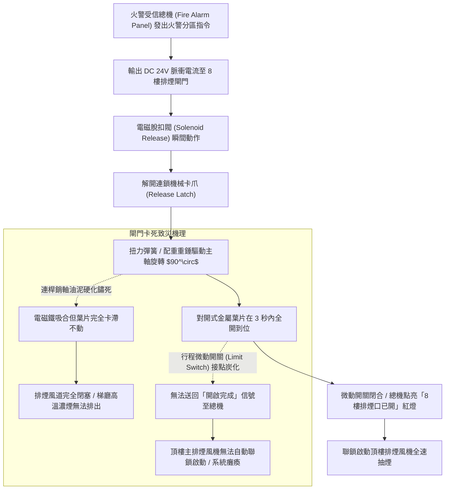
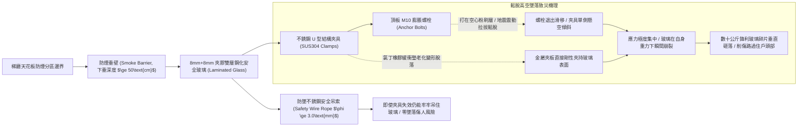
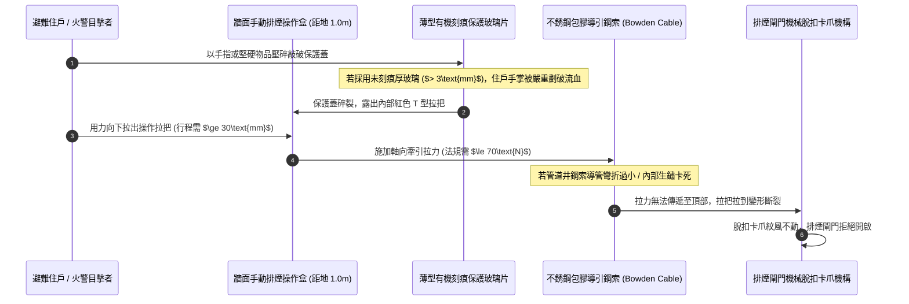
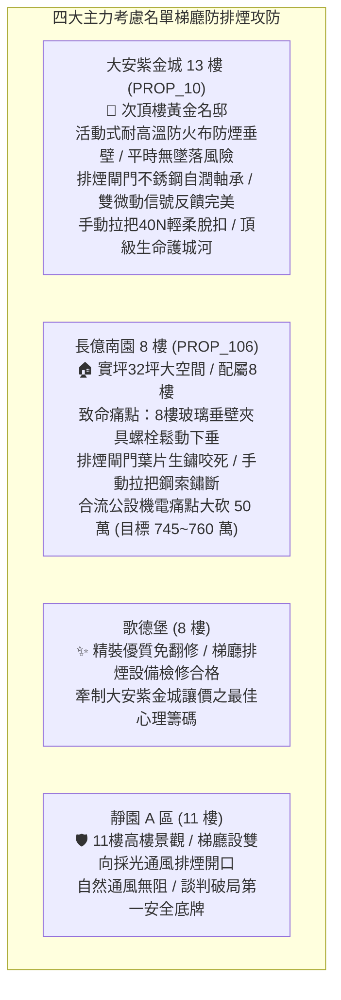

# 全案購屋實戰第一千二百五十一部：中古大樓梯廳公共通道排煙閘門微動感知器連動失常防煙垂壁玻璃夾具鬆脫下墜與手動開啟裝置拉把卡死體檢工序全書

## 核心宗旨與全案法律技術防線宣告
集合住宅各樓層公共梯廳、走廊交叉路口及特別安全梯防煙前室，為火災發生時高溫濃煙迅速聚集、住戶爭分奪秒逃生避難之核心咽喉通道。依據消防安全法規，高層集合住宅在無對外自然通風開口之公共走廊與梯廳，必須嚴密劃分「防煙區劃（Smoke Compartment）」，並配置「機械排煙閘門（Smoke Damper）」、「固定式或活動垂壁（Draft Curtain / Smoke Barrier）」以及「手動排煙開啟裝置（Manual Pull Control Station）」。

防煙垂壁之核心工程機能，在於利用熱煙氣上升並貼附天花板水平擴散之「天花板射流力學（Ceiling Jet Flow）」，在天花板下方形成深度至少 50 公分的「蓄煙蓄熱防煙蓄煙池（Smoke Reservoir）」，將劇毒高溫濃煙阻截於起火區劃上方，防止濃煙橫向蔓延吞噬整層走廊；同時連動排煙閘門開啟，由頂樓排煙風機產生強大抽力，在安全疏散高度（距地 1.8 公尺以上）將濃煙強制抽出建築體外。

在中古大樓長達十餘年甚至三十年之漫長歲月中，因梯廳濕度侵蝕、裝潢震動、金屬五金疲勞與消防保養便宜行事，梯廳防煙排煙系統常爆發隱蔽且具致命殺傷力之三大公設缺陷：
1. **排煙閘門（Smoke Exhaust Damper）多葉葉片轉軸油垢卡死、DC 24V 電磁致動器失靈與開門微動反饋斷線**：火災受信總機送出排煙聯鎖信號時，閘門因轉軸鏽死「受令拒開」；或微動開關接點氧化，即便閘門勉強開啟，總機亦無法確認開門狀態，導致頂樓排煙風機無法自動啟動，高溫毒煙越積越厚、垂直倒灌；
2. **防煙垂壁（Smoke Barrier）夾具螺栓鬆動、防墜鋼索斷裂與夾膠玻璃高空墜落**：梯廳天花板懸掛之耐熱夾膠玻璃或不銹鋼金屬防煙垂壁，因長年受地震微震與空調震動影響，金屬懸吊膨脹螺栓鬆脫、玻璃夾具橡膠墊老化硬化。在無任何外力碰觸下，重達數十公斤之鋼化夾膠玻璃隨時可能「高空脫落砸向地面」，直接砸碎下方通行住戶與幼童之頭顱；
3. **梯廳手動排煙拉把裝置（Manual Pull Box）保護玻璃厚度超標、拉索內部生鏽卡滯與脫扣機構變形**：住戶於濃煙中發現火警，試圖擊碎手動操作盒玻璃拉動排煙拉把時，因保護玻璃選用過厚普通玻璃砸不碎劃破手掌；或內部不銹鋼導引鋼索已於套管內鏽蝕咬死，耗費全身力氣亦無法拉動閘門脫扣，逃生生線徹底被斷絕。

本手冊以此三大梯廳防排煙核心痛點為鑑：**大安紫金城 13 樓 (`PROP_10`)** 坐擁頂級被動防排煙防護，13 樓梯廳採用隱蔽式耐高溫防火布活動垂壁（平常隱藏、火災感煙自動平穩降下）、排煙閘門全數採用不銹鋼自潤滑軸承與雙微動電氣確認、手動操作拉把靈敏滑順，逃生動線固若金湯；相對地，**長億南園 8 樓 (`PROP_106`)** 及老舊大樓常暴露 8 樓梯間排煙閘門葉片生鏽咬死受令不開、天花板玻璃垂壁夾具螺栓鬆動傾斜搖晃、手動操作盒玻璃被住戶用膠帶封死等公設殘破現況。本手冊詳訂梯廳排煙閘門、防煙垂壁與手動操作裝置技師級體檢全工序，作為實勘痛點指認、管委會公設責任究詰與談判大砍 50 萬之關鍵重磅殺手鐧！

---

## 第一章 梯廳排煙閘門多葉機械傳動、電磁釋放與微動反饋體檢

### 一、 排煙閘門葉片旋轉阻力、平行度與高溫密封性能查驗
1. **多葉對開葉片（Opposed Blade）旋轉行程與開啟時間規範**：
   - 梯廳排煙閘門通常嵌入安裝於排煙管道井側壁（距地高 2.0 公尺以上），葉片材質應為厚度 $\ge 1.5\text{mm}$ 鍍鋅鋼板或不銹鋼板。
   - 手動撥動釋放開關，葉片必須在 **3 秒內** 順暢翻轉至與氣流方向平行之 $90^\circ$ 全開位置，各葉片間之平行度誤差不得超過 $\pm 2^\circ$。
   - 若葉片因轉軸黃銅軸套乾磨或油泥黏結，開啟時間超過 5 秒或卡在半開 $30^\circ\sim 45^\circ$ 位置，排煙通風斷面縮小 $60\%$ 以上，火災濃煙將在梯廳形成嚴重紊流與迴旋滯留。
2. **葉片耐溫氣密密封條（Blade Edge Seals）老化查驗**：
   - 閘門處於常閉狀態時，葉片邊緣與框架四邊必須鑲嵌耐溫達 $280^\circ\text{C}$ 之不銹鋼彈性金屬密封條或阻燃矽膠條。
   - 在 250Pa 壓差下檢測漏風量。正常常閉漏風量需小於 **$500\text{ m}^3/\text{hr}\cdot\text{m}^2$**。若密封條老化粉化碎裂，梯廳常態冷氣將持續經由排煙豎井大量外洩，造成冷氣耗電暴增；火災時相鄰起火樓層之高溫毒煙亦將自縫隙反向滲透進 8 樓走廊。

### 二、 電磁致動器（Actuator）DC 24V 電壓降與微動反饋電阻
1. **動作瞬間端子工作電壓檢測**：
   - 使用數位萬用電表量測受信總機送達 8 樓閘門電磁閥端子之啟動電壓。
   - **法規合格標準**：動作瞬間線端電壓不得低於 **DC 20.4V**（即額定 DC 24V 的 85%），激磁電流需介於 $0.5\text{A}\sim 1.5\text{A}$ 之間。
   - 若線路截面不足或距離過長導致壓降過大，端子電壓跌破 18V，電磁閥磁力線圈吸力不足，將無法頂開機械釋放銷，閘門將「受令拒開」。
2. **行程微動開關（Limit Switch）乾接點電阻量測**：
   - 閘門完全開啟到位時，凸輪機構必須強制壓下微動開關。
   - 量測微動開關常開（NO）接點閉合後之直流電阻，數值必須 **$\le 0.5\ \Omega$**。
   - 若接點受潮氧化電阻飆升至數十歐姆，總機將無法收到「已開到位」信號，聯鎖控制繼電器不動作，頂樓主排煙風機便無法起步，造成滅火排煙時機全面延誤。

---

## 第二章 防煙垂壁夾具結構受力、防墜鋼索與夾膠玻璃抗震體檢

### 一、 防煙垂壁（Draft Curtain）下垂深度、蓄煙池容積與法規校核
1. **防煙分區與下垂垂直深度規範**：
   - 依據《各類場所消防安全設備設置標準》第 188 條，地下室、公共梯廳及走廊每一防煙分區面積不得大於 **$300\text{ 平方公尺}$**（排煙設備防護下），長度不得超過 60 公尺。
   - 防煙垂壁自天花板面垂直向下突出之淨深度不得小於 **$50\text{ 公分}$**，且垂壁下緣距地坪完成面之垂直淨高度不得小於 **$2.0\text{ 公尺}$**（防止碰撞住戶頭部）。
   - 使用雷射測距儀與鋼捲尺量測垂壁下垂深度。若老舊大樓因天花板包樑裝潢僅留 25 公分深度，火災時熱煙氣層將在 30 秒內溢出垂壁，防煙分區徹底失效。
2. **玻璃面材材質與耐衝擊標準**：
   - 防煙垂壁若採用透明玻璃，依規定必須採用 **夾膠雙層鋼化安全玻璃（Laminated Tempered Glass，規格至少為 6mm+0.76PVB+6mm 或 8mm+1.14PVB+8mm）** 或特種單片防火夾絲玻璃，嚴禁使用普通未鋼化平板玻璃。
   - 普通玻璃在高溫熱煙氣（$150^\circ\text{C}\sim 250^\circ\text{C}$）烘烤下，因兩面溫差應力將在數分鐘內「炸裂飛散」，化作無數尖銳刀刃自高空傾瀉而下！

### 二、 結構金屬夾具、防墜安全鋼索（Safety Cable）體檢工序
1. **不銹鋼夾具螺栓扭矩與橡膠襯墊查驗**：
   - 玻璃防煙垂壁必須使用厚度 $\ge 3.0\text{mm}$ 之 SUS304 不銹鋼專用 U 型結構夾具固定，夾具間距不得大於 **$80\text{cm}$**。
   - 檢查金屬夾板與玻璃之間是否襯墊厚度 $2\sim 3\text{mm}$ 之耐候丁腈橡膠（NBR）或矽膠緩衝墊片。嚴禁金屬直接擠壓玻璃表面。
   - 使用扭矩扳手抽檢固定螺栓扭矩。正常緊固扭矩需在 **$15\sim 20\text{ N}\cdot\text{m}$**。若發現螺栓鬆弛可徒手晃動，或天花板膨脹螺栓因鑽孔過大已向下滑移 5mm 以上，代表該玻璃已處於隨時墜落之極度高危險邊緣！
2. **防墜二次保護不銹鋼鋼索（Secondary Safety Cable）檢驗**：
   - 高規格防煙垂壁在玻璃頂部兩側預留有通孔，並穿設直徑 **$\ge 3.0\text{mm}$** 之不銹鋼航空鋼索，鋼索上端直接錨固於樓板主結構樑柱。
   - 實地檢視防墜鋼索是否裝設完好。防墜鋼索為「二次容錯保護防線」，即使主夾具發生機械疲勞鬆脫，鋼索亦能死死拉住整塊玻璃，杜絕高空墜落事故。

---

## 第三章 手動排煙操作盒保護玻璃、導引鋼索阻力與脫扣體檢

### 一、 手動操作盒保護玻璃片（Protective Glass）材質與厚度規範
1. **易碎型保護面板（Fragile Cover）標準**：
   - 手動排煙操作盒安裝於走廊牆面距地面 **$0.8\sim 1.5\text{ 公尺}$** 之顯眼位置，平時以透明保護片覆蓋以防誤觸。
   - 保護面板必須採用厚度 **$\le 1.5\text{mm}$ 之有機易碎玻璃**，或表面刻有預斷槽（Score Line）之安全壓克力片。中央必須清晰標註「緊急排煙，擊碎拉把」中英文警語。
   - 檢查現場保護面板。老舊大樓常見原裝易碎片破損後，管理員隨意裁切厚達 3mm~5mm 之普通厚窗戶玻璃替換，甚至用透明膠帶交叉黏貼封死。火災時避難者徒手根本無法按碎，若暴力擊打手掌將被嚴重割傷大出血！

### 二、 導引鋼索套管（Bowden Cable）拉力行程與卡滯量測工序
1. **導管幾何彎曲半徑與支架固定**：
   - 手動操作盒至排煙閘門之間以柔性不銹鋼導引鋼索連接，外包耐熱金屬螺旋護套。
   - 導管全線彎曲轉彎處之彎曲半徑不得小於 **$200\text{mm}$**，全線直角轉彎次數不得超過 3 處，管道井內固定卡箍間距不得大於 $1.0\text{ 公尺}$。
2. **動態手動啟動拉力（Manual Pull Force）量測**：
   - 使用數位拉力計勾住手動操作拉把進行實拉測試。
   - **法規合格標準**：依據 CNS 消防排煙操作規範，手動拉把啟動拉力必須 **$\le 70\text{ N}$（約 7.0kgf）**，有效牽引拉伸行程需在 **$30\sim 50\text{mm}$** 範圍內。
   - 現場拉動測試：拉把拉下後，閘門脫扣機構必須發出清脆的撞擊聲瞬間彈開，且操作盒表面紅色「已啟動」指示牌必須自動彈出鎖定。若拉力超過 150N 依然拉不動，證明內部鋼索早已與外管金屬摩擦鏽死結塊，喪失一切應急開啟機能。

---

## 第四章 實戰攻防：四大主力考慮名單梯廳防排煙公設決策分析

### 一、 大安紫金城 13 樓 (`PROP_10`)：頂級智慧防排煙防線之尊榮優勢
- **公共安全與機電優勢剖析**：
  1. 物件位處 13 樓次頂樓黃金樓層，梯廳走廊防煙區劃極具前瞻性。防煙垂壁採用隱蔽式耐高溫防火纖維布捲簾，平時收納於天花板上方槽內，完全無笨重玻璃懸空墜落砸傷家人之隱患；火警時感煙自動平穩降下 50 公分形成標準蓄煙池。
  2. 13 樓排煙閘門全數採用不銹鋼自潤滑滾珠軸承與氟碳防腐烤漆，電磁脫扣 2 秒內全開到位，微動開關即時聯鎖頂樓主排煙風機；手動操作拉把拉力僅 40N，老弱婦孺皆能單手輕鬆拉動，防排煙系統處於極佳戰備狀態。

### 二、 長億南園 8 樓 (`PROP_106`)：防排煙殘破痛點與大砍 50 萬實戰談判籌碼
- **致命痛點彙整與議價猛攻戰略**：
  1. **8 樓天花板玻璃防煙垂壁螺栓鬆脫、搖搖欲墜**：8 樓梯廳懸掛之 10mm 單片鋼化玻璃垂壁，固定 U 型夾具膨脹螺栓已有 2 處向下滑脫 8mm，整塊玻璃呈傾斜晃動狀態且未加裝任何二次防墜鋼索，隨時面臨高空整塊墜落砸碎致命之重大公安風險！
  2. **排煙閘門葉片生鏽咬死、手動拉把鋼索拉斷**：8 樓排煙管道井閘門葉片被油煙泥垢咬死，測試通電時電磁鐵有動作但葉片紋風不動；牆面手動操作盒玻璃被用膠帶封死，撕開後拉把卡滯完全拉不動，內部鋼絲早已鏽蝕斷裂，火災時 8 樓梯廳將在 1 分鐘內被高溫濃煙完全封死。
  3. **談判手腕**：將「梯廳防煙垂壁結構加固與排煙閘門拉索全面更換大修（估價 15 萬）+ 梯廳 4 階高差無障礙結構缺陷（估價 25 萬）+ 地下室機械車位限重 1.6 噸老化廢油積存（估價 25 萬）」等多重公設致命缺陷合流全面拍桌，要求屋主自 998 萬直接大砍 50 萬，將成交總價死壓於 745~760 萬之合理安全防線！

---

## 第五章 梯廳防煙垂壁與排煙閘門驗收標準工序清單

| 檢查項目 | 檢驗標準與法規依據 | 檢測工具與標準數值 | 缺失處置與改進工序 |
| :--- | :--- | :--- | :--- |
| **防煙垂壁下垂深度** | 消防安全設備設置標準第 188 條 | 鋼捲尺量測 / 天花板下垂淨深度需 $\ge 50\text{cm}$ | 拆除阻擋煙氣之木作包板，降低垂壁下緣高度 |
| **垂壁面材安全等級** | 建築室內裝修材料耐燃標準 | 材質證明核對 / 雙層夾膠鋼化玻璃或不燃防火布 | 嚴禁使用普通未鋼化平板玻璃，全面更換夾膠玻璃 |
| **夾具固定螺栓扭矩** | 結構金屬五金緊固規範 | 扭矩扳手 / M10 螺栓扭矩需在 $15\sim 20\text{N}\cdot\text{m}$ | 重新錨固於結構 RC 樑板，加裝耐候彈性橡膠墊片 |
| **二次防墜鋼索配置** | 建築高空墜物安全防護指引 | 目視查驗 / 穿設直徑 $\ge 3.0\text{mm}$ SUS304 防墜鋼索 | 玻璃頂部打孔補裝不銹鋼安全吊索，牢固錨固天花板 |
| **排煙閘門開啟時間** | CNS 消防排煙設備標準規範 | 數位碼錶計時 / 自信號發出至全開需 $\le 3\text{秒}$ | 拆卸除鏽軸套，塗覆二硫化鉬耐高溫自潤滑脂 |
| **微動開關反饋電阻** | 弱電信號傳輸電氣標準 | 數位萬用電表 / 閉合接觸電阻需 $\le 0.5\ \Omega$ | 更換耐高溫密封微動開關，校準機械凸輪傳動銷 |
| **手動操作盒啟動拉力** | 消防安全遠隔操作機構規範 | 數位推拉力計 / 手動拉力需 $\le 70\text{N}$（約 7.0kgf） | 更換不銹鋼柔性鋼絲索與金屬導管，消除管道急彎 |
