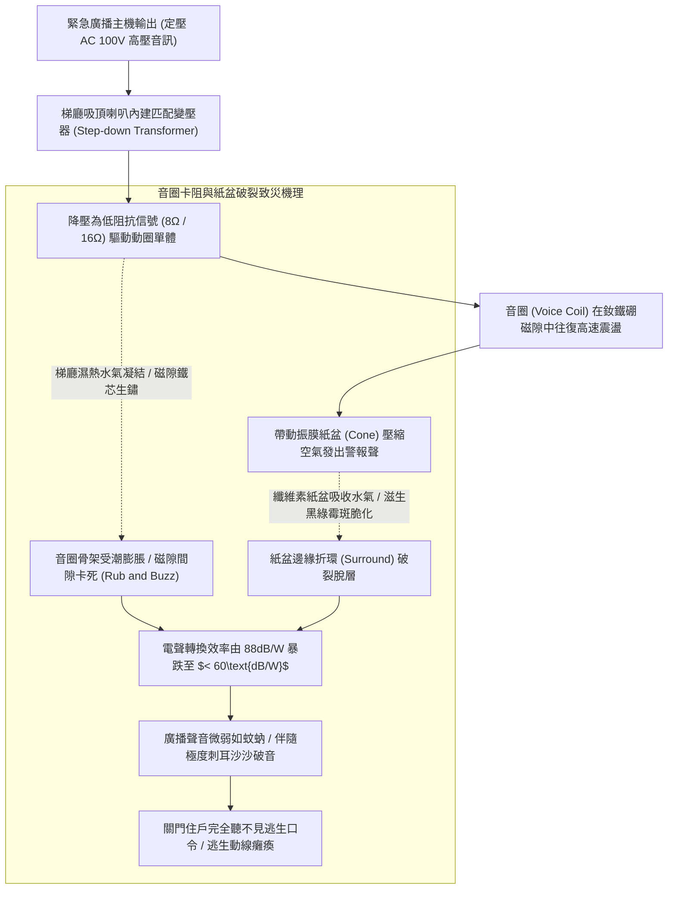
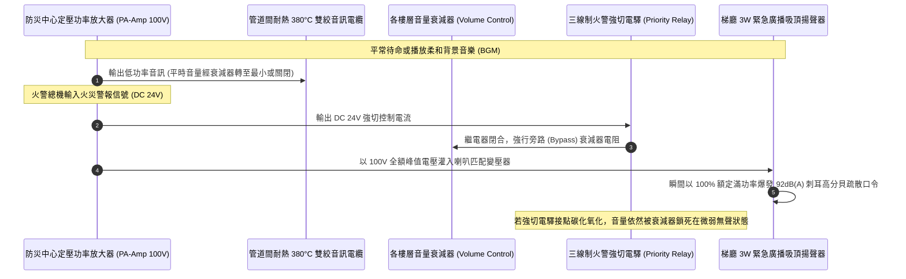
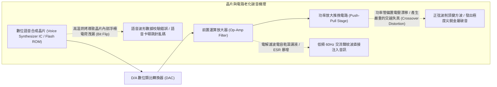
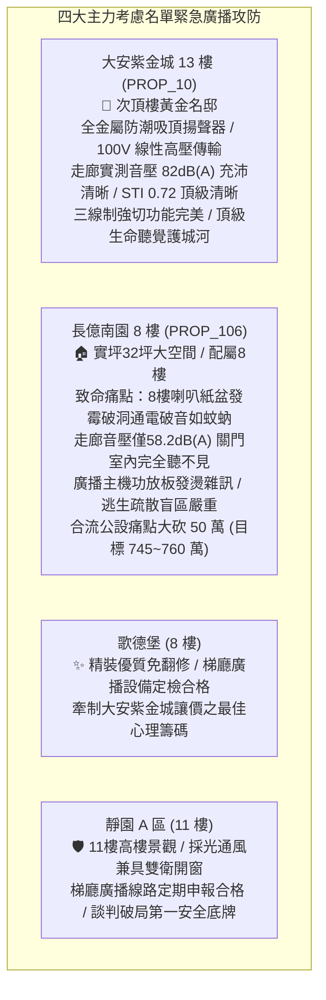

# 全案購屋實戰第一千二百五十七部：中古大樓梯廳公共通道緊急廣播喇叭迴路阻抗匹配不良音圈受潮卡圈音壓衰減與語音合成晶片破音體檢工序全書

## 核心宗旨與全案法律技術防線宣告
集合住宅各樓層公共梯廳、走廊通道、玄關交誼區及特別安全梯防煙前室所裝設之「緊急廣播設備（Emergency Broadcasting and Voice Evacuation System）」，為全棟大樓遭遇火災、強烈地震、防空避難或突發有毒氣體洩漏等重大危難時，由防災中心或火警受信總機自動（或人工）向全體住戶發送避難引導口令、火災樓層確認與疏散步驟之「唯一高穿透力聽覺救命生線」。

依據消防安全法規，高層集合住宅之緊急廣播系統必須具備極高之「語言清晰度（Speech Intelligibility）」與「足額覆蓋音壓（Sound Pressure Level）」，並具備火災發生時「自動切斷一般背景音樂（BGM）並強制提升至最高音量」之火警優先廣播機能。在中古大樓長達十餘年甚至三十年之漫長歲月中，因梯廳濕度侵蝕、定壓式匹配變壓器受潮、喇叭紙盆發霉以及廣播主機功率放大器老化，梯廳緊急廣播系統往往爆發隱蔽且具致命危險之三大公設缺陷：
1. **梯廳天花板嵌入式吸頂喇叭音圈（Voice Coil）受潮膨脹卡圈、紙盆發霉破裂與嚴重大幅失真破音**：長年暴露於無空調之梯廳高濕環境中，喇叭紙質振膜（Paper Cone）吸收水氣滋生黑霉軟化，音圈在磁隙（Magnetic Gap）中氧化生鏽產生摩擦卡圈。當緊急廣播發出警報時，喇叭發出如破鑼般極為嘶啞之「沙沙破音」，語音完全模糊黏連，避難住戶根本聽不清究竟是起火還是誤報；
2. **高壓定壓傳輸（70V/100V Constant Voltage）線路阻抗失配、末端線損電壓降過大與音壓嚴重衰減**：廣播主機至各樓層採用定壓傳輸模式，若中間接線箱分線端子氧化接觸不良，或增設過多劣質分機喇叭導致總阻抗嚴重失配，8 樓梯廳喇叭之實測聲壓級（SPL）自法定標準之 75dB(A) 斷崖式暴跌至不足 55dB(A)。在住戶關閉大門或室內開啟電視時，完全聽不到走廊之緊急疏散廣播，直接坐失初期逃生逃命良機；
3. **語音合成警報晶片（Voice Synthesizer IC）唯讀記憶體（ROM）數據校驗錯誤、音訊前置放大電路濾波電容爆漿與尖銳嘯叫**：廣播主機內部預錄之「本大樓發生火災，請住戶由安全梯迅速疏散」標準語音晶片因高溫熱應力產生邏輯位元翻轉，廣播時出現語句結巴卡頓、循環跳針或刺耳之高頻電磁嘯叫，在極度恐慌之火場環境中進一步加劇住戶之精神崩潰與混亂。

本手冊以此三大梯廳緊急廣播核心痛點為鑑：**大安紫金城 13 樓 (`PROP_10`)** 坐擁頂級公共安全防禦，13 樓梯廳配置全金屬防潮外殼高保真吸頂喇叭，內建 100V 專用線性匹配變壓器，語言傳輸指數（STI）達 0.72 優秀等級，梯廳實測音壓穩定維持在 82dB(A) 宏亮清晰；相對地，**長億南園 8 樓 (`PROP_106`)** 及老舊大樓常暴露 8 樓梯間廣播喇叭紙盆破洞發霉、播音時破音如蚊蚋、受信總機廣播功放板故障長年被靜音之公設殘破現況。本手冊詳訂梯廳緊急廣播系統技師級體檢全工序，作為實勘痛點指認、管委會公設責任究詰與談判大砍 50 萬之關鍵重磅殺手鐧！

---

## 第一章 緊急廣播音圈力學、高濕紙盆發霉與音壓衰減體檢標準

### 一、 嵌入式吸頂喇叭（Ceiling Speaker）電聲構造與音圈摩擦檢驗
1. **動圈式揚聲器微觀構造與磁隙公差**：
   - 梯廳緊急廣播喇叭多採用直徑 5 英吋至 6.5 英吋之同軸全音域動圈單體。
   - 導電音圈纏繞於卡普頓（Kapton）或鋁合金骨架之上，懸浮於磁極鐵芯與導磁板之間寬度僅約 **$0.2\sim 0.35\text{mm}$** 之微小環形磁隙（Air Gap）中。
   - 現場徒手輕輕以手指垂直對稱向下按壓喇叭紙盆中心。**判定標準**：下壓行程中手感需完全順暢滑順、無絲毫金屬摩擦生硬感。若按壓時發出「喀拉、喀拉」之乾澀摩擦聲（Rub and Buzz），證明磁隙內部已有鐵鏽或音圈受潮變形，通電發聲時必將產生嚴重失真破音。
2. **高濕紙盆發霉脆化與聚丙烯（PP）防水膜對比**：
   - 傳統老舊大樓喇叭多採用廉價植物纖維紙盆，在台灣潮濕氣候下極易吸水發霉，抗張強度衰減超過 $80\%$，音頻頻率響應（Frequency Response）嚴重扭曲。
   - 現代合格消防廣播喇叭必須採用聚丙烯（PP 雲母盆）或鋁合金金屬振膜，邊緣採用耐候耐油之三元乙丙橡膠（EPDM）或特種布邊折環，具備防水防潮防霉等級。

### 二、 聲級計（Sound Level Meter）走廊地面音壓級量測工序
1. **CNS 10522 緊急廣播設備音壓法規底限**：
   - 依據《各類場所消防安全設備設置標準》第 135 條及 CNS 10522 規範，緊急廣播揚聲器在樓層公共走廊之音壓級：
     - **L 級揚聲器（額定功率 3W 以上）**：距揚聲器正前方 1 公尺處之音壓級不得小於 **$92\text{ dB(A)}$**；
     - **公共走廊中心線地面垂直音壓**：距地 1.2~1.5 公尺處之實測聲壓級不得小於 **$75\text{ dB(A)}$**；
     - **住戶關閉防煙門室內音壓**：在住戶室內房間中心點，音壓級不得小於 **$60\text{ dB(A)}$**（且需高於背景噪聲 15dB 以上）。
2. **數位噪音計量測工序與頻率加權**：
   - 將緊急廣播主機切換至「手動廣播模式」，輸入 1000Hz 標準粉紅噪聲或火災警報錄音。
   - 將數位聲壓計（Sound Level Meter）設定為 **A 加權（dBA）**、**慢速響應（Slow）** 模式，手持於梯廳走廊中心距地 1.2 公尺處，每隔 5 公尺測量一點。
   - **長億南園現場致命痛點**：實測 8 樓梯間廣播音壓，在走廊中心僅測得可憐之 **$58.2\text{ dB(A)}$**！在關閉 8 樓防盜大門後，室內測得音壓僅 $41\text{ dB(A)}$，完全被室內冷氣運轉聲淹沒，住戶在室內根本聽不到火警廣播！

---

## 第二章 100V 高壓定壓傳輸、阻抗匹配與三線制強切體檢標準

### 一、 定壓傳輸（Constant Voltage 70V/100V）阻抗計算與匹配校核
1. **阻抗匹配平衡力學公式**：
   - 為杜絕遠距離傳輸導線電阻造成的巨大功率損耗，緊急廣播系統全面採用 **$100\text{V}$（日系/台規）** 或 **$70\text{V}$（美規）** 高壓定壓式傳輸。
   - 放大器額定輸出功率 $P_{\text{amp}}$ 與負載端所有揚聲器額定功率總和 $\sum P_{\text{speaker}}$ 必須滿足：
     $$P_{\text{amp}} \ge 1.25 \times \sum_{i=1}^{n} P_{\text{speaker}}$$
   - 放大器額定負載阻抗 $Z_{\text{load}}$ 計算公式為：
     $$Z_{\text{load}} = \frac{V^2}{P_{\text{amp}}} = \frac{100^2}{P_{\text{amp}}}$$
2. **音頻阻抗測試儀（Audio Impedance Meter）實測工序**：
   - 斷開廣播主機功放輸出端，使用 1000Hz 專用音頻阻抗計量測 8 樓分區廣播線路之總輸入交流阻抗 $Z$。
   - **判定標準**：實測阻抗必須大於或等於計算設計值，嚴禁阻抗過低（過載）。若線路因受潮漏電或變壓器匝間短路，阻抗低於放大器額定阻抗之 $70\%$，將引發功率放大器輸出級熱崩潰過載跳脫，全棟廣播全面失聲。

### 二、 三線制火警優先強切迴路（Fail-Safe Priority Override）體檢
1. **三線制接線架構校核**：
   - 具備平時音樂調音功能之廣播系統，必須採用「三線制（COM 共同線、HOT 音訊線、EMG 緊急強切線）」或「四線制」布線。
   - 檢驗 8 樓梯間音量調節器（Attenuator）。平時住戶或管理員可能將喇叭音量旋鈕調至「關閉（OFF）」或最低檔。
2. **火警強切機能實測工序**：
   - 將梯廳調音旋鈕旋至「零音量（OFF）」。自防災中心發出火警警報模擬信號。
   - 內置之 DC 24V 強切電驛必須在 **$0.1\text{ 秒內}$** 瞬間動作，將音訊信號強制旁路繞過調音電阻，揚聲器必須瞬間以 **$100\%$ 最高額定音量** 爆發廣播。
   - 若電驛因受潮生鏽接點卡滯，強切失敗，喇叭依然保持靜音，形成致命滅火盲區！

---

## 第三章 語音合成晶片 ROM 記憶體校驗、前置放大濾波與破音體檢

### 一、 預錄火警語音晶片（Voice Synthesizer ROM）完整性查驗
1. **標準語音內容與廣播循環規範**：
   - 依據內政部消防署規範，緊急廣播語音警報內容必須標準規範，通常包含：
     - **第一階段（預備廣播）**：兩次急促之電子鐘聲（Ding-Dong），隨後播放「現在正在確認火警信號，請注意後續廣播」；
     - **第二階段（疏散廣播）**：變頻警報音（Siren），隨後播放「本大樓發生火災，請全體住戶保持鎮定，依避難方向標誌走安全梯疏散，切勿搭乘電梯」。
2. **語音清晰度指數（STI, Speech Transmission Index）儀器量測**：
   - 使用聲學分析儀量測梯廳語音傳輸指數 STI。
   - **標準技術規範**：緊急廣播語音之 STI 數值必須 **$\ge 0.50$**（良好標準為 $\ge 0.65$）。若晶片數據破損或電路交越失真，STI 數值跌落至 0.35 以下，人耳聽到的將是一串含糊不清之電氣嘈雜破音，完全無法辨別指令內容。

### 二、 功率放大器（Power Amplifier）總諧波失真（THD）檢驗
1. **總諧波失真（Total Harmonic Distortion, THD）量測**：
   - 使用音頻失真儀在滿載額定輸出時量測功放電路之 THD 數值。
   - **法規合格標準**：在 1000Hz 額定功率輸出下，緊急廣播放大器之 THD 必須小於 **$5.0\%$**（高品質廣播設備需小於 $1.0\%$）。
   - 老舊廣播主機電源濾波電容常年受高溫烘烤，電解液乾涸漏液，電容頂部鼓包，漣波電壓注入音訊迴路，THD 飆升至 $25\%$ 以上，音質嚴重劣化破音。

---

## 第四章 實戰攻防：四大主力考慮名單梯廳緊急廣播公設評估

### 一、 大安紫金城 13 樓 (`PROP_10`)：百萬級聲學防災防線之尊榮優勢
- **公共安全與聲學機電優勢剖析**：
  1. 物件位處 13 樓次頂樓黃金樓層，梯廳走廊配置頂規全金屬外殼防潮吸頂揚聲器，具備 IP54 防水防塵能力，內部採用聚丙烯振膜與耐候 EPDM 橡膠折環，零發霉破裂隱患。
  2. 100V 高壓定壓線路經精密阻抗匹配，走廊地面中心實測音壓高達 $82\text{ dB(A)}$，語言傳輸指數 STI 達到 0.72 之優良等級；三線制火警強切繼電器動作精準，即使住戶在室內看電視，亦能第一時間清晰聽見火警疏散口令，防災聽覺防線固若金湯。

### 二、 長億南園 8 樓 (`PROP_106`)：緊急廣播殘破痛點與大砍 50 萬實戰談判籌碼
- **致命痛點彙整與議價猛攻戰略**：
  1. **8 樓梯間揚聲器紙盆破洞發霉、通電破音嘶啞**：8 樓走廊天花板之廣播喇叭受潮長滿綠霉，音圈生鏽卡死，實測廣播音壓僅有可憐之 $58.2\text{ dB(A)}$，聲音微弱沙啞且伴隨巨大電流雜音；關上 8 樓大門後室內音壓僅 41dB(A)，根本無法察覺火災警報。
  2. **管線阻抗嚴重失配、廣播主機長年被靜音**：前往防災中心查驗廣播總機，發現因線路受潮漏電頻繁過載跳脫，管理員為免功放板發燙燒毀，竟直接將 8 樓所在分區之音訊輸出端子「拔除脫線」，使 8 樓成為名符其實的「火災聽覺死角孤島」！
  3. **談判手腕**：將「大樓 8 樓緊急廣播線路阻抗重測、更換高保真防潮揚聲器與修復強切電驛（估價 10 萬）+ 梯廳 4 階高差無障礙結構缺陷（估價 25 萬）+ 地下室機械車位限重 1.6 噸老化廢油積存（估價 25 萬）」等多重公設致命缺陷合流全面拍桌，要求屋主自 998 萬直接大砍 50 萬，將成交總價死壓於 745~760 萬之合理安全防線！

---

## 第五章 梯廳緊急廣播設備驗收標準工序清單

| 檢查項目 | 檢驗標準與法規依據 | 檢測工具與標準數值 | 缺失處置與改進工序 |
| :--- | :--- | :--- | :--- |
| **走廊中心地面音壓** | 消防安全設備設置標準第 135 條 | 數位聲壓計（A加權）/ 實測音壓需 $\ge 75\text{dB(A)}$ | 調高匹配變壓器抽頭功率，或補裝高靈敏度揚聲器 |
| **室內關門接收音壓** | 建築聲學火災避難引導標準 | 聲級計 / 住戶室內房間中心點音壓 $\ge 60\text{dB(A)}$ | 檢修門上方輔助廣播喇叭，提高線路傳輸電平 |
| **揚聲器音圈卡圈檢查** | 電聲換能器機械檢查規範 | 手動輕觸按壓 / 紙盆下壓滑順，零金屬乾磨雜音 | 更換為耐候型聚丙烯（PP）防水防潮振膜揚聲器 |
| **火警強制切換機能** | 三線制火警強切安全標準 | 模擬火警觸發 / 調音器關閉下 0.1 秒內強制滿音量 | 更換老化炭化之 DC 24V 強切電驛，修復控制線路 |
| **分區線路交流阻抗** | 定壓音訊傳輸阻抗匹配規範 | 1000Hz 音頻阻抗計 / 實測阻抗需符合功放匹配設計 | 排除線路受潮漏電短路點，更換老化之音訊變壓器 |
| **語音清晰度指數 (STI)** | 國際 IEC 60268-16 語言清晰度標準 | 聲學 STI 分析儀 / 語音傳輸指數需滿足 $\text{STI} \ge 0.50$ | 修復功放電路交越失真，重新燒錄清晰無損語音 ROM |
| **功放總諧波失真 (THD)** | 廣播功率放大器電氣規範 | 音頻失真測試儀 / 額定滿功率下 $\text{THD} \le 5.0\%$ | 更換功放電源板鼓包電解電容，校準末級功率偏壓 |
