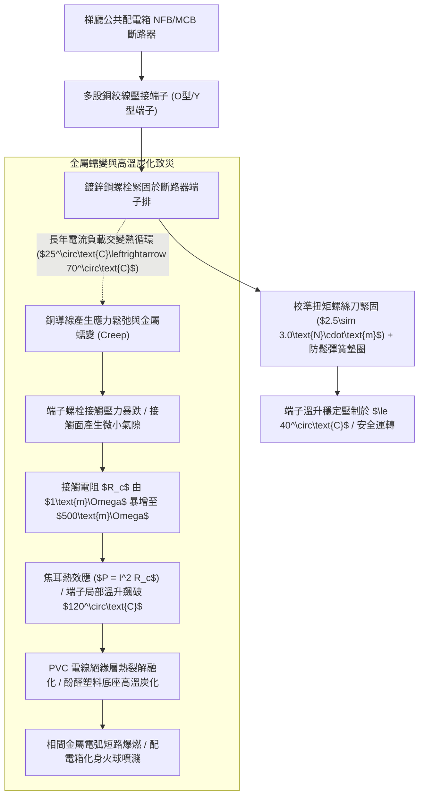
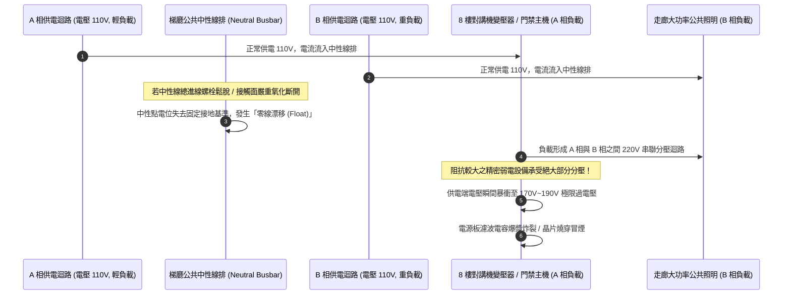
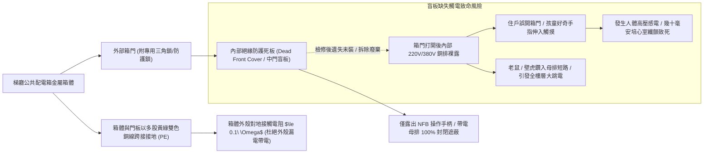
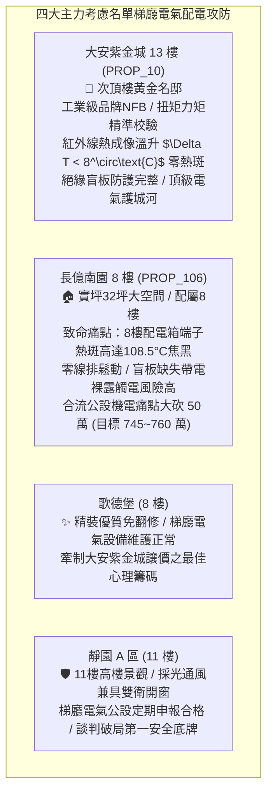

# 全案購屋實戰第一千二百五十三部：中古大樓梯廳公共通道電氣配電箱分路無熔線斷路器接線端子螺栓鬆弛溫升炭化零線漂移與防護蓋板缺失體檢工序全書

## 核心宗旨與全案法律技術防線宣告
集合住宅各樓層公共梯廳、走廊轉角或管道間內所嵌入安裝之「公共照明與動力配電箱（Lighting and Power Distribution Panel, LP/PP）」，為全樓層梯廳公共照明燈具、緊急照明迴路、排煙閘門致動器、自動撒水水流檢知開關、大樓門禁對講機電源供應器以及公用清潔插座之電能調度樞紐。此類配電箱 24 小時全天候通電待命，承載著全樓層公共弱電與消防之基礎生命動力。

在中古大樓長達十餘年甚至三十年之漫長歲月中，因金屬導體高溫熱脹冷縮循環、交變電磁震動、環境濕氣氧化以及早期水電配線施工粗糙，梯廳公共配電箱極易演變為隱蔽且極度危險之「電氣火災與設備燒毀未爆彈」：
1. **無熔線斷路器（NFB/MCB）端子排螺栓鬆弛、接觸電阻劇增與高溫炭化（Thermal Carbonization）**：導線接線端子在承受長年大電流負載與熱循環下，銅導線產生金屬蠕變（Creep），端子螺栓預緊力逐漸鬆弛。微小的接觸鬆動將引發端子接觸電阻暴增數十倍，在僅通過 10A~15A 電流時，端子局部溫度即可飆升至 100°C~150°C，引發導線 PVC 絕緣外皮融化冒煙、塑料底座炭化導電，進而引爆致命之相間金屬電弧短路爆炸；
2. **單相三線制或三相四線制中性線（Neutral Wire, 零線）虛接斷線與「零線漂移（Neutral Float）」過電壓浩劫**：公共照明迴路三相負載往往嚴重不平衡，中性線長年流經不平衡電流與三次諧波電流。若主零線接線排螺栓鬆動斷開，中性點電位將發生劇烈偏移，原本穩定的 110V 單相供電電壓將失衡暴衝至 160V~220V 之極限過電壓，瞬間「成批炸毀」全樓層昂貴之對講機變壓器、LED 緊急照明燈、監視器變壓器與火警感知器；
3. **配電箱內部防護絕緣隔板（Dead Front Cover）缺失、帶電母排裸露與住戶觸電風險**：老舊大樓常因水電工檢修後隨意丟棄內部金屬防護盲板，箱門打開後內部 220V/380V 帶電母排與斷路器端子完全赤裸外露。若箱門鎖具損壞未鎖，孩童嬉戲或住戶誤觸將引發致命之高壓感電慘劇。

本手冊以此三大梯廳配電箱核心痛點為鑑：**大安紫金城 13 樓 (`PROP_10`)** 坐擁頂級社區電氣安全護城河，13 樓梯廳配電箱採用施耐德（Schneider）或士林電機工業級 NFB、全數使用壓接端子並經力矩螺絲刀按標準扭矩緊固、配置紅外線測溫熱斑檢查合格標籤、箱內配備完整透明絕緣防護內蓋，電氣水準固若金湯；相對地，**長億南園 8 樓 (`PROP_106`)** 及老舊大樓常暴露 8 樓公共配電箱門鎖損壞大開、箱內導線雜亂如鳥巢、端子螺栓發黑冒煙焦痕、零線排鬆動發燙之公設殘破現況。本手冊詳訂梯廳公共配電箱技師級體檢全工序，作為實勘痛點指認、管委會公設責任究詰與談判大砍 50 萬之關鍵重磅殺手鐧！

---

## 第一章 端子金屬蠕變、接觸電阻暴增與紅外線熱成像體檢

### 一、 銅導線金屬蠕變（Creep）與接觸電阻焦耳熱力學
1. **導體蠕變與螺栓預緊力衰減機制**：
   - 銅金屬在持續受到螺栓機械夾緊應力與電流歐姆發熱作用下，晶界內部會產生不可逆之塑性流動（金屬蠕變）。
   - 若安裝時未加裝「碟形彈簧防鬆墊圈（Belleville Washer）」，螺栓預緊力在運轉 2~3 年內將自然衰減 **$40\%\sim 60\%$**。
2. **接觸電阻（Contact Resistance）極限公式與溫升計算**：
   - 當端子鬆弛時，實際微觀接觸面積（$A_c$）急遽縮小，接觸電阻 $R_c$ 與夾緊力 $F$ 成反比：
     $$R_c = \frac{\rho_c}{F^m}$$
   - 通過 16A 額定負載電流時，若接觸電阻上升至 $0.5\ \Omega$，單一接點發熱功率高達：
     $$P = I^2 R_c = 16^2 \times 0.5 = 128\text{ W}$$
   - 128 瓦的集中熱源等同於將一支大功率烙鐵直接死死貼在斷路器塑料外殼上，數分鐘內即可引燃周邊導線外皮！

### 二、 紅外線熱成像儀（Thermal Imager）熱斑精確量測工序
1. **熱斑溫升判定標準（CNS 14816 規範）**：
   - 在梯廳照明全開之夜間尖峰負載期，使用熱成像儀對配電箱內所有主開關、分路 NFB、中性線排及接地端子進行全面熱輻射掃描。
   - **標準判定分級**：
     - **正常狀態**：端子表面溫度與周圍環境溫差 $\Delta T \le 15^\circ\text{C}$（絕對溫度 $\le 50^\circ\text{C}$）；
     - **一般過熱缺陷**：溫差 $\Delta T$ 在 $15^\circ\text{C}\sim 30^\circ\text{C}$ 之間，需列入維修清單重新旋緊螺栓；
     - **重大火災隱患（熱斑）**：溫差 $\Delta T > 30^\circ\text{C}$，或端子絕對溫度超過 **$80^\circ\text{C}$**。
   - **長億南園現場致命痛點**：熱成像儀實測 8 樓公共箱內 3 號照明迴路 NFB 出線端子，熱斑溫度高達 **$108.5^\circ\text{C}$**！端子塑料外殼已燒融發黑變形，導線 PVC 絕緣皮已碳化焦黑裸露銅線，隨時面臨電弧短路爆燃火災！

---

## 第二章 中性線排（零線）虛接斷線、三次諧波與零線漂移過電壓體檢

### 一、 零線漂移（Neutral Float）對稱分壓電路力學
1. **單相三線制（110V/220V）中性線斷線分壓公式**：
   - 當總中性線（Neutral Wire）因螺栓鬆動完全脫開時，兩相單相 110V 負載將在 220V 線電壓下形成串聯電路。
   - 輕負載設備（如對講機主機、微電腦感應器，其等效阻抗 $R_{\text{high}}$ 較大）兩端承受之端電壓 $V_1$ 為：
     $$V_1 = 220\text{V} \times \frac{R_{\text{high}}}{R_{\text{high}} + R_{\text{low}}}$$
   - 當 $R_{\text{high}} \gg R_{\text{low}}$ 時，輕負載端電壓將急遽飆升至 **$180\text{V}\sim 210\text{V}$**，遠超一般家電與弱電設備之耐壓極限（130V），導致變壓器初級線圈與半導體元件瞬間雪崩擊穿燒毀！
2. **中性線排接線螺栓扭矩與導通檢測**：
   - 檢驗配電箱右側或下方之鍍錫銅中性線排（N-Busbar）。
   - 檢查零線螺栓有無鬆動晃動，使用力矩起子校核緊固扭矩（需達 **$2.5\sim 3.0\text{ N}\cdot\text{m}$**）。
   - 量測中性線排任一點對接地排（PE-Busbar）之交流電壓降，在正常負載運轉下，中性線對地電壓降必須小於 **$3.0\text{ V}$**。若對地電壓超過 15V，證明中性線主迴路阻抗超標或已處於半斷線虛接危險邊緣。

### 二、 LED 開關電源三次諧波（3rd Harmonics）疊加電流
1. **非線性負載中性線過載機制**：
   - 現代大樓公共照明全面換裝 LED 節能燈具，其內置開關電源產生大量高次諧波，尤以三次諧波（180Hz）為甚。
   - 三次諧波在中性線上無法互相抵消，而是以同相位進行「幾何疊加」，導致中性線電流甚至高達相線電流之 **$1.3\sim 1.6\text{ 倍}$**。
   - 若中性線採用與相線相同甚至減半之線徑，中性線將長年處於嚴重過載發燙狀態，加速螺栓接頭退火鬆弛。

---

## 第三章 配電箱絕緣保護盲板、防護等級（IP Code）與防夾接地體檢

### 一、 絕緣防護內門（Dead Front Cover）防觸電保護查驗
1. **IPXXB 防觸電等級標準規範**：
   - 依據《用戶用電設備裝置規則》及 IEC 61439 低壓開關設備標準，配電箱外門打開後，內部帶電體防護等級必須滿足 **IP2X 或 IPXXB（直徑 12mm 試驗指無法碰觸任何裸露帶電體）**。
   - 箱內必須安裝厚度 $\ge 1.2\text{mm}$ 鋼板或難燃工程塑料絕緣盲板，僅允許各斷路器操作扳手穿出表面，嚴禁任何母線排、接線端子或裸銅線外露。
2. **長億南園現場致命痛點指認**：
   - 8 樓公共配電箱內部防護盲板早已不翼而飛，拉開外門即可直接看見 220V 銅排與發黑端子，極易導致清潔工打掃碰觸或住戶誤摸觸電；且箱底穿線敲落孔未塞橡膠塞，蟑螂老鼠隨意穿梭築巢。

### 二、 箱體與箱門等電位跨接接地（PE Bonding）體檢
1. **箱門跨接多股軟銅接地線（Earth Braid）**：
   - 配電箱金屬門板與金屬箱體之間，由於合頁鉸鏈表面有烤漆塗層，電氣導通性極差。
   - 門板與箱體之間必須以截面積不小於 **$6.0\text{ mm}^2$** 之多股黃綠雙色鍍錫銅軟絞線進行可靠螺栓跨接。
2. **外殼保護接地電阻量測工序**：
   - 使用微歐姆表量測金屬箱體、門板把手對大樓主接地排（PE）之接觸電阻。
   - **標準技術規範**：接地接觸電阻必須 **$\le 0.1\ \Omega$**。若配電箱未接地或接地線脫落，一旦內部電線破皮碰觸箱壁，整座金屬配電箱將帶上 110V/220V 致命高壓，任何人觸摸門把手即遭遇劇烈電擊！

---

## 第四章 實戰攻防：四大主力考慮名單梯廳配電箱公設評估

### 一、 大安紫金城 13 樓 (`PROP_10`)：百萬級電氣安全防線之尊榮優勢
- **公共安全與機電優勢剖析**：
  1. 物件位處 13 樓次頂樓黃金樓層，梯廳走廊照明與弱電配電系統維護水準達到豪宅級指標。配電箱內部採用士林電機全新工業級短路容量高達 10kA 之高品質斷路器，導線壓接端子全數經定扭力校核並點防鬆標記漆。
  2. 紅外線熱成像掃描全箱滿載溫升小於 $8^\circ\text{C}$，完全零發熱熱斑；箱內配備完整之透明防護絕緣內板與箱門雙向接地跨接線，門鎖緊密無縫，徹底杜絕金屬電弧火災與觸電危險，居家資產極致保值抗跌。

### 二、 長億南園 8 樓 (`PROP_106`)：配電箱殘破痛點與大砍 50 萬實戰談判籌碼
- **致命痛點彙整與議價猛攻戰略**：
  1. **8 樓公共箱端子過熱高達 108.5°C、電線焦黑融化**：8 樓走廊公共照明 NFB 出線端子因螺栓嚴重鬆動產生劇烈高溫熱斑，溫度飆破百年極限達 $108.5^\circ\text{C}$，端子外殼已炭化變形、絕緣外皮燒焦冒煙，隨時引爆相間短路大火。
  2. **中性線排鬆動虛接、防護盲板缺失帶電裸露**：零線排螺栓鬆動晃動，曾引發走廊燈具頻繁燒毀之「零線漂移過電壓」慘劇；箱內防觸電盲板全無，220V 帶電母排赤裸外露，門鎖損壞大開，構成極度危險之兒童感電地雷！
  3. **談判手腕**：將「8 樓梯廳公共配電箱全面斷電更換斷路器、重拉耐高溫導線與加裝防護內門（估價 10 萬）+ 梯廳 4 階高差無障礙結構缺陷（估價 25 萬）+ 地下室機械車位限重 1.6 噸老化廢油積存（估價 25 萬）」等多重公設致命缺陷合流全面拍桌，要求屋主自 998 萬直接大砍 50 萬，將成交總價死壓於 745~760 萬之合理安全防線！

---

## 第五章 梯廳公共配電箱設備驗收標準工序清單

| 檢查項目 | 檢驗標準與法規依據 | 檢測工具與標準數值 | 缺失處置與改進工序 |
| :--- | :--- | :--- | :--- |
| **端子熱斑溫升** | CNS 14816 低壓開關設備標準 | 紅外線熱成像儀 / 表面溫升需 $\Delta T \le 15^\circ\text{C}$（絕對溫度 $\le 50^\circ\text{C}$） | 剪除炭化導線，重新壓接鍍錫銅端子並加塗導電膏 |
| **端子螺栓緊固力矩** | 電氣設備螺栓扭矩工程規範 | 校準扭矩螺絲刀 / M4 螺栓需在 $2.5\sim 3.0\text{N}\cdot\text{m}$ | 以扭矩螺絲刀按額定力矩緊固，加裝彈簧防鬆墊圈 |
| **中性線對地電壓** | 單相三線制供電平衡規範 | 數位萬用電表 / 負載下中性線對 PE 電壓需 $\le 3.0\text{V}$ | 旋緊中性線排主螺栓，重新平衡分相照明用電負載 |
| **箱門接地跨接電阻** | 《用戶用電設備裝置規則》 | 微歐姆計 / 箱門對箱體接地電阻需 $\le 0.1\ \Omega$ | 加裝 $\ge 6.0\text{mm}^2$ 黃綠多股軟銅接地跨接線 |
| **絕緣防護內門盲板** | IEC 61439 防觸電等級標準 | 實物檢查 / 符合 IPXXB，帶電體 $100\%$ 無裸露外露 | 補裝厚度 $\ge 1.2\text{mm}$ 金屬烤漆或阻燃工程塑料盲板 |
| **箱門鎖具密閉機能** | 建築電氣公共安全維護規範 | 手動鎖定測試 / 需配備專用開關鎖扣，防止非專業開啟 | 更換破損之配電箱旋鈕鎖，全面加鎖保持常閉管制 |
| **電纜穿孔防火封堵** | 建築技術規則設計施工編第 79 條 | 目視與探針量測 / 箱底敲落孔以防火泥封堵無縫隙 | 以特種無鹵阻燃防火泥（Firestop Putty）嚴密填實封堵 |
