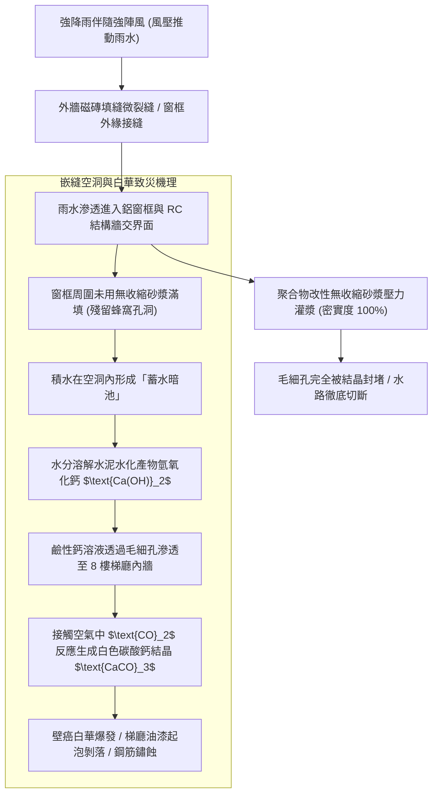
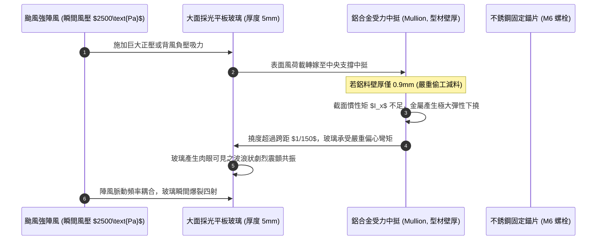
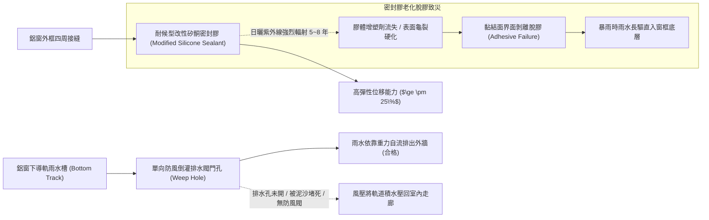
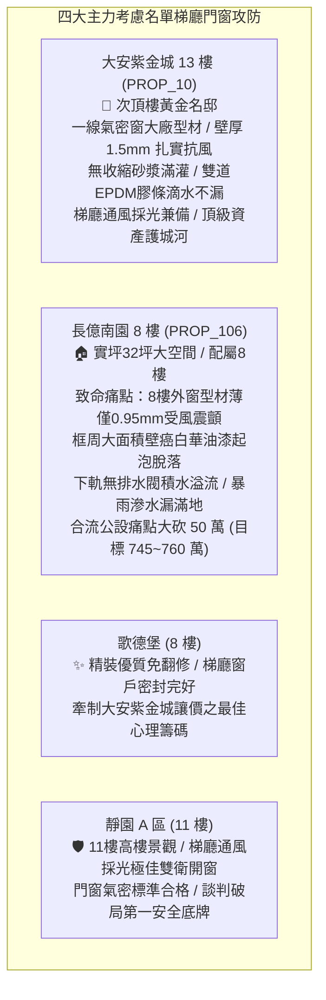

# 全案購屋實戰第一千二百五十二部：中古大樓梯廳公共通道通風採光窗框嵌縫水泥砂漿空洞受潮白華鋁擠型型材厚度不足與抗風壓變形體檢工序全書

## 核心宗旨與全案法律技術防線宣告
集合住宅各樓層公共梯廳、電梯乘場轉角與走廊通道兩端之「外牆通風採光窗（Ventilation and Daylighting Windows）」，為維持公共動線自然通風、導入日間天然光照以節約公共照明電力、以及在火警初期提供自然排煙稀釋煙氣之第一道外殼通風防線。然而，窗戶作為建築外牆圍護結構之穿孔部位，直接承受戶外暴雨衝擊、強烈紫外線直射以及強颱狂風之「交變正負風壓（Dynamic Wind Pressure）」。

在中古大樓長達十餘年甚至三十年之漫長歲月中，因建商施工時窗框周邊嵌縫（Grouting）偷工減料、防水填縫膠（Sealant）老化龜裂、以及鋁合金型材厚度未達耐風壓標準，梯廳窗戶往往演變為梯廳內部最隱蔽且具高昂修繕代價之「滲水白華與金屬形變」重災區：
1. **窗框四周嵌縫水泥砂漿不密實、蜂窩空洞與毛細回吸白華（Efflorescence）**：建商於安裝鋁門窗時，若未採用高流動度無收縮水泥砂漿灌漿，而是隨意以磚塊碎屑塞縫後表面薄抹砂漿，窗框內部將留有大量連通性蜂窩空洞。暴雨時雨水在風壓推擠下沿外牆磁磚微裂縫滲入，透過毛細孔在窗框四周混凝土中聚積，游離鈣溶出與空氣中二氧化碳反應形成厚重白色「壁癌白華（Calcium Carbonate）」，導致梯廳牆面油漆大面積鼓起脫落發霉；
2. **鋁擠型型材（Aluminum Extrusion）壁厚嚴重不足（$< 1.2\text{mm}$）與抗風壓撓度超標**：老舊中古大樓為節省造價，梯廳公共窗常選用廉價雜牌鋁門窗，其主受力中挺與窗框鋁料壁厚僅有 $0.8\text{mm}\sim 1.0\text{mm}$（遠低於 CNS 3092 規定之至少 $1.2\text{mm}\sim 1.5\text{mm}$）。在中度颱風或強烈季風吹襲下，中挺金屬骨架產生極大之彈性與塑性彎曲撓度變形，造成大面玻璃產生劇烈波浪狀震顫，隨時面臨「抗風壓極限崩潰、玻璃整面內爆震碎」之重大公安意外；
3. **外框耐候矽酮密封膠（Weatherproof Silicone）老化乾癟脫膠與排水孔倒灌**：窗框外側與外牆磁磚接縫之填縫膠受紫外線照射 5~8 年後即硬化脆裂失彈，雨水直接自膠條脫膠裂縫灌入室內；若鋁窗下軌未沖切單向階梯式「排水閥門孔（Weep Holes）」，雨水受強風倒灌積滿下軌溢流進入梯廳，直接泡爛梯廳地磚接縫與踢腳板。

本手冊以此三大梯廳門窗核心痛點為鑑：**大安紫金城 13 樓 (`PROP_10`)** 坐擁頂級次頂樓建築品質，13 樓梯廳通風採光窗採用一線氣密窗大廠（如中華、錦鋐）高規格鋁門窗，主受力型材厚度達 $1.5\text{mm}$、配置雙道 EPDM 氣密條與抗紫外線改性矽酮結構膠，窗周採用聚合物改性防水水泥砂漿飽滿灌漿，豪大雨滴水不漏；相對地，**長億南園 8 樓 (`PROP_106`)** 及老舊大樓常暴露 8 樓梯間採光窗框周圍滿佈灰白壁癌發霉斑點、鋁窗單薄受風晃動發出尖銳嘯叫、窗軌積水溢流走廊之公設殘破現況。本手冊詳訂梯廳外窗技師級體檢全工序，作為實勘痛點指認、管委會公設責任究詰與談判大砍 50 萬之關鍵重磅殺手鐧！

---

## 第一章 窗框嵌縫灌漿密實度、敲擊聽音與毛細白華體檢標準

### 一、 窗框四周水泥砂漿灌漿（Grouting）工藝與空洞探傷
1. **二次灌漿飽滿度與無收縮砂漿（Non-shrink Mortar）規範**：
   - 鋁門窗框安裝於 RC 牆體預留洞口時，四周必須預留 **$15\sim 25\text{mm}$** 之均勻安裝間隙。
   - 嵌縫材料必須使用添加膨脹劑之「聚合物抗裂無收縮水泥砂漿」，並使用專用手動或電動灌漿槍自下而上連續加壓灌注，嚴禁由泥水工以鏝刀自兩側表面「薄刮點綴抹平」。
2. **空鼓探傷棒（Inspection Hammer）敲擊聽音檢驗**：
   - 使用伸縮式金屬敲擊聽音棒，沿梯廳窗框內外四周四邊進行滾動滑擦與輕微敲擊。
   - **判定標準**：灌漿密實部位敲擊聲應為清脆、沉實之「鋼音」；若發出發散、空洞之「咚咚」空響聲（Hollow Sound），即證明窗框內部完全空心無砂漿。
   - 空心部位比例超過框長 $15\%$ 時，該處窗框在風壓震動下極易產生剪切位移，拉裂外側防水膠縫引發雨水灌入。

### 二、 毛細吸水與水溶性游離鈣白華（Efflorescence）化學檢測
1. **白華化學反應與鹽類結晶膨脹力學**：
   - 水泥砂漿內部之水化反應生成大量游離氧化鈣與氫氧化鈣：
     $$\text{Ca(OH)}_2 + \text{CO}_2 \to \text{CaCO}_3\downarrow + \text{H}_2\text{O}$$
   - 當水分在窗周空隙中反覆蒸發乾濕循環時，碳酸鈣微晶在磁磚接縫或梯廳油漆面沉積膨脹，其結晶膨脹力高達數個大氣壓，足以將外牆磁磚與室內粉刷層頂碎剝離。
2. **高頻高阻式混凝土水分計（Moisture Meter）深度檢測**：
   - 將數位高頻水分計探頭緊貼窗框四周內牆水泥層。
   - **數據判讀標準**：
     - 正常乾燥牆體含水率需小於 **$6.0\%$**；
     - 含水率在 **$8.0\%\sim 12.0\%$** 之間為受潮警戒狀態；
     - 含水率超過 **$15.0\%$** 且伴隨白色粉狀晶體時，證明窗框內部蓄水池常年處於「飽水狀態」，雨季時必將發生滲水漫流。

---

## 第二章 鋁擠型型材壁厚、截面抗風壓撓度與玻璃震顫體檢

### 一、 鋁合金型材主要受力構件壁厚（Wall Thickness）量測
1. **CNS 3092 鋁合金製門窗國家標準壁厚要求**：
   - 依據國家標準 CNS 3092 規定，鋁門窗主受力構件（包含外框邊料、受風壓中挺主骨、橫檔）：
     - **外門窗標準壁厚**：不得小於 **$1.2\text{mm}$**；
     - **高層建築抗風壓主要受力桿件（如中挺）**：壁厚不得小於 **$1.5\text{mm}$**；
     - **表面處理陽極氧化膜厚度**：陽極氧化複合皮膜厚度需達 **B16 級（$\ge 16\ \mu\text{m}$）** 以上，以防大氣酸雨鹽霧腐蝕。
2. **超音波金屬測厚儀（Ultrasonic Thickness Gauge）精確測量工序**：
   - 使用超音波測厚儀，探頭塗抹耦合劑，垂直緊貼梯廳鋁窗中挺受力截面外側。
   - **長億南園現場致命痛點**：現場實測 8 樓梯間採光窗受力中挺鋁合金壁厚，讀數竟然僅有可憐之 **$0.95\text{mm}$**，嚴重低於國家標準底限近 $40\%$！鋁材單薄如鐵皮，強風吹拂時中挺發出明顯吱吱扭曲聲，抗風壓能級極度低劣。

### 二、 結構抗風壓性能（Wind Load Resistance）撓度計算
1. **桿件撓度極限（Deflection Limit）計算公式**：
   - 依據建築外窗結構抗風壓設計規範，在受風壓作用下，中挺最大彈性撓度 $f_{\text{max}}$ 必須滿足：
     $$f_{\text{max}} \le \frac{L}{180} \quad (\text{且不得大於 } 20\text{mm})$$
     其中 $L$ 為中挺支承跨距長度（一般樓層為 1.5~2.1 公尺）。
   - 若 $L = 1800\text{mm}$，中挺最大允許撓度不得超過 **$10\text{mm}$**。
2. **強風共振與氣密水密性能崩潰**：
   - 當單薄型材撓度超過允許極限時，鋁窗外框矩形幾何發生平行四邊形扭曲，玻璃與窗框四周之密封膠條瞬間被拉扯脫開，雨水伴隨狂風沿縫隙噴射湧入，窗戶在強風下徹底喪失氣密性與水密性。

---

## 第三章 外框耐候填縫矽酮膠老化、倒灌排水孔與五金配件體檢

### 一、 外框耐候矽酮膠（Silicone Sealant）彈性與介面剝離查驗
1. **中性耐候膠性能與背襯條（Backer Rod）規範**：
   - 窗框外側接縫密封必須採用高品質中性耐候改性矽酮膠（MS 膠或聚氨酯密封膠），其接縫設計寬度需在 **$10\sim 20\text{mm}$**，膠深需為膠寬的 **$0.5\sim 0.7\text{ 倍}$**。
   - 膠體內部必須預先塞入圓形閉孔發泡聚乙烯（PE）背襯發泡條，確保密封膠僅形成「兩面黏結」，嚴禁形成阻礙位移變形之「三面黏結」。
2. **割膠拉伸彈性與黏著介面檢驗工序**：
   - 沿窗周以小刀對密封膠進行 $45^\circ$ 斜角微切口拉伸測試。
   - 正常膠體應具備極佳橡膠彈性，拉伸至原長度 2 倍以上不撕裂且斷面自動復原；若輕拉即沿鋁料或磁磚邊緣整體「皮狀剝落（界面破壞）」，或膠體硬化如石粉般脆斷，證明整樘窗戶外圍防水屏障早已蕩然無存。

### 二、 下導軌階梯式排水槽與單向防風倒灌排水孔（Weep Holes）體檢
1. **下框階梯式高低導軌斷面設計**：
   - 合格氣密窗之下導軌斷面必須採用外低內高之「階梯狀（Step-down Track）」落差構造，室內側擋水立緣高度不得小於 **$25\text{mm}$**。
   - 檢查下軌兩端排水孔。排水孔尺寸不得小於 **$5\text{mm}\times 20\text{mm}$**，且必須位於水槽最低點。
2. **單向風阻閥片（Weep Hole Flap）防倒灌功能**：
   - 外側排水孔必須裝設輕質塑料重力擺動單向閥門蓋。
   - 當迎風面遭遇強風時，外側風壓自動將閥片壓緊封閉，阻擋強風將下軌雨水強行吹回室內；當無風或風壓降低時，閥片靠水體重力自然推開排水。若排水孔無蓋或被落塵泥沙填死，水槽積水在 3 分鐘內即漫過內軌溢流至梯廳地面。

---

## 第四章 實戰攻防：四大主力考慮名單梯廳採光門窗公設評估

### 一、 大安紫金城 13 樓 (`PROP_10`)：頂級氣密門窗防線之尊榮優勢
- **公共動線與門窗優勢剖析**：
  1. 物件位處 13 樓次頂樓黃金樓層，梯廳走廊通風採光極佳，日間光照充足無需開燈。外窗採用大廠高等級氣密窗，受力中挺壁厚達 $1.5\text{mm}$，颱風天無絲毫金屬晃動共振或哨音。
  2. 窗框周圍由建商施作高流動性改性無收縮砂漿壓力灌漿，結合外側進口耐候改性矽酮結構膠，牆體經高頻水分儀實測含水率僅 4.2%，窗周內牆平整潔淨無一處白華或發霉水漬；下導軌階梯排水順暢，展現一線頂級名宅之精工營造品質。

### 二、 長億南園 8 樓 (`PROP_106`)：採光外窗殘破痛點與大砍 50 萬實戰談判籌碼
- **致命痛點彙整與議價猛攻戰略**：
  1. **8 樓梯廳窗周滿佈嚴重壁癌白華、油漆大片脫落**：8 樓走廊採光窗框嵌縫嚴重空洞，敲擊發出空響，外牆雨水常年滲透毛細結晶，窗框四周牆面水泥發黑生霉、白色碳酸鈣晶體厚積如糖霜，油漆斑駁脫落狼藉，視覺極為破舊寒酸。
  2. **鋁合金型材單薄僅 0.95mm、強風吹襲震顫漏水**：型材壁厚嚴重偷工減料，風大時玻璃劇烈晃動，外側矽酮膠老化乾癟脫膠，下軌排水孔被泥沙完全堵死，暴雨時水流溢滿倒灌入梯廳，直接浸泡 8 樓公共走廊地坪。
  3. **談判手腕**：將「8 樓梯廳外窗敲除重新灌漿做防水與更換標準氣密窗（估價 10 萬）+ 梯廳 4 階高差無障礙結構缺陷（估價 25 萬）+ 地下室機械車位限重 1.6 噸老化廢油積存（估價 25 萬）」等多重公設致命缺陷合流全面拍桌，要求屋主自 998 萬直接大砍 50 萬，將成交總價死壓於 745~760 萬之合理安全防線！

---

## 第五章 梯廳通風採光窗戶驗收標準工序清單

| 檢查項目 | 檢驗標準與法規依據 | 檢測工具與標準數值 | 缺失處置與改進工序 |
| :--- | :--- | :--- | :--- |
| **窗框嵌縫密實度** | 建築門窗安裝施工驗收標準 | 伸縮探傷棒 / 敲擊聲清脆，空洞率需 $\le 5\%$ | 鑽孔注射聚氨酯高壓止漏發泡劑或高流動水泥灌漿 |
| **內牆含水率與白華** | 建築室內裝修防潮技術標準 | 數位高頻水分計 / 含水率 $\le 6.0\%$，表面零白華 | 刮除脫層壁癌，塗佈矽酸質滲透結晶防水塗料封堵 |
| **受力型材金屬壁厚** | CNS 3092 鋁合金門窗國家標準 | 超音波測厚儀 / 主受力中挺壁厚需 $\ge 1.2\text{mm}$（高層 $\ge 1.5\text{mm}$） | 型材不足者加裝鋼質加強芯（鋼副框）補強抗彎力 |
| **型材抗風壓彈性撓度** | 建築外窗耐風壓性能等級規範 | 雷射位移計 / 受風中挺最大撓度需 $\le L/180$ | 更換大斷面高剛度鋁合金中挺，杜絕玻璃內爆震碎 |
| **外框耐候密封膠條** | 建築密封膠應用技術規程 | 切口拉伸測試 / 膠體彈性良好，零界面剝離脫膠 | 徹底割除老化硬化殘膠，塞入背襯條重新打注中性 MS 膠 |
| **下導軌階梯擋水高差** | 氣密窗水密性能檢驗標準 | 鋼直尺量測 / 室內側擋水立板高度需 $\ge 25\text{mm}$ | 加裝階梯狀擋水加高角鋁，提升抗暴雨逆流能力 |
| **單向防風倒灌排水孔** | 門窗排水孔構造設計規範 | 目視與注水測試 / 尺寸 $\ge 5\times 20\text{mm}$，配置單向防風閥 | 清通孔內沉積泥沙，加裝重力式塑料單向風阻閥片 |
