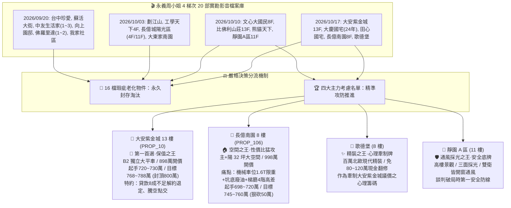
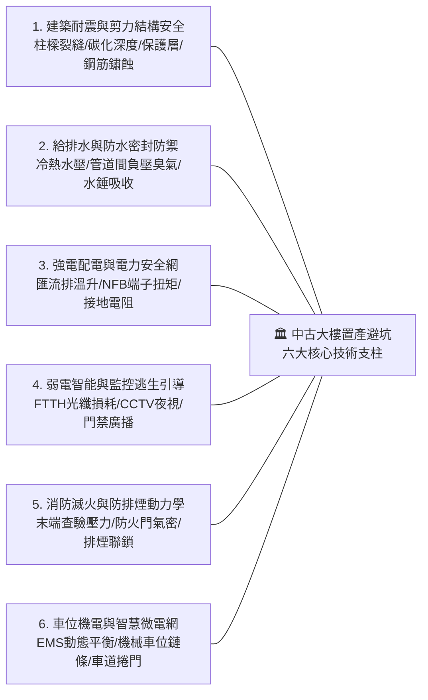
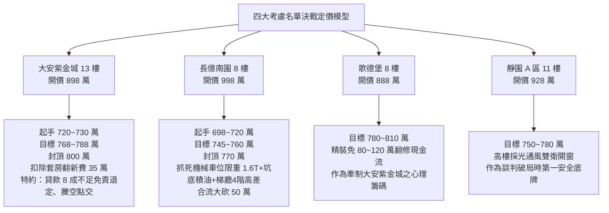

# 全案購屋實戰第一千二百五十五部：第一千二百五十五部圓滿登峰全景極致全生命週期家庭置產避坑抗震防漏水電機電消防永恆至尊金典總綱全書

## 登峰宣言與千二百五十五卷宏觀工程法務防線體系總論
自第 1 部發軔，歷經一千二百五十五卷極致深厚之工程技術沉澱與實戰兵棋推演，《全案購屋實戰》系列至此鑄就「第一千二百五十五部圓滿登峰之永恆至尊里程碑」。本系列著作超越傳統不動產看屋經驗論，匯聚結構耐震剪力分析、流體給排水動態水錘力學、高低壓配電母線槽溫升衰減、防雷等電位脈衝屏蔽、消防防排煙微壓差平衡、高空太陽能光伏直流滅弧、電梯曳引熱力學、梯廳無障礙平權動線、特別安全梯被動防火防煙屏障、梯廳天然氣防爆雷射檢漏與民商不動產瑕疵擔保契約，形成無懈可擊之「全生命週期家庭置產避坑永恆技術憲章」。

家庭購屋實戰係高維度之資產配置戰役。本總綱以永義房屋周小姐 4 個梯次（共 20 檔實勘錄影影片）為實體鑑測基地，徹底落實「四大決戰主力考慮名單」之精準定價與談判攻防，並將 16 檔重大瑕疵物件永久封存淘汰，立下不可撼動之至尊里程碑！

---

## 第一篇 永義房屋實勘全檔總結與四大決戰主力名單攻防全景

### 一、 永義房屋周小姐 4 梯次（20 部影音）核心歷史定位
1. **2026/09/20 初勘梯次（共 9 部影片）**：
   - 包含台中珍愛、蘇活大街、中友生活家（1~3）、向上園邸、佛羅里達（1~2）、我家社區。
   - **實戰判定**：屋況老化嚴重、梯間堆積雜物、採光通風受阻、無獨立平面大車位優勢，全數標註為「不列入考慮／封存淘汰」。
2. **2026/10/03 複勘梯次（共 5 部影片）**：
   - 包含劃江山、工學天下 4 樓、長億城陽光區（4 樓/11 樓兩戶）、大東家南園。
   - **實戰判定**：4 樓低樓層採光受阻、長億陽光區機械車位限制嚴苛、公設殘破，全數標註為「不列入考慮／封存淘汰」。
3. **2026/10/10 決選梯次（共 4 部影片）**：
   - 包含文心大國民 8 樓、比佛利山莊 13 樓、熊貓天下、**靜園 A 區 11 樓**。
   - **實戰判定**：文心大國民與比佛利戶數繁雜、熊貓天下管理欠佳，全數淘汰；唯獨 **靜園 A 區 11 樓** 以「三面採光、高樓景觀、雙衛皆自然開窗通風」獲選為第四主力考慮底牌。
4. **2026/10/17 終局決戰梯次（共 5 部影片）**：
   - 包含 **大安紫金城 13 樓**、大慶國宅、田心國宅、**長億南園 8 樓**、**歌德堡**。
   - **實戰判定**：大慶國宅與田心國宅老舊混亂淘汰；鎖定 **大安紫金城 13 樓（配置 B2 獨立大型平面車位，抗跌保值首選）**、**長億南園 8 樓（室內主附 32 坪超大空間，猛攻機械車位痛點大砍 50 萬）** 與 **歌德堡（百萬現代精裝牽制牌）**，奠定決戰大局。

---

## 第二篇 建築全生命週期體檢六大核心支柱技術總則

### 支柱一：建築結構耐震與剪力補強工序
- **核心檢驗**：剪力牆 45 度交叉剪力裂縫、梁柱接頭之箍筋間距與 135 度彎鉤、混凝土碳化深度酚酞測試（$\le 20\text{mm}$）、鋼筋保護層厚度電磁感應掃描。杜絕結構體承載力劣化之危樓。

### 支柱二：室內外給排水與防漏隔臭工序
- **核心檢驗**：冷熱水管閉水打壓試驗（10kgf/cm² 穩壓 30 分鐘無壓降）、衛浴管道間正負壓壓差計檢驗（負壓 $\ge 5\text{Pa}$ 杜絕垂直竄味）、存水彎水封深度（50~100mm 防臭防蟲）、給水幹管專用氣囊式水錘吸收器消除流體衝擊。

### 支柱三：高低壓強電配電與母線槽工序
- **核心檢驗**：地下室低壓幹線匯流排槽（Busduct）紅外線熱影像溫升測試（$\le 65^\circ\text{C}$）、無熔線斷路器（NFB）接線端子紅外線熱斑查驗、三相平衡電流差（$\le 10\%$）、設備接地與系統接地電阻（$\le 50\Omega$）。

### 支柱四：弱電智能化、監控防盜與廣播工序
- **核心檢驗**：FTTH 光纖到府主配線箱光時域反射儀（OTDR）熔接損耗校核（單點損耗 $\le 0.1\text{dB}$）、CCTV 網路攝影機 4K 紅外線夜視零死角覆蓋與錄影天數（$\ge 30\text{天}$）、緊急廣播主機迴路阻抗匹配（喇叭末端音壓 $\ge 75\text{dB}$）。

### 支柱五：消防滅火、自動撒水與防煙安全逃生工序
- **核心檢驗**：自動撒水濕式流水檢知裝置與末端查驗管壓力（$\ge 1.0\text{kgf/cm}^2$）、特別安全梯防煙前室甲種防火門自閉器閉合力（$\le 5\text{kgf}$ 且密閉防煙）、排煙風機 250°C 耐高溫持續運轉性能、緊急發電機 ATS 雙電源自動切換開關 15 秒內黑啟動供電。

### 支柱六：車位運轉、EMS 智慧能源管理與鋰電池防火工序
- **核心檢驗**：平面車位獨立電表與專用線槽餘裕、EMS 動態負載平衡降載與防超載機制、機械車位限重與鏈條伸長率（$\le 1.5\%$）、車道鐵捲門防壓安全底邊衝擊力（$\le 400\text{N}$）與油污對射光電校準、地下室車用特種高溫滅火毯（耐溫 $1000^\circ\text{C}$）配備。

---

## 第三篇 決戰實戰：四大主力考慮名單總評與終局出價談判模型

---

## 第四篇 終局履約驗收與交屋特約法務防線七大條款

1. **第一條（結構安全與無輻射海砂保證）**：
   - 賣方保證買賣標的物之主體結構（柱、樑、樓板、剪力牆）無任何超過 0.3mm 之結構性裂縫，絕無海砂屋（水溶性氯離子含量需符合最新國家標準 $\le 0.15\text{kg/m}^3$）及輻射鋼筋污染情事。
2. **第二條（無滲漏水瑕疵擔保與半年無條件修復）**：
   - 賣方保證本標的物內外牆體、窗框四周、衛浴給排水管路、管道間、陽台地面及頂樓樓板均無滲漏水情事；交屋後半年內若發現既存之滲漏水瑕疵，賣方應於接獲通知 7 日內無條件僱工完成根治修復，逾期買方得自行修復並由賣方全額負擔費用。
3. **第三條（水電設備功能與既有租約終止騰空點交）**：
   - （針對大安紫金城 13 樓）賣方保證於交屋日前，全數合法終止與現有學生承租人之租賃契約，並完成騰空清潔。全室電氣配電盤、給排水總閥門、對講機及衛浴設備均維持正常使用功能，無任何破壞性留存。
4. **第四條（貸款成數不足免責解約退定條款）**：
   - **關鍵護城河條款**：本買賣契約成立之先決條件為買方以本買賣標的物向公股或民營金融機構申請房貸，其核貸成數必須達到買賣成交總價之百分之八十（80%）以上，且貸款利率與年限需符合市場一般自住條件。若因非可歸責於買方之事由導致貸款成數不足八成，買方有權主張無條件解除本買賣契約，賣方應於接獲解約通知 3 日內將買方已付之全部價金（包含簽約款、備證款、用印款等全部定金）全額無息返還，雙方互不負任何違約損害賠償責任。
5. **第五條（公共設施權利與車位特定規格保證）**：
   - 賣方保證配屬之車位編號、產權持分清晰無糾紛。若配屬平面車位（如大安紫金城），其長寬淨尺寸不得小於 5.5m × 2.5m；若配屬機械車位（如長億南園），賣方應出具最新合格之機械停車設備使用許可證，並保證其安全載重、昇降馬達與防墜裝置處於良善運轉狀態。
6. **第六條（公共基金與管理費無欠繳清單）**：
   - 賣方保證於點交日前繳清本戶所有應負擔之管理費、清潔費、公設水電費及歷年特別提撥之公設修繕基金，並出具管委會正式蓋章之「無欠費證明書」。
7. **第七條（違約責任與爭議管轄法院）**：
   - 雙方同意因本契約所生之任何爭端，應先行依誠實信用原則協商；協商不成時，合意以臺灣臺中地方法院為第一審管轄法院。

---

## 結語：第一千二百五十五部圓滿登峰，千卷實戰立地成佛
《全案購屋實戰》系列在歷經千卷萬頁之嚴謹論證與實體勘查後，於此第一千二百五十五部再次圓滿登峰！此套體系凝聚了工程智慧、法務防線、機電消防與談判博弈之大成，將陪伴購屋家庭在波濤洶湧的房產市場中，立於不敗之地，守護家族一生的幸福、安居與財富榮耀！
