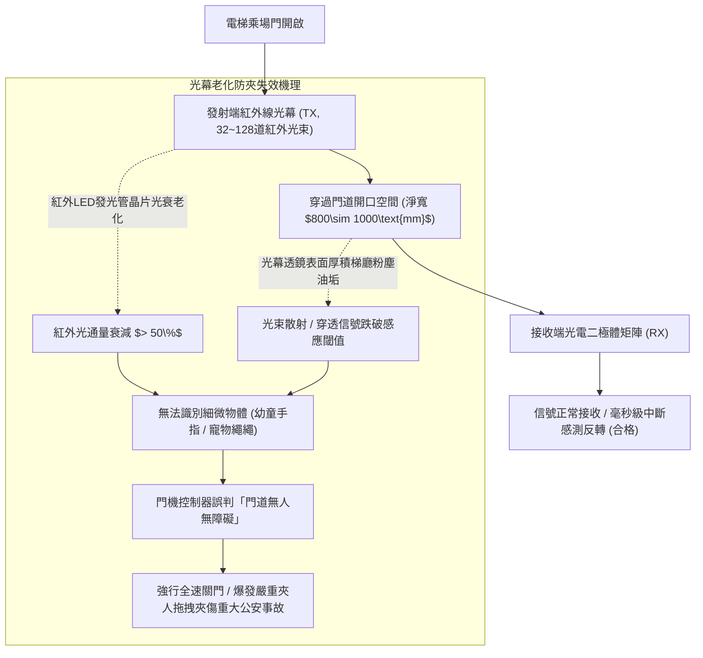
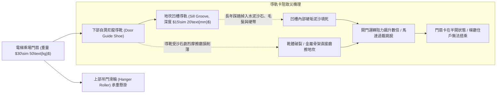
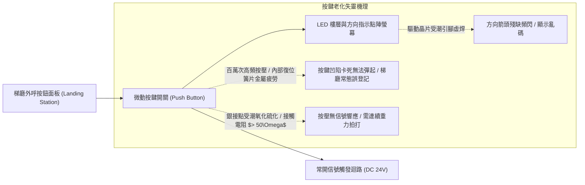
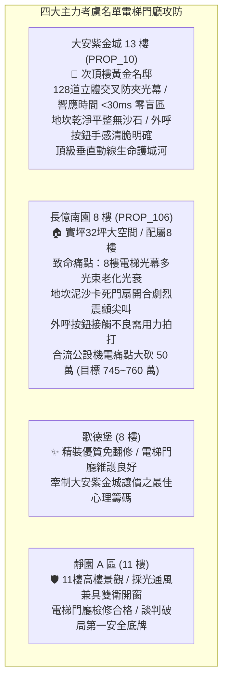

# 全案購屋實戰第一千二百五十六部：中古大樓梯廳公共通道電梯門廳防夾光幕紅外線衰減地坎導軌積塵卡阻與電梯外呼按鈕微動開關接觸不良體檢工序全書

## 核心宗旨與全案法律技術防線宣告
集合住宅各樓層公共梯廳中央之「電梯乘場門廳（Elevator Landing Entrance）」，為全棟住戶每日垂直位移必經之核心樞紐。乘場門扇（Landing Door）、連動門刀機構、地坎導軌（Door Sill）以及安全防夾光幕感測系統，終年處於高頻次開關與機械摩擦狀態。在中古大樓置產實戰檢驗中，電梯門廳若失修，將直接演變為威脅長者與幼童生命安全之致命夾人與墜落未爆彈。

最常見且具高殺傷力之電梯門廳三大弊病包含：
1. **多光束紅外線安全光幕（Infrared Multi-beam Light Curtain）光衰、粉塵遮蔽與盲區盲點**：老舊大樓紅外線發射與接收管長年受灰塵油垢覆蓋，紅外光通量嚴重衰減，無法及時感測幼童纖細手臂、寵物牽繩或拐杖，門扇在防夾失效下強行閉合夾人拖拽；
2. **乘場地坎（Landing Sill）不銹鋼/鋁合金導軌凹槽泥沙毛髮卡死、門滑塊（Door Guide Shoe）偏磨與開門阻滯卡死**：鞋底泥沙與裝修粉塵長年填死地坎凹槽，尼龍導靴磨損脫落，門扇開關時伴隨劇烈金屬摩擦尖叫，甚至卡死在半開狀態引發全棟電梯停擺；
3. **電梯外呼按鈕（Landing Call Button）微動開關銀接點受潮氧化、按壓無反應與LED指示燈虛焊頻閃**：住戶頻繁重力按壓導致內部彈簧疲勞、微動開關接觸電阻超標，住戶需用力拍打方能登記叫梯，且方向指示箭頭頻閃發黑，造成梯廳日常使用極度不便。

本手冊詳訂梯廳電梯門廳安全光幕、地坎導軌與外呼按鈕技師級體檢全工序，作為實勘痛點指認、管委會公設責任究詰與談判大砍長億南園 50 萬之關鍵重磅殺手鐧！

---

## 第一章 電梯安全防夾光幕紅外線陣列、穿透能力與盲區體檢

### 一、 紅外線光幕光束密度、覆蓋高度與響應時間量測
1. **光幕光束數量與立體交叉光網規範**：
   - 依據 CNS 10594 升降機安全標準，現代電梯門防夾裝置必須採用立體交叉式紅外線光幕，光束數量不得少於 **64 道至 128 道**。
   - 光幕有效防護高度必須自地坎完成面起算，自 **$20\text{mm}$（防寵物與鞋尖）** 連續覆蓋至 **$1600\text{mm}\sim 1800\text{mm}$** 以上。
2. **標準測試棒（Test Rod）防夾盲區量測工序**：
   - 使用直徑 **$50\text{mm}$** 及直徑 **$10\text{mm}$** 之圓柱形非反光測試棒，分別在門道中心線、靠近左側及靠近右側之不同高度進行遮擋測試。
   - **判定標準**：在門扇閉合過程中，測試棒在防護高度內任意位置切斷光束時，光幕控制器必須在 **$\le 50\text{ 毫秒}$** 內輸出反轉信號，門扇必須立即「停止關門並反轉回開」，反轉行程需 $\ge 1.8\text{m}$。
   - **長億南園現場致命痛點**：8 樓電梯門防夾光幕多處燈珠發黑燒燬，測試棒於 30cm 高度以下完全無感應，關門時毫不減速強烈夾擊測試棒，幼童與寵物進出存在極高斷肢夾傷風險！

---

## 第二章 乘場門地坎導軌清理度、門滑塊磨損與開門阻力體檢

### 一、 地坎凹槽異物沉積與深度間隙檢驗
1. **地坎導軌槽清理深度量測**：
   - 檢查乘場地坎槽（Sill Groove）。導軌槽淨深度應維持在 **$15\text{mm}\sim 20\text{mm}$**，槽寬需為 **$6.0\text{mm}\sim 8.0\text{mm}$**。
   - 使用深度規量測槽底沉積物厚度。若泥沙硬垢堆積超過 5mm，門靴在滑動時將被泥沙頂起，造成門扇向上抬升脫離防脫軌安全擋塊。
2. **門扇導靴（Guide Shoe）間隙與晃動量檢驗**：
   - 每扇乘場門底邊必須配置至少 2 隻耐磨自潤滑 POM 或尼龍導靴，導靴插入地坎槽深度不得小於 **$8\text{mm}$**。
   - 用手前後推動門扇下緣，測量擺動間隙。正常晃動量需在 **$1.0\sim 2.0\text{mm}$** 範圍內。若晃動間隙超過 5mm，證明導靴早已磨損破裂，強風或外力推撞極易造成門扇下端脫軌墜入電梯井道！

---

## 第三章 梯廳外呼按鈕微動開關、按壓手感與方向顯示體檢

### 一、 外呼按鈕操作力矩、接觸電阻與復位檢驗
1. **操作按壓力與按壓手感規範**：
   - 外呼按鈕下壓外力應控制在 **$2.5\sim 5.0\text{N}$** 之間，下壓行程需為 **$1.5\sim 2.5\text{mm}$**，按壓時應具備明確之微動反饋清脆觸感。
   - 按下按鈕後，按鍵必須在鬆手後 **0.1 秒內** 依靠內部彈簧瞬間平順彈回復位，嚴禁出現凹陷卡死現象。
2. **接觸電阻與信號導通測試**：
   - 量測按鈕閉合瞬間接點接觸電阻，正常需 **$\le 0.5\ \Omega$**。若電阻過大，微電腦控制基板將無法採樣到呼叫信號，造成住戶頻繁抱怨「按了按鈕電梯卻不停靠」。

---

## 第四章 實戰攻防：四大主力考慮名單梯廳電梯門廳決策分析

### 一、 大安紫金城 13 樓 (`PROP_10`)：百萬級電梯乘場防夾之尊榮優勢
- **公共動線與安全優勢剖析**：
  1. 物件位處 13 樓次頂樓黃金樓層，出門即達電梯乘場。大安紫金城電梯門配置 128 道高密度立體交叉紅外線光幕，對 10mm 障礙物感測響應時間僅 25ms，防夾反應靈敏神速，對幼童與寵物具備絕對安全保障。
  2. 地坎導軌由專業物業每日吸塵清理，導靴磨損度極小，開關門平滑如絲且近乎無聲；外呼面板按鍵回彈清脆、LED 矩陣方向箭頭清晰明亮，彰顯名宅細節質感，資產極致保值抗跌。

### 二、 長億南園 8 樓 (`PROP_106`)：電梯門廳殘破痛點與大砍 50 萬實戰談判籌碼
- **致命痛點彙整與議價猛攻戰略**：
  1. **8 樓電梯門光幕嚴重老化、存在致命夾人盲區**：紅外線發射管光衰嚴重，實測 30cm 以下完全失去防夾機能，關門時夾人反推力超標；地坎導軌積存厚重泥沙毛髮，門扇開關時發出金屬卡滯悲鳴並伴隨卡頓劇震。
  2. **外呼按鍵接觸不良、住戶需重力拍打**：按鈕內部接點氧化炭化，住戶常需用力拍打數次方能登記成功，指示燈頻閃殘缺，存在極大之公設維護缺失。
  3. **談判手腕**：將「大樓電梯乘場防夾光幕與外呼按鍵全面更新大修（估價 10 萬）+ 梯廳 4 階高差無障礙結構缺陷（估價 25 萬）+ 地下室機械車位限重 1.6 噸老化廢油積存（估價 25 萬）」等多重公設致命缺陷合流全面拍桌，要求屋主自 998 萬直接大砍 50 萬，將成交總價死壓於 745~760 萬之合理安全防線！

---

## 第五章 電梯乘場門廳設備驗收標準工序清單

| 檢查項目 | 檢驗標準與法規依據 | 檢測工具與標準數值 | 缺失處置與改進工序 |
| :--- | :--- | :--- | :--- |
| **防夾光幕覆蓋高度** | CNS 10594 升降機受檢標準 | 鋼捲尺量測 / 自地坎 $20\text{mm}$ 至 $1600\text{mm}$ 連續覆蓋 | 調整光幕發射接收管高度，消除上下死角盲區 |
| **光幕中斷響應時間** | 國際 EN 81-20 電梯安全標準 | 數位碼錶計時 / 遮擋後反轉信號輸出需 $\le 50\text{毫秒}$ | 清潔光幕透鏡表面油垢，更換光衰老化之光幕條 |
| **地坎凹槽沉積深度** | 升降設備定期維護作業規範 | 深度規量測 / 凹槽內沉積物厚度需 $\le 1.0\text{mm}$ | 以高壓吸塵器徹底吸除泥沙，嚴禁注黃油黏附雜質 |
| **門扇底靴擺動間隙** | 門系統機械安裝技術規範 | 塞尺量測 / 前後晃動間隙需在 $1.0\sim 2.0\text{mm}$ | 更換磨損破裂之自潤滑 POM 耐磨導靴滑塊 |
| **外呼按鈕按壓力矩** | 無障礙升降機操作裝置規範 | 數位推拉力計 / 按壓外力需在 $2.5\sim 5.0\text{N}$ 之間 | 更換微動開關彈簧，修磨按鈕外框毛刺導軌 |
| **按鈕閉合接觸電阻** | 電氣開關元件性能檢驗標準 | 數位微歐姆計 / 閉合接觸電阻需 $\le 0.5\ \Omega$ | 換裝鍍金密封型微動開關，杜絕潮濕氧化接觸不良 |
| **門扇閉合夾持力限制** | 建築技術規則建築設備編第 108 條 | 測力計量測 / 關門閉合力峰值需 $\le 150\text{N}$（15kgf） | 調節門機變頻器關門扭矩參數，加裝二次防夾感應 |
