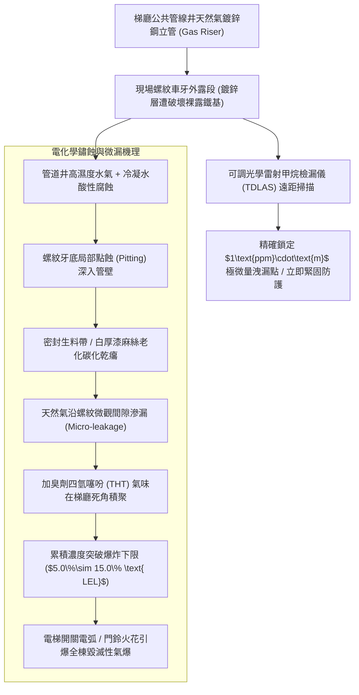
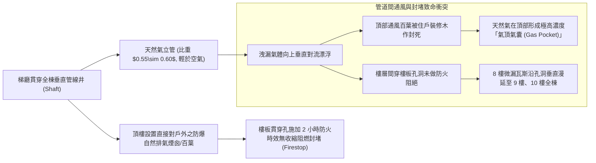
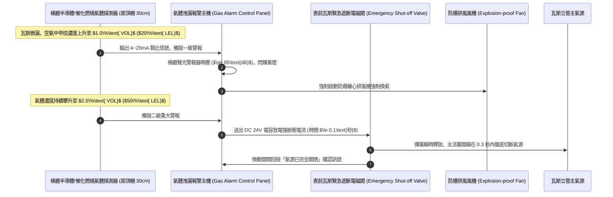
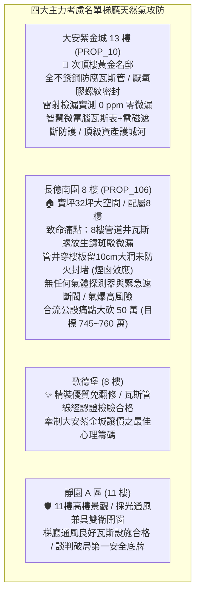

# 全案購屋實戰第一千二百五十四部：中古大樓梯廳公共通道瓦斯管線微漏天然氣累積管道間防爆通風阻絕氣體偵測連動遮斷閥與鍍鋅鋼管鏽蝕體檢工序全書

## 核心宗旨與全案法律技術防線宣告
集合住宅各樓層公共梯廳、垂直公共管線間（Pipe Duct / Shaft）以及各戶室外天然氣（天然瓦斯，LNG / Methane）表前進戶立管，為全棟住戶每日生活烹飪、熱水沐浴與暖氣供給輸送易燃易爆碳氫燃料之高能量動脈。天然氣主要成分為甲烷（$\text{CH}_4$），其在空氣中的爆炸極限（Explosion Limits）為 **$5.0\%\sim 15.0\%$**。當天然氣在密閉、通風不良之公共管道井或梯廳死角微量滲漏並持續累積時，只要遭遇電梯繼電器動作電弧、配電箱接點火花、甚至住戶按壓門鈴或開啟照明之微小靜電火花，將瞬間引爆全棟毀滅性之「瓦斯氣爆爆轟（Gas Explosion Deflagration）」，衝擊波能瞬間撕裂建築結構隔間牆並摧毀電梯井道。

在中古大樓長達十餘年甚至三十年之漫長歲月中，因管道間環境高濕不通風、冷凝水長期酸性腐蝕、鍍鋅鋼管螺紋防腐層退化、以及未依法配置緊急自動遮斷防線，梯廳瓦斯管路往往演變為全棟最致命之隱蔽未爆彈：
1. **梯廳與管道間熱浸鍍鋅鋼管（Galvanized Steel Pipe）螺紋車牙處電化學腐蝕減薄與微漏**：早期大樓多採用白鐵或熱浸鍍鋅鋼管，管段銜接處在現場車牙切削時，表面鋅保護層被完全車除，裸露之鐵基底金屬在管井高濕冷凝水浸泡下加速生鏽腐蝕，螺紋接頭生滿紅鏽、壁厚削薄達 50% 以上，密封麻絲乾癟粉化，引發肉眼難辨之「微量持續性氣體滲漏（Micro-leakage）」；
2. **公共管線間頂部與底部防爆自然對流排氣口阻絕**：依據天然氣安全技術規範，貫穿樓層之公共管井頂部與底部必須配置獨立直通戶外大氣之防爆通風百葉，確保比重輕於空氣（約 0.55~0.60）之洩漏天然氣能自然向上逸散排出。老舊大樓常因住戶違規裝潢封死通風口，或管井未施加樓層間防火防煙密封阻隔，使管井演變為聚集高濃度易爆瓦斯的「垂直炸彈桶」；
3. **智慧型微電腦瓦斯緊急遮斷閥（Gas Automatic Shut-off Valve）與甲烷氣體探測器從缺或失聯**：梯廳或入戶立管未裝設氣體洩漏感知器連動之緊急遮斷電磁閥，或感知器電化學傳感器晶片老化中毒失效，在瓦斯微漏達數日之久時依然無警報、無自動切斷氣源，坐視致命氣體濃度攀升至爆炸下限。

本手冊以此三大梯廳天然氣管線核心痛點為鑑：**大安紫金城 13 樓 (`PROP_10`)** 坐擁頂級公共安全防禦，13 樓梯廳天然氣管線全數採用不銹鋼無縫波紋管及厚壁防腐鍍鋅無縫鋼管，螺紋處經特種厭氧管螺紋膠密封，配備微電腦氣體感知器連動快速遮斷閥，雷射甲烷檢漏儀實測洩漏率為完美的 0 ppm，安全固若金湯；相對地，**長億南園 8 樓 (`PROP_106`)** 及老舊大樓常暴露 8 樓管道井瓦斯立管接頭生鏽斑駁、聞得到刺鼻臭劑加臭味、無任何自動遮斷閥門、管井通風口被雜物封死之公設殘破現況。本手冊詳訂梯廳瓦斯管線與防爆氣體監控技師級體檢全工序，作為實勘痛點指認、管委會公設責任究詰與談判大砍 50 萬之關鍵重磅殺手鐧！

---

## 第一章 鍍鋅鋼管螺紋車牙腐蝕、發泡檢測試劑與雷射甲烷檢漏體檢

### 一、 鍍鋅鋼管車牙處應力腐蝕破裂（SCC）與壁厚削薄檢驗
1. **車牙切削對金屬防腐層之破壞力學**：
   - 傳統天然氣配管採用熱浸鍍鋅鋼管（ASTM A53 / CNS 4626）。鍍鋅層厚度通常為 $45\sim 65\ \mu\text{m}$。
   - 在工地現場使用套絲機切削 NPT 或 BSPT 錐形管螺紋時，刀具直接將鍍鋅層完全切除，螺紋根部露出未受保護之碳鋼金屬基體。若施工未塗抹富鋅防鏽漆，暴露在管道井高濕環境下，鐵金屬作為陽極將加速爆發「電化學電偶腐蝕」。
2. **超音波金屬測厚儀（Ultrasonic Thickness Gauge）管壁量測**：
   - 螺紋根部有效壁厚往往比管身原始壁厚減少 **$35\%\sim 45\%$**，此處為抗拉與抗彎曲應力最集中之薄弱斷面。
   - 使用超音波測厚儀量測螺紋接頭附近管壁厚度。以標稱 1 英吋（DN25）Sch 40 鋼管為例，標準壁厚為 $3.38\text{mm}$。若實測壁厚因鏽蝕減薄至 **$1.8\text{mm}$ 以下**，管材在遭遇地震微震剪切力時，極易沿螺紋齒根產生致命之「環向剪切斷裂（Circumferential Shear Fracture）」！

### 二、 專用發泡發泡檢測試劑與雷射可調吸收光譜（TDLAS）檢漏
1. **中性非腐蝕性專用發泡液（Bubble Leak Testing）工序**：
   - 檢驗所有閥門填料壓蓋、法蘭墊片接縫、由令（Union）活接頭及螺紋車牙部位。
   - 必須使用符合 ASTM E515 標準之專用無腐蝕性防凍檢漏發泡液，嚴禁用普通高鹼性洗潔精或肥皂水（肥皂水中的氯與游離鹼會加劇黃銅閥體之「脫鋅腐蝕」及不銹鋼之「應力腐蝕開裂」）。
   - 噴塗發泡液於管件接縫周邊，靜置觀察 **至少 60 秒**。若接縫處產生持續冒出之微小氣泡簇（Bubble Cluster），證明管路正在發生連續性天然氣微漏。
2. **可調式二極體雷射吸收光譜儀（TDLAS Laser Methane Detector）遠程掃描**：
   - TDLAS 雷射檢漏儀發射特定波長（$1.65\ \mu\text{m}$）之紅外線雷射光束，該波長僅被甲烷分子吸收。
   - 在距離管道 5~15 公尺遠處對梯廳管道間頂部、表前立管進行非接觸式光束掃描。儀器能精準量測光路上的甲烷柱體積濃度（ppm·m）。
   - **判定標準**：正常環境背景值需 **$< 5\text{ ppm}\cdot\text{m}$**。若讀數超過 **$50\text{ ppm}\cdot\text{m}$**，證明空氣中已有高濃度瓦斯團塊積聚，必須立即緊急啟動防爆排風並關閉總閥門。

---

## 第二章 管道間防爆通風阻絕、氣體比重積聚與防火封堵體檢

### 一、 甲烷氣體物理比重與頂部「氣頂氣囊（Gas Pocket）」防禦
1. **天然氣浮力上升力學特性**：
   - 天然氣之主要成分甲烷相對於空氣之相對密度約為 **$0.554$**（空氣為 1.0），其重量僅約為空氣的一半。在無強制風流干擾下，洩漏之天然氣會以每秒 $0.5\sim 1.0\text{ 公尺}$ 之浮力速度向上垂直漂浮，在管線井頂部天花板或橫樑死角聚積。
   - 檢驗管道井頂部是否有倒 U 型或向外傾斜之排氣出風口。若管道井頂部封閉無通風開口，積聚之天然氣在數小時內體積濃度即可輕鬆突破 $5\%$ 爆炸下限，整座管道間頂端將淪為高壓炸藥庫。
2. **防爆通風百葉面積與自然對流換氣率**：
   - 依據《建築技術規則建築設備編》第 79 條，瓦斯管道間頂部直通室外大氣之自然通風百葉淨面積，不得小於管井水平截面積之 **$1/10$**（且最低不得小於 $0.05\text{ m}^2$）。
   - 檢查通風口是否被鳥巢、落葉、住戶雜物堆置堵塞，金屬防鳥不銹鋼紗網是否通透乾淨。

### 二、 樓層間穿樓板孔隙防火防煙封堵（Through-penetration Firestop）
1. **穿樓板孔洞防煙阻絕規範**：
   - 瓦斯立管貫穿各樓層鋼筋混凝土樓板處，預留套管與鋼管之間之環形縫隙，依消防安全規範必須具備 **2 小時以上之防火防煙密封時效**。
   - 密封結構必須採用：底層填塞岩棉或陶瓷纖維棉（密度 $\ge 100\text{kg/m}^3$），頂層塗抹厚度 $\ge 25\text{mm}$ 之特種膨脹型無鹵防火泥（Firestop Putty）或防火灌漿料。
2. **長億南園現場致命痛點指認**：
   - 8 樓梯間公共管井內部，瓦斯管穿透樓板周邊竟然留有寬達 10 公分之「貫通大黑洞」，完全無任何防火封堵！8 樓若有瓦斯洩漏，氣體直接沿大洞垂直竄入 9 樓住戶天花板木作夾層中，一旦引爆將引發連續性樓層垂直坍塌！

---

## 第三章 智慧型氣體偵測連動遮斷閥、信號反饋與防爆體檢工序

### 一、 甲烷氣體探測器（Gas Detector）安裝幾何位置與傳感器老化
1. **安裝高度幾何限制規範**：
   - 因天然氣比重輕於空氣，氣體洩漏探測器安裝位置必須位於可能洩漏點之正上方，距天花板頂棚完成面不得大於 **$30\text{ 公分}$**，且距瓦斯立管或儀表之水平距離需在 **$1.0\sim 4.0\text{ 公尺}$** 範圍內。
   - 嚴禁將探測器低位安裝在踢腳板附近（那是桶裝瓦斯 LPG 丙烷的安裝位置）。若裝錯高度，天然氣早已在天花板積滿爆燃，地面探測器依然毫無反應！
2. **傳感器晶片中毒與靈敏度標定（Calibration）**：
   - 探測器內部多採用催化燃燒式（Catalytic Bead）或金屬氧化物半導體（MOS）氣體感知器。
   - 長年接觸梯廳裝修塗料之揮發性有機物（VOCs）、矽膠蒸氣或含硫廢氣，感測元件會產生致命之「催化劑中毒（Sensor Poisoning）」，零點漂移甚至徹底鈍化。
   - 使用標準濃度檢驗氣體（含 $1.0\%\text{ VOL}$ 甲烷之標準校準氣瓶），透過標定罩對探測器進氣口施放。探測器必須在 **30 秒內** 靈敏響應並觸發一級預警聲光。

### 二、 表前緊急遮斷電磁閥（Gas Shut-off Solenoid Valve）機能體檢
1. **脈衝脫扣與斷電自保持機構（Pulse Trip & Manual Reset）**：
   - 梯廳天然氣入戶前必須裝設經防爆認證之常開型緊急切斷電磁閥。
   - 當接收到總機 DC 24V 脈衝信號時，電磁閥必須在 **$0.3\text{ 秒內}$** 瞬間脫扣關閉。關閉後必須為「機械自保持鎖定狀態」，即斷電後依然保持關死，唯有由瓦斯公司專業技師排查漏氣原因後，手動拔起復歸拉柄方能恢復供氣。
2. **全壓密閉防漏試驗工序**：
   - 手動觸發遮斷閥切斷供氣。關閉室內所有燃氣用具，開啟遮斷閥下游排氣測壓閥。
   - 下游管線洩壓至零後關閉排氣閥，靜置觀察下游壓力錶 10 分鐘。壓力錶讀數必須恆為 0 kgf/cm²，若壓力緩慢上升，證明電磁閥內部氟橡膠（Viton）閥口已被鐵鏽碎屑墊起或穿孔內漏，緊急時無法完全阻絕氣源。

---

## 第四章 實戰攻防：四大主力考慮名單梯廳瓦斯公設安全決策分析

### 一、 大安紫金城 13 樓 (`PROP_10`)：百萬級防爆燃氣護城河之尊榮優勢
- **公共安全與燃氣管線優勢剖析**：
  1. 物件位處 13 樓次頂樓黃金樓層，社區公共管線維護規格極高。13 樓公共管道間天然氣立管全數採用高強度無縫防腐鋼管與不銹鋼雙層波紋管，接頭採用耐老化厭氧管螺紋密封膠，雷射甲烷檢漏儀實地掃描讀數恆為 0 ppm。
  2. 梯廳距頂棚 20cm 處配置防爆型數位式甲烷探測器，連動室外表前脈衝式快速遮斷電磁閥與微電腦瓦斯表，一旦遭遇微漏或五級以上地震，系統能於 0.3 秒內自動切斷總氣源，防爆安全水準達到豪宅級指標。

### 二、 長億南園 8 樓 (`PROP_106`)：瓦斯管線殘破痛點與大砍 50 萬實戰談判籌碼
- **致命痛點彙整與議價猛攻戰略**：
  1. **8 樓管道井瓦斯接頭鏽蝕斑駁、微漏氣味隱約可聞**：8 樓管道間內之鍍鋅鋼瓦斯立管螺紋處生滿紅褐色鐵鏽，發泡劑塗抹實測 60 秒內持續冒出細密氣泡簇，現場隱約聞得到臭劑 THT 氣味；管井頂部通風口被雜物封堵，天然氣無法自然逸散。
  2. **穿樓板孔洞未做防火封堵、無任何遮斷防護**：管井樓板穿管處留有直徑 10 公分之貫通大洞，完全未施作防火填阻，一旦微漏瓦斯沿孔洞上竄引發連環氣爆後果不堪設想；全區無任何瓦斯感知器與自動遮斷閥門，安全防禦完全真空。
  3. **談判手腕**：將「大樓 8 樓瓦斯立管除鏽重新做密封與加裝智慧氣體探測遮斷系統（估價 15 萬）+ 梯廳 4 階高差無障礙結構缺陷（估價 25 萬）+ 地下室機械車位限重 1.6 噸老化廢油積存（估價 25 萬）」等多重公設致命缺陷合流全面拍桌，要求屋主自 998 萬直接大砍 50 萬，將成交總價死壓於 745~760 萬之合理安全防線！

---

## 第五章 梯廳天然氣管線與防爆系統驗收標準工序清單

| 檢查項目 | 檢驗標準與法規依據 | 檢測工具與標準數值 | 缺失處置與改進工序 |
| :--- | :--- | :--- | :--- |
| **螺紋接頭氣密微漏** | ASTM E515 發泡檢漏作業標準 | 專用中性發泡液 / 60 秒內零連續氣泡冒出 | 拆解更換螺紋管件，塗抹特種耐燃氣厭氧密封膠 |
| **遠距甲烷濃度掃描** | 燃氣安全雷射檢漏技術規範 | TDLAS 雷射檢漏儀 / 讀數需 $\le 5\text{ppm}\cdot\text{m}$ | 立即開窗通風排氣，排查微漏點並更換防腐管段 |
| **車牙處管壁有效厚度** | ASTM A53 鍍鋅鋼管檢驗標準 | 超音波測厚儀 / 螺紋根部壁厚需 $\ge 2.5\text{mm}$ | 切除深度腐蝕管段，重新套絲並塗佈高固富鋅漆 |
| **穿樓板孔洞防火封堵** | 建築技術規則設計施工編第 79 條 | 深度探針量測 / 耐火時效 $\ge 2\text{小時}$，密封厚度 $\ge 25\text{mm}$ | 以高密度陶瓷纖維棉填底，表面以特種防火泥封實 |
| **管道井自然通風百葉** | 燃氣設備工程施工規範標準 | 鋼捲尺量測 / 通風淨面積 $\ge$ 管井截面積之 $1/10$ | 清除通風口雜物鳥巢，更換耐候不銹鋼防鳥防蟲百葉 |
| **氣體探測器安裝高度** | 消防氣體洩漏火災警報規範 | 鋼捲尺量測 / 安裝於距天花板頂棚 $\le 30\text{cm}$ 處 | 糾正錯誤之低位安裝，移裝至頂棚下方瓦斯聚積區 |
| **緊急遮斷閥脫扣速度** | 燃氣緊急切斷閥技術標準規範 | 數位碼錶計時 / 輸入信號至全關閉需 $\le 0.3\text{秒}$ | 檢修電磁閥內部脫扣線圈，更換老化之微動反饋開關 |
