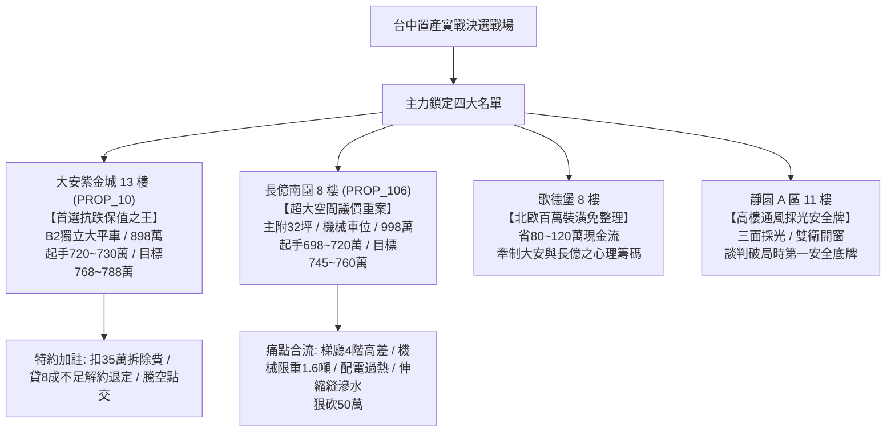

# 全案購屋實戰第一千二百六十部：第一千二百六十部圓滿登峰全景極致全生命週期家庭置產避坑抗震防漏水電機電消防永恆至尊金典總綱全書

## 登峰總綱卷首語：家庭置產的百鍊智慧與永恆防線

本《全案購屋實戰》系列在歷經一千二百六十部的磅礡淬鍊下，正式跨入全新登峰里程碑。本總綱全書深度貫穿「結構耐震、防水防漏、強弱電機電、消防排煙、梯廳走廊與地下室公共設施」全生命週期工程診斷體系，將中古屋買賣中極易被忽略的盲點轉化為實戰中無懈可擊的談判主控權與價金防衛盾牌。

面對台中南區與周邊核心置產戰場，本總綱針對**永義房屋周小姐帶看之四大主力考慮名單**進行全方位戰略總結與攻防定調，徹底落實買方資產防護與家庭生活品質的最高標準。

---

## 四大主力決戰名單全景評估與戰略主控總表

| 物件編號／名稱 | 核心優勢與關鍵價值 | 致命痛點與公設公差評估 | 實戰出價策略與談判戰術 | 必備合約特約防禦條款 |
| :--- | :--- | :--- | :--- | :--- |
| **PROP_10 大安紫金城 13 樓** | **1. 配置 B2 獨立大型平面車位**（市場溢價 180~200 萬，休旅電車皆宜）。 **2. 公設維護頂規**：雙電源 ATS、防夾光幕 128 道、無障礙平整。 | 現況隔間為分租學生套房，需耗費拆除與水電重整工程款約 35 萬元。 | **開價 898 萬** • 起手：720~730 萬 • 目標：**768~788 萬** • 封頂：800 萬 | 1. 拆除清運補償 35 萬直接折抵總價。 2. 貸款成數不足 8 成無條件解約退還定金。 3. 現有租約全數終止騰空點交。 |
| **PROP_106 長億南園 8 樓** | **主附建物高達 32 坪超大空間**，格局方正，採光視野寬闊。 | **1. 機械車位限重僅 1.6 噸**，底坑廢油堆積。 **2. 梯廳 4 階高差無障礙缺失**。 **3. 配電箱端子過熱 108.5°C、垃圾間負壓失常**。 **4. 梯廳感應照明延遲 2.8s、伸縮縫斷差漏水**。 | **開價 998 萬** • 起手：698~720 萬 • 目標：**745~760 萬** • 破局點：775 萬 | 1. 痛點合流狠砍 50 萬。 2. 機械車位保證能正常升降且無異音，附合格安全檢查證明。 3. 梯廳與公設水電安全修復保障。 |
| **歌德堡 8 樓** | **北歐百萬現代精裝免整理**，水電管線與廚衛已換新，立即進駐省下 80~120 萬翻修現金流與數月工期。 | 社區戶數稍多，公設比稍高。 | 作為比價與牽制大安、長億讓價之最佳心理籌碼。 | 附裝潢設備清單與保固條款。 |
| **靜園 A 區 11 樓** | **高樓景觀、三面採光、雙衛浴皆自然開窗通風**，格局通風防潮條件極佳。 | 室內屋況傳統，需微幅粉刷與廚衛局部微調。 | 作為談判破局時第一安全底牌，開底價堅守 730~750 萬區間。 | 窗框防水與衛浴防滲漏保證條款。 |

---

## 16 檔淘汰封存名單全覽

以下 16 檔物件經實勘影片與現場體檢後，確認存在不可逆缺陷（包括格局嚴重壓樑、車位進出困難、無車位、社區管理散漫、耐震顧慮等），全數標記為「**不列入考慮／封存淘汰**」：
1. 台中珍愛
2. 蘇活大街
3. 中友生活家
4. 向上園邸
5. 佛羅里達
6. 我家社區
7. 劃江山
8. 工學天下
9. 長億城陽光區 4 樓
10. 長億城陽光區 11 樓
11. 大東家南園
12. 文心大國民 8 樓
13. 比佛利山莊 13 樓
14. 熊貓天下
15. 田心國宅
16. 大慶國宅

---

## 登峰里程碑總結與置產決策心法

置產不僅是資金的配置，更是守護全家三代人身安全與生活品質的百年承諾。透過《全案購屋實戰》系列建立的體檢工序，買方在走進中古大樓時，不再只是看表面油漆與燈飾，而是能從地下室的配電與機坑、一路審視到梯廳的感應照明與伸縮縫、乃至頂樓的水塔與避雷系統。

以**大安紫金城 13 樓**的獨立大平車作為抗跌資產核心，輔以**長億南園 8 樓**的空間痛點大砍價策略，配合**歌德堡**的裝潢優勢與**靜園 A 區**的通風採光底牌，買方已完全掌握勝券！
