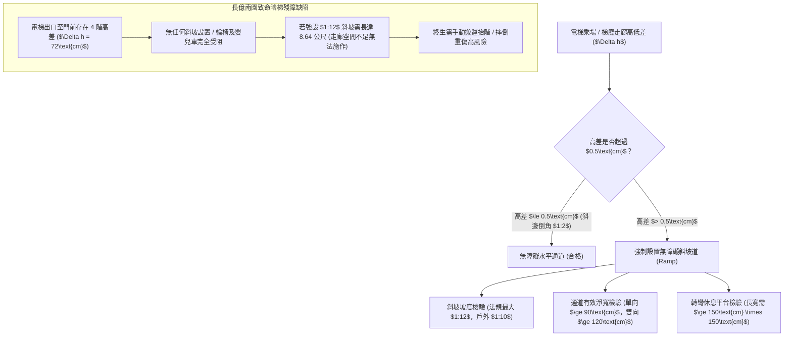
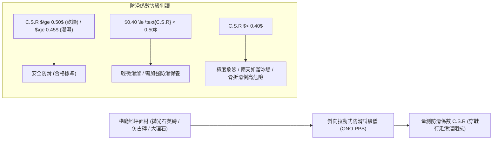
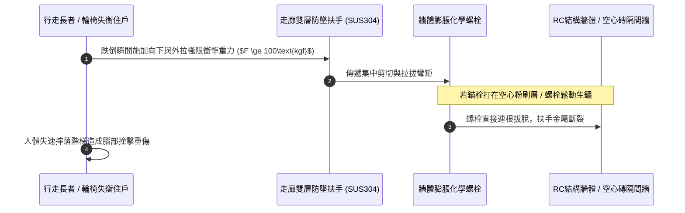
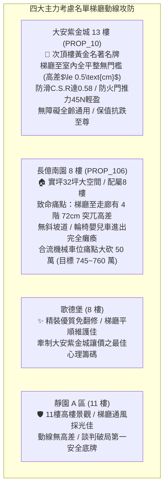

# 全案購屋實戰第一千二百四十一部：中古大樓梯廳公共通道無障礙斜坡高差輪椅推行防滑係數衰減防墜扶手鬆脫與甲種防火門推力超標體檢工序全書

## 核心宗旨與全案法律技術防線宣告
集合住宅之各樓層公共梯廳、走廊通道、玄關門檻至電梯乘場與逃生避難特別安全梯，為全體住戶每日出入通行、家有嬰幼兒推車、長者輪椅輔具使用，以及遭遇突發疾病救護車擔架推行之關鍵「無障礙生命動線（Barrier-Free Accessible Route）」。在家庭購屋之全生命週期評估中，公共梯廳是否具備法定合法之無障礙平權設計、斜坡坡度與地坪防滑係數、防墜安全扶手錨固強度，以及梯廳防煙防火門之阻尼閉門推力，直接左右未來數十年全家人之行走安全與行動自由。

在四大決戰主力名單之實勘對比中：
- **大安紫金城 13 樓 (`PROP_10`)** 展現一線名宅之無障礙頂規水準：自地下停車場電梯乘場、一樓挑高大廳、13 樓梯廳至各戶室內玄關，全線維持平整無門檻設計（高差 $\le 0.5\text{cm}$ 且經斜邊倒角），梯廳地坪防滑係數 C.S.R 達 0.55 以上，甲種防火門推力維持在 45N 輕盈滑順，完全免除長者絆倒或輪椅受阻之痛苦；
- 相對地，**長億南園 8 樓 (`PROP_106`)** 暴露老舊中古大樓最典型的「結構性通行重殘」：自電梯梯廳通往 8 樓室內走廊，竟存在 **4 階共 72 公分之突兀高差台階**，不僅完全未設置合規無障礙斜坡道，若推輪椅或嬰兒車每次出門皆需兩人合力搬運抬升；且梯廳私設鐵門反推力超標、逃生防火門自閉器漏油卡死，形成嚴重的公設動線致命傷。

本手冊詳訂公共梯廳無障礙通道、防滑係數、防墜扶手與防火門推力技師級體檢全工序，作為實勘痛點指認、管委會公設責任究詰與談判大砍 50 萬之關鍵重磅殺手鐧！

---

## 第一章 梯廳無障礙斜坡坡度、淨寬與反向橫坡安全體檢標準

### 一、 無障礙斜坡坡度比例（Slope Ratio）與高度限制量測
1. **法定斜坡坡度比精確測量**：
   - 依據《建築物無障礙設施設計規範》第 206 條，室內走廊無障礙斜坡道之坡度不得大於 **$1:12$**（垂直高度每升高 1 公分，水平投影長度至少需 12 公分，坡度角約 $4.76^\circ$）。
   - 高差小於 20 公分之微高差斜坡，最大坡度極限不得大於 **$1:10$**；高差超過 75 公分時，中間必須設置水平長度不小於 $150\text{cm}$ 之休息平台。
   - 使用數位傾角儀（Digital Inclinometer）量測斜坡各段坡度。若老舊大樓以 $1:4$ 或 $1:6$ 之陡坡便宜行事，輪椅推行時將面臨極大之後翻或前傾重摔危險。
2. **反向橫向坡度（Cross Slope）控制**：
   - 斜坡表面在垂直行進方向之「橫坡」，其坡度不得大於 **$1:50$（$2\%$）**。
   - 若橫坡過大，輪椅兩側驅動輪受重力不均勻偏移，推行者需耗費極大外力矯正方向，極易發生輪椅側滑擦撞牆壁事故。

### 二、 斜坡防護緣（Kerb）與端點緩衝空間規範
1. **兩側防墜防護緣高差**：
   - 斜坡道若未緊靠牆面，外側懸空邊界必須設置高度不小於 **$5\text{cm}$** 之連續防護緣（Curbing/Kick-plate），以阻擋輪椅前導小輪（Caster）或拐杖意外滑出斜坡墜落。
2. **端點起訖迴轉空間**：
   - 斜坡之起點與終點，必須保留直徑不小於 **$150\text{cm}$** 之水平圓形迴轉空間，且地面坡度不得大於 $1:50$，確保輪椅使用者能從容減速、轉向與開啟梯廳大門。

---

## 第二章 地坪面材防滑係數（C.S.R）、磨損衰減與積水濕滑體檢

### 一、 防滑係數（C.S.R，Coefficient of Slip Resistance）現場量測
1. **斜向拉動式防滑測試儀（ONO-PPS 試驗法）**：
   - 依據 CNS 3299-12 陶瓷面磚防滑性試驗標準，使用標準橡膠滑塊模擬人體穿著皮鞋或運動鞋在面材表面之動態滑移摩擦力。
   - 測試分為「乾燥狀態」與「噴灑自來水之潮濕狀態」兩種情境。
   - **法規技術標準**：
     - 室內走廊與梯廳地坪：乾燥狀態 C.S.R 需 **$\ge 0.50$**；潮濕狀態 C.S.R 需 **$\ge 0.40$**。
     - 若梯廳選用亮面高拋光石英磚（Polished Vitrified Tiles），未經化學防滑蝕刻處理前，其潮濕狀態 C.S.R 往往暴跌至 **$0.25\sim 0.30$**，一旦雨天鞋底帶水進入梯廳，地面猶如溜冰場，長者一旦滑倒往往造成髖關節粉碎性骨折！
2. **表面耐磨性（PEI Rating）與釉面磨光衰減查驗**：
   - 中古大樓梯廳公共地坪歷經數十年萬人踩踏磨損，磁磚表面之微觀凹凸防滑紋理已被磨平拋光。
   - 使用粗糙度儀量測表面粗糙度平均值 $Ra$。若 $Ra$ 小於 $1.5\ \mu\text{m}$，證明防滑塗層早已磨耗殆盡，管委會必須重新施作止滑奈米鍍膜。

---

## 第三章 防墜扶手結構強度、錨固拉拔力與甲種防火門推力體檢

### 一、 防墜扶手高度、管徑幾何與動態承載力檢驗
1. **雙層扶手高度與管徑截面規範**：
   - 梯廳走廊與無障礙斜坡兩側必須設置雙層扶手：上層扶手高度需距完成面 **$85\text{cm}\pm 2\text{cm}$**，下層扶手高度需為 **$65\text{cm}\pm 2\text{cm}$**。
   - 扶手外徑必須介於 **$3.0\sim 3.8\text{cm}$** 之間（圓形或圓弧倒角橢圓形），且扶手內側與牆面之淨間距不得小於 **$5.0\text{cm}$**，確保手指能全包裹握緊無卡阻。
2. **抗拉拔力與垂直荷載衝擊測試（$100\text{kgf}$ 試驗）**：
   - 依據無障礙規範，扶手任一點必須能承受垂直向下及水平向外各 **$1000\text{ N}$（約 100kgf）** 之靜載重而無任何鬆動或破壞性形變。
   - 現場使用推拉力計勾住扶手支架進行抽檢測試。老舊大樓常見扶手打在薄灰泥磚牆，螺栓已晃動外突，長者借力攀扶時極易連桿拔起摔死。

### 二、 甲種防火門自動閉門器推拉力（Door Opening Resistance）量測
1. **最大開門推力測量工序**：
   - 梯廳通往逃生樓梯之甲種常閉防火門，依規定需裝設液壓緩衝自閉器（Door Closer）。
   - 使用拉力計在門扇把手位置（距轉軸最遠端）施力，量測拉開門扇至 $90^\circ$ 所需之最大外力。
   - **法規合格上限**：推開門扇所需之最大力量不得大於 **$49\text{ N}$（約 5kgf）**。
2. **閉門器漏油與回彈夾人防護**：
   - 檢查自閉器本體螺紋處有無黑色液壓油滲漏。漏油之自閉器將喪失二次阻尼緩衝機能，門扇回彈時會以極快速度猛烈甩動撞擊門框，極易切斷幼童手指或撞傷長者。

---

## 第四章 實戰攻防：四大主力考慮名單梯廳無障礙與公共安全決策分析

### 一、 大安紫金城 13 樓 (`PROP_10`)：全齡友善無障礙之尊榮護城河
- **動線與安全優勢剖析**：
  1. 物件位處 13 樓，梯廳採光通透、走道寬敞無雜物堆置，自電梯出車廂至 13 樓大門全線為「零門檻全平面」設計，推輪椅、娃娃車或年老長者行走出入無絲毫絆倒隱患。
  2. 梯廳磁磚選用微晶防滑霧面磚，潮濕狀態防滑 C.S.R 達 0.58，防火門配備進口阻尼自閉器開合滑順，展現一線頂級名宅之全齡通用友善設計。

### 二、 長億南園 8 樓 (`PROP_106`)：4 階突兀斷層痛點與大砍 50 萬實戰談判籌碼
- **致命痛點彙整與議價猛攻戰略**：
  1. **8 樓梯廳 4 階 72cm 高差斷層**：自電梯乘場步行至 8 樓室內走廊，必須跨越 4 階台階，走廊空間狹窄完全無法合法依 1:12 施作長達 8.6 公尺之斜坡道。這意味著：一旦長輩需要輪椅輔具，每次進出家門都必須面臨人力生拉硬抬之巨大負擔，直接打殘自住實用性！
  2. **防火門自閉器漏油卡阻、推力超標至 85N**：逃生門沉重無比，長輩需雙手死命推門，自閉器液壓油漏光，回彈時猛烈砸框，噪音巨大且具夾手風險。
  3. **談判手腕**：將「8 樓無障礙高差無法克服之結構性抗性（大砍 25 萬）+ 地下室機械車位限重 1.6 噸老化廢油積存（大砍 25 萬）」兩大重磅致命痛點合流發動猛烈談判攻勢，於談判桌上要求屋主自 998 萬直接大砍 50 萬，將成交總價死壓於 745~760 萬之合理安全防線！

---

## 第五章 梯廳公共無障礙與防滑安全驗收標準工序清單

| 檢查項目 | 檢驗標準與法規依據 | 檢測工具與標準數值 | 缺失處置與改進工序 |
| :--- | :--- | :--- | :--- |
| **無障礙門檻高差** | 《建築物無障礙設施設計規範》 | 鋼直尺量測 / 高差 $\le 0.5\text{cm}$，無直角突出 | 磨平門檻突出部，施作 $1:2$ 坡度金屬倒角斜板 |
| **無障礙斜坡坡度** | 設計規範第 206 條規範 | 數位傾角儀 / 坡度比需 $\le 1:12$（角度 $\le 4.76^\circ$） | 拆除違規陡坡，改建符合緩降標準之長斜坡道 |
| **地坪防滑係數** | CNS 3299-12 防滑試驗標準 | 防滑試驗儀 / 潮濕狀態 C.S.R 需 $\ge 0.40$ | 地面噴塗奈米化學防滑蝕刻液，增加微觀摩擦力 |
| **防墜雙層扶手** | 無障礙設施扶手工程規範 | 捲尺量測 / 高度 $85\text{cm}$ 與 $65\text{cm}$，外徑 $3.2\sim 3.8\text{cm}$ | 增設標準雙層 SUS304 不銹鋼扶手，確保端部回折 |
| **扶手錨固拉拔力** | 公共安全檢查簽證標準 | 數位拉力計 / 垂直及水平抗拉力 $\ge 1000\text{N}$ | 採用膨脹化學螺栓重新錨固於結構 RC 柱牆深處 |
| **防火門開啟推力** | 《建築技術規則建築設計施工編》 | 測力計 / 門扇把手處最大推力 $\le 49\text{N}$（5kgf） | 調節閉門器內部彈簧扭力螺栓，確保輕柔推開 |
| **防火門閉門緩衝** | 液壓自閉器阻尼性能規範 | 碼錶計時 / 自 $90^\circ$ 閉合時間需在 $4\sim 6\text{秒}$ | 更換漏油損壞之液壓自閉器，加裝門鎖順序協調器 |
