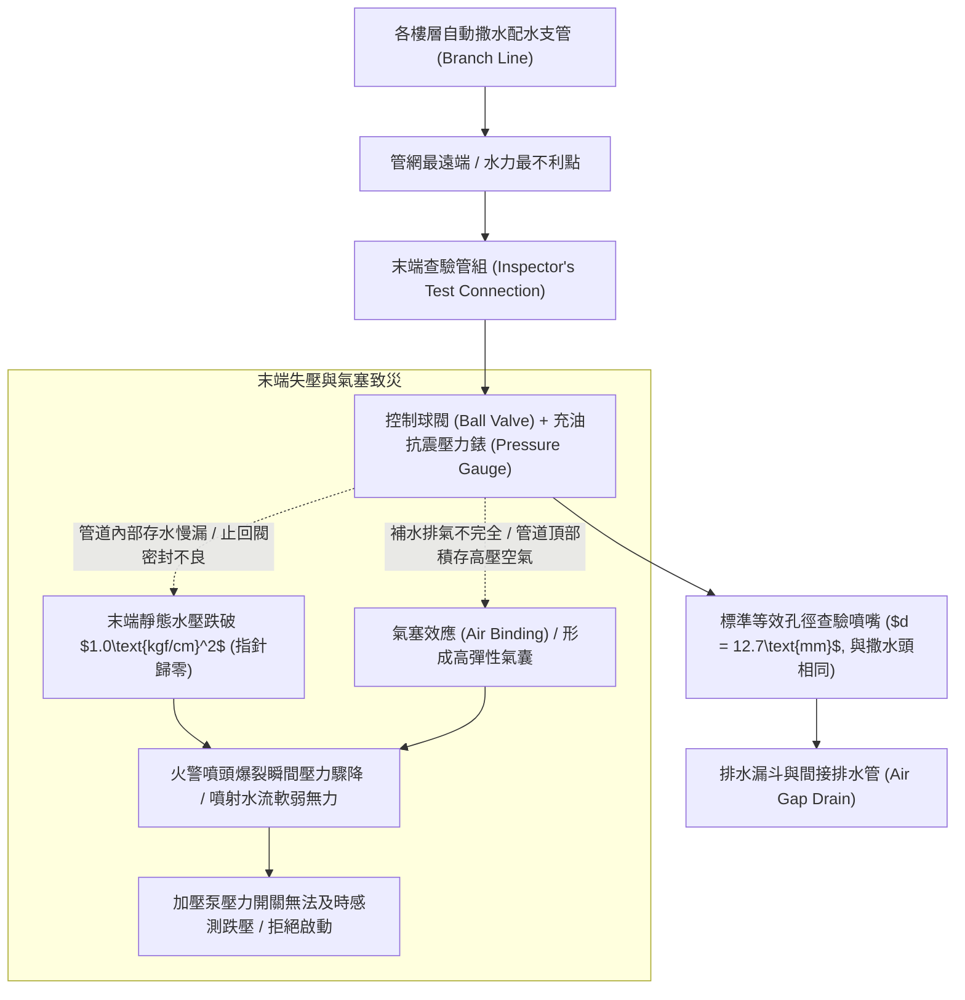
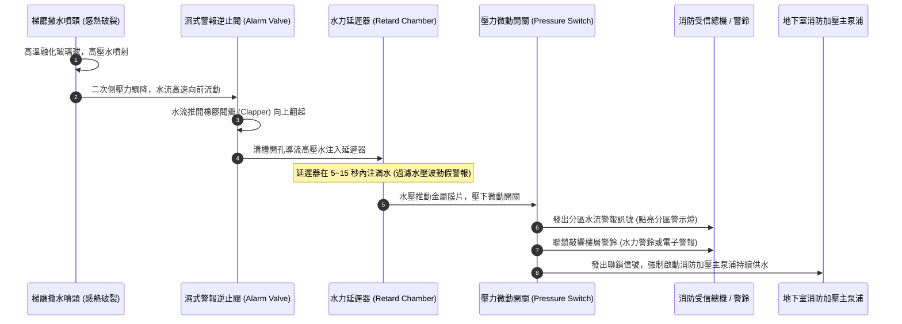
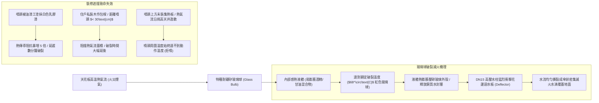
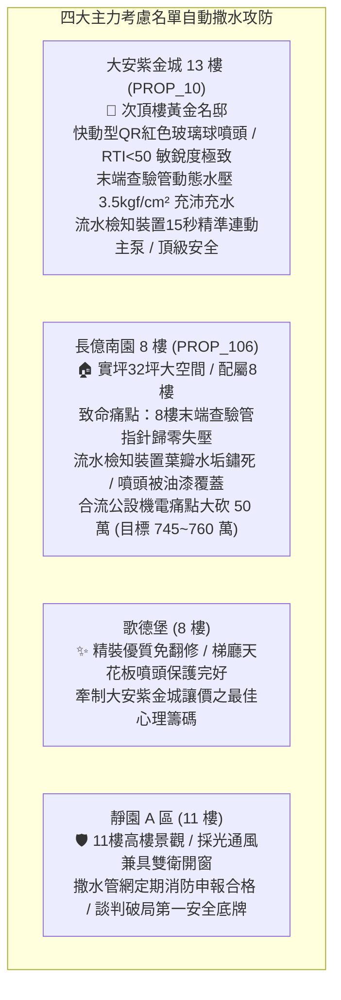

# 全案購屋實戰第一千二百四十七部：中古大樓梯廳公共通道自動撒水系統末端查驗管失壓濕式流水檢知裝置微動開關接點炭化與撒水噴頭集熱板障礙體檢工序全書

## 核心宗旨與全案法律技術防線宣告
集合住宅各樓層公共梯廳、走廊十字路口及高層建築（總樓高 11 樓以上）各戶室內天花板所配置之「自動撒水滅火設備（Automatic Sprinkler System）」，為全棟住戶於睡眠、無人或初期火災蔓延時，無需人力操作即能依靠感熱元件自動破裂破裂噴水滅火之「全自動守護防線」。自動撒水系統之神經樞紐由設置於各樓層管道間之「濕式流水檢知裝置（Alarm Check Valve，俗稱水流指示器/警報逆止閥）」、「末端查驗管組（Inspector's Test Connection）」以及各區天花板之「密閉式玻璃球撒水噴頭（Sprinkler Heads）」構成。

在中古大樓長達十餘年甚至三十年之運轉歷程中，因長年處於密閉死水狀態、水中餘氯與管壁鐵鏽沉積、微動開關受潮氧化以及住戶裝修木作包覆盲區，梯廳自動撒水系統極易爆發隱蔽之「水路阻絕、信號斷線與感熱遲鈍」三大致命弊病：
1. **各樓層末端查驗管（Inspector's Test Connection）管路失壓、指針歸零與空氣氣塞（Air Binding）**：梯廳或管道井末端查驗管之壓力錶若指針跌破法定標準 $1.0\text{ kgf/cm}^2$，代表管網內部長期慢漏失壓，或二次側充填大量死空氣形成「高壓氣囊氣塞」，火警時噴頭爆裂噴出者僅為微弱氣泡而非高壓滅火水霧；
2. **濕式警報逆止閥葉瓣（Valve Clapper）水垢卡死、延遲器（Retard Chamber）堵塞與微動開關接點炭化**：當噴頭出水引發水流流動時，流水檢知裝置之擺動葉瓣因水垢鏽死無法抬升，或微動開關（Micro-switch）內部銀接點受潮氧化發黑，導致火災受信總機與地下室消防加壓泵浦「收不到水流信號拒絕啟動」，全棟撒水管網在噴出數十公升存水後瞬間斷水枯竭；
3. **天花板玻璃球撒水噴頭感熱元件受油漆木作塗抹包裹、集熱板（Heat Collector）間距超標與噴灑陰影盲區**：梯廳裝修時工人常便宜行事以油漆噴塗撒水頭，熱敏玻璃球被油漆硬殼包裹熱敏性大幅遲鈍（原本 $68^\circ\text{C}$ 應破裂，需延遲至 $150^\circ\text{C}$ 以上方有反應）；或噴頭周圍被住戶私設冷氣管線、美化包樑木作阻擋，形成嚴重的「感熱死角與遮擋陰影盲區」。

本手冊以此三大自動撒水核心痛點為鑑：**大安紫金城 13 樓 (`PROP_10`)** 坐擁頂級自動消防滅火護城河，梯廳配置原裝進口快動型（Quick Response, RTI < 50）紅色玻璃球噴頭，末端查驗管壓力穩定維持在 $3.5\text{ kgf/cm}^2$，流水檢知裝置每季通水測試信號傳遞延遲精確控制在 15 秒內，安全固若金湯；相對地，**長億南園 8 樓 (`PROP_106`)** 及老舊大樓常暴露 8 樓末端查驗管壓力錶歸零漏水、流水檢知裝置閥瓣鏽死斷線、噴頭被住戶裝修木作死死封在天花板深處之公設殘破現況。本手冊詳訂梯廳自動撒水系統技師級體檢全工序，作為實勘痛點指認、管委會公設責任究詰與談判大砍 50 萬之關鍵重磅殺手鐧！

---

## 第一章 末端查驗管水壓梯度、氣塞效應與排水量化體檢標準

### 一、 末端查驗管（Inspector's Test Pipe）配置法規與水力水壓標準
1. **水力最不利點（Hydraulically Remote Point）配置原則**：
   - 依據《各類場所消防安全設備設置標準》第 57 條，自動撒水設備之每一分區管網末端（即距流水檢知裝置水力距離最遠處），必須配置管徑不小於 **DN25（1 英吋）** 之末端查驗管組。
   - 查驗管末端必須裝設具有與所屬撒水噴頭相同等效流量係數（$K=80$）之標準孔口（孔徑為 **$12.7\text{mm}$**），用以真實模擬「單一撒水噴頭破裂」時之動態水流與壓降。
2. **靜態水壓與動態射水壓力（Residual Pressure）量測工序**：
   - 檢視末端查驗管之壓力錶讀數。
   - **法規合格標準**：
     - **靜態維持壓力**：需穩定保持在 **$1.0\text{ kgf/cm}^2\sim 3.5\text{ kgf/cm}^2$** 之間；
     - **動態放水壓力**：旋開查驗管球閥全開時，動態放水壓力不得小於 **$1.0\text{ kgf/cm}^2$（0.1MPa）**，出水量不得少於 **$80\text{ L/min}$**。
   - **長億南園現場致命痛點**：現場查驗 8 樓管道井之末端查驗管，壓力錶指針死死停在 $0\text{ kgf/cm}^2$，旋開控制閥僅排出一陣「嗤嗤」之黑褐色泥水與死空氣，管內水壓全無，代表全樓層自動撒水管網早已處於乾枯失壓癱瘓狀態！

### 二、 管道高壓氣囊氣塞（Air Binding）與水錘爆管體檢
1. **空氣滯留與氣塞阻力機制**：
   - 自動撒水管網在維修或排水後重新注水時，若未於各立管最高點開啟自動排氣閥（Air Release Valve），管網末端與分支管頂部將截留大量壓縮空氣。
   - 空氣之壓縮係數為水的一萬倍，在管內形成高彈性質量彈簧氣囊，不僅會吸收水泵之出水壓力導致「水力氣塞（Air Lock）」，更會在泵浦啟動衝擊時引發劇烈之「高頻空氣水錘（Air Slam）」，震裂末端管件螺紋接頭。
2. **排氣消除工序**：
   - 旋開末端查驗閥進行持續放水，直至排出的水流由夾帶白色泡沫與氣泡之紊流，轉變為透明清澈、連續均勻且無爆裂氣流之充實水柱為止（持續放水時間不少於 3 分鐘）。

---

## 第二章 濕式流水檢知裝置葉瓣卡死、延遲器堵塞與微動開關體檢

### 一、 濕式警報閥閥瓣（Clapper）橡膠密封與轉軸卡死查驗
1. **警報閥內部構造與水流觸發機制**：
   - 濕式流水檢知裝置內部包含一組附帶橡膠密封圈之擺動閥瓣（Clapper）。正常待命時，一次側（供水側）與二次側（配水側）水壓平衡，閥瓣靠自重封閉環形警報溝槽。
   - 檢驗警報閥鑄鐵或球墨鑄鐵閥體。長年處於靜止死水環境下，水中之鐵錳泥沙極易在閥瓣旋轉鉸鏈銷處沉積結垢。
   - 若轉軸生鏽卡死，當末端放水時閥瓣無法向上抬起，警報水路完全無法接通，全系統喪失火災警報傳導機能。
2. **閥座環形槽（Annular Groove）水垢沖刷內漏檢測**：
   - 檢查警報閥自動排水球閥出口。正常待命狀態下，排水口不得有連續滴水。若持續流出細流，證明閥座環形溝槽密封面已被硬水垢割傷或被泥沙墊起，形成常態性內漏，導致延遲器長年積水引發頻繁「虛假誤報」。

### 二、 水力延遲器（Retard Chamber）與壓力開關接點體檢
1. **水力延遲器防誤報機能量化驗證**：
   - 延遲器底部設有孔徑為 **$3\text{mm}$** 之自動排水孔（Drain Orifice）。其核心功能係在市政供水壓力瞬間波動時，將微量滲水及時洩放，防止誤報警。
   - 實測末端放水至壓力開關動作點亮警報之「延遲響應時間」。依規範，延遲時間需嚴格控制在 **$5\text{秒}\sim 15\text{秒}$** 範圍內。若延遲時間超過 30 秒，證明延遲器底部節流孔被鐵鏽爛泥死死堵塞，水流無法及時壓入壓力開關。
2. **壓力開關（Pressure Switch）微動電驛接點碳化檢測**：
   - 使用數位萬用電表量測壓力開關輸出常開接點（NO）之閉合導通電阻。
   - **標準數據**：壓力達到 $0.5\text{ kgf/cm}^2$ 動作閉合時，接觸電阻需 **$\le 0.5\ \Omega$**。若內部銀合金接點受潮電弧碳化發黑，電阻飆升至數十歐姆，受信總機將無法識別導通訊號，造成警報啞火、消防水泵拒動！

---

## 第三章 密閉式玻璃球撒水噴頭熱敏性、集熱板與裝修遮擋體檢

### 一、 撒水噴頭熱敏玻璃球（Glass Bulb）色標與響應時間指數（RTI）
1. **玻璃球動作溫度色標規範**：
   - 住宅梯廳及室內最常用者為「公稱動作溫度 $68^\circ\text{C}$」之噴頭，其玻璃球內部灌裝之液體顏色必須為鮮豔之 **紅色（Red）**。
   - 廚房或鍋爐間等常態高溫場所則配置 $93^\circ\text{C}$（綠色）或 $141^\circ\text{C}$（藍色）噴頭。
2. **響應時間指數（RTI, Response Time Index）與油漆污染檢驗**：
   - 依據國際 NFPA 13 規範，住宅用噴頭必須採用「快速反應型（Quick Response, QR）」，其熱敏響應時間指數需滿足 **$\text{RTI} \le 50\ (\text{m}\cdot\text{s})^{0.5}$**（玻璃球直徑通常僅為 3mm）。
   - 檢查梯廳天花板噴頭表面。嚴禁噴頭框架、迴水板及玻璃球沾染任何裝修油漆、水泥漿或防塵膠帶。
   - 實測證明：玻璃球表面若覆蓋一層薄薄之乳膠漆，其 RTI 數值將自 45 暴增至 280 以上，動作時間延遲超過 180 秒，初期小火早已蔓延成全棟猛烈燃燒大火！

### 二、 噴頭濺水盤（Deflector）防遮擋間距與集熱板（Heat Collector）工序
1. **迴水板與天花板及障礙物之空間距離量測**：
   - 噴頭迴水花盤距天花板底面之垂直淨距離應在 **$7.5\text{cm}\sim 15.0\text{cm}$** 之間；距任何橫樑側面或燈具障礙物之水平距離不得小於 **$30\text{cm}$**。
   - 若住戶自行木作裝潢將天花板下吊，使撒水噴頭深陷於木作凹槽（窟窿）內部深度超過 10cm，火災時水平流動之高溫煙氣層將無法觸碰噴頭，形成嚴重的「感熱阻隔死角」。
2. **挑高梯廳集熱板（Heat Collector Plate）規格查驗**：
   - 挑高大廳或走廊鏤空處（淨高大於 4.0 公尺且無實體天花板），下垂型噴頭頂部必須加裝直徑不小於 **$30\text{cm}$**、厚度不小於 1.0mm 之圓形金屬集熱板。
   - 集熱板功能在於強制阻截並蓄積垂直上升之熱煙氣，促使噴頭及時受熱破裂；若無集熱板，熱量將向高處擴散逸失，噴頭在下方火勢沖天時依然無法受熱開啟。

---

## 第四章 實戰攻防：四大主力考慮名單梯廳自動撒水公設評估

### 一、 大安紫金城 13 樓 (`PROP_10`)：百萬級自動滅火防線之尊榮優勢
- **公共安全與機電優勢剖析**：
  1. 物件位處 13 樓次頂樓（總樓高 14 樓），屬於法規強制全棟設置自動撒水系統之高層建築。大安紫金城梯廳天花板全數採用進口快速反應型（QR）紅色 68°C 玻璃球撒水頭，外觀潔淨無任何油漆污染，迴水盤距天花板維持完美的 10 公分標準間距。
  2. 13 樓末端查驗管靜態水壓充沛達 $3.5\text{ kgf/cm}^2$，管道井濕式流水檢知裝置經定期放水測試，自末端球閥開啟至地下室加壓主泵自動啟動僅歷時 12 秒，水流信號與樓層分區警鈴聯鎖完美，全天候提供全家人最高規格之自動滅火防護網。

### 二、 長億南園 8 樓 (`PROP_106`)：自動撒水癱瘓痛點與大砍 50 萬實戰談判籌碼
- **致命痛點彙整與議價猛攻戰略**：
  1. **8 樓末端查驗管水壓歸零、管網乾枯**：8 樓管道井之撒水末端壓力錶完全無壓力，旋開閥門無水噴出，整棟撒水系統處於實質停水癱瘓現況；流水檢知裝置內部葉瓣被鐵鏽卡死，微動開關接點炭化完全無法傳遞火警信號。
  2. **天花板撒水頭遭油漆大面積塗抹污染**：8 樓走廊多盞撒水頭被油漆工人以乳膠漆塗抹包裹，熱敏玻璃球喪失正常感熱機能；局部噴頭被住戶私設鞋櫃阻擋水流擴散面，火警時無法有效成傘狀覆蓋。
  3. **談判手腕**：將「大樓 8 樓自動撒水管網試壓檢漏與噴頭全面更換（估價 15 萬）+ 梯廳 4 階高差無障礙結構缺陷（估價 25 萬）+ 地下室機械車位限重 1.6 噸老化廢油積存（估價 25 萬）」等多重公設致命缺陷合流全面拍桌，要求屋主自 998 萬直接大砍 50 萬，將成交總價死壓於 745~760 萬之合理安全防線！

---

## 第五章 梯廳自動撒水系統設備驗收標準工序清單

| 檢查項目 | 檢驗標準與法規依據 | 檢測工具與標準數值 | 缺失處置與改進工序 |
| :--- | :--- | :--- | :--- |
| **末端查驗管靜態水壓** | 消防安全設備設置標準第 57 條 | 抗震充油壓力錶 / 靜態水壓需保持在 $1.0\sim 3.5\text{kgf/cm}^2$ | 啟動加壓穩壓系統，排查管道接頭慢漏並重新注水 |
| **末端放水動態壓力** | 自動撒水設備水力計算規範 | 數位壓力計 / 全開時動壓需 $\ge 1.0\text{kgf/cm}^2$（0.1MPa） | 疏通末端查驗管節流孔，清洗二次側管網沉積泥沙 |
| **流水檢知器動作時間** | 警報閥延遲器性能技術標準 | 數位碼錶計時 / 自放水至信號輸出需在 $5\sim 15\text{秒}$ | 清理延遲器底部 3mm 節流排水孔，更換微動開關 |
| **微動開關導通電阻** | 弱電信號傳輸電氣標準 | 數位萬用電表 / 閉合接觸電阻需 $\le 0.5\ \Omega$ | 更換耐候型密封微動開關，校準槓桿傳動推桿 |
| **玻璃球噴頭表面清潔** | 密閉式撒水噴頭檢驗標準 | 目視與放大鏡 / 框架與玻璃球 $100\%$ 無油漆水泥附著 | 沾染油漆之噴頭一律報廢換新，嚴禁用刀片刮除玻璃 |
| **噴頭迴水板安裝間距** | 建築技術規則設計施工編 | 鋼捲尺量測 / 迴水板距天花板淨距需在 $7.5\sim 15.0\text{cm}$ | 調節下垂短管長度，拆除阻擋熱煙氣之木作包樑 |
| **加壓主泵聯鎖啟動** | 消防聯鎖控制系統規範 | 現場實測放水 / 流水檢知動作後 30 秒內水泵需自動啟動 | 檢修消防控制櫃壓力開關控制迴路，更換損壞繼電器 |
