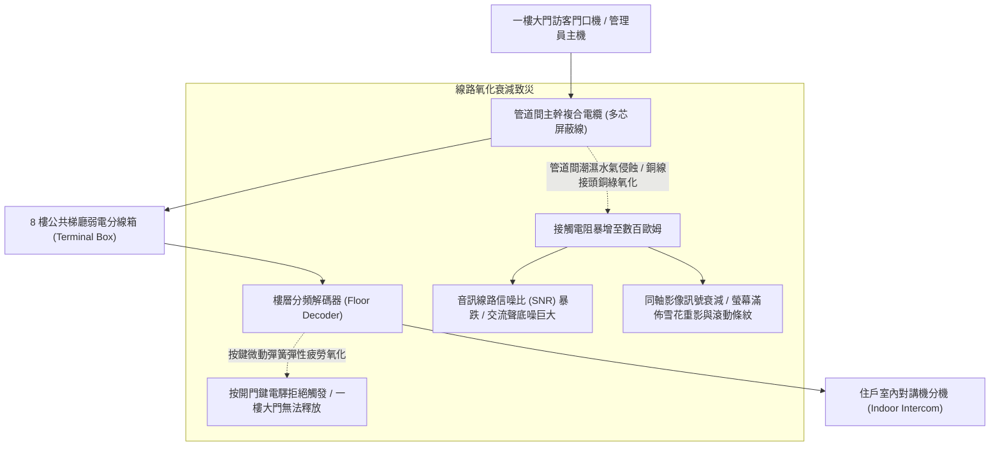
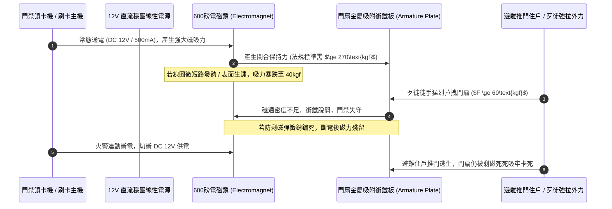
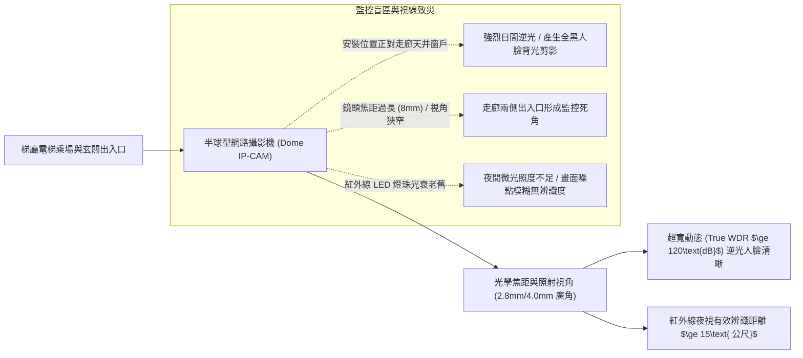
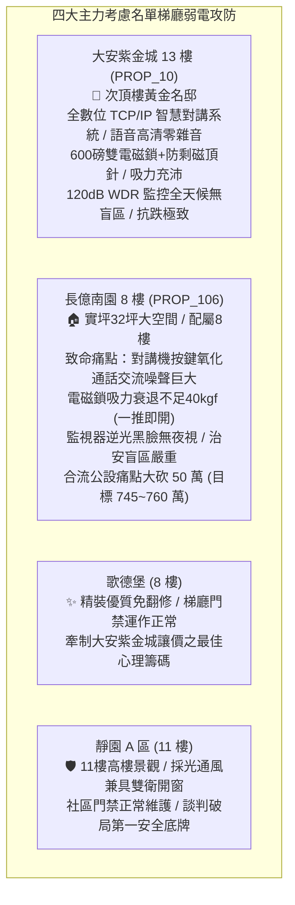

# 全案購屋實戰第一千二百四十三部：中古大樓梯廳公共通道大樓對講機分機線路氧化雜音訊號衰減門禁電磁鎖吸力衰退與訪客防盜監控盲區體檢工序全書

## 核心宗旨與全案法律技術防線宣告
集合住宅各樓層公共梯廳、入戶門玄關與管理室中控中心之間之「大樓對講機系統（Intercom System）」與「梯廳門禁電磁防盜鎖（Magnetic Lock System）」，為全棟住戶每日辨識來訪賓客、與警衛室緊急雙向語音通聯、遠端釋放一樓大門門禁，以及阻絕外來推銷、可疑陌生人尾隨侵入之第一道治安與弱電防護網絡。在中古大樓長達十餘年甚至三十年之漫長歲月中，隱蔽於梯廳弱電管道井內之對講機分分配器、音訊影像複合線路、樓層解碼器以及門禁電磁鎖，往往因受潮氧化、供電變壓器老化、訊號阻抗失配而爆發全面性之弱電系統癱瘓。

在中古大樓全生命週期置產實勘中，最隱蔽且常年失檢之梯廳弱電三大致命病灶包含：
1. **多芯複合電纜與接線端子受潮氧化、音訊底噪嘯叫與影像雪花條紋**：老舊大樓常見之「十芯/十二芯類比對講系統」，傳輸線路長年受管道間高濕潮氣侵蝕，銅導線氧化產生綠色銅鏽，迴路接觸電阻激增，導致通話時伴隨巨大之「嗡嗡」交流電底噪與高頻尖叫嘯叫，影像訊號衰減產生嚴重之重影、滾動橫條紋與雪花盲點，長者與幼童根本無法透過對講機辨識門外訪客身分；
2. **梯廳防火門/防盜門電磁鎖（Electromagnetic Lock）線圈老化、剩磁不消與吸力衰退**：梯廳門禁電磁鎖長年通電吸合，電磁鐵內部漆包線絕緣老化匝間微短路，吸附力由額定標準之 300kgf/600Lbs 驟降至不足 50kgf，成年人稍加用力推拉即可輕易強行扯開門扉，防盜機能蕩然無存；反之若鎖體內部防剩磁彈簧銷（Anti-Residual Magnetism Pin）鏽死，斷電後剩磁無法釋放，門扇死死吸附無法推開，火災逃生時極易將避難住戶活活困死於梯廳通道；
3. **訪客門禁監視器（CCTV）紅外線夜視死角、背光黑臉與錄影儲存中斷**：梯廳攝影機鏡頭角度安裝不良，在走廊迎光處產生強烈背光「黑臉效應」，夜間紅外線 LED 補光燈老化發黑衰減，視距不足 2 公尺，形成梯廳暗角監控盲區，一旦發生刑案或尾隨入侵，完全調閱不到清晰之人臉與動態特徵。

本手冊以此三大梯廳弱電與安全核心痛點為鑑：**大安紫金城 13 樓 (`PROP_10`)** 坐擁頂級社區治安防禦，梯廳配備數位化 TCP/IP 網路型高畫質智慧對講機，具備寬動態 WDR 攝影機、防尾隨雙向門禁感應與 600 磅防剩磁雙電磁鎖，室內對講機螢幕高解析且音質純淨；相對地，**長億南園 8 樓 (`PROP_106`)** 及老舊大樓常暴露梯廳對講機按鍵接觸不良、通話雜音如雷、電磁鎖一推就開、監視器鏡頭模糊積灰等殘破現況。本手冊詳訂梯廳對講機、門禁電磁鎖與監控視角技師級體檢全工序，作為實勘痛點指認、管委會公設責任究詰與談判大砍 50 萬之關鍵重磅殺手鐧！

---

## 第一章 對講機音訊迴路阻抗、類比訊號衰減與影像雜訊體檢

### 一、 類比音訊信噪比（SNR）與迴路環路電阻（Loop Resistance）量測
1. **導線氧化與環路電阻量測工序**：
   - 類比對講機系統使用 0.5mm~0.8mm 純銅導線。自梯廳弱電箱至各戶分機之電纜長度通常在 15~30 公尺之間。
   - 使用數位萬用電表量測對講通話迴路之直流環路電阻（Loop Resistance）。正常純銅雙絞線環路電阻應小於 **$5.0\ \Omega$**。若實測電阻超過 **$30\ \Omega$**，代表線路已有接頭氧化、冷壓接線帽鬆弛或局部斷股現象。
2. **通話底噪與音訊信噪比（SNR）量測**：
   - 使用聲級計與音訊頻譜分析儀量測分機送話與受話品質。
   - **標準數據**：正常通話音訊信噪比（SNR）需 **$\ge 45\text{ dB}$**，背景雜訊音壓需小於 $35\text{ dB(A)}$。若拿起動話筒即聽見刺耳之「嗡嗡」50/60Hz 市電倍頻交流干擾聲或「滋滋」高頻噪聲，證明管道間弱電纜線未施加鋁箔屏蔽接地，或與強電動力電纜混穿於同一管道井內遭受嚴重之電磁感應干擾。

### 二、 影像訊號電平衰減與視訊阻抗匹配（75Ω）檢測
1. **同軸電纜（RG-59/RG-6）特性阻抗校核**：
   - 帶影像顯示之對講機系統，其視訊訊號傳輸依靠 75Ω 同軸電纜。
   - 使用視訊信號測試儀量測復合視訊廣播信號（CVBS）之峰峰值電平（Peak-to-Peak Voltage）。正常電平應為 **$1.0\text{V}_{\text{p-p}} \pm 0.1\text{V}$**（75Ω 終端負載下）。
   - 若訊號電平跌落至 $0.6\text{V}_{\text{p-p}}$ 以下，室內機螢幕將嚴重發暗、失步扭曲；若末端未加裝 75Ω 終端電阻，視訊高頻電磁波將在電纜末端產生強烈反射波，引發畫面上出現重疊殘影（Ghosting）與模糊鬼影。
2. **影像解析度與雜訊度現場檢定**：
   - 現場呼叫測試，檢視螢幕是否有垂直滾動條紋（地迴路電位差 Ground Loop 引起）或水平白色雜訊拉絲。
   - 辨識訪客五官輪廓，在距離門口機 1 公尺處，螢幕需能清晰辨識訪客眼角、嘴角與鼻樑特徵。

---

## 第二章 門禁電磁鎖保持力衰減、剩磁危害與斷電釋放體檢

### 一、 電磁鎖靜態保持力（Holding Force）量測工序
1. **保持力標準規範與量測架構**：
   - 梯廳公共出入口之電磁鎖（磁力鎖），其額定靜態保持拉力多設計為 **600 磅（約 272kgf）** 或 **1200 磅（約 544kgf）**。
   - 使用數位拉力計搭配機械槓桿加力架，施加垂直於鎖體吸附面方向的拉伸外力。
   - **判定標準**：在通電工作狀態下，電磁鎖必須能承受不小於額定值 $90\%$（即 600 磅鎖需承受至少 $245\text{ kgf}$）之極限靜拉力而不脫開。
   - **老舊大樓常見弊病**：長億南園梯廳電磁鎖表面氧化生滿麻坑紅鏽，且供電變壓器老化輸出電壓跌落至 DC 9.5V，實測吸力竟不足 40kgf，成年人無需門禁卡，雙手用力猛拉即可隨意扯開梯廳門禁，形同治安真空門戶大開！
2. **鎖體表面平面度與間隙厚度塞尺測量**：
   - 檢驗電磁鐵矽鋼片表面與門扇銜鐵板（Armature Plate）之貼合度。銜鐵板必須具備微小之彈性活動浮動裕度（藉由橡膠墊圈彈性浮動）。
   - 在吸合狀態下，使用 0.05mm 塞尺量測四邊接縫。若兩者因安裝偏斜產生大於 0.1mm 之空氣間隙，磁路磁阻將暴增數倍，保持力直接斷崖式跌落 $70\%$。

### 二、 剩磁消除機制（Anti-Residual Magnetism）與火警逃生斷電釋放
1. **防剩磁頂針（Spring-Loaded Pin）彈力查驗**：
   - 高品質電磁鎖在銜鐵板中央設有一顆彈簧頂針。當線圈斷電時，頂針瞬間彈出將銜鐵板頂開微小間隙，徹底切斷軟鐵內部殘留之磁滯微剩磁。
   - 檢查頂針是否被油垢卡死或彈簧疲勞失效。切斷電源開關瞬間，門扇必須在 **$0.2\text{ 秒內}$** 完全釋放開合，推門阻力需歸零。
2. **消防火警連動斷電解鎖（Fail-Safe）機能測試**：
   - 依據建築法規，梯廳安全防護門之電磁鎖必須採用「斷電開門（Fail-Safe）」安全迴路。
   - 現場模擬火災受信總機發出火警信號，或手動按下緊急釋放開關（Emergency Exit Push Button）。
   - 電磁鎖電源必須瞬間被強制切斷，門扇自動彈開解鎖。嚴禁使用斷電依然鎖死之「通電開門（Fail-Secure）」線路，否則火災斷電時梯廳將淪為無處可逃的奪命密室！

---

## 第三章 梯廳訪客防盜監控 CCTV 視角、背光補償與夜視體檢工序

### 一、 逆光人臉黑臉效應與寬動態（True WDR $\ge 120\text{dB}$）檢驗
1. **背光環境人臉特徵可辨度測量**：
   - 梯廳通道往往一端臨接通風採光窗或明亮天井。白天室外照度高達 $10000\text{ Lux}$，而梯廳內部僅 $150\text{ Lux}$，光照反差極大。
   - 傳統無寬動態功能之廉價攝影機，在訪客自採光窗方向走來時，畫面將產生嚴重的「過曝剪影」，訪客五官全黑無法辨識。
2. **硬體寬動態（True WDR）性能核驗**：
   - 查驗攝影機規格是否標註「True WDR 120dB（雙快門感光曝光合成）」，嚴禁使用效果極差之軟體數位寬動態（DWDR）。
   - 實測在正午強烈背光情境下，訪客站在門前 1.5 公尺處，其面部受光面與背光面之細節特徵、眉毛輪廓、瞳孔反光需能清晰在監控主機錄影畫面中完美還原。

### 二、 紅外線（IR）夜視死角與有效辨識距離實測
1. **夜間全黑環境下之照度與夜視有效視距**：
   - 將梯廳照明全部關閉，模擬深夜無燈或突發斷電狀態（環境照度小於 $0.1\text{ Lux}$）。
   - 攝影機必須於 1 秒內自動切換 ICR 紅外濾光片（發出清脆的「喀噠」切換聲），並啟動陣列式紅外 LED 補光燈。
   - **合格標準**：在全黑環境下，距離鏡頭 **$5.0\text{ 公尺}$** 範圍內之人體面部，畫面需清晰無過曝熱點（Smart IR 智慧防過曝機能正常），背景死角無黑塊阻斷。
2. **錄影儲存天數與幀率（FPS）法規查驗**：
   - 檢驗管理室數位錄影主機（NVR）之硬碟儲存容量與設定參數。
   - 梯廳攝影機解析度需達 **1080P（200萬畫素）或 4K** 以上，錄影幀率不得低於 **15 FPS**（建議 30 FPS 全實時流暢錄影），歷史錄影保留天數必須滿足《公寓大廈公共安全管理標準》所規定之 **至少 30 天**。若錄影因硬碟損壞僅存 3 天或停留在數月前，公共安全保障形同虛設。

---

## 第四章 實戰攻防：四大主力考慮名單梯廳弱電安防決策分析

### 一、 大安紫金城 13 樓 (`PROP_10`)：百萬級智慧弱電護城河之尊榮優勢
- **弱電與治安優勢剖析**：
  1. 物件位處 13 樓高樓層，出門即達梯廳，社區弱電安防設施極為完善先進。全棟採用數位 TCP/IP 網路架構智慧對講主機，通話聲音如面對面交談般清晰，毫無傳統類比對講機之電磁噪聲底噪。
  2. 13 樓梯廳防盜門配備 600 磅全不銹鋼防剩磁電磁鎖，吸合力量達 280kgf 固若金湯，火警時連動瞬間釋放；梯廳天花板配置 400 萬畫素超寬動態（120dB WDR）星光級紅外線攝影機，24 小時無死角監控錄影長達 45 天，居家安全與資產保值性極高。

### 二、 長億南園 8 樓 (`PROP_106`)：弱電門禁殘破痛點與大砍 50 萬實戰談判籌碼
- **致命痛點彙整與議價猛攻戰略**：
  1. **對講機通話嚴重雜音、按鍵卡阻**：8 樓室內對講機線路受潮氧化，拿起話筒雜音巨大完全聽不清門口訪客聲音，且按開門鍵時常接觸不良，需用力拍打方有反應；室內螢幕水波紋滾動模糊不清。
  2. **梯廳門禁電磁鎖吸力衰減、徒手可開**：8 樓梯廳安全門電磁鎖表面生鏽，實測吸力不足 40kgf，成年人徒手稍加用力即可推開，防盜門禁淪為裝飾擺設；監視器鏡頭覆蓋油垢，逆光時人臉一片漆黑，存在極大之治安盲區。
  3. **談判手腕**：將「梯廳對講機線路與門禁電磁鎖全面重作更換（估價 15 萬）+ 梯廳 4 階高差無障礙結構缺陷（估價 25 萬）+ 地下室機械車位限重 1.6 噸老化廢油積存（估價 25 萬）」等多重公設致命缺陷合流全面拍桌，要求屋主自 998 萬直接大砍 50 萬，將成交總價死壓於 745~760 萬之合理安全防線！

---

## 第五章 梯廳弱電門禁與安防監控驗收標準工序清單

| 檢查項目 | 檢驗標準與法規依據 | 檢測工具與標準數值 | 缺失處置與改進工序 |
| :--- | :--- | :--- | :--- |
| **通話信噪比 (SNR)** | 建築弱電通訊工程驗收規範 | 頻譜分析儀 / 音訊信噪比需 $\ge 45\text{dB}$，無交流聲 | 檢查管道間接地屏蔽，重新更換鍍錫雙絞音訊線 |
| **視訊訊號電平** | CVBS 視訊標準規格檢驗 | 視訊信號分析儀 / 峰峰值電平需在 $1.0\text{V}_{\text{p-p}} \pm 0.1\text{V}$ | 補加 75Ω 匹配電阻，更換為低衰減 RG-6 同軸線 |
| **電磁鎖保持力** | 門禁安防電磁鎖安全規範 | 數位測力計 / 保持吸力需 $\ge 245\text{kgf}$（600磅） | 調整穩壓電源至 DC 12V，拋光電磁鐵接合面鏽斑 |
| **防剩磁頂針機能** | 消防逃生安全開門技術規範 | 碼錶計時 / 斷電瞬間門扇釋放時間 $\le 0.2\text{秒}$ | 清洗潤滑頂針機構，更換疲勞之防剩磁彈簧銷 |
| **火警連動斷電解鎖** | 《建築技術規則建築設備編》 | 現場連動觸發 / 火警信號輸入 1 秒內強制斷電解鎖 | 檢修門禁控制器消防警報聯鎖繼電器常閉接點 |
| **攝影機逆光寬動態** | 智慧安防高清監控標準 | 灰階測試圖卡 / True WDR 性能需 $\ge 120\text{dB}$ | 調整背光補償參數或更換寬動態星光級鏡頭模組 |
| **監控夜視有效視距** | 建築物閉路電視系統工程規範 | 照度計與實測 / 全黑下 $5.0\text{m}$ 內五官清晰辨識 | 清洗保護罩玻璃，更換大功率陣列式紅外 LED 燈珠 |
