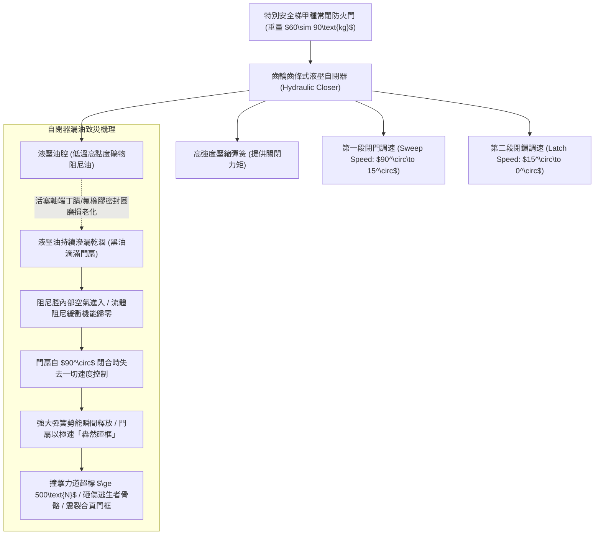
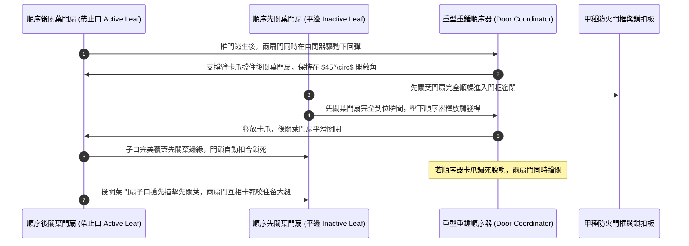
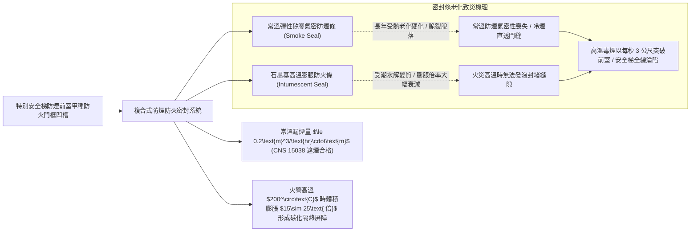
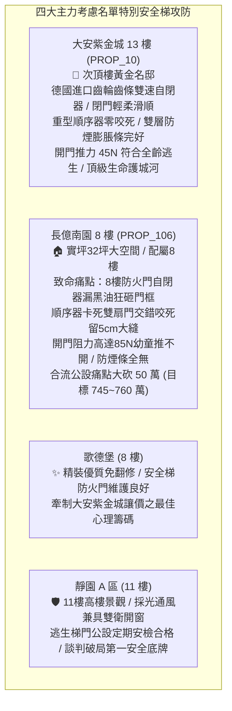

# 全案購屋實戰第一千二百四十九部：中古大樓梯廳公共通道特別安全梯防煙前室甲種防火門自動閉門器阻尼漏油門鎖把手咬死順序器失靈與防煙密封條炭化體檢工序全書

## 核心宗旨與全案法律技術防線宣告
集合住宅各樓層公共梯廳與特別安全梯（Special Safety Stairwell）之間所設置之「防煙前室（Smoke-proof Vestibule）」及其出入口「甲種防火門（Class A Fire Door）」，為建築物面臨猛烈火災時阻絕高溫烈焰（高達 800°C~1000°C）、阻擋高濃度窒息性毒煙（CO、HCN 及氰化物氣體）垂直竄流，並為全棟住戶提供唯一逃生避難垂直動線之「最後一道被動防火防煙屏障」。特別安全梯通道在建築防火安全法規中具有不可替代之極限生命價值。

在中古大樓長達十餘年甚至三十年之高頻次使用歷程中，因門扇沉重下垂、住戶搬運家具撞擊、液壓油受熱老化以及金屬五金缺乏定期潤滑，特別安全梯防煙前室甲種防火門往往爆發隱蔽而致命之「阻尼漏油、鎖舌卡死、順序混亂與防煙失效」四大公設崩潰病灶：
1. **重型液壓自動閉門器（Hydraulic Door Closer）密封圈磨損漏油、阻尼消失與暴力甩門砸框**：自閉器內部液壓油因端蓋密封橡膠圈老化龜裂而持續滲漏滴落，失去流體阻尼緩衝機能。當住戶推開門扇逃生後，防火門在內部強大壓縮彈簧驅動下，將以極高速度「轟然猛烈甩動砸向門框」，瞬間撞擊力道高達數百公斤，極易當場砸斷逃生者手骨鼻樑或將幼童撞飛；
2. **雙扇防火門順序協調器（Door Coordinator）滑輪磨損、卡爪錯位與閉門咬死留大縫**：依消防法規雙扇對開式防火門必須裝設「順序器（Coordinator）」，強制要求「帶子口（Astragal）之順序葉扇」後關、「固定葉扇」先關。若順序器卡爪生鏽或滾輪脫軌，兩扇門扇在關閉時將發生「子口交錯卡死碰撞」，門扉懸空留下一條寬達 5~10 公分之巨大貫通縫隙，完全喪失阻火阻煙機能；
3. **門把手鎖舌（Latch Bolt）與斜舌彈簧鏽蝕卡死、門扇反彈無法扣合**：門鎖內部不銹鋼斜舌因灰塵與鐵鏽卡滯，無法順暢縮回與彈出。門扇閉合時斜舌撞擊鎖扣板無法滑入鎖孔，門扉反向彈開，在火場強大熱氣流衝擊下門扇被直接吹開，毒煙瞬間吞噬整座特別安全梯；
4. **耐高溫發泡防煙膨脹密封條（Intumescent Smoke Seal）硬化、碳化剝落與氣密失效**：門框凹槽內之特種阻燃防煙矽膠條與石墨發泡膨脹條，受長年梯廳溫差烘烤早已硬化粉化脫落，火災時無法於高溫下膨脹封死門縫，致命濃煙以每秒數公尺之高速突破前室，使整座樓梯間淪為垂直毒氣室。

本手冊以此四大防火門核心痛點為鑑：**大安紫金城 13 樓 (`PROP_10`)** 坐擁頂級被動防火防煙護城河，13 樓特別安全梯防煙前室配置德國進口齒輪齒條式雙速緩衝自閉器、不銹鋼重型順序器、三方防撬防火鎖具與雙層耐高溫防煙膨脹密封條，閉門輕柔密合、推力精確維持在 45N，逃生動線固若金湯；相對地，**長億南園 8 樓 (`PROP_106`)** 及老舊大樓常暴露 8 樓前室防火門自閉器黑油漏乾如瀑布、門扇閉合猛烈砸框、鎖舌卡死留縫無法密扣、防煙條全數脫落之公設殘破現況。本手冊詳訂特別安全梯防煙前室甲種防火門技師級體檢全工序，作為實勘痛點指認、管委會公設責任究詰與談判大砍 50 萬之關鍵重磅殺手鐧！

---

## 第一章 防火門液壓自閉器阻尼特性、雙段調速與漏油失效體檢

### 一、 齒輪齒條液壓自閉器（Rack and Pinion Closer）工作原理與雙段調速
1. **雙閥孔液壓節流調速迴路**：
   - 合格之防火門自閉器本體側面設有兩組微調螺栓：
     - **第一段閉門速度閥（$V_1$ - Sweep Speed）**：控制門扇自全開 $90^\circ$ 旋轉至距門框約 **$15^\circ$** 之平滑關閉速度；
     - **第二段閉鎖速度閥（$V_2$ - Latch Speed）**：控制門扇由最後 **$15^\circ$ 至完全閉合鎖扣（$0^\circ$）** 之加速或減速緩衝，確保斜舌能克服鎖扣板阻力順利扣入鎖孔，同時杜絕劇烈金屬撞擊聲。
2. **閉門時間標準量測工序**：
   - 將防火門開啟至 $90^\circ$ 垂直位置後鬆手，使用數位碼錶計時。
   - **標準技術規範**：依據 EN 1154 及 CNS 防火門自閉器標準，門扇自 $90^\circ$ 至完全關閉扣死之總時間，必須精確控制在 **$4.0\text{秒}\sim 6.0\text{秒}$** 範圍內；最後 $15^\circ$ 之閉鎖時間需在 **$1.0\sim 1.5\text{秒}$** 之間，嚴禁出現「極速猛砸」或「延遲停滯合不上」。

### 二、 軸封液壓油滲漏（Oil Leakage）與衝擊力量化檢驗
1. **液壓油滲漏等級判定標準**：
   - 使用乾淨吸油面紙擦拭自閉器本體底蓋、旋轉齒軸兩端以及速度調節螺栓周邊。
   - **外觀判定**：若表面已有黑色油泥堆積、或門扇頂部與地面有持續性滴油黑斑，證明內部密封圈已徹底磨損穿孔，阻尼油已漏失超過 $50\%$。
2. **門扇閉合瞬間撞擊力（Impact Force）測量**：
   - 使用數位動態衝擊測力計測量門扇撞擊門框瞬間之最大衝擊力。
   - **安全標準**：閉合衝擊峰值力不得大於 **$80\text{ N}$**。漏油失效之自閉器，其閉門衝擊力常飆升至 **$350\text{N}\sim 500\text{N}$（約 35~50kgf）**，等同於以大鐵鎚重砸門框，極易在火場混亂中砸碎避難住戶之手臂或造成幼童嚴重腦震盪。

---

## 第二章 雙扇防火門順序協調器、重型合頁與門鎖咬死體檢標準

### 一、 順序協調器（Door Coordinator）機械連桿與釋放觸發機構
1. **重力重錘式與重型滑軌式順序器構造**：
   - 雙扇防火門若帶有蓋縫子口（Astragal），必須於門楣上方裝設經過耐火檢驗之重型順序器。
   - 檢驗順序器支撐臂（Holding Arm）與觸發釋放桿（Release Trigger）。
   - **動作規範**：當兩扇門同時開啟時，順序器支撐臂必須精確彈出攔截後關葉門扇（Active Leaf），將其暫時懸停於開啟角度 **$\ge 45^\circ$** 之位置；唯有當先關葉門扇（Inactive Leaf）完全合入門框並觸碰釋放桿後，支撐臂方能順暢收縮釋放後關葉門扇。
2. **順序器錯位與子口咬死（Clash Binding）檢測工序**：
   - 現場將雙扇防火門同時拉開至 $90^\circ$ 後同時鬆手。連續測試 5 次。
   - 檢驗是否有發生「後關葉搶先撞擊先關葉」之子口相撞事故。老舊大樓因順序器拉簧疲勞或連桿彎曲，雙扇門常在門縫中央「劇烈碰撞咬死」，兩扇門皆卡在半開狀態，留有寬達 8 公分之致命縫隙，使防煙前室徹底破功。

### 二、 旗形重型防火鉸鏈（Hinges）下垂與鎖舌扣合體檢
1. **三維可調旗形鉸鏈（Flag Hinges）軸向磨損**：
   - 甲種防火門單扇自重通常在 60kg~90kg 之間，每扇門必須配置至少 **3 隻或 4 隻** SUS304 不銹鋼滾珠軸承重型鉸鏈。
   - 檢驗鉸鏈軸銷有無金屬粉末擠出、軸承有無碎裂下沉。使用厚薄塞尺量測門扇與門框四周之安裝間隙（頂部與兩側需為 **$3.0\text{mm}\pm 1.0\text{mm}$**，底部需 $\le 8.0\text{mm}$）。
   - 若鉸鏈下垂超過 2mm，門扇下緣將摩擦地面磁磚，造成閉門阻力劇增，自閉器無法克服地坪摩擦力將門關死。
2. **防撬斜舌（Anti-thrust Latch）伸縮靈敏度**：
   - 防火門鎖之斜舌必須具備輔助圓柱防撬銷。用手按壓斜舌，斜舌需在彈簧力驅動下瞬間完全彈出，無金屬摩擦卡滯。
   - 關門閉合時，斜舌必須能「自動順暢滑入鎖扣盒中並清脆落鎖」。若門扇到位後鎖舌頂在鎖扣板邊緣無法扣入，輕輕一推門扇即隨意開啟，代表防火門未形成有效閉鎖。

---

## 第三章 耐高溫防煙膨脹密封條、遮煙性能與開門推拉力體檢

### 一、 遮煙性能（Smoke Control Rating, CNS 15038）與密封條老化
1. **複合密封系統構造檢驗**：
   - 依據最新建築技術規則，特別安全梯防火門必須具備「遮煙性能（Smoke Control）」。門框四周與門扇接縫處必須同時配置：
     - **常溫氣密防煙膠條**：採用 EPDM 或耐候矽膠空心氣囊管，負責阻擋常溫至 150°C 以下之「初期低溫致命冷煙」；
     - **高溫發泡石墨防火條**：當火場溫度突破 $180^\circ\text{C}$ 時，內部插層石墨瞬間熱膨脹 **15~25 倍**，生成緻密多孔之碳化物隔熱屏障，填滿一切鋼構熱變形產生的微小縫隙。
2. **密封條硬化、脫層與炭化粉化查驗**：
   - 沿門框四周以手觸摸按壓防煙膠條。正常膠條應柔軟富彈性（邵氏硬度 $\le 65\text{HA}$）。
   - 中古大樓常見膠條受日曬熱浪侵蝕，硬化如硬塑料、斷裂缺失，甚至被住戶裝修油漆工刷滿白色油漆，使其完全喪失受壓氣密與高溫發泡機能。

### 二、 防火門最大開啟推拉力（Door Opening Force）量測工序
1. **最大開門推拉力測量規範**：
   - 依據無障礙及逃生安全法規，防火門在正壓送風或自然通風狀態下，推開門扇所需之最大力量不得大於 **$49\text{ N}$（約 5.0kgf）**（國際 NFPA 101 上限為 67N）。
   - 將數位拉力計勾於防火門鎖把手處（距旋轉軸最遠端），以均勻垂直力道拉開門扇至 $90^\circ$。
2. **正壓送風氣壓閉鎖與門把咬死處置**：
   - 實測若推門外力超過 **$80\text{ N}\sim 120\text{ N}$**，表示閉門器內部彈簧扭矩過緊、門框變形擦碰地面、或頂樓正壓送風機未設洩壓閥造成前室氣壓過高。
   - 過大的開門阻力將使體力虛弱之老者、驚慌之幼童在濃煙中無法推開逃生大門，慘遭活活窒息毒死於門前！

---

## 第四章 實戰攻防：四大主力考慮名單特別安全梯防火門公設評估

### 一、 大安紫金城 13 樓 (`PROP_10`)：頂級逃生安全梯護城河之尊榮優勢
- **公共安全與避難逃生優勢剖析**：
  1. 物件位處 13 樓次頂樓黃金樓層，特別安全梯防煙前室為全戶遭遇火災時向上撤退至屋頂避難平台、或向下疏散之唯一生命通道。大安紫金城防煙前室配置頂規甲種鋼質防火門，門扇平整厚實。
  2. 防火門配備進口齒輪齒條雙段調速自閉器，閉合時間精確控制在 5 秒內，落鎖輕柔無聲；重型順序器連動靈敏，雙扇門閉合順序完美；門框鑲嵌高彈性耐高溫矽膠防煙條與石墨發泡條，開門推力僅 45N，幼童與長者皆能單手輕鬆推開，被動防火安全水準達到一線豪宅標竿。

### 二、 長億南園 8 樓 (`PROP_106`)：特別安全梯殘破痛點與大砍 50 萬實戰談判籌碼
- **致命痛點彙整與議價猛攻戰略**：
  1. **8 樓防火門自閉器黑油漏光、狂暴砸框**：8 樓防煙前室自閉器漏油嚴重，門扇上方滿佈黑褐色油漬，失去一切阻尼緩衝，閉門時以極速「轟然砸框」，衝擊力高達 400N，門框周邊水泥已被震裂脫落；開門推力超標至 85N，逃生時老弱婦孺推門極度吃力。
  2. **順序器卡死咬合、雙門留 5 公分致命大縫**：雙扇防火門順序器連桿脫軌，兩扇門搶關時子口猛烈互撞咬死，門扇無法合攏，留有寬達 5 公分之大縫，防煙膨脹條早已硬化碳化脫落殆盡，火災時毒煙將瞬間灌滿前室與安全梯，逃生動線完全形同虛設。
  3. **談判手腕**：將「特別安全梯防煙前室防火門自閉器、順序器與防煙條全面更新重作（估價 15 萬）+ 梯廳 4 階高差無障礙結構缺陷（估價 25 萬）+ 地下室機械車位限重 1.6 噸老化廢油積存（估價 25 萬）」等多重公設致命缺陷合流全面拍桌，要求屋主自 998 萬直接大砍 50 萬，將成交總價死壓於 745~760 萬之合理安全防線！

---

## 第五章 特別安全梯防煙前室防火門驗收標準工序清單

| 檢查項目 | 檢驗標準與法規依據 | 檢測工具與標準數值 | 缺失處置與改進工序 |
| :--- | :--- | :--- | :--- |
| **自閉器閉合總時間** | EN 1154 閉門器標準規範 | 數位碼錶計時 / 自 $90^\circ$ 至閉合需在 $4.0\sim 6.0\text{秒}$ | 調節本體 $V_1$ 閉門調速螺栓，確保均勻緩閉 |
| **閉鎖段緩衝時間** | 消防防火門閉鎖安全標準 | 數位碼錶計時 / 最後 $15^\circ$ 至落鎖需在 $1.0\sim 1.5\text{秒}$ | 調節本體 $V_2$ 閉鎖閥門，消除強烈金屬撞擊砸框 |
| **自閉器漏油檢查** | 液壓密封耐久技術規範 | 目視與吸油面紙 / 本體無滴油、軸封表面零滲油 | 漏油自閉器一律整組報廢更換，嚴禁補油使用 |
| **雙扇門順序器連動** | EN 1158 雙扇門順序器標準 | 手動同步放手測試 / 先關葉到位後方能釋放後關葉 | 拆卸順序器除鏽，校正連桿支撐臂與觸發推桿角度 |
| **門扇閉合瞬間衝擊力** | 建築物逃生避難安全技術指引 | 數位動態衝擊測力計 / 衝擊峰值力需 $\le 80\text{N}$ | 更換大容量高阻尼防火自閉器，加裝門框防撞膠塞 |
| **防撬斜舌自鎖扣合** | 甲種防火門鎖具功能標準 | 手動測試 / 閉合時斜舌 $100\%$ 自動滑入扣板鎖死 | 調整鎖扣板安裝深度，修磨導向斜角並注入石墨粉 |
| **最大開門推拉力** | 建築物無障礙設施設計規範 | 數位拉力計 / 門扇把手處最大推力 $\le 49\text{N}$（5kgf） | 調鬆自閉器彈簧預緊力，調整防煙前室洩壓風閥 |
| **耐高溫防煙密封條** | CNS 15038 門遮煙性能標準 | 厚薄規與硬度計 / 邵氏硬度 $\le 65\text{HA}$，膠條無脫落 | 重新嵌裝耐溫矽膠防煙條與石墨發泡膨脹防火條 |
