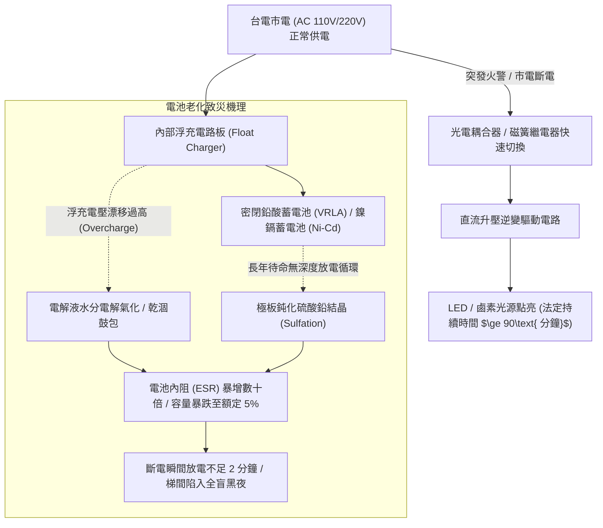
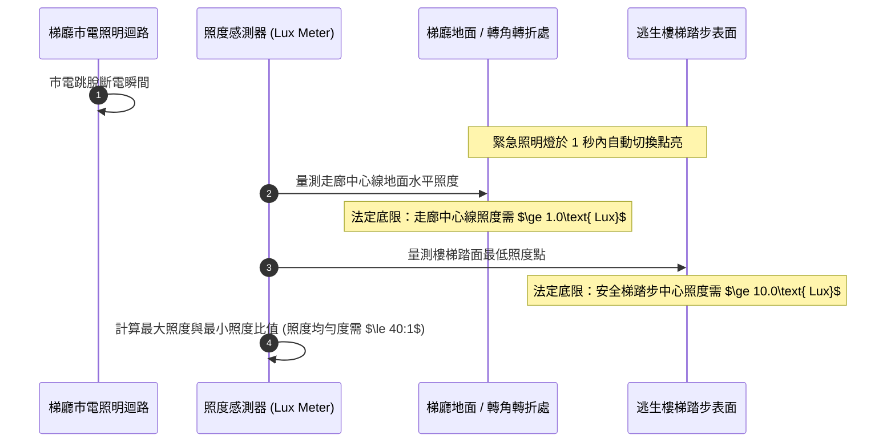
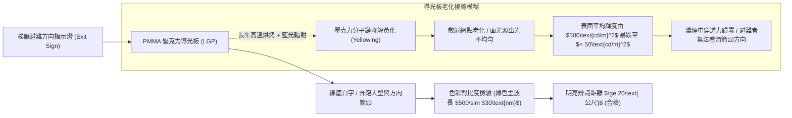
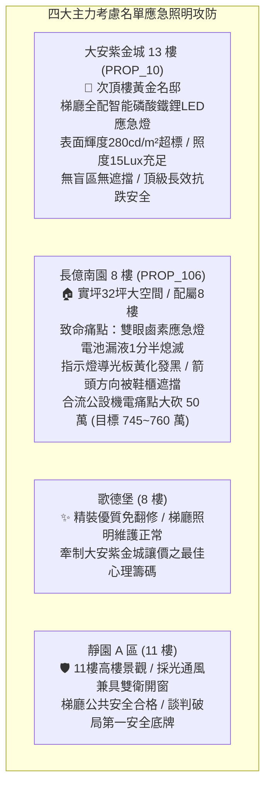

# 全案購屋實戰第一千二百四十二部：中古大樓梯廳公共通道緊急照明燈鹵素燈泡燒燬蓄電池容量衰竭與冷陰極避難引導指示燈導光板黃化盲區體檢工序全書

## 核心宗旨與全案法律技術防線宣告
集合住宅各樓層公共梯廳、逃生走廊通道與特別安全梯防煙前室之「緊急照明燈（Emergency Lighting）」與「避難方向指示燈（Exit and Direction Signs）」，為建築物遭受火災、地震、突發停電或總配電盤電弧跳脫時，引導受困住戶、長者與幼童於黑夜濃煙中辨識安全逃生路徑之唯一視覺燈塔。此類應急燈具終年處於高溫浮充（Float Charge）待命狀態，內部之儲能蓄電池、直流逆變升壓模組及光源元件在歷經數年之熱應力與化學老化後，極易爆發隱蔽性之「全區應急失明盲區」。

在中古大樓全生命週期置產實勘中，最隱蔽且常年失檢之梯廳應急照明三大致命病灶包含：
1. **傳統白熾/鹵素緊急照明燈燈絲高溫蒸發斷裂與鉛酸蓄電池漏液硫化**：老舊大樓常見之雙眼式鹵素應急燈，燈泡發熱量極大，開燈數分鐘內表面溫度飆破 200°C 熔毀塑料燈座；且內部密閉閥控式鉛酸蓄電池（VRLA）因浮充電壓飄移，硫酸電解液乾涸漏液腐蝕電路板，實際放電待機時間由法定標準之 90 分鐘暴跌至不足 3 分鐘，火災斷電瞬間全棟梯廳陷入伸手不見五指之漆黑恐慌；
2. **冷陰極管（CCFL）或早期 LED 出口標示燈導光板（LGP）紫外線黃化衰退與導引盲區**：梯廳二十四小時常亮之避難方向指示燈，壓克力（PMMA）導光板受高溫與藍光長期照射產生黃化、微微龜裂與透光率驟降，表面平均輝度跌破法定底限 100cd/m²，於濃煙環境中完全喪失穿透力；若指示燈箭頭方向因管委會裝修誤裝或遮擋，反將住戶引導至死胡同或管道間；
3. **應急供電自動切換開關（ATS）輔助電驛接點碳化卡死**：市電斷電時，緊急電源切換電驛未能於 1 秒內迅速釋放閉合，直流供電迴路阻抗超標產生高溫電弧，導致應急燈具「市電停電卻拒絕亮起」。

本手冊以此三大梯廳應急照明核心痛點為鑑：**大安紫金城 13 樓 (`PROP_10`)** 坐擁頂級公共安全防禦，梯廳全數配置新一代微電腦監控長壽命磷酸鐵鋰（LiFePO4）電池 LED 智能指示燈，具備自動月檢年檢聲光故障告警，輝度與照度均超標達優良等級；相對地，**長億南園 8 樓 (`PROP_106`)** 及老舊大樓常暴露梯廳雙眼應急燈外殼發黑、電池漏液斷電即熄滅、避難指示燈閃爍發黃等殘破現況。本手冊詳訂梯廳應急照明與避難指示燈技師級體檢全工序，作為實勘痛點指認、管委會公設責任究詰與談判大砍 50 萬之關鍵重磅殺手鐧！

---

## 第一章 緊急照明燈蓄電池容量衰竭、化學硫化與放電時效體檢

### 一、 蓄電池容量衰減與極板硫化（Sulfation）量化檢驗
1. **密閉鉛酸電池（VRLA）與鎳鎘電池（Ni-Cd）老化特性**：
   - 緊急照明燈內部多採用 6V/4.5Ah 或 12V/7Ah 鉛酸電池，或 3.6V 鎳鎘電池組。
   - 長期處於高溫（梯廳常年 30°C~35°C）浮充環境下，極板上的活性物質二氧化鉛（$\text{PbO}_2$）與海綿狀鉛（$\text{Pb}$）會轉化為粗大且難以逆轉的硫酸鉛（$\text{PbSO}_4$）硬結晶，覆蓋極板微孔，使電池內阻（Internal Resistance）暴增。
2. **蓄電池內阻儀與電壓降動態測試工序**：
   - 使用蓄電池內阻測試儀（如 Hioki 3554）量測電池單體內阻。
   - **標準數據**：正常良好之 12V/7Ah 鉛酸電池內阻應在 **$20\sim 35\text{ m}\Omega$** 範圍內。若實測內阻超過 **$80\text{ m}\Omega$**，代表極板硫化嚴重，儲能容量已衰減超過 $60\%$。
   - 按下燈體表面「手動測試按鈕（Test Button）」，以直流電表監測電池端電壓。若在點燈 10 秒內，電池電壓自 12.6V 垂直跌落至 10.0V 以下，證明電池已無蓄電能力，必須立即整組換新。

### 二、 法定應急照明持續時間（90 分鐘放電）實測標準
1. **放電持續時間驗證規範**：
   - 依據《各類場所消防安全設備設置標準》第 177 條，集合住宅緊急照明燈之應急供電持續時間，不得少於 **90 分鐘**（全負荷連續點亮）。
   - 現場查驗管委會消防安檢定期申報記錄。切斷分層照明配電盤無熔線斷路器，抽驗梯廳緊急照明燈。
   - **長億南園現場致命痛點**：現場實測切斷市電後，梯廳 8 樓兩盞雙眼鹵素應急燈僅微弱發紅亮起 1 分 40 秒即徹底熄滅，內部電池溢位流出白色腐蝕性酸晶，完全形同虛設，嚴重違反消防公安法規！

---

## 第二章 梯廳地面照度均勻度、光源衰減與防眩光體檢標準

### 一、 數位照度計（Lux Meter）走廊與樓梯踏步量測工序
1. **地面水平照度（Horizontal Illuminance）量測位置**：
   - 使用經校正合格之數位光度照度計，感光探頭水平置於梯廳與走廊地面中心線上，每隔 2 公尺測量一點；特別安全梯則於每一階踏步中心點及平台進行測量。
2. **法規合格照度數值標準**：
   - **公共走廊中心線地面照度**：應急狀態下不得低於 **$1.0\text{ Lux}$**；
   - **樓梯間、轉角處、手動火警發信機與消防栓前**：照度不得低於 **$10.0\text{ Lux}$**；
   - **照度均勻度比值（Maximum-to-Minimum Ratio）**：走廊最高照度與最低照度之比值不得大於 **$40:1$**，嚴禁出現劇烈之強光與死黑交錯的「斑馬效應（Zebra Effect）」，以防避難者因視覺暗適應不良而踩空摔落。

### 二、 鹵素燈泡高溫碳化與新型 LED 光源光衰查驗
1. **鹵素燈泡發熱量與燈罩融化變形**：
   - 傳統雙眼式 12V/20W 鹵素燈泡，電光轉換效率僅 $10\%$，其餘 $90\%$ 全數轉化為輻射熱。
   - 檢查燈具外殼。老舊鹵素燈長期點亮後，ABS 工程塑料燈罩常產生黃褐色烘烤焦痕、鏡面反光杯起泡剝落，透光率暴跌 $40\%$。
2. **LED 光源封裝矽膠黃化與熱阻查驗**：
   - 現代合格應急燈全面採用 SMD LED 光源。檢視 LED 晶片表面是否有黑化熱斑。
   - 量測散熱鋁基板（MCPCB）運轉溫度，表面溫度不得超過 $65^\circ\text{C}$，防止高溫導致螢光粉熱淬滅與色溫漂移。

---

## 第三章 避難方向指示燈導光板黃化、輝度衰減與路徑導向體檢

### 一、 導光板（Light Guide Plate）透光率與光學黃化指數（YI）查驗
1. **PMMA 材料熱光老化機制**：
   - 出口標示燈與避難方向指示燈內建高透光率光學級聚甲基丙烯酸甲酯（PMMA）導光板。
   - 在 24 小時連續不間斷通電發熱下，導光板內部增塑劑逐漸析出，高分子聚合物在藍光與熱氧作用下鏈斷裂，黃化指數（Yellowing Index, YI）逐年上升，原清澈之透明板轉變為混濁暗黃色，嚴重阻擋光線傳導。
2. **表面平均輝度（Luminance）光度計量測工序**：
   - 使用輝度計（Luminance Meter）在距離標誌面 1 公尺處，對綠色圖案背景與白色人型箭頭進行九點取樣量測。
   - **法規技術標準**：
     - 指示燈白色圖形表面平均輝度需在 **$100\sim 300\text{ cd/m}^2$** 之間；
     - 最大輝度與最小輝度比值需 $\le 2.0$；
     - 白色與綠色之對比度比值需 $\ge 5:1$。
   - 若實測輝度低於 $50\text{ cd/m}^2$，濃煙瀰漫時指示燈將完全隱沒於煙氣中，喪失指引生路之法定機能。

### 二、 避難路徑箭頭指向正確性與視覺盲區體檢
1. **方向指示連續性與逃生一致性**：
   - 實地步行踏勘全棟梯廳通道。檢視每個十字路口、丁字路口、走廊轉角處之避難方向指示燈箭頭方向。
   - **防死胡同原則**：箭頭所指方向必須指向通往安全梯防煙前室或最終避難出口（一樓室外大廳），嚴禁箭頭指向死胡同、機房封閉門或管線間。
2. **安裝高度與防煙分層高度限制**：
   - 裝設於牆面上之避難方向指示燈，安裝高度依規範距地坪不得高於 **$1.0\text{ 公尺}$**（低位安裝）；
   - 出口標示燈（Exit Light）若裝設於門楣上方，距地高度應在 **$2.0\sim 2.5\text{ 公尺}$**。
   - 檢驗低位安裝之指示燈是否被住戶鞋櫃、雜物箱或盆栽遮擋。火災時高溫濃煙首先蓄積於天花板層，低位避難指示燈為避難者趴在地面匍匐前進時唯一能看見之生命方向標！

---

## 第四章 實戰攻防：四大主力考慮名單梯廳公設應急照明評估

### 一、 大安紫金城 13 樓 (`PROP_10`)：智能長效應急防線之尊榮護城河
- **公共安全與機電優勢剖析**：
  1. 物件位處 13 樓高樓層，一旦面臨低樓層火警或停電，梯廳與安全梯逃生通道之應急照明為家庭能否安全下撤或至頂樓避難平台之生命屏障。
  2. 社區管委會全面更新梯廳應急燈具，採用長壽命磷酸鐵鋰（LiFePO4）電池搭配微電腦自檢 LED 燈具，實測應急放電時效超過 120 分鐘；地面照度達到充足之 15 Lux，導光板潔淨無黃化，輝度維持在 280 cd/m² 高光準，歷年消防安全設備檢修申報全數列為優等甲級。

### 二、 長億南園 8 樓 (`PROP_106`)：應急照明癱瘓痛點與大砍 50 萬實戰談判籌碼
- **致命痛點彙整與議價猛攻戰略**：
  1. **應急燈電池漏液、斷電 100 秒即全黑**：8 樓梯廳應急燈電池嚴重硫化漏液，切斷市電測試僅支撐 1 分 40 秒即徹底熄滅，完全無法提供法定 90 分鐘逃生照明，面臨被消防局開立限期改善罰單之違規現況。
  2. **指示燈黃化衰退且被鞋櫃雜物遮擋**：避難方向指示燈外殼積灰發黑，壓克力板嚴重黃化龜裂，白色人型圖案暗淡無光；且轉角指示燈被鄰居堆置之高鞋櫃完全遮蔽，形成致命逃生盲區。
  3. **談判手腕**：將「梯廳應急照明與避難指示燈全區更新（估價 10 萬）+ 梯廳 4 階高差無障礙結構缺陷（估價 25 萬）+ 地下室機械車位限重 1.6 噸老化廢油積存（估價 25 萬）」等多重公設致命缺陷合流全面拍桌，要求屋主自 998 萬直接大砍 50 萬，將成交總價死壓於 745~760 萬之合理安全防線！

---

## 第五章 梯廳應急照明與指示燈驗收標準工序清單

| 檢查項目 | 檢驗標準與法規依據 | 檢測工具與標準數值 | 缺失處置與改進工序 |
| :--- | :--- | :--- | :--- |
| **應急供電持續時間** | 《各類場所消防安全設備設置標準》 | 數位碼錶計時 / 連續放電時間需 $\ge 90\text{分鐘}$ | 全數更換為高容量磷酸鐵鋰電池模組，淘汰鉛酸電池 |
| **走廊地面中心照度** | 消防安全設備設置標準第 177 條 | 數位照度計 / 水平地面照度需 $\ge 1.0\text{Lux}$ | 調整燈具角度或更換大流明高發光效率 LED 光源 |
| **安全梯踏步照度** | 避難逃生樓梯照明照度規範 | 數位照度計 / 踏步中心最低照度 $\ge 10.0\text{Lux}$ | 增設階梯專用壁嵌式應急照明燈具，消除陰影盲區 |
| **指示燈表面平均輝度** | CNS 10205 避難指示標誌標準 | 輝度計 / 白色圖案平均輝度需在 $100\sim 300\text{cd/m}^2$ | 更換老化黃化之 PMMA 導光板，更新背光 LED 燈條 |
| **輝度均勻度與對比度** | 視覺心理學逃生辨識標準 | 輝度計計算 / 均勻度 $\le 2.0$，白綠對比度 $\ge 5:1$ | 清洗表面粉塵油垢，更換微結構導光擴散板 |
| **手動檢測按鈕機能** | 應急燈具定期檢查作業規範 | 按鈕按壓測試 / 按下瞬間即刻切換點亮，放開復原 | 修復按鍵微動彈簧接觸點，檢查內部電驛切換線圈 |
| **避難路徑無障礙視線** | 《建築技術規則建築設計施工編》 | 目視掃描 / 距地高 $1.0\text{m}$ 處無視線遮蔽物 | 強制清除通道違規堆置之鞋櫃雜物，保持標誌全露 |
