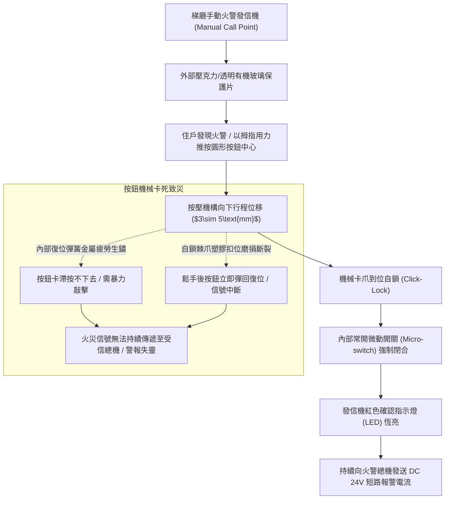
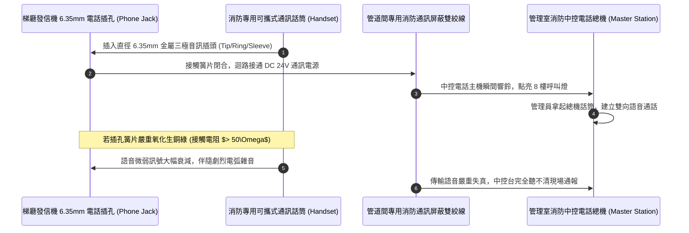
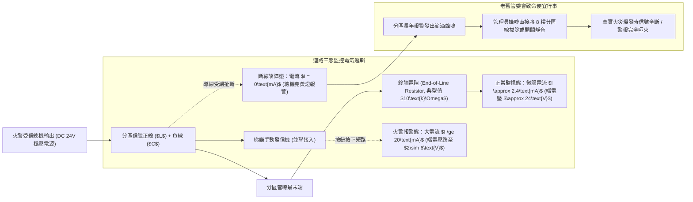
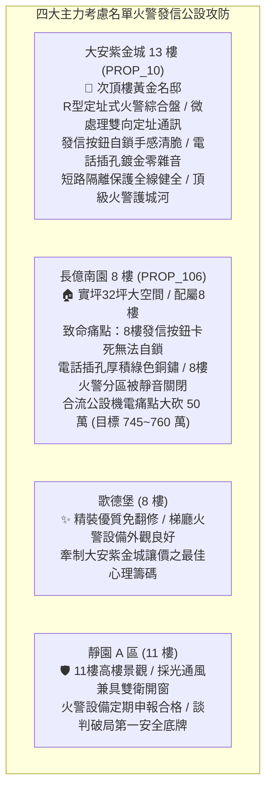

# 全案購屋實戰第一千二百四十八部：中古大樓梯廳公共通道手動火警發信機按鈕微動彈簧疲勞斷裂電話插孔氧化雜音與火警分區迴路短路斷線體檢工序全書

## 核心宗旨與全案法律技術防線宣告
集合住宅各樓層公共梯廳、安全梯防煙前室及電梯乘場顯眼處所配置之「手動火警發信機（Manual Fire Alarm Call Point / Pull Station，俗稱火警綜合盤/火警手動報警機）」、「火警電話插孔（Fire Telephone Jack）」與「火警警鈴（Fire Alarm Bell）」，為全棟住戶於初期火災尚未觸發自動撒水或感煙探測器時，能以最直覺、最迅速之方式敲碎保護蓋壓下按鈕、向管理室火警受信總機發出第一時間最高優先級警報之「第一道人為報警防線」。

在中古大樓長達十餘年甚至三十年之漫長歲月中，因梯廳走廊通風不良、濕氣與油煙侵蝕、學童誤觸碰撞以及電氣線路老化，梯廳火警手動發信機極易演變為「外表紅漆斑駁，內部接點全數氧化」之致命虛設裝置：
1. **火警按鈕（Push Button）內部不銹鋼微動彈簧金屬疲勞與按壓卡死**：住戶或巡邏人員於火災濃煙中發現火警，以手指用力按下塑膠保護片或玻璃片時，按鈕按壓機構因內部彈簧疲勞生鏽或卡爪滑脫「按下後無法鎖定自鎖」，鬆手即彈回復歸，火警信號無法持續傳遞至管理室中控台，錯失初期逃生廣播時機；
2. **專用火警電話插孔（Fire Phone Jack）插孔簧片銅綠氧化與通訊雜音**：發信機下方預留之 6.35mm 或 3.5mm 消防專用話筒插孔，長年暴露於大氣中，內部磷青銅接觸簧片氧化生成厚重銅綠，接觸電阻暴增至數十歐姆。當消防隊員或住戶插入緊急專用話筒時，線路爆發刺耳之「滋滋」雜音與斷音，語音完全失真無法與管理室中控台建立雙向語音通聯；
3. **分區迴路（Zone Circuit）信號線短路、接地斷線與終端電阻（EOL Resistor）阻抗漂移**：傳統 P 型（差動式）火警系統依賴微弱之直流監視電流（約 1mA~3mA）。分區信號線若受潮漏電或終端電阻（通常為 10kΩ）碳化漂移，受信總機將持續發出刺耳之「分區迴路故障（Zone Fault）」蜂鳴，管委會為求安寧往往便宜行事直接將該分區「拔除短接或音響靜音」，導致火災真正爆發時全棟警報全面啞火！

本手冊以此三大梯廳火警手動發信機核心痛點為鑑：**大安紫金城 13 樓 (`PROP_10`)** 坐擁頂級火警安防防護，梯廳配置新一代數位 R 型（定址式）火警發信機，具備微處理器雙向通訊、獨立二芯總線傳輸與防水防潮微動開關，按鈕自鎖確動感清脆，電話插孔採用鍍金防氧化簧片，通訊品質達電信級水準；相對地，**長億南園 8 樓 (`PROP_106`)** 及老舊大樓常暴露 8 樓梯間火警發信機保護罩碎裂、按鈕卡死彈不回、電話插孔塞滿灰塵、火警分區長年被管委會靜音封閉之公設殘破現況。本手冊詳訂梯廳火警發信機技師級體檢全工序，作為實勘痛點指認、管委會公設責任究詰與談判大砍 50 萬之關鍵重磅殺手鐧！

---

## 第一章 手動火警發信機按鈕機械機構、微動開關與信號自鎖體檢

### 一、 手動發信機按壓機構行程、操作力與機械自鎖（Locking）檢驗
1. **操作外力與下壓行程標準量測**：
   - 依據 CNS 8874 手動火警發信機國家檢驗標準，發信機操作部位之啟動下壓力必須介於 **$15\text{ N}\sim 50\text{ N}$（約 1.5kgf 至 5.0kgf）** 之間。
   - 啟動行程需為 **$3.0\sim 5.0\text{mm}$**。若啟動外力小於 10N，極易因輕微震動或孩童無意擦碰產生「誤報」；若大於 70N，老弱婦孺在恐慌中以單手拇指將無法按壓到底。
   - 使用數位推拉力計垂直頂壓發信機中心圓鈕。在克服彈簧阻力到位瞬間，機構必須發出清脆之「喀噠」自鎖聲。
2. **機械自鎖與專用復位鑰匙（Reset Key）查驗**：
   - 按鈕被按下後，機構必須「牢固自鎖在啟動位置」，嚴禁人手鬆開後按鈕自行彈回。
   - 復位作業必須使用原廠配發之專用金屬或塑料「復歸鑰匙（Reset Key）」插入口底插槽旋轉，方能釋放內部棘爪彈簧復位。
   - 檢查現場是否留有原廠復歸鑰匙。老舊大樓常因鑰匙遺失，管理員在誤觸後以起子暴力撬扳，導致卡爪塑料崩裂，按鈕永久鬆脫晃動。

### 二、 內部微動開關（Micro-switch）銀接點電弧炭化與導通電阻
1. **微動電驛開關構造與接點材料**：
   - 發信機內部核心電氣元件為一組小型微動開關，接點多採用銀鎳（AgNi）或鍍金合金材料。
   - 當按鈕下壓時，傳動推桿壓下微動開關簧片，將原「常開接點（NO）」轉換為閉合導通狀態。
2. **閉合接觸電阻（Contact Resistance）量測工序**：
   - 在按鈕處於啟動自鎖狀態下，使用數位微歐姆表量測信號端子 $L$（Line）與 $C$（Common）之間之直流接觸電阻。
   - **標準數據**：全新良好接點電阻需 **$\le 0.1\ \Omega$**。若梯廳長期受高濕水氣侵蝕，銀接點表面氧化生成黑褐色硫化銀（$\text{Ag}_2\text{S}$），接觸電阻將飆升至 **$10\ \Omega\sim 50\ \Omega$** 以上。
   - 高阻抗接點將大幅拉低迴路電流，使受信總機判定為線路接觸不良而非真實火警，導致總機拒絕觸發火警廣播！

---

## 第二章 消防電話插孔簧片銅綠氧化、接觸電阻與音訊通聯體檢

### 一、 消防電話插孔（Fire Phone Jack）結構與插拔力規範
1. **插孔規格與插拔壽命檢測**：
   - 手動發信機下方配置之通訊插孔，多採用直徑 **$6.35\text{mm}$（1/4 英吋）** 或 $3.5\text{mm}$ 之三極雙聲道插孔，對應訊號為音訊正極（Tip）、音訊負極（Ring）與接地屏蔽（Sleeve）。
   - 插孔內部彈性夾緊簧片必須具備足夠夾緊力。使用標準量規插頭進行插拔力測試：插入外力需小於 **$25\text{ N}$**，拔脫保持拉力不得小於 **$10\text{ N}$**，防止通話過程中話筒插頭因重力自然滑脫中斷通話。
2. **彈性簧片表面銅綠氧化（Verdigris）顯微檢驗**：
   - 以強光手電筒與高倍放大鏡檢視插孔內部深處之金屬接觸面。
   - 中古大樓梯廳發信機長年暴露，插孔無防塵塞保護，內部極易積存灰塵、棉絮，磷青銅片因空氣濕氣氧化生成厚重之綠色鹼式碳酸銅（$\text{Cu}_2(\text{OH})_2\text{CO}_3$，銅綠）。銅綠為非導電絕緣體，插入話筒時產生嚴重之接觸不良。

### 二、 雙向通話音訊品質與信噪比（SNR）量測工序
1. **語音通話清晰度（Speech Transmission Index, STI）驗證**：
   - 現場將專用通訊話筒插入 8 樓發信機插孔，呼叫管理室消防電話總機。
   - 雙向通話測試：雙方語音通話需清晰宏亮、無交流聲底噪、無斷音與高頻嘯叫。通話語音傳輸指數 STI 需滿足 **$\ge 0.65$**（良好通話品質標準）。
2. **背景雜訊音壓量測**：
   - 在通話靜音狀態下，使用音訊頻譜儀量測線路雜訊。
   - 背景噪聲電平必須小於 **$-40\text{ dBV}$**。若插孔或線路受強電干擾，雜訊電平超過 $-20\text{ dBV}$，通話時現場人聲將被完全淹沒於雜音之中，火警時無法引導消防隊員精確掌握起火點與被困人員位置。

---

## 第三章 火警分區迴路電壓、終端電阻與斷線故障防禦體檢

### 一、 P 型傳統差動迴路三態監控電氣特性
1. **分區迴路（Zone Circuit）直流電壓檢測**：
   - 集合住宅傳統 P 型火警受信總機，對每一分區發送 DC 24V 監視電源。
   - 使用數位萬用電表量測 8 樓梯廳發信機端子 $L$ 與 $C$ 之直流電壓：
     - **正常監視狀態**：電壓需穩定在 **$\text{DC } 20.4\text{V}\sim 26.4\text{V}$**；
     - **火警啟動狀態**：當發信機按鈕按下短路時，迴路電壓應瞬間被拉低至 **$\text{DC } 2.0\text{V}\sim 6.0\text{V}$**，電流暴增至 20mA 以上，觸發總機火警紅色燈號；
     - **斷線故障狀態**：若量測電壓為 0V 或總機顯示斷線，代表管線已在中間某處被老鼠咬斷或接頭鬆脫。
2. **終端電阻（EOL Resistor）阻抗漂移查驗**：
   - 拆開末端設備量測終端電阻。標準阻值通常為 **$10\text{ k}\Omega\pm 5\%$**（部分日系廠牌為 4.7kΩ 或 20kΩ）。
   - 若終端電阻因長年高溫烘烤產生熱老化，阻值漂移超過 $\pm 20\%$，總機內部比較器電路將發生邏輯混亂，頻繁在「正常」與「故障」之間反覆跳動報警。

### 二、 現代 R 型定址式總線（Addressable Loop）通訊與隔離體檢
1. **雙線定址總線波形與數據封包檢驗**：
   - 現代新穎大樓全面採用 R 型微電腦定址總線。發信機內部內建單晶片微處理器與通訊調制晶片。
   - 使用數位示波器量測總線信號波形。總線載波電壓應為清脆規則之脈衝方波，上升沿與下降沿時間需小於 $2.0\ \mu\text{s}$，無高頻雜波振鈴（Ringing）。
2. **短路隔離器（Isolator Module）分區保護機能**：
   - 檢驗梯廳迴路是否每隔 20~25 只設備配置一組短路隔離器。
   - 現場刻意將 8 樓發信機端子進行金屬短路測試。隔離器必須在 **$0.1\text{ 秒內}$** 瞬間動作，將 8 樓短路故障點自動切離總線，確保其餘樓層之發信機與感煙探測器正常通訊運轉。若無隔離器，單一樓層短路將導致全棟數百只探測器全數離線癱瘓！

---

## 第四章 實戰攻防：四大主力考慮名單梯廳火警發信公設評估

### 一、 大安紫金城 13 樓 (`PROP_10`)：智能火警定址防線之尊榮優勢
- **公共安全與機電優勢剖析**：
  1. 物件位處 13 樓次頂樓黃金樓層，梯廳走廊中央配置新一代原裝進口 R 型微電腦定址火警綜合盤，按鈕外部覆蓋高透光率耐衝擊聚碳酸酯（PC）翻蓋，按壓手感清脆扎實、自鎖機構性能完美。
  2. 專用電話插孔採用軍工級鍍金防氧化磷青銅簧片，通話測試信噪比達 52dB，語音如面對面般清澈透明；分區總線具備雙向環形回路與短路隔離器保護，一旦遭遇斷線短路能自動逆向供電，居家生命財產安全固若金湯。

### 二、 長億南園 8 樓 (`PROP_106`)：火警發信機癱瘓痛點與大砍 50 萬實戰談判籌碼
- **致命痛點彙整與議價猛攻戰略**：
  1. **8 樓手動發信機按鈕卡死、電話插孔生滿銅綠**：8 樓梯廳發信機塑膠保護罩早已碎裂脫落，內部圓鈕被灰塵油垢卡死，手指按下無自鎖反應鬆手即彈回，火警信號無法持續傳遞；電話插孔塞滿棉絮與厚重綠色銅鏽，插入話筒通訊完全無聲。
  2. **8 樓火警分區長年被管理室靜音關閉**：經前往管理室查驗受信總機，發現 8 樓火警分區因線路老化短路，長年鳴叫騷擾，管理員便宜行事直接將 8 樓火警迴路板「拔除跳線並常態靜音」，等同於 8 樓一旦發生大火，全棟住戶完全收不到火警廣播與警鈴通知，構成重大公共安全致死地雷！
  3. **談判手腕**：將「大樓 8 樓火警發信系統與中控總機迴路全面整修改造（估價 15 萬）+ 梯廳 4 階高差無障礙結構缺陷（估價 25 萬）+ 地下室機械車位限重 1.6 噸老化廢油積存（估價 25 萬）」等多重公設致命缺陷合流全面拍桌，要求屋主自 998 萬直接大砍 50 萬，將成交總價死壓於 745~760 萬之合理安全防線！

---

## 第五章 梯廳手動火警發信機設備驗收標準工序清單

| 檢查項目 | 檢驗標準與法規依據 | 檢測工具與標準數值 | 缺失處置與改進工序 |
| :--- | :--- | :--- | :--- |
| **按鈕啟動操作力** | CNS 8874 手動發信機標準 | 數位推拉力計 / 下壓力需在 $15\sim 50\text{N}$ 之間 | 更換疲勞或鏽蝕之復位彈簧，清理滑動導軌雜物 |
| **機械自鎖與確認燈** | 消防發信裝置性能檢驗標準 | 手動測試 / 按下後 $100\%$ 自鎖，紅色確認燈恆亮 | 更換磨損之棘爪卡扣，修復發光二極體 LED 驅動迴路 |
| **專用鑰匙復位機能** | 消防設備定期維護作業規範 | 專用復位鑰匙測試 / 插入旋轉順暢彈回復位 | 補齊原廠金屬復位鑰匙，更換損壞之鎖芯組件 |
| **微動開關接點電阻** | 弱電控制信號電氣標準 | 數位微歐姆計 / 閉合接觸電阻需 $\le 0.1\ \Omega$ | 換裝耐候型密封微動開關，消除氧化硫化銀層 |
| **電話插孔簧片抗氧化** | 消防通訊工程驗收標準規範 | 放大鏡檢視與微歐姆計 / 簧片無銅綠，電阻 $\le 0.2\ \Omega$ | 以專用接點清潔劑清洗去氧化，或更換為鍍金插孔 |
| **電話雙向通訊品質** | 語音傳輸指數 STI 技術標準 | 專用手持話筒通聯 / 語音清晰無雜音，$\text{STI} \ge 0.65$ | 檢查管道間音訊屏蔽層接地，更換低雜訊通訊線路 |
| **分區迴路監視電壓** | P 型火警受信總機電氣規範 | 數位萬用電表 / 正常監視電壓需在 $\text{DC } 20.4\sim 26.4\text{V}$ | 排除分區線路受潮漏電短路點，更換老化終端電阻 |
