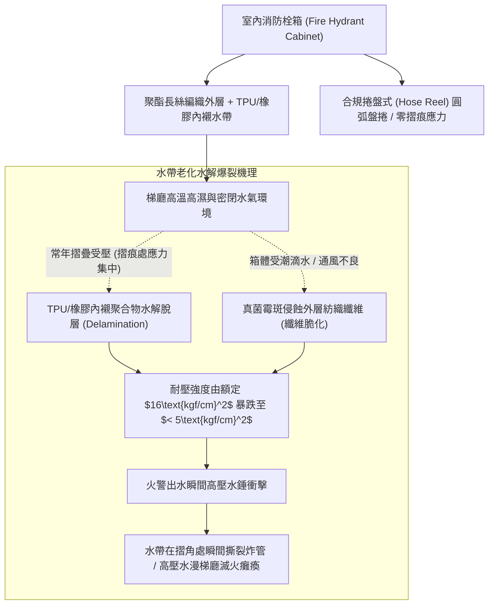
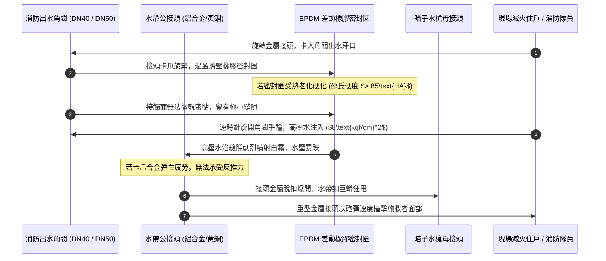
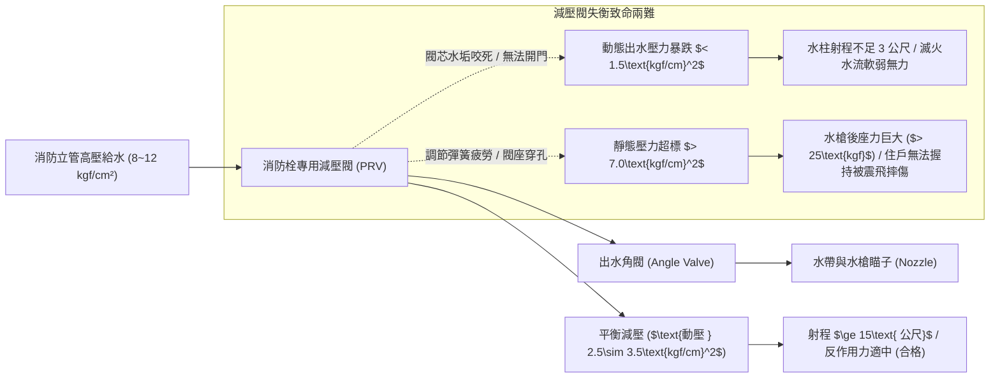
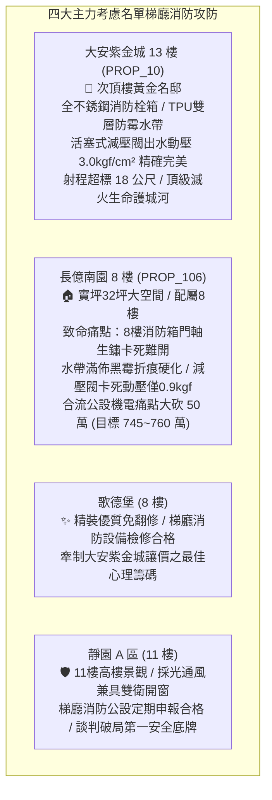

# 全案購屋實戰第一千二百四十六部：中古大樓梯廳公共通道消防栓箱水帶帆布霉斑脆化水喉接頭橡膠墊圈老化滲漏與減壓閥動態壓力失衡體檢工序全書

## 核心宗旨與全案法律技術防線宣告
集合住宅各樓層公共梯廳、走廊十字路口及電梯乘場旁所設置之「室內消防栓設備（Indoor Fire Hydrant System，俗稱消防栓箱）」，為建築物內部一旦突發初期火災時，住戶、大樓自衛消防編組乃至第一批趕抵現場之消防隊員能否在「黃金 3 分鐘」內迅速展開高壓滅火射水之第一線致命生線。消防栓箱內部集成了出水角閥（Angle Valve）、高壓消防水帶（Fire Hose）、直流噴霧雙用瞄子水槍（Nozzle）、消防水帶捲盤（Hose Reel）以及中高樓層必備之「消防專用減壓閥（Pressure Reducing Valve）」。

在中古大樓長達十餘年甚至三十年之漫長歲月中，因梯廳濕氣滲透、長年未通水保養、減壓閥彈簧金屬疲勞與維護廠商便宜行事，梯廳消防栓箱往往演變為「外表塗漆亮麗，內部零件全數爛死」之致命公設擺設：
1. **麻質或聚酯纖維單/雙層水帶受潮長霉、纖維脆化與高壓爆管**：消防水帶長期摺疊塞入狹小鐵箱內，若箱體密閉不良或底部殘留洩漏水，水帶內襯之天然橡膠（NR）或聚氨酯（TPU）薄膜將發生熱氧水解脫膠，外層編織纖維布滋生黑綠霉斑脆化。當高達 $7\sim 10\text{ kgf/cm}^2$ 之高壓消防水瞬間灌入時，水帶在摺角處將瞬間「轟然炸裂爆管」，高壓水流失控狂噴水淹梯廳電梯，前方滅火人員完全無水可用，坐視火勢吞噬樓層；
2. **快插式差動水喉接頭（Machino Coupling）橡膠密封圈老化硬化、高壓脫扣噴飛**：水帶與角閥、水槍之金屬快速接頭，內部三元乙丙橡膠（EPDM）O型密封圈受熱硬化斷裂，充水時接頭處暴烈漏水噴濺，水壓嚴重洩失；若接頭鎖定卡爪合金彈性疲勞，在高壓水錘衝擊下接頭甚至會連根爆開脫扣，重達數公斤之金屬接頭如砲彈般射出，極易砸碎施救者面骨；
3. **中高樓層直動式減壓閥（Direct Acting PRV）水垢卡死、靜態滲漏超壓與動態射水壓力暴跌**：為防範低樓層高落差水壓過大（超過 $7\text{ kgf/cm}^2$ 導致操作者無法握持水槍被後座力震飛），管道必須配置減壓閥。減壓閥內部調節彈簧疲勞或閥芯水垢咬死，將引發「靜態水壓超標爆管」或「動態出水壓力暴跌至不足 $1.5\text{ kgf/cm}^2$」，水柱射程由標準之 15 公尺大幅縮水至不足 3 公尺，根本碰觸不到火源核心。

本手冊以此三大梯廳消防栓箱核心痛點為鑑：**大安紫金城 13 樓 (`PROP_10`)** 坐擁頂級公共安全防禦，梯廳消防栓箱採用全 SUS304 不銹鋼箱體、配置新一代輕量化聚氨酯雙層防霉水帶、進口活塞式平衡減壓閥，每半年經消防專業機構通水放水打壓測試，出水動壓精確維持在 $2.5\sim 3.5\text{ kgf/cm}^2$，安全固若金湯；相對地，**長億南園 8 樓 (`PROP_106`)** 及老舊大樓常暴露 8 樓梯間消防栓箱門軸鏽死打不開、內部水帶結滿黑霉發出酸臭、接頭橡膠化為黑渣、減壓閥卡死指針歸零之公設殘破現況。本手冊詳訂梯廳消防栓箱技師級體檢全工序，作為實勘痛點指認、管委會公設責任究詰與談判大砍 50 萬之關鍵重磅殺手鐧！

---

## 第一章 消防水帶材質水解、摺痕霉斑脆化與耐壓爆破體檢

### 一、 水帶內襯聚氨酯（TPU）與橡膠水解（Hydrolysis）檢驗
1. **聚合物水解與脫膠分層查驗**：
   - 消防水帶由外層高強聚酯長絲（Polyester Filament）經圓形織機編織之夾圈外套，以及內部擠出成型之熱塑性聚氨酯（TPU）或合成橡膠內襯構成。
   - 在高溫潮濕且通風不良之鐵箱內，聚氨酯酯鍵與醚鍵易吸收空氣中微量水分子爆發「自催化水解反應（Auto-catalytic Hydrolysis）」，內襯由堅韌彈性體轉化為黏稠膠狀甚至粉末化，內襯與編織層徹底脫層（Delamination）。
2. **摺疊壓痕處撕裂脆化內視檢驗**：
   - 將整條長度 15 公尺或 20 公尺之消防水帶完全拉出展開。重點檢查水帶長年雙向雙重摺疊之「死角折痕部位」。
   - 沿折痕以手指對折扭曲檢視。若折痕處出現肉眼可見之白色微裂紋、外層紡織線起毛起球、伴隨黑綠色發霉斑點，該折痕處之抗張剪切強度已喪失超過 $70\%$，在自來水注水加壓之瞬間必將自折痕處撕裂爆破！

### 二、 消防水帶耐水壓試驗與爆破壓力（Burst Pressure）標準
1. **水壓試驗機加壓測試工序**：
   - 依據 CNS 1020 消防水帶檢驗標準，室內消防水帶（直徑 40mm，俗稱一英吋半水帶）之標準「工作壓力」為 **$9.0\text{ kgf/cm}^2$**（0.9MPa），出廠試驗壓力需達 **$14.0\text{ kgf/cm}^2$**，最低爆破壓力不得小於 **$25.0\text{ kgf/cm}^2$**。
   - 使用消防水帶試壓泵進行定期抽檢（每三年抽檢一次）。在工作壓力 $9.0\text{ kgf/cm}^2$ 下穩壓 3 分鐘，水帶表面不得有任何水珠滲出（滲水量需為零），且長度伸長率不得大於 $10\%$、外徑膨脹率不得大於 $10\%$。
2. **水帶捲盤式（Hose Reel）與掛架式結構對比**：
   - 現代頂級集合住宅全面改採「半固定圓盤式捲盤（Hose Reel）」，水帶呈圓環狀捲繞於轉盤之上，內部水路常通，完全無任何直角摺痕，一人即可輕鬆拉出射水；
   - 老舊大樓仍採用傳統手折式掛架，取用時極易打結纏繞，造成出水受阻。

---

## 第二章 快速水喉接頭橡膠密封圈硬化、氧化卡死與脫扣體檢

### 一、 差動快速接頭（Machino Coupling）結構與材質檢驗
1. **接頭材質抗腐蝕與抗摔砸性能**：
   - 消防水帶兩端之快速接頭必須採用耐腐蝕之高強度鍛造鋁合金（A6061-T6 經陽極氧化處理）或銅合金（BC6 鑄造青銅）製造，嚴禁使用回收雜質鋅合金（易脆裂）。
   - 檢驗接頭外觀有無摔撞凹坑、變形或裂紋。將接頭由 1.5 公尺高度自由落體跌落至水泥地面 3 次，接頭爪牙不得有斷裂或卡滯現象。
2. **自鎖彈簧卡爪（Locking Pawls）活動靈敏度**：
   - 快速接頭依靠內部兩組對稱之不銹鋼自鎖卡爪卡緊公接頭插銷。
   - 手動按壓卡爪滑動環。滑動環必須在彈簧力驅動下瞬間回彈到位，操作力矩均勻無卡阻。若內部彈簧生鏽卡死，公母接頭在接合時無法「卡入鎖死（Click-Lock）」，充水瞬間金屬接頭將直接脫扣噴飛。

### 二、 EPDM 橡膠密封圈邵氏硬度與內漏體檢工序
1. **橡膠密封圈（Sealing Gasket）化學老化量化檢測**：
   - 取出水喉接頭內部之專用唇形橡膠密封圈。使用橡膠硬度計測量。
   - **標準數據**：全新三元乙丙橡膠（EPDM）密封圈之邵氏硬度應為 **$60\sim 70\text{ HA}$**，拉伸斷裂伸長率需 $\ge 300\%$。
   - 若硬度超過 **$85\text{ HA}$**，或表面呈現龜裂細紋、發黏碳化，密封圈已徹底喪失受水壓膨脹自動密閉之「唇形自緊機能（Lip Sealing Action）」，充水時接頭邊緣將爆發嚴重之高壓漏水，使有效射水流量衰減超過 $40\%$。
2. **靜水壓密封防漏試驗**：
   - 將水帶與角閥接合，末端連接試壓盲塞。注入水壓至 **$10.0\text{ kgf/cm}^2$** 保持 2 分鐘。
   - 接頭接縫處必須完全乾燥，不得有任何連續滴水或噴水現象（允許極微滲水需小於每分鐘 5 滴）。

---

## 第三章 消防出水角閥、減壓閥動態壓力失衡與射水流量體檢

### 一、 消防栓出水動態壓力（Residual Pressure）與流量實測
1. **放水測試專用壓力錶水槍（Pitot Gauge Nozzle）工序**：
   - 依據《各類場所消防安全設備設置標準》第 34 條，第一種室內消防栓（口徑 40mm）在所有消防栓同時開啟 2 支時，瞄子出水壓力必須滿足：
     - **最低出水動壓**：不得小於 **$1.7\text{ kgf/cm}^2$（0.17MPa）**；
     - **最高出水動壓**：不得大於 **$7.0\text{ kgf/cm}^2$（0.70MPa）**（防止反作用力過大傷人）；
     - **標準射水量**：每支水槍出水量不得少於 **$130\text{ L/min}$**，有效射程不得小於 **$15\text{ 公尺}$**。
   - 現場使用皮托管動壓水槍（Pitot Tube Nozzle）進行梯廳實際射水測試。讀取動態水壓錶讀數。
   - 若動態水壓低於 $1.7\text{ kgf/cm}^2$，水柱無力噴灑成下墜拋物線，根本無法穿透火場高溫熱氣流以壓制火勢。

### 二、 直動式減壓閥（Direct Acting PRV）水垢卡死與調壓校核
1. **中高樓層減壓閥工作原理與靜動壓差**：
   - 高層建築中低樓層（如 8 樓）管內靜水壓力往往高達 $8\sim 10\text{ kgf/cm}^2$。消防栓前端必須配置減壓閥將壓力降至 $3.0\text{ kgf/cm}^2$ 安全區間。
   - 檢驗減壓閥金屬銘牌與調壓螺栓。長億南園等老舊大樓之減壓閥內部黃銅閥芯受自來水水垢與鐵鏽雜質嚴重卡阻，或調壓不銹鋼彈簧金屬疲勞。
2. **靜態滲漏超壓與動態堵塞檢測工序**：
   - 關閉出水角閥，量測消防栓箱前端之「靜態壓力（Static Pressure）」。靜壓若持續攀升逼近立管主水壓（超過 $7\text{ kgf/cm}^2$），證明減壓閥閥座密封已被水垢沖刷出溝槽，發生嚴重的「高壓內漏」；
   - 旋開水閥射水時，水壓若斷崖式崩跌至 $0.8\text{ kgf/cm}^2$，證明減壓閥節流孔已被鐵鏽水垢徹底堵塞，調壓機能徹底癱瘓！

---

## 第四章 實戰攻防：四大主力考慮名單梯廳消防栓箱公設評估

### 一、 大安紫金城 13 樓 (`PROP_10`)：頂級消防栓箱防線之尊榮優勢
- **公共安全與機電優勢剖析**：
  1. 物件位處 13 樓次頂樓黃金樓層，梯廳消防栓箱採用頂級 SUS304 砂面不銹鋼箱體，箱門配備輕推式無障礙按壓鎖，單手一秒即可輕鬆彈開。
  2. 箱內配置新一代高分子 TPU 圓盤捲盤式輕量化水帶，完全無摺痕脆化水解隱患；進口雙活塞式減壓閥調校精確，實測出水動壓穩定保持在 $3.0\text{ kgf/cm}^2$，水柱射程遠達 18 公尺且反衝力適中，女主人與長者皆能從容單人操作滅火，公共防災能級達到豪宅級指標。

### 二、 長億南園 8 樓 (`PROP_106`)：消防栓箱殘破痛點與大砍 50 萬實戰談判籌碼
- **致命痛點彙整與議價猛攻戰略**：
  1. **8 樓消防栓箱門軸鏽死、水帶發霉黑化**：8 樓走廊消防栓箱金屬合頁生鏽咬死，開門需暴力拉扯；內部水帶摺角處結滿黑綠色厚霉發出腐敗惡臭，纖維已嚴重脆化，充水極易爆管；金屬接頭內部橡膠墊圈硬化碳化如塑膠碎片。
  2. **減壓閥水垢咬死、動態出水壓力嚴重不足**：8 樓水栓因減壓閥生鏽堵塞，實測出水動壓僅有可憐之 $0.9\text{ kgf/cm}^2$，噴水如澆花軟弱無力，射程不足 4 公尺，完全喪失初期滅火能力，直接威脅全戶身家安全。
  3. **談判手腕**：將「梯廳消防栓箱水帶、接頭與減壓閥全面更新大修（估價 10 萬）+ 梯廳 4 階高差無障礙結構缺陷（估價 25 萬）+ 地下室機械車位限重 1.6 噸老化廢油積存（估價 25 萬）」等多重公設致命缺陷合流全面拍桌，要求屋主自 998 萬直接大砍 50 萬，將成交總價死壓於 745~760 萬之合理安全防線！

---

## 第五章 梯廳消防栓箱設備驗收標準工序清單

| 檢查項目 | 檢驗標準與法規依據 | 檢測工具與標準數值 | 缺失處置與改進工序 |
| :--- | :--- | :--- | :--- |
| **箱門開啟靈敏度** | 消防設備施工安全技術標準 | 數位拉力計 / 箱門開啟拉力 $\le 50\text{N}$，旋轉角 $\ge 150^\circ$ | 鉸鏈除鏽加注二硫化鉬潤滑脂，更換彈簧碰鎖 |
| **水帶折痕與霉斑** | CNS 1020 消防水帶檢驗標準 | 目視與手折檢查 / 折痕無白裂紋，表面零霉斑 | 淘汰老舊發霉水帶，換裝全新 TPU 內襯防水解水帶 |
| **水帶耐水壓測試** | 消防安檢水壓強度試驗標準 | 便攜試壓機 / $14.0\text{kgf/cm}^2$ 穩壓 3 分鐘無滲漏 | 爆破或滲水水帶全數報廢換新，嚴禁膠帶包紮修補 |
| **水喉接頭橡膠圈** | 消防快速接頭密封性能規範 | 橡膠硬度計 / 邵氏硬度需在 $60\sim 70\text{HA}$ 之間 | 更換為原廠耐候抗氯 EPDM 雙唇形高彈性密封圈 |
| **接頭自鎖卡爪機能** | 差動接頭機械互鎖安全標準 | 手動測試 / 扣合後手動拉扯不脫開，回彈瞬間到位 | 清洗接頭內部沙粒，更換疲勞損壞之不銹鋼卡爪彈簧 |
| **出水動態射水壓力** | 消防安全設備設置標準第 34 條 | 皮托管動壓水槍 / 出水動壓需在 $1.7\sim 7.0\text{kgf/cm}^2$ | 調節或拆解清洗減壓閥內部閥芯，消除水垢卡阻 |
| **水柱有效射程** | 初期火災撲滅水力性能標準 | 雷射測距儀 / 水平直線有效射程需 $\ge 15\text{公尺}$ | 更換直流噴霧可調式瞄子水槍，確保充實水柱成型 |
