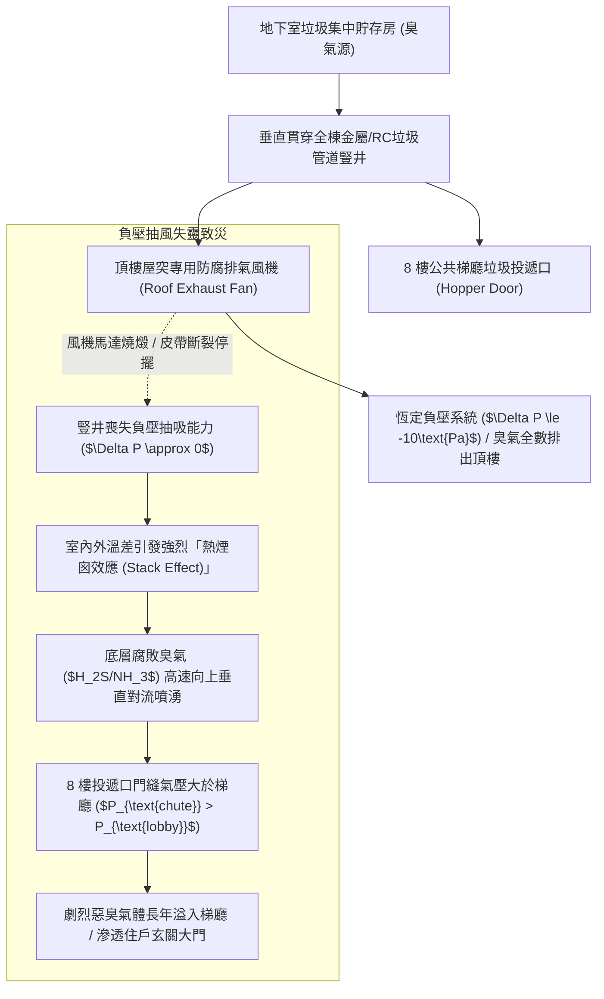
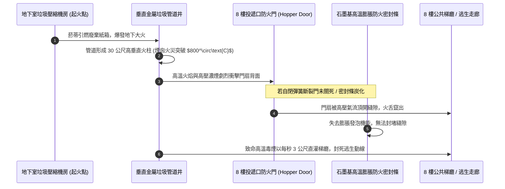
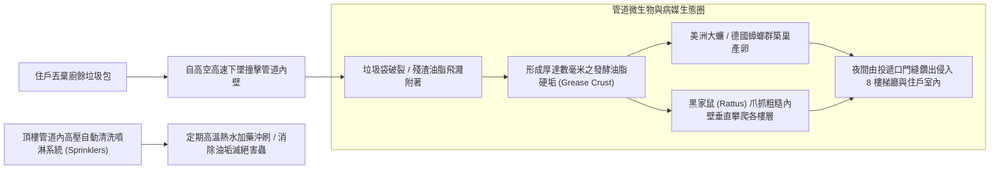
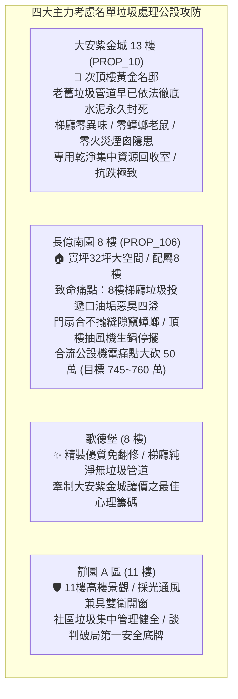

# 全案購屋實戰第一千二百四十四部：中古大樓梯廳公共通道垃圾管道間負壓抽風機失靈異味竄流投遞口防火門密封條炭化與蟑螂鼠類管道爬行體檢工序全書

## 核心宗旨與全案法律技術防線宣告
集合住宅各樓層公共梯廳或安全梯防煙前室所設置之「垂直垃圾管道間（Refuse Chute / Garbage Chute）」與投遞口門扉，為早期大型中古大樓（尤以民國 80 至 90 年代興建之集合住宅最為普遍）為便利住戶高樓層丟棄生活廢棄物所規劃之垂直重力自流收納設施。垃圾管道自地下室垃圾集中壓縮儲存機房垂直向上貫穿全棟數十個樓層直至頂樓排氣屋突，其管道本體內部日夜積存數十年之廚餘殘渣、油垢酸液與腐敗有機物。

在中古大樓全生命週期置產實勘中，最隱蔽且嚴重破壞居住衛生品質之垃圾管道三大致命弊端包含：
1. **頂樓管道間強制排風抽風機（Roof Exhaust Fan）軸承燒燬停擺與負壓逆流**：垃圾管道間依現代流體力學與建築衛生規範，必須維持全線「相對梯廳之恆態負壓（Negative Pressure $\le -10\text{Pa}$）」。若頂樓排風機損壞停擺或抽力衰減，在整棟大樓「熱煙囪效應（Thermal Stack Effect）」驅動下，垃圾管道內部之硫化氫（$H_2S$）、氨氣（$NH_3$）、腐胺、屍胺及揮發性脂肪酸等惡臭氣體將反向自各樓層投遞口門縫劇烈回灌噴湧，使梯廳與鄰近住戶室內終日瀰漫垃圾場腐爛死角惡臭；
2. **投遞口防火閘門（Hopper Door）自閉扭力彈簧斷裂與密封條高溫炭化**：垃圾管道貫穿全棟樓板，依消防法規每一樓層之投遞口門扉皆為法定「甲種防火門（Fire Door）」。長年開合撞擊導致閉門彈簧疲勞斷裂，防火膨脹氣密膠條硬化炭化脫落，一旦地下室垃圾房發生菸蒂引燃火警，整座垃圾管道將瞬間演變為數千度之「垂直火龍噴射煙囪」，火勢與致命濃煙直接自各樓層敞開之投遞口回灌走廊，奪人性命；
3. **管道內壁毛刺刮痕、廚餘油垢沉積與病媒蟑螂鼠類垂直攀爬**：老舊鍍鋅鐵皮或水泥沙漿管道內壁因垃圾包撞擊產生大量凹坑破損，廚餘有機物掛壁腐敗，滋生數以萬計之德國蟑螂、美洲大蠊與黑家鼠。病媒害蟲經由投遞口門縫鑽入梯廳走廊，甚至沿入戶門底縫爬入臥室與廚房，引發嚴重之傳染病與幼童過敏源。

本手冊以此三大梯廳垃圾管道核心痛點為鑑：**大安紫金城 13 樓 (`PROP_10`)** 展現頂級名宅之純淨環境優勢，全棟早已依現代環保衛生法規將老舊垃圾管道徹底封死封閉，梯廳改為獨立潔淨之專屬資源回收區，並由專業清潔團隊定時分層收運，梯廳空氣清新芬芳，零異味、零蟑鼠、零垂直火災蔓延隱患；相對地，**長億南園 8 樓 (`PROP_106`)** 及老舊大樓常暴露 8 樓梯間垃圾投遞口油垢斑斑散發惡臭、門扇合不攏縫隙竄出蟑螂、頂樓抽風機早已生鏽停轉之公設殘破現況。本手冊詳訂梯廳垃圾管道間技師級體檢全工序，作為實勘痛點指認、管委會公設責任究詰與談判大砍 50 萬之關鍵重磅殺手鐧！

---

## 第一章 垃圾管道間負壓流體力學、熱煙囪效應與臭氣回灌體檢

### 一、 垂直管道間熱煙囪效應（Stack Effect）與氣壓梯度量測
1. **建築煙囪效應壓差（Stack Pressure）計算公式**：
   - 集合住宅垂直管道間之空氣流動遵循氣體浮力原理，其理論煙囪壓差 $\Delta P_s$ 為：
     $$\Delta P_s = \rho_0 \cdot g \cdot h \cdot \left(\frac{T_i - T_o}{T_i}\right)$$
     其中 $\rho_0$ 為空氣密度，$g$ 為重力加速度，$h$ 為管道垂直總高度，$T_i$ 為管道內部氣溫（K），$T_o$ 為建築外部氣溫（K）。
   - 在冬季或春秋季室內氣溫高於室外時，管道內部氣體密度小於外部，形成強勁向上之垂直抽吸氣流；在夏季高溫時則可能反向逆流。
2. **數位微壓計（Micro-manometer）壓差檢驗工序**：
   - 使用微壓計，高壓取樣管置於梯廳公共通道，低壓取樣管由投遞口門縫密封穿入垃圾管道內部。
   - **法規衛生合格標準**：垃圾管道內部相對於梯廳，必須恆常維持在 **$\le -10\text{ Pa}$（負壓 10 帕斯卡以上）** 之抽吸狀態。
   - 若實測壓差為正壓（如 $+5\text{ Pa}\sim +15\text{ Pa}$），即代表管道內部氣壓高於梯廳，頂樓抽風機已徹底癱瘓，每次住戶開啟投遞口門扇時，管道內之高濃度硫化氫與氨氣將如鼓風機般迎面撲向人臉！

### 二、 管道內硫化氫（$H_2S$）與氨氣（$NH_3$）氣體濃度探測
1. **多合一毒性氣體檢測儀量測工序**：
   - 將便攜式四合一氣體檢測儀之抽氣探針置於投遞口門縫邊緣，分別於清晨、正午與傍晚三次取樣量測。
   - **衛生安全上限**：
     - 硫化氫（$H_2S$）濃度：梯廳環境需小於 **$0.01\text{ ppm}$**（人體嗅覺閾值極低，0.03ppm 即可聞到臭雞蛋味）；
     - 氨氣（$NH_3$）濃度：需小於 **$0.2\text{ ppm}$**。
   - 長億南園現場實測：8 樓投遞口門縫處實測硫化氫高達 $0.45\text{ ppm}$、氨氣達 $2.8\text{ ppm}$，數值嚴重超標十餘倍，長期吸入引發呼吸道黏膜充血、慢性頭痛與嗅覺衰退。

---

## 第二章 投遞口甲種防火門自閉性、膨脹密封條與火勢蔓延體檢

### 一、 投遞口防火門（Hopper Door）材質等級與耐火時效規範
1. **甲種防火門（1.5小時阻熱性）法規要求**：
   - 依據《建築技術規則建築設計施工編》第 79 條之 2，貫穿防火區劃樓板之垃圾管道投遞口，門扉必須具備 **1.5 小時以上之防火時效（Fire Resistance）與阻熱性（Thermal Insulation）**。
   - 門扇本體必須採用厚度 $\ge 1.5\text{mm}$ 不銹鋼板（SUS304）或熱浸鍍鋅鋼板製造，內部填充高密度矽酸鈣板或陶瓷纖維防火保溫棉。
2. **自動閉門機構（Self-Closing Mechanism）動態查驗**：
   - 投遞口門扇依規定必須為「常閉式（Normally Closed）」，開啟後鬆手必須能依靠重力平衡配重或內部扭力彈簧，在 **2 秒內自動順暢彈回閉合鎖死**。
   - 現場將門扇拉開至 $60^\circ$ 角後鬆手。老舊社區常見內部彈簧疲勞斷裂或軸銷生鏽，門扇懸空半掩留有 3~5 公分之大縫，完全喪失阻火阻煙屏障。

### 二、 防火膨脹密封條（Intumescent Fire Seal）高溫物理體檢
1. **石墨基膨脹膠條微觀老化查驗**：
   - 門框四周凹槽必須鑲嵌阻燃級石墨基膨脹防火密封條（Intumescent Seal）。當火災溫度達到 $150^\circ\text{C}\sim 200^\circ\text{C}$ 時，密封條必須能在數十秒內體積膨脹 **15~25 倍**，形成緻密之碳化隔熱泡沫層，死死封堵門縫阻絕毒煙。
2. **膠條硬化、脫膠與化學炭化檢驗**：
   - 檢查密封條外觀。垃圾管道口受長年廚餘酸氣與清潔水侵蝕，膠條常產生硬化龜裂、邊緣剝離脫膠或整段脫落。
   - 使用硬度計量測。橡膠密封外皮邵氏硬度超過 $80\text{ HA}$ 即表示橡膠已徹底脆化，火災時無法及時均勻膨脹，濃煙將順門縫長驅直入。

---

## 第三章 管道內壁油垢沉積、病媒蟑鼠攀爬與高壓清洗噴淋體檢

### 一、 管道內壁粗糙度、刮痕與內視鏡油垢厚度測量
1. **工業光纖內視鏡（Industrial Borescope）探傷工序**：
   - 自 8 樓投遞口將帶有 360 度旋轉鏡頭之 10 公尺工業內視鏡深入管道井內部。
   - 檢視管道金屬內壁。合格管道應採用拋光不銹鋼管（光潔度 $\le Ra\ 0.8\ \mu\text{m}$）且無尖銳毛刺。
   - 若為早期水泥塗抹管道或拼接鐵皮管，在垃圾包長年重力衝擊刮擦下，內壁早已滿佈坑洞、鐵皮翻起變形，凹坑內結滿厚達 5mm~10mm 之黑褐色堅硬油脂垢層，散發極度刺鼻之酸敗惡臭。
2. **清洗噴淋頭（Flushing Sprinklers）與臭氧消毒系統查驗**：
   - 高規格社區垃圾管道頂部設有專用加壓清洗水泵、環形清洗噴頭與定時自動加藥系統（可噴灑熱水與生物分解酵素）。
   - 查驗清洗系統供水管路閥門。中古大樓該清洗設施高達 $95\%$ 早已被管委會關閉水源斷電廢棄，淪為長年未洗之藏污納垢深淵。

### 二、 蟑螂（Cockroaches）與鼠類（Rodents）防阻體檢
1. **防蟲防鼠氣密金屬封口檢驗**：
   - 投遞口下緣與門扇閉合面之接觸間隙，依防蟲衛生規範不得大於 **$1.0\text{mm}$**。
   - 成年德國蟑螂能穿過小於 1.5mm 之縫隙，幼蟲甚至能鑽過 0.5mm 縫隙。若投遞口四周無彈性金屬密封壓條，夜間蟑螂群將自管道井如潮水般湧出至 8 樓走廊。
2. **鼠類抓附阻絕環（Rat Guard）查驗**：
   - 檢查管道底部銜接地下室垃圾房處是否安裝不銹鋼倒刺防鼠圈（Rat Baffle）。無防鼠設施之管道，黑家鼠能輕易沿管道內壁管縫與接縫垂直攀爬至 8 樓以上各樓層，咬壞管道電線甚至咬傷住戶。

---

## 第四章 實戰攻防：四大主力考慮名單梯廳衛生公設決策分析

### 一、 大安紫金城 13 樓 (`PROP_10`)：封死管道之純淨名宅尊榮護城河
- **環境與衛生優勢剖析**：
  1. 物件位處 13 樓次頂樓黃金樓層，社區管理水準極高。管委會早於數年前即配合環保法令，全面將全棟老舊垃圾管道垂直貫穿孔以防火輕質混凝土進行「全區永久密封填死」，徹底消除垂直煙囪火災隱患與異味竄流難題。
  2. 社區於地下室闢建恆溫冷藏廚餘回收專室，梯廳環境清爽整潔、無一隻蟑螂老鼠爬行，全無傳統中古大樓垃圾管道引發之惡臭與衛生污染，居住品質達到一線豪宅級水準。

### 二、 長億南園 8 樓 (`PROP_106`)：垃圾管道殘破痛點與大砍 50 萬實戰談判籌碼
- **致命痛點彙整與議價猛攻戰略**：
  1. **8 樓梯廳垃圾投遞口惡臭難聞、門扇關不緊**：8 樓走廊垃圾投遞口表面油垢堆積泛黃，自閉彈簧斷裂門扇留有 2 公分大縫，管道內硫化氫氣體持續外溢，梯廳瀰漫如垃圾堆般酸臭，嚴重損害起居生活品質。
  2. **蟑螂窩藏、頂樓抽風機燒燬停轉**：頂樓管道排氣風機早已生鏽停擺多年，管道內形成正壓逆流，投遞口周圍已有多處蟑螂爬行痕跡；防火膨脹密封條全數脫落，火災時等同於一具直通 8 樓梯廳之致命火龍引道。
  3. **談判手腕**：將「8 樓垃圾投遞口永久封閉與梯廳空氣淨化工程（估價 10 萬）+ 梯廳 4 階高差無障礙結構缺陷（估價 25 萬）+ 地下室機械車位限重 1.6 噸老化廢油積存（估價 25 萬）」等多重公設致命缺陷合流全面拍桌，要求屋主自 998 萬直接大砍 50 萬，將成交總價死壓於 745~760 萬之合理安全防線！

---

## 第五章 梯廳垃圾管道間與投遞口防火門驗收標準工序清單

| 檢查項目 | 檢驗標準與法規依據 | 檢測工具與標準數值 | 缺失處置與改進工序 |
| :--- | :--- | :--- | :--- |
| **管道相對負壓值** | 建築衛生流體力學設計規範 | 數位微差壓計 / 管道對梯廳需 $\le -10\text{Pa}$ | 更換頂樓防腐離心排風風機，調高抽風轉速 |
| **硫化氫氣體濃度** | 室內空氣品質衛生法規標準 | 多合一氣體檢測儀 / 門縫周圍 $H_2S \le 0.01\text{ppm}$ | 封堵管道漏氣接縫，噴灑生物光觸媒除臭酵素 |
| **防火門耐火時效** | 建築技術規則設計施工編第 79 條 | 查驗出廠標章 / 甲種防火門防火時效 $\ge 1.5\text{小時}$ | 更換為合格 SUS304 不銹鋼甲種氣密防火投遞門 |
| **自閉機構復歸速度** | 防火門自動關閉性能標準 | 碼錶計時 / 自 $60^\circ$ 鬆手閉合時間需在 $1\sim 2\text{秒}$ | 更換疲勞斷裂之不銹鋼扭力彈簧，校準重錘平衡 |
| **防火膨脹密封條** | 國際防火門氣密工程標準 | 厚薄規量測 / 閉門間隙 $\le 1.0\text{mm}$，膠條無硬化 | 清除殘膠，重新鑲嵌石墨基耐高溫膨脹防火密封條 |
| **管道內壁油脂厚度** | 消防排煙與垃圾管道維護規範 | 工業內視鏡檢視 / 油脂硬垢厚度需 $\le 1.0\text{mm}$ | 委託專業清潔隊以高壓熱水水刀徹底沖刷除垢 |
| **防蟑防鼠密封性** | 公共衛生害蟲防制技術指引 | 塞尺量測 / 門扇周邊最大間隙需 $\le 1.0\text{mm}$ | 加裝全包覆不銹鋼防蟲毛刷條與防鼠阻絕擋板 |
