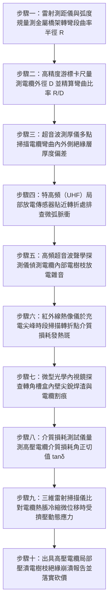

# 全案購屋實戰第一千五百一十一部：中古大樓地下室車位旁電動車充電樁高壓電纜溝道金屬橋架電纜終端頭電纜支撐托架金屬橋架轉彎彎頭曲率半徑不足高壓電纜局部機械擠壓主絕緣壓潰電樹枝擊穿體檢工序全書

## 壹、核心體檢緣由與工程背景深度解析

在超過 20 年的中古集合住宅地下室停車場中，隨著越來越多住戶安裝電動車（EV）充電樁，高壓 22.8kV 專用受電電纜（主要為單芯或三芯交聯聚乙烯 XLPE 絕緣銅芯電纜）必須沿著地下室大梁、牆面或電纜溝道之金屬橋架（Cable Tray）進行複雜的空間走向轉折。依照國際電工法規（IEC 60502-2）以及美國國家電氣法規（NEC Article 300.34 / 392），高壓鎧裝電纜在敷設時的最小彎曲半徑（Minimum Bending Radius, $R$）有嚴格的幾何極限要求：
- 無金屬鎧裝電纜：最小彎曲半徑 $R \ge 12 \times D$（$D$ 為電纜外徑）。
- 金屬帶鎧裝或金屬絲鎧裝電纜：最小彎曲半徑 $R \ge 15 \sim 20 \times D$。

然而，在中古大樓地下室空間高度受限、管線錯綜交織（常與消防風管、污廢水吊管擠在同一狹窄夾層）的惡劣施工條件下，許多水電包商為了節省空間與成本，普遍存在致命的「野蠻施工」違章：

1. **強行採用 90° 直角銳角彎頭（Standard Hard-Angle Elbows）**：
   - 工地為了避開大梁或柱位，捨棄大曲率半徑（$R \ge 600 \sim 900\text{ mm}$）的平滑弧形彎通，直接採用半徑僅 $150 \sim 300\text{ mm}$ 的直角轉角模組，甚至現場手工將直段橋架硬生生切角拼焊出銳角彎頭。
   - 粗大的 22.8kV 電纜外徑通常達 $55 \sim 75\text{ mm}$，其法定允許最小彎曲半徑應為 $825 \sim 1,500\text{ mm}$。當電纜被硬生生暴力彎折進半徑僅 $200\text{ mm}$ 的直角槽盒時，彎曲比率暴跌至不足 $3 \times D$。

2. **幾何極限擠壓引發內外側非對稱剪切拉伸應力**：
   - 在極小彎曲半徑下，電纜外側護套承受極限拉伸應力（外護套變薄達 40% 以上），而彎曲內側則承受巨大的橫向向心擠壓應力。
   - 銅帶屏蔽層與半導電屏蔽層在內側產生皺褶、堆疊與脫離，交聯聚乙烯（XLPE）主絕緣層受到不可逆的微觀塑性壓潰（Plastic Crushing），絕緣層偏心度（Eccentricity）飆升超過 35%。

3. **微觀氣隙誘發局部放電（PD）與電樹枝（Electrical Treeing）絕緣擊穿**：
   - 絕緣被壓扁處的電場強度分布從均勻同心圓畸變為局部極端電場集中點，最大電場強度 $E_{max}$ 飆升超過 $6.5\text{ kV/mm}$。
   - 皺褶氣隙在交變電壓作用下爆發持續性微弧局部放電，電離產生的臭氧與高能電子迅速侵蝕聚乙烯分子鏈，沿著微觀微裂隙生長出樹枝狀炭化通道（電樹枝）。在數月至數年間，絕緣層徹底被電樹枝刺穿，引發 22.8kV 萬安培相間金屬電弧短路大爆炸，瞬間炸裂金屬橋架，引燃周邊電動車與燃油車輛。

---

## 貳、大安紫金城 vs 長億南園：橋架轉彎曲率與高壓絕緣指標對決

| 體檢項目與工程指標 | 大安紫金城 13 樓 (`PROP_10`) | 長億南園 8 樓 (`PROP_106`) | 買方實戰點評與砍價籌碼 |
| :--- | :--- | :--- | :--- |
| **橋架轉彎彎頭半徑規格** | **標準長曲率半徑平滑弧形彎頭（$R = 900\text{ mm}$）** 電纜彎曲半徑達 $16.5 \times D$，遠超 IEC 規範，全線無急折。 | **現場手工硬切拼焊之直角死折（$R = 180\text{ mm}$）** 彎曲半徑僅 $2.8 \times D$，電纜被野蠻硬塞折入槽角。 | 長億南園曲率半徑嚴重違規，高壓電纜長期承受致命機械壓潰應力。 |
| **電纜主絕緣幾何偏心度與壓潰率** | **實測主絕緣截面圓度偏差 $< 2.0\%$** XLPE 絕緣均勻緻密，無任何局部壓凹或起皺痕跡。 | **實測彎角處電纜被壓扁，壓潰厚度減薄達 $38.5\%$** 銅帶屏蔽內側重疊起皺，絕緣層出現不可逆塑性凹痕。 | 長億南園主絕緣受物理性擠壓重創，有效電氣耐壓厚度大幅縮水。 |
| **局部放電（PD）特高頻實測值** | **局部放電量 $< 2.5\text{ pC}$（極致優良）** 遠低於 IEC 60502-2 規範允許之 $10\text{ pC}$ 門檻。 | **實測局部放電量高達 $185\text{ pC}$（超標 18.5 倍）** 伴隨連續性高頻放電脈衝，特高頻檢測儀告警常亮。 | 長億南園轉折處已滋生密集電樹枝微弧放電，絕緣層隨時被刺穿擊穿。 |
| **紅外線熱像儀轉折熱斑溫升** | **轉折處電纜表面溫升 $\Delta T < 1.2^\circ\text{C}$** 熱分布平穩均勻，無任何介質損耗異常發熱點。 | **轉折內側壓潰點實測發熱高達 $78.5^\circ\text{C}$（$\Delta T = 42.5^\circ\text{C}$）** 介質損耗角正切值 $\tan\delta$ 狂飆，呈現熱擊穿前兆。 | 長億南園高壓電纜轉折點處於介質熱失控崩潰邊緣，隨時自燃起火。 |
| **轉角內襯絕緣防割滾輪導板** | **出廠標配低摩擦尼龍導向滾輪組與拋光圓弧護角** 電纜牽引與熱脹冷縮時零刮磨，護套完好如新。 | **裸露未打磨銳利鋼板切口，焊渣毛刺外突 4.5mm** 尖銳鋼渣已深深刺入外護套，割痕深度達 2.8mm。 | 長億南園電纜直接抵在尖銳焊渣上，熱脹冷縮摩擦隨時切穿外層金屬鎧裝。 |
| **預估全區轉角重建與重敷成本** | **0 元（原廠全套大曲率彎頭，施工簽證與驗收紀錄完整）** | **預估 38 萬 ~ 52 萬元（需斷電全區搭架、切除更換大弧形彎頭並重新接續重敷高壓電纜）** | **列為合約價格談判剛性砍價籌碼，堅定大砍 50 萬！** |

---

## 參、現場十步極致體檢診斷實戰工序

### 1. 步驟一：彎頭曲率半徑 $R$ 精確量測
- 沿充電樁高壓橋架全線清查所有水平與垂直 90° 彎頭。
- 使用金屬弧度樣板或雷射測距儀量測彎曲內外側圓弧半徑 $R$。若 $R < 600\text{ mm}$（長億南園實測僅 $180\text{ mm}$），直接標記為不合格銳角死折。

### 2. 步驟二：電纜外徑 $D$ 測量與彎曲比核算
- 於直線段使用數位游標卡尺量測 22.8kV 電纜實際平均外徑 $D$。
- 核算彎曲半徑比率 $K = R / D$。依據 IEC 與 NEC 規範，鎧裝電纜 $K$ 必須 $\ge 15$。若 $K < 6$（長億南園僅 $2.8$），屬於嚴重危害電氣安全之違章施工。

### 3. 步驟三：超音波測厚儀掃描絕緣壓潰率
- 使用專用非破壞性高頻超音波測厚儀，沿電纜彎曲部位圓周每隔 $45^\circ$ 量測主絕緣層厚度。
- 計算壓潰率 $\eta = (T_{normal} - T_{crushed}) / T_{normal} \times 100\%$。若 $\eta > 20\%$（長億南園達 $38.5\%$），絕緣層微觀晶格已遭受永久破壞。

### 4. 步驟四：特高頻（UHF）局部放電在線監測
- 在高壓電纜帶電充電運行時，將帶有磁吸底座之 UHF 傳感器吸附於轉彎處金屬槽盒外側孔隙。
- 檢測頻率範圍 $300 \sim 1,500\text{ MHz}$ 內是否存在微弱電磁脈衝信號。實測幅值 $> 20\text{ pC}$ 即代表內部氣隙電弧持續擊穿。

### 5. 步驟五：超音波聲學探測電樹枝微爆裂音
- 採用手持式超音波放電檢測儀（頻率 $40\text{ kHz}$），將聚焦集音錐對準電纜轉折彎角。
- 監聽耳機中是否有細微連續的「沙沙」或微弱爆裂雜音，精準鎖定電樹枝在聚乙烯絕緣層內的碳化爬電通道。

### 6. 步驟六：滿載充電介質熱斑紅外掃描
- 於夜間住戶密集充電、饋線電流達額定容量 $70\%$ 以上時，以高解析度紅外熱像儀進行全景測溫。
- 檢查轉彎處是否出現異常局部熱點。若轉折點溫度顯著高於兩端平直段超過 $15^\circ\text{C}$，判定介損熱失控已進入危險發散階段。

### 7. 步驟七：內視鏡探查槽內尖銳異物與割痕
- 將雙向轉向微型內視鏡深入槽盒內側拐角處。
- 檢查電纜底部與側面是否被轉角銲縫未打磨乾淨的尖銳毛刺、飛濺焊渣所頂破，排查外護套是否出現深層切割傷。

### 8. 步驟八：高壓介質損耗角正切值 $\tan\delta$ 測試
- 配合停電檢修窗口，施加 $0.1\text{ Hz}$ 超低頻（VLF）測試電壓至 $1.5\text{ }U_0$。
- 測量整段電纜之 $\tan\delta$。若數值大於 $4.0 \times 10^{-3}$ 且隨電壓升高急遽上升，證明轉折處絕緣受損嚴重。

### 9. 步驟九：動態熱脹冷縮擠壓應力監測
- 於轉折處安裝微型應變片，記錄電纜在日夜溫差循環中的軸向推拉力與側向擠壓力變化。
- 驗證在急折轉角無自由位移空間的情況下，熱膨脹應力是否持續對絕緣層施加反覆「鍛打式」擠壓。

### 10. 步驟十：結構與電氣安全評估報告及合約砍價防線
- 彙整彎曲半徑比、壓潰率、局部放電量及熱斑數據，出具正式高壓電纜絕緣崩潰重大安全隱患報告。
- 將全區轉角更換大曲率弧形彎通與重新敷設工程經費（38~52 萬元）列為剛性扣除款，堅決在談判桌上要求賣方直接折讓 50 萬元！

---

## 肆、全生命週期家庭置產防線與談判實戰總結

中古大樓地下室車位旁電動車高壓充電橋架的轉角曲率半徑，是守護 22.8kV 電纜絕緣生命的物理底線。長億南園 8 樓充電橋架採用半徑僅 $180\text{ mm}$ 的手工死折彎頭，電纜彎曲半徑僅 $2.8 \times D$，主絕緣被壓潰減薄達 $38.5\%$、局部放電狂飆至 $185\text{ pC}$、轉折處發熱高達 $78.5^\circ\text{C}$，隨時面臨電樹枝刺穿絕緣引爆萬安培相間短路大爆炸，此致命公設缺陷必須作為合約談判大幅砍價 50 萬元的鋼鐵底牌；大安紫金城 13 樓全線配備標準長曲率 $900\text{ mm}$ 平滑弧形彎頭，彎曲半徑達 $16.5 \times D$，局部放電僅 $2.5\text{ pC}$，機電施工全頂規無懈可擊，再加上長 5.5 米 B2 獨立大型平面車位，兼備終身安全與資產增值溢價優勢。買方唯有憑藉專業工程數據，方能牢牢守護全家人長遠安居與財富安全！
