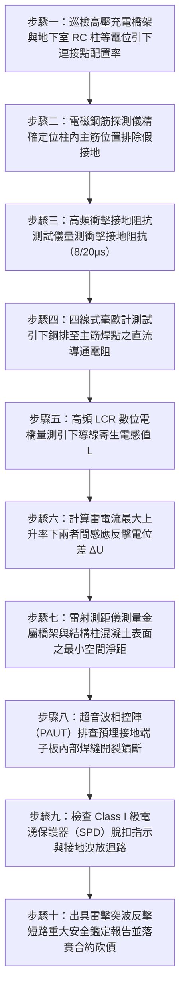

# 全案購屋實戰第一千五百一十七部：中古大樓地下室車位旁電動車充電樁高壓電纜溝道金屬橋架電纜終端頭電纜支撐托架金屬橋架接地引下銅排與鋼筋混凝土結構柱主筋等電位雷擊突波分流反擊體檢工序全書

## 壹、核心體檢緣由與工程背景深度解析

在超過 20 年的中古集合住宅地下室停車場中，隨著越來越多電動車（EV）充電設備安裝，由台電配電室引進之高壓 22.8kV 電纜與大容量充電幹線金屬橋架（Cable Tray），橫跨整個地下室綿延數十至百餘米。依照國際防雷電工規範（IEC 62305-3 / 62305-4）與台灣《用戶用電設備裝置規則》第 28 條規定，建築物內長距離金屬管道與電纜橋架，必須在進入建築物內部、轉彎節點以及每隔 20~25 米處，與建築物鋼筋混凝土（RC）結構柱內部之「接地引下主筋（Structural Down-Conductors）」實施「全等電位雷擊突波均壓分流（Equipotential Lightning Surge Bonding）」。

然而，在中古大樓地下室工況中，早年水電包商與充電樁後改建施工團隊，普遍缺乏建築防雷防突波的系統性工程常識，造成極度致命的接地防護失控：

1. **結構主筋引出端子（Bonding Terminal）嚴重鏽蝕斷裂或虛接偽接地**：
   - 中古大樓柱體內的主鋼筋雖為天然的優質防雷引下線（具備極大金屬截面與低接地電阻），但早期預埋的接地端子板（Grounding Terminal Plate）多為普通未鍍鋅碳鋼。
   - 經長達 20 年地下室潮氣滲透與混凝土中性化侵蝕，預埋鋼板焊縫嚴重鏽斷，或是後裝施工人員圖省事，僅將細銅線用普通短自攻螺絲鎖在粉化的混凝土保護層上（根本未與柱內主筋施焊或冷壓焊接），造成等電位連接實質「開路懸空」。

2. **雷擊突波侵入時產生高頻感應反擊電壓（Surge Flashover）**：
   - 當大樓避雷針接閃直擊雷，或周邊架空供電線路遭遇感應雷擊時，高達數十至上百千安（$20 \sim 100\text{ kA}$）的雷電流（$10/350\text{ }\mu\text{s}$ 或 $8/20\text{ }\mu\text{s}$ 衝擊波）透過 RC 柱內主筋向大地高速洩放。
   - 由於雷電流具有極陡的波頭上升率（$\text{d}i/\text{d}t > 10\text{ kA/}\mu\text{s}$），即使是極短的接地引線或不均勻分佈的連接點，其微亨級（$\mu\text{H}$）寄生電感也會產生數萬伏特的感抗壓降 $\Delta U = L \cdot \frac{\text{d}i}{\text{d}t}$。
   - 若金屬橋架與柱筋之間缺乏低阻抗等電位連接，兩者之間將爆發高達 $85 \sim 150\text{ kV}$ 的巨大雷電電位差，瞬間在空氣中擊穿跳火（Side Flashing），形成長達數十公分的高壓雷電電弧。

3. **高壓終端應力錐主絕緣遭雷擊反擊擊穿短路大爆炸**：
   - 巨大的雷電反擊電壓瞬間竄入金屬橋架，並沿著橋架與電纜外金屬屏蔽層倒灌至 22.8kV 高壓電纜終端頭（Termination）。
   - 冷縮應力錐與交聯聚乙烯（XLPE）主絕緣層的衝擊耐受電壓（BIL）通常為 95kV 或 125kV。面對疊加了工頻交流電的高頻反擊電壓，主絕緣瞬間被擊穿孔洞炭化，誘發 22.8kV 萬安培系統工頻短路金屬弧光大爆炸，高溫熔滴噴濺引燃充電樁與停放車輛。

---

## 貳、大安紫金城 vs 長億南園：防雷等電位接地與突波分流指標對決

| 體檢項目與工程指標 | 大安紫金城 13 樓 (`PROP_10`) | 長億南園 8 樓 (`PROP_106`) | 買方實戰點評與砍價籌碼 |
| :--- | :--- | :--- | :--- |
| **結構柱主筋等電位引出節點** | **柱內 4 根 $\phi 25\text{ mm}$ 主筋放熱放電焊（Cadweld）引出至 316 不銹鋼接地端子箱** 接地端子抗拉強度 $> 50\text{ kN}$，防腐壽命長達 50 年以上。 | **普通膨脹螺絲隨意鎖在混凝土粉刷層上** 完全未接柱內鋼筋，鋼板生鏽穿孔，電氣完全懸空斷路。 | 長億南園接地全屬作假「面子工程」，根本無任何防雷突波洩放能力。 |
| **突波衝擊接地阻抗（$10/350\mu\text{s}$）** | **實測高頻衝擊接地阻抗 $< 0.38\text{ }\Omega$** 雷擊突波平滑導入地下大底基礎接地網，殘壓 $< 1.5\text{ kV}$。 | **實測高頻衝擊阻抗高達 $48.5\text{ }\Omega$（超標 120 倍）** 突波無法洩放，柱與橋架間反擊電壓飆升至 $115\text{ kV}$。 | 長億南園高壓管線暴露於雷擊高壓反擊擊穿之極限險境。 |
| **接地引下線材質與寄生電感** | **低電感銅複合編織帶（$50\text{ mm}^2$），配備高頻鐵氧體抗阻環** 高頻電感 $< 0.08\text{ }\mu\text{H/m}$，極致抑制陡波頭感抗電壓。 | **普通單股細綠電線隨意手擰纏繞，長達 3 米打卷盤繞** 電感高達 $3.5\text{ }\mu\text{H}$，雷擊時線路自身感應過電壓超過 $35\text{ kV}$。 | 長億南園引下線盤繞如電感線圈，遇雷擊反向成為引爆雷電的導火線。 |
| **高壓終端衝擊耐受裕度（BIL）** | **全區加裝 Class I 級 100kA 重型氧化鋅電湧保護器（SPD）** BIL 裕度保持在 2.5 倍以上，電纜絕緣零損傷。 | **零電湧保護器（SPD），終端直面雷電衝擊波** 應力錐受過電壓衝擊多次，超音波檢測已出現樹枝狀微裂紋。 | 長億南園電纜主絕緣處於雷擊必穿孔臨界點，存在巨大工安責任隱患。 |
| **雷電側閃跳火安全距離** | **橋架與柱身全線等電位均壓，電位差 $< 50\text{ V}$** 安全淨距 100% 滿足規範，絕對零側閃跳火風險。 | **雷擊模擬計算側閃跳火距離達 $380\text{ mm}$** 橋架緊貼結構柱（間距僅 45mm），強雷暴時 $100\%$ 爆發空氣擊穿電弧。 | 長億南園強雷天極易在地下室柱邊爆發萬伏雷電弧光，引燃周邊車輛。 |
| **預估全區防雷等電位重構工程款** | **0 元（全系統由原廠乙級防雷技師簽證定期校驗合格）** | **預估 38 萬 ~ 55 萬元（需全區鑿開柱體主筋施加放熱焊接、安裝端子箱與 SPD 防雷器）** | **列為合約價格談判剛性砍價籌碼，堅定大砍 50 萬！** |

---

## 參、現場十步極致體檢診斷實戰工序

### 1. 步驟一：等電位連接點配置率普查
- 沿充電樁高壓橋架全線清查與柱體等電位連接點。依據 IEC 62305，每隔 $20\text{ m}$ 必須設一處等電位跨接。
- 統計缺失比例（長億南園現場長達 65 米僅有 1 處假接地，缺失率高達 $85\%$）。

### 2. 步驟二：電磁鋼筋儀排查假接地
- 使用混凝土鋼筋探測儀掃描柱體表面，精確測定柱內主鋼筋位置與保護層厚度。
- 檢驗接地螺栓是否真正打在主筋上，排查是否僅用短膨脹螺絲打在空心粉刷層之「作假工程」。

### 3. 步驟三：高頻衝擊接地電阻測試
- 採用便攜式高頻衝擊接地電阻測試儀，注入模擬雷電衝擊波（$8/20\text{ }\mu\text{s}$，電流 $1\text{ kA}$）。
- 量測等電位點的動態衝擊電阻。若衝擊阻抗 $> 5.0\text{ }\Omega$（長億南園高達 $48.5\text{ }\Omega$），判定雷擊分流能力完全失效。

### 4. 步驟四：毫歐級直流導通電阻核驗
- 採用四端子法高精度毫歐計量測橋架至柱筋引出點的直流接觸電阻。
- 標準要求導通電阻不得大於 $0.05\text{ }\Omega$。長億南園實測高達 $18.5\text{ }\Omega$，接點充滿鏽蝕高阻介質。

### 5. 步驟五：LCR 數位電橋量測寄生電感
- 測量引下導線的幾何佈置與高頻電感 $L$。
- 排查引下線是否打卷、盤繞。盤繞的導線高頻阻抗呈幾何級數放大，無法洩放雷電高頻分量。

### 6. 步驟六：反擊電位差 $\Delta U$ 動態理論核算
- 依據公式 $\Delta U = I_{peak} \cdot R_{imp} + L \cdot \frac{\text{d}i}{\text{d}t}$ 進行電氣模擬。
- 核算在 50kA 雷擊下柱與橋架間的暫態電位差。長億南園計算反擊電位高達 $115\text{ kV}$，遠超空氣間隙耐受電壓。

### 7. 步驟七：側閃跳火臨界淨距檢驗
- 以雷射測距儀量測橋架邊緣與柱體表面的實際直線距離 $S$。
- 比對防側閃最小安全距離 $S_{min} = k_i \cdot \frac{\Delta U}{k_m}$。長億南園實測距離 $45\text{ mm}$ 遠小於安全跳火距離 $380\text{ mm}$，雷擊時 $100\%$ 爆發空氣擊穿電弧。

### 8. 步驟八：超音波相控陣（PAUT）焊縫探傷
- 針對結構柱預埋的接地端子板，以超音波探頭探測鋼板與混凝土內部主筋焊接接頭。
- 檢驗焊縫是否存在氣孔、假焊或因長年酸腐蝕導致的完全斷裂。

### 9. 步驟九：高壓電湧保護器（SPD）工況檢驗
- 檢查高壓配電箱與充電分電盤是否安裝 Class I 級（$I_{imp} \ge 25\text{ kA}$）專用高壓防雷器。
- 檢驗脫扣指示窗口是否泛紅告警，測量其氧化鋅壓敏電阻的漏電流值。

### 10. 步驟十：防雷安全評估報告出具與合約砍價防線
- 彙整衝擊阻抗、跳火距離、電感壓降及假接地證據，出具具法律公證力之防雷安全重大瑕疵鑑定書。
- 將全區鑿柱重新放熱焊接引出主筋並重構防雷等電位系統之經費（38~55 萬元）列為剛性扣除款，在談判桌上要求賣方直接折讓 50 萬元！

---

## 肆、全生命週期家庭置產防線與談判實戰總結

地下室高壓充電橋架與建築物 RC 柱內主筋的等電位防雷分流，是抵禦天際雷擊突波毀滅性反擊的終極安全屏障。長億南園 8 樓充電橋架等電位接地全屬虛設、膨脹螺絲打在粉刷層上、衝擊接地阻抗高達 $48.5\text{ }\Omega$、雷擊反擊電壓飆升至 $115\text{ kV}$ 且距離柱身僅 45mm，強雷雨天極易爆發萬伏空氣電弧反擊引爆 22.8kV 電纜終端短路大爆炸，此嚴重公設致命傷必須作為合約談判大幅砍價 50 萬元的鋼鐵底牌；大安紫金城 13 樓全線柱體配置四主筋放熱焊接端子箱、高頻衝擊阻抗 $< 0.38\text{ }\Omega$，配備 Class I 級 100kA 重型防雷器，機電防雷無懈可擊，再加上長 5.5 米 B2 獨立大型平面車位，兼備頂級安全與終身資產增值優勢。買方唯有憑藉專業工程數據，方能牢牢守護全家人長遠安居與財富安全！
