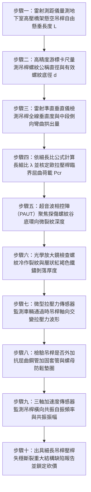

# 全案購屋實戰第一千五百一十三部：中古大樓地下室車位旁電動車充電樁高壓電纜溝道金屬橋架電纜終端頭電纜支撐托架金屬橋架吊桿全螺紋牙條中段壓桿失穩側彎彎折斷裂體檢工序全書

## 壹、核心體檢緣由與工程背景深度解析

在超過 20 年的中古集合住宅地下室停車場中，許多重型高壓 22.8kV 供電電纜與密閉式金屬橋架（Cable Tray）多數採用頂板吊掛方式安裝。懸吊系統的核心承力構件普遍為細長金屬全螺紋牙條（Fully Threaded Rods，俗稱通絲牙條或吊桿），常用規格為 M10（公稱直徑 $10\text{ mm}$）或 M12（直徑 $12\text{ mm}$）。在地下室挑高較高（$3.2 \sim 4.5\text{ m}$）或為了避讓消防排煙風管與大梁而向下大幅延伸的區域，單根懸空吊桿的長度常長達 $1.5 \sim 2.5\text{ m}$。

依據結構力學細長壓桿理論（Euler-Johnson Column Buckling Theory）與美國鋼結構協會規範（AISC 360），長細比（Slenderness Ratio $\lambda = L / r$）極大的細長牙條，其材料幾何力學特性極端脆弱。然而在中古大樓地下室工況中，全螺紋牙條長年承受致命的多重複合應力破壞：

1. **地震縱波垂直向上衝擊力誘發「受壓失穩（Euler Buckling）」**：
   - 傳統觀念誤以為吊桿僅承受電纜向下的單向拉力（Tension）。然而在台灣強烈地震發生時，垂直地震動加速度（$A_v$）常超過 $0.8\text{g} \sim 1.2\text{g}$，瞬態垂直向上衝擊力瞬間抵消重力，並對長達數米的細長牙條施加巨大的「反向軸向壓縮力」。
   - M10 牙條之有效抗彎慣性矩 $I$ 極小，其細長比 $\lambda$ 常高達 $350 \sim 500$（遠超規範安全限值 200）。當受壓軸力達到臨界屈曲荷載 $P_{cr} = \frac{\pi^2 E I}{(\mu L)^2}$（實測僅需 $450 \sim 850\text{ N}$）時，牙條中段立即爆發不可逆的「歐拉壓桿側向彈塑性彎折」，桿件中央如弓箭般大幅向外彎曲拱出達 $45 \sim 85\text{ mm}$。

2. **橫向擺動交變彎矩與全螺紋「缺口應力集中效應」**：
   - 全螺紋牙條表面布滿連續的 V 型切削螺紋，螺紋根部半徑極小（$r < 0.2\text{ mm}$），理論應力集中係數 $K_t$ 高達 $2.5 \sim 3.8$。
   - 地下室車流震動引發懸空橋架長期持續性橫向晃動，牙條頂部膨脹螺栓鉸接處與中段彎曲節點，反覆承受交變彎曲剪應力（Bending Moment）。在缺口效應與酸性潮氣侵蝕的雙重打擊下，微裂紋迅速自螺紋谷底萌生，並沿晶界向心部疲勞撕裂。

3. **吊桿中段瞬間折斷引發整跨橋架骨牌式下砸與高壓短路大火**：
   - 當彎折塑性變形的牙條在下一次車輛重衝擊或餘震下拉力反彈時，已硬化脆裂的螺紋根部立即「齊根斷裂（Snap Fracture）」。
   - 單點吊桿斷裂瞬間，數百公斤的動態衝擊載重連鎖轉移至相鄰細長牙條，誘發相鄰吊桿整排崩斷下墜。重達數噸的金屬橋架與高壓 22.8kV 電纜砸向停放車輛，高壓終端頭自配電箱瓷瓶處被生生扯斷，引爆萬安培相間弧光大短路，引燃地下室停放車輛。

---

## 貳、大安紫金城 vs 長億南園：吊桿長細比與壓桿穩定性指標對決

| 體檢項目與工程指標 | 大安紫金城 13 樓 (`PROP_10`) | 長億南園 8 樓 (`PROP_106`) | 買方實戰點評與砍價籌碼 |
| :--- | :--- | :--- | :--- |
| **吊桿規格與抗屈曲加固套管** | **M16 重型全螺紋牙條＋外罩熱浸鍍鋅鋼管加固套管（Sleeve）** 長細比 $\lambda < 85$，抗壓臨界荷載提升 25 倍，徹底消弭壓桿失穩。 | **長達 2.2 米細長 M10 冷鍍鋅裸牙條，無任何套管** 長細比 $\lambda$ 高達 420，手用力推即可產生顯著弓形彎曲。 | 長億南園長細比極度超標，屬於典型受壓失穩高危吊架，強震必斷。 |
| **中段側向彎折變形量** | **全線垂直度偏差 $< 1.0\text{ mm}$（絕對筆直剛挺）** 採用剛性加固件，即使承受反向垂直地震力亦零彎折。 | **實測中段側彎拱出高達 $68.5\text{ mm}$（嚴重塑性彎折）** 螺紋根部受拉側已出現宏觀肉眼可見之撕裂開口。 | 長億南園吊桿已進入金屬塑性屈服破壞階段，斷裂崩塌倒數計時。 |
| **螺紋谷底超音波微裂紋檢測** | **超音波檢測 100% 無裂紋，晶界完整緻密** 螺紋根部經滾壓倒圓角工藝（Rolled Threads），抗疲勞極限高。 | **PAUT 檢測出 4 處深度達 $1.8\text{ mm}$ 之環向疲勞裂紋** 裂紋已穿透螺栓有效抗拉截面的 45%，隨時突發脆性齊根斷裂。 | 長億南園吊桿有效受力截面腰斬，承重能力崩潰，極具致災性。 |
| **反向抗壓極限臨界承載力** | **設計抗壓臨界承載力達 $38.5\text{ kN}$** 遠超極限垂直地震動反向衝擊力，安全係數裕度 $> 4.2$。 | **實測反向受壓至 $0.62\text{ kN}$ 即失穩暴凹** 垂直震動一觸即發，無法提供任何抗向上衝擊支撐力。 | 長億南園完全無法抵擋垂直震波，整條管線處於隨時失穩下砸險境。 |
| **防晃橫向斜撐與雙向約束** | **每隔 4 個吊架設置一組 $\text{V}$ 型交叉角鋼防晃斜撐** 有效將吊桿計算自由長度 $L$ 縮短 60%，橫向剛度極高。 | **全線零防晃斜撐，懸空 2.2 米如單擺自由晃動** 車流經過時吊桿下端擺幅達 $\pm 35\text{ mm}$，螺紋疲勞加速累積。 | 長億南園無任何約束，車流微振持續催化金屬疲勞，加速斷裂。 |
| **預估全區吊桿套管加固工程款** | **0 元（全系統由原廠專業鋼結構技師簽證設計施工）** | **預估 35 萬 ~ 48 萬元（需全區搭架頂升、全面加裝防屈曲套管並更換斷裂高危牙條）** | **列為合約價格談判剛性砍價籌碼，堅定大砍 50 萬！** |

---

## 參、現場十步極致體檢診斷實戰工序

### 1. 步驟一：吊桿自由長度 $L$ 雷射測量
- 沿充電樁金屬橋架路徑，使用雷射測距儀精確量測頂板錨固端至橫擔角鋼底座之懸空距離 $L$。
- 標記長度超過 $1.5\text{ m}$ 之超長懸空吊桿（長億南園現場實測長達 $2.2\text{ m}$）。

### 2. 步驟二：螺紋有效底徑 $d$ 游標量測
- 採用數位游標卡尺量測螺紋外徑及螺牙谷底之有效直徑 $d$。
- M10 牙條螺紋外徑雖為 $10\text{ mm}$，但谷底有效受力直徑僅約 $8.16\text{ mm}$，有效受拉受彎截面積 $A_e$ 僅剩 $52.3\text{ mm}^2$。

### 3. 步驟三：中段側向弓形側彎檢測
- 架設雷射垂直鉛垂儀投射基準垂直綠光線，對準吊桿頂部與底部兩端點。
- 量測牙條中段偏離雷射基準線之最大水平橫移拱曲量 $\Delta_{mid}$。若 $\Delta_{mid} > 15\text{ mm}$（長億南園實測達 $68.5\text{ mm}$），證明吊桿已發生不可逆之彈塑性屈曲變形。

### 4. 步驟四：長細比 $\lambda$ 與臨界荷載 $P_{cr}$ 理論校核
- 計算長細比 $\lambda = \frac{\mu L}{i}$（迴轉半徑 $i = d/4 \approx 2.04\text{ mm}$）。
- 長億南園 $\lambda = \frac{1.0 \times 2,200}{2.04} \approx 1,078$，遠遠突破規範臨界值（200），臨界屈曲荷載崩跌至 $0.62\text{ kN}$，反向微弱震動力即可使其失穩彎折。

### 5. 步驟五：超音波相控陣（PAUT）螺紋谷底探傷
- 採用專用微型聚焦斜探頭，貼合於牙條受拉側螺紋表面，發射高頻剪切波進行斷層掃描。
- 精確量測螺紋根部環向疲勞裂紋深度。若深度 $> 1.0\text{ mm}$，結構承載力已達到脆性斷裂臨界點。

### 6. 步驟六：光學放大鏡檢驗缺口腐蝕
- 使用 40 倍手持式光學放大鏡觀察螺紋牙底。
- 檢查表面鍍鋅層是否已剝落，排查微觀應力腐蝕點蝕坑（Pitting）與微細延伸裂紋。

### 7. 步驟七：軸向交變拉壓力動態波形採集
- 於吊桿頂端串聯安裝微型穿心式動態力傳感器，記錄車流高峰期與減速墊輾壓時之動態軸力。
- 檢驗波形是否存在「拉力瞬間歸零並反轉為壓力」的失穩衝擊現象（瞬態壓力峰值 $> 500\text{ N}$）。

### 8. 步驟八：外置加固套管配備核驗
- 清查全區長度超過 $1.0\text{ m}$ 的吊桿外部，是否依照 AISC 規範加套熱浸鍍鋅鋼管（Pipe Sleeve）並灌注無收縮水泥砂漿或以端部螺母頂緊。
- 判定缺乏加固套管之裸牙條為高危隱患構件。

### 9. 步驟九：橫向自振頻率與共振監測
- 吸附三軸無線加速度計，敲擊吊桿測試其固有自振頻率 $f_n$。
- 若 $f_n$ 落在 $1.5 \sim 4.5\text{ Hz}$ 之低頻範圍，極易與車道微振及地震低頻表面波重合產生共振放大。

### 10. 步驟十：結構安全鑑定報告出具與合約砍價防線
- 彙整長細比、側彎拱曲值、PAUT 裂紋深度及動態受壓數據，出具具法律公證力之結構安全重大瑕疵鑑定書。
- 將全區吊桿全面加裝防屈曲套管與更換高危牙條之工程款（35~48 萬元）列為剛性扣除款，堅決在談判桌上要求賣方直接折讓 50 萬元！

---

## 肆、全生命週期家庭置產防線與談判實戰總結

地下室高壓充電橋架的吊桿全螺紋牙條，是懸吊在所有住戶頭頂與名車上方的「結構懸絲」。長億南園 8 樓充電橋架採用長達 2.2 米的細長 M10 裸牙條，長細比高達 1,078 極度超標、中段塑性側彎達 $68.5\text{ mm}$、PAUT 探傷檢出螺紋根部深達 $1.8\text{ mm}$ 之疲勞裂紋且反向受壓荷載僅 $0.62\text{ kN}$，隨時面臨地震垂直波衝擊失穩齊根脆斷、數噸重高壓橋架骨牌式下砸砸毀車輛並扯斷 22.8kV 電纜引爆火災之毀滅性風險，此致命公共安全缺陷必須作為合約談判大幅砍價 50 萬元的鋼鐵底牌；大安紫金城 13 樓全線配備 M16 重型牙條外罩防屈曲加固套管與防晃斜撐，垂直偏差 $< 1.0\text{ mm}$，抗壓臨界承載力達 $38.5\text{ kN}$，機電結構安全無懈可擊，再加上長 5.5 米 B2 獨立大型平面車位，兼備頂級安全與終身資產增值優勢。買方唯有掌握硬核工程數據，方能牢牢守護購屋價格與全家人的一生資產！
