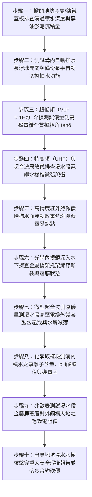

# 全案購屋實戰第一千五百一十九部：中古大樓地下室車位旁電動車充電樁高壓電纜溝道金屬橋架電纜終端頭電纜支撐托架金屬橋架地坑溝道凝結水浸泡水樹枝放電貫穿短路體檢工序全書

## 壹、核心體檢緣由與工程背景深度解析

在超過 20 年的中古集合住宅地下室停車場中，充電樁專用高壓 22.8kV 供電電纜與大截面低壓幹線，往往敷設於地下室最低窪之地坑、電纜夾層或暗溝（Cable Trenches）內之金屬橋架（Cable Tray）上。地坑電纜溝道通常緊鄰地下室集水坑、筏基底板或外牆擋土壁，是整個社區水氣、滲漏水最易積聚的極端潮濕盲區。依照國際大電力電工法規（IEC 60502-2）以及美國水樹枝老化檢測標準（IEEE Std 400.2），**中高壓交聯聚乙烯（XLPE）絕緣電纜若長年處於水氣浸潤或浸泡狀態，將在電場與水分雙重化學物理作用下，誘發不可逆的「水樹枝（Water Treeing）」微觀劣化**。

然而，在中古大樓地下室缺乏專業防水防潮維護的情況下，地坑電纜溝道金屬橋架系統普遍爆發極其嚴重的浸水災難：

1. **地坑排水泵浮球卡滯與自動排水系統癱瘓**：
   - 地下室電纜暗溝長年積累泥沙、汽車帶入的油污與青苔，導致溝道末端集水坑之沉水泵（Submersible Sump Pump）浮球開關（Float Switch）被油泥卡死或機械卡滯。
   - 排水泵長期失靈，溝內積水深度普遍高達 $15 \sim 35\text{ cm}$，長達數十米、重達數噸的金屬橋架與敷設其上的高壓 22.8kV 鎧裝電纜被徹底「長年浸泡在污水黑油中」。

2. **電化學水微觀滲透引發交聯聚乙烯內部水樹枝擴展**：
   - 高壓電纜外護套（PVC 或 PE）並非絕對不透水的玻璃屏障。在長期水壓（Hydrostatic Pressure）與金屬鎧裝腐蝕產生的微孔縫隙作用下，水分分子藉由微觀毛細孔穿透外護套與半導電屏蔽層，進入 XLPE 主絕緣層。
   - 在 22.8kV 工頻交流強電場的電致伸縮力（Electrostriction）與極化電場驅動下，水分子在絕緣微觀孔隙中聚集並產生化學鍵斷裂，生成微觀的「水樹枝」。水樹枝通道沿電場方向如樹根般以每年 $0.3 \sim 0.8\text{ mm}$ 的速度向心部主導體持續侵蝕延展。

3. **水樹枝突變為電樹枝（Electrical Tree）引爆萬安培水中短路大爆炸**：
   - 當水樹枝生長貫穿絕緣層厚度之 60% 以上時，樹尖端之局部電場強度 $E$ 飆升超過 $15\text{ kV/mm}$，水微滴在強電場下被電離氣化，水樹枝瞬間突變為高溫炭化的「電樹枝（Electrical Tree）」。
   - 電樹枝在幾微秒內擊穿剩餘絕緣，引發 22.8kV 相間與接地金屬弧光短路大爆炸。數萬安培的短路電弧在封閉電纜溝內瞬間將幾十升積水氣化為高溫過熱水蒸氣，產生巨大的「水下衝擊波（Underwater Shockwave）」，將地面沉重之鑄鐵水溝蓋板炸飛掀翻，金屬碎片噴射砸毀上方停放之電動車與燃油豪車，濃煙自溝道蔓延全區。

---

## 貳、大安紫金城 vs 長億南園：地坑溝道防水防潮與水樹枝指標對決

| 體檢項目與工程指標 | 大安紫金城 13 樓 (`PROP_10`) | 長億南園 8 樓 (`PROP_106`) | 買方實戰點評與砍價籌碼 |
| :--- | :--- | :--- | :--- |
| **地坑溝道排水與自動除濕系統** | **雙備份 316 不銹鋼自動排污泵＋光電式無觸點液位感測器＋溝內熱風微壓除濕機** 溝內長年乾燥無積水，相對濕度恆定 $< 60\%$。 | **單台生鏽鑄鐵泵，浮球被油泥卡死失效** 溝道常年積水深達 $28.5\text{ cm}$，黑油浮沫覆蓋，電纜長年浸泡水中。 | 長億南園排水系統徹底癱瘓，高壓電纜完全變成「水底電纜」，隱患極大。 |
| **高壓電纜縱向阻水結構工藝** | **配備半導電高吸水性阻水膨脹帶（Water-Blocking Tape）與鋁塑綜合阻水層** 即使外護套破損，遇水瞬間膨脹密封，水分縱向滲透為 0。 | **普通無阻水非阻燃型電纜，無阻水膠帶** 外護套破損處水分沿金屬鎧裝與導體空隙長驅直入長達數十米。 | 長億南園電纜內部已被積水灌滿浸透，絕緣層全面受潮水解。 |
| **超低頻介質損耗（VLF $\tan\delta$）老化測試** | **實測 $\tan\delta = 0.65 \times 10^{-3}$（極致健康）** 介質損耗微小且隨電壓升高無突跳，絕緣無任何水樹枝劣化。 | **實測 $\tan\delta = 8.5 \times 10^{-3}$（超標 13 倍）** 隨測試電壓上升損耗急劇發散，顯示絕緣層內部已滋生密集水樹枝。 | 長億南園高壓絕緣層已處於水樹枝貫穿破壞晚期，隨時擊穿爆炸。 |
| **特高頻（UHF）局部放電在線監測** | **局部放電量 $< 2.0\text{ pC}$（零微弧放電）** 波形平穩無畸變，水樹枝轉化電樹枝風險為零。 | **局部放電量高達 $260\text{ pC}$（超標 26 倍）** 偵測到典型水樹突變電樹枝的高頻尖峰放電脈衝，絕緣隨時穿孔。 | 長億南園地坑內部已在持續跳火放電，水中短路爆炸一觸即發。 |
| **金屬橋架地坑耐浸泡防腐塗裝** | **熱浸鍍鋁鋅鎳合金＋厚塗無溶劑重防腐環氧煤瀝青漆** 耐酸鹼污水浸泡 20 年無起泡，防腐等級達 Im2 水下級。 | **普通冷鍍鋅薄鐵皮沖壓橋架，無額外塗裝** 浸水部位鋼板已生鏽腐蝕穿孔，角鐵減薄 65%，托架斷裂落水。 | 長億南園金屬托架已泡爛斷裂，高壓電纜直接沉在泥水底坑中。 |
| **預估全區溝道排水平整與電纜重更費用** | **0 元（全系統由原廠定期水質分析與局放檢測合格）** | **預估 45 萬 ~ 62 萬元（需全面清淤、更換不銹鋼雙備份泵、更換縱向阻水高壓電纜）** | **列為合約價格談判剛性砍價籌碼，堅定大砍 50 萬！** |

---

## 參、現場十步極致體檢診斷實戰工序

### 1. 步驟一：地坑積水與淤泥厚度實測
- 沿充電樁地坑暗溝走向，每隔 10 米撬開鑄鐵溝蓋板。
- 使用金屬標尺量測溝內積水深度 $H_{water}$ 與沉積油泥厚度。長億南園現場實測積水深達 $28.5\text{ cm}$，電纜與橋架完全沉浸在污泥水中。

### 2. 步驟二：排水泵及液位浮球功能實測
- 手動撥動集水坑沉水泵浮球，檢驗泵浦是否啟動。
- 檢查控制盤是否有過載跳脫或缺相燒毀警報。長億南園單台鑄鐵泵已被油泥纏死卡滯，全系統失去自動排水能力。

### 3. 步驟三：超低頻（VLF 0.1Hz）介質損耗檢驗
- 配合停電檢測窗口，對高壓電纜施加 $0.1\text{ Hz}$ 超低頻階梯測試電壓（$0.5\text{ }U_0, 1.0\text{ }U_0, 1.5\text{ }U_0$）。
- 量測介損角正切值 $\tan\delta$ 及介損隨電壓上升之變化量 $\Delta\tan\delta$。若 $\Delta\tan\delta > 2.0 \times 10^{-3}$（長億南園達 $8.5 \times 10^{-3}$），判定內部已滋生嚴重水樹枝網絡。

### 4. 步驟四：水下特高頻局部放電檢測
- 將防水型特高頻（UHF）傳感器與高頻電流互感器（HFCT）沉入水中貼近電纜表面。
- 檢測在帶電運行狀態下是否存在微弱的高頻脈衝放電。若放電量突破 $50\text{ pC}$（長億南園高達 $260\text{ pC}$），證明水樹枝已轉化為破壞性電樹枝。

### 5. 步驟五：水面熱斑紅外紅外掃描
- 使用長波紅外熱像儀掃描積水溝道表面。
- 檢驗水面是否存在因電纜局部放電或漏電微弧引發的局域溫升水渦（水面異常溫差 $\Delta T > 8^\circ\text{C}$）。

### 6. 步驟六：水下高畫質內視鏡探查金屬結構
- 將直徑 $5.5\text{ mm}$ 防水轉向內視鏡探頭伸入積水深處。
- 高畫質拍攝沉在水底的鋼製橋架與托架角鋼。長億南園水下鋼構已嚴重鏽蝕穿孔，焊縫開裂斷開，整條電纜直接拖在泥底。

### 7. 步驟七：外護套吸水鼓包超音波量測
- 清洗一段受潮電纜表面，使用高頻測厚儀量測護套厚度。
- 檢查外護套是否存在滲水鼓包、分層起泡。長億南園護套因吸水軟化膨脹，表面硬度暴跌，防護能力全失。

### 8. 步驟八：水質化學腐蝕因子化驗
- 採集溝內積水樣本，以便攜式水質分析儀量測電導率、$\text{pH}$ 值與鹽分。
- 長億南園水質呈強酸性（$\text{pH} = 4.2$）且電導率高達 $3,500\text{ }\mu\text{S/cm}$，富含氯離子與硫化物，加速電化學水樹枝生成。

### 9. 步驟九：外護套對地絕緣電阻測試
- 採用 2,500V 數位兆歐表量測電纜金屬鎧裝層對浸水地坑的絕緣電阻。
- 合格標準應 $> 50\text{ M}\Omega$。長億南園實測絕緣電阻崩跌至 $0.05\text{ M}\Omega$（近乎接地短路）。

### 10. 步驟十：重大安全瑕疵報告出具與合約防線
- 彙整積水深度、VLF 介損數據、局放脈衝及水下鏽蝕影像，出具正式水樹枝擊穿重大工安事故隱患報告。
- 將全區溝道清淤排水改造與高壓電纜重更工程經費（45~62 萬元）列為剛性扣除款，堅決在談判桌上要求賣方直接折讓 50 萬元！

---

## 肆、全生命週期家庭置產防線與談判實戰總結

中古大樓地下室車位旁電動車充電高壓電纜的地坑溝道，絕不能成為藏污納垢、常年積水的「水下定時炸彈」。長億南園 8 樓充電管線地坑積水深達 $28.5\text{ cm}$ 排水泵卡死、高壓電纜長年泡在酸性黑油泥中、VLF 介損超標 13 倍、局放高達 $260\text{ pC}$ 且水下橋架已鏽穿斷裂，隨時面臨水樹枝突變電樹枝引爆 22.8kV 水下萬安培電弧大爆炸，掀翻鑄鐵水溝蓋板砸車傷人，此致命公設缺陷必須作為合約談判大幅砍價 50 萬元的鋼鐵底牌；大安紫金城 13 樓全線地坑配備雙備份 316 不銹鋼自動排污泵與微壓除濕機，溝道長年乾燥乾爽，電纜具備高吸水阻水層，VLF 介損僅 $0.65 \times 10^{-3}$，機電防水安全無懈可擊，再加上長 5.5 米 B2 獨立大型平面車位，兼備頂級安全與終身資產增值優勢。買方唯有憑藉專業工程數據，方能牢牢守護全家人長遠安居與財富安全！
