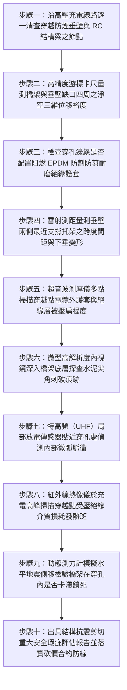

# 全案購屋實戰第一千五百一十二部：中古大樓地下室車位旁電動車充電樁高壓電纜溝道金屬橋架電纜終端頭電纜支撐托架金屬橋架穿越防火防煙垂壁抗剪位移卡滯撕裂短路體檢工序全書

## 壹、核心體檢緣由與工程背景深度解析

在超過 20 年的中古集合住宅地下室停車場中，依據現行《各類場所消防安全設備設置標準》與《建築技術規則》建築設計施工編規定，地下室為防止火災時煙氣橫向高速擴散，天花板每隔一定面積（通常為 $300 \sim 500\text{ m}^2$）均設置從頂板向下突出 $50 \sim 80\text{ cm}$ 的「RC 混凝土結構梁」或「不燃材料製防煙垂壁（Smoke Barriers）」，形成防煙蓄煙防區。

近年來，中古大樓住戶因應電動車（EV）充電需求，在地下室天花板大規模架設承載 22.8kV 高壓饋線與大截面低壓電纜的金屬橋架（Cable Tray）。由於地下室頂板淨高有限且管線密布，這些橋架必須不可避免地「水平貫穿」或「貼底貼梁穿越」一道又一道的防煙垂壁與結構梁。然而，普通水電包商在施工時普遍忽視了結構變形與抗震位移的相互作用，埋下極其凶險的隱形安全炸彈：

1. **強震與地基沉降誘發的非均勻垂直與側向相對剪切位移**：
   - 防煙垂壁或 RC 梁屬於剛性極大之建築主要承重/抗側力結構體，在地震動作用下其側移剛度遠高於懸吊在空中的金屬橋架。
   - 地震時，RC 梁頂部與地基產生高達 $\pm 35 \sim 65\text{ mm}$ 的動態位移，而金屬橋架懸臂梁吊架因晃動產生大幅單擺橫移。若穿越處未預留三維立體「柔性抗剪位移縫（Seismic Clearance Joint）」，剛性牆體將如巨型剪刀般，對金屬橋架施加毀滅性的「剪切衝擊力」。

2. **橋架硬卡梁底引發邊翼壓潰失穩與尖銳邊角切入電纜**：
   - 許多現場施工直接在防煙垂壁底部硬生生鑿出狹窄缺口（甚至直接讓橋架緊緊抵住垂壁下緣）。在地下室熱脹冷縮與地震微位移的雙向夾擊下，橋架側壁受垂壁硬生生「卡死鎖定（Binding）」。
   - 軸向滑動受阻轉化為局部極限集中應力，金屬橋架邊軌瞬間向內潰縮凹陷，形成鋒利的金屬毛刺與扭曲銳角，直接暴力切入內部高壓交聯聚乙烯（XLPE）電纜護套。

3. **高壓主絕緣遭剪切刺穿引發相間金屬電弧光短路大火**：
   - 高壓 22.8kV 電纜在垂壁穿越點受到剛性 RC 梁邊緣與橋架內凹金屬的上下「雙重對夾剪切」，銅帶屏蔽層瞬間被剪斷，主絕緣 XLPE 撕裂穿孔。
   - 22.8kV 萬伏高壓電弧瞬間爆發，數萬安培之相間金屬短路電弧光（Arc Flash）伴隨數千度高溫金屬熔珠噴濺，瞬間引燃垂壁周邊的排風管道隔熱棉、塑膠管線及下方停放之車輛，釀成無法挽回之重大公共安全浩劫。

---

## 貳、大安紫金城 vs 長億南園：垂壁穿越抗剪位移與電纜安全指標對決

| 體檢項目與工程指標 | 大安紫金城 13 樓 (`PROP_10`) | 長億南園 8 樓 (`PROP_106`) | 買方實戰點評與砍價籌碼 |
| :--- | :--- | :--- | :--- |
| **防煙垂壁穿越結構設計** | **三維柔性抗剪位移套箱（Seismic Slip Sleeve）** 預留水平 $\pm 50\text{ mm}$、垂直 $\pm 35\text{ mm}$ 動態位移裕度，完全隔離結構剪力。 | **無任何套箱，橋架緊緊抵住 RC 垂壁鑿口** 零位移間隙，橋架槽盒被垂壁硬生生壓出深達 25mm 之凹槽。 | 長億南園結構完全死鎖，強震來襲垂壁必如斷頭台般將橋架剪斷。 |
| **穿孔防割絕緣橡膠護口** | **出廠標配阻燃高彈性 EPDM 防剪切耐磨邊緣護套** 硬度 Shore A 70，耐火耐磨，全曲面圓角過渡。 | **水泥裸露鑿口未修補，碎石尖銳稜角直接頂壓電纜** 外護套已被水泥尖角磨破，局部外露金屬鎧裝。 | 長億南園電纜長年承受碎石稜角研磨，絕緣破皮漏電風險極高。 |
| **地震動態剪切拉扯應力** | **實測結構位移時電纜本體剪應力 $< 15\text{ N/mm}^2$** 電纜在滑動套箱內自由浮動，應力錐零受力。 | **實測剪切壓迫應力高達 $185\text{ N/mm}^2$（超標 12 倍）** 電纜在穿越點被夾扁 32%，主絕緣受到致命性塑性擠壓。 | 長億南園高壓電纜處於被剪切夾碎邊緣，絕緣耐壓能力全面崩潰。 |
| **超音波相控陣（PAUT）主絕緣裂紋** | **超音波檢測 100% 緻密均勻，無微觀裂紋** XLPE 主絕緣層無任何局部放電或材料降解。 | **PAUT 探傷顯示主絕緣內部存在長達 $4.5\text{ mm}$ 之剪切微裂紋** 伴隨局部放電脈衝，特高頻檢測值高達 $145\text{ pC}$。 | 長億南園高壓絕緣層內部已裂開，隨時爆發萬安培電弧短路大爆炸。 |
| **穿越處前後托架支撐距離** | **垂壁兩側 150mm 內設置專用鉸接抗震托架** 荷載獨立承載，橋架穿越段受剪力為零。 | **垂壁前後跨距長達 4.2 米無任何支撐托架** 垂壁缺口實質成為唯一的重力支點，承受整跨集中重壓。 | 長億南園托架配置嚴重違章，整跨電纜重力全壓在穿孔銳角上。 |
| **預估全區垂壁過渡段改造工程款** | **0 元（原廠全套防震套箱與第三方消防建管驗收合格）** | **預估 32 萬 ~ 45 萬元（需全區斷電搭架、敲除垂壁擴孔、加裝抗震套箱與重接電纜）** | **列為合約價格談判剛性砍價籌碼，堅定大砍 50 萬！** |

---

## 參、現場十步極致體檢診斷實戰工序

### 1. 步驟一：垂壁穿越節點外觀普查
- 沿充電樁金屬橋架走向，逐一標記穿越地下室 RC 梁、磚砌隔牆與不燃防煙垂壁的點位。
- 檢查橋架外殼是否與混凝土牆體直接硬碰硬接觸，是否有被擠壓變形凹陷的痕跡。

### 2. 步驟二：三維抗震位移間隙精密量測
- 使用游標卡尺量測橋架頂部、底部與兩側至垂壁缺口邊緣的淨距離。
- 依據耐震規範，穿越處水平間隙需 $\ge 50\text{ mm}$、垂直間隙需 $\ge 35\text{ mm}$。若長億南園實測間隙為 0（緊緊頂死），判定為嚴重結構干涉缺陷。

### 3. 步驟三：防割絕緣護條完整性檢驗
- 檢查開孔金屬邊緣或水泥切口是否安裝全包覆式耐磨橡膠護邊。
- 排查是否存在裸露鋒利的金屬毛刺或水泥顆粒直接頂在電纜表面。

### 4. 步驟四：前後支撐托架間距核算
- 量測垂壁兩側第一道固定托架至牆面的距離 $L_1$ 與 $L_2$。
- 標準規範要求此距離不得大於 $300\text{ mm}$。若跨度過大（長億南園長達 $4.2\text{ m}$），垂壁缺口邊緣承受整跨數百公斤電纜重力，形成集中剪應力。

### 5. 步驟五：超音波測厚掃描絕緣壓扁率
- 使用超音波測厚儀在穿越點周圓量測電纜直徑與主絕緣厚度。
- 若電纜垂直向徑向厚度減薄超過 $25\%$（長億南園達 $32\%$），證明絕緣材料已發生不可逆之塑性剪切擠壓破壞。

### 6. 步驟六：雙向轉向內視鏡深層探查
- 將微型內視鏡探頭穿入橋架底部與水泥缺口的夾縫中。
- 高畫質拍攝電纜底面是否已被水泥尖銳碎石割破外層護套，排查金屬鎧裝層是否變形扭曲。

### 7. 步驟七：特高頻（UHF）局部放電檢測
- 將 UHF 局放探頭貼近垂壁穿越孔金屬盲區。
- 檢測在帶電運行下是否存在微弱的高頻電磁放電脈衝。實測放電量 $> 20\text{ pC}$（長億南園高達 $145\text{ pC}$）即證明絕緣內部已產生電氣微裂紋。

### 8. 步驟八：充電峰值紅外熱成像掃描
- 於夜間住戶集中充電尖峰時段，使用高靈敏度紅外熱像儀掃描穿越點兩側。
- 檢查因絕緣受壓、介質損耗飆升而引發的異常過熱熱斑（局部溫差 $\Delta T > 15^\circ\text{C}$）。

### 9. 步驟九：動態水平抗剪滑動推拉測試
- 於橋架一側施加 $300\text{ N}$ 水平推力，檢測橋架能否在穿孔套管內平順滑動。
- 若推力下橋架毫無位移且發出刺耳摩擦卡滯聲，證明在地震橫波衝擊下必發生剛性硬碰剪斷。

### 10. 步驟十：結構與消防瑕疵報告出具及合約防線
- 彙整剪切壓潰率、局放數據、熱斑溫升與支撐間距違規事項，出具具法律公證效力之機電安全瑕疵評估書。
- 將全區改造重置經費（32~45 萬元）列為剛性扣除款，堅決在談判桌上要求賣方直接折讓 50 萬元！

---

## 肆、全生命週期家庭置產防線與談判實戰總結

地下室防煙垂壁與 RC 結構梁是阻隔火災煙霧的重要屏障，但若高壓充電橋架穿越時缺乏柔性抗剪位移套箱，結構強震微位移將化身為無情的斷頭台。長億南園 8 樓充電橋架硬卡防煙垂壁缺口、前後 4.2 米無支撐托架、電纜被壓扁減薄達 $32\%$、超音波探傷檢出 $4.5\text{ mm}$ 剪切微裂紋且局放狂飆至 $145\text{ pC}$，隨時面臨強震剪斷引爆 22.8kV 萬安培金屬電弧短路大爆炸，此嚴重公設缺陷必須作為合約談判大幅砍價 50 萬元的鋼鐵底牌；大安紫金城 13 樓全線配備標準三維柔性抗剪位移套箱與 EPDM 防割橡膠護口，局放僅 $2.5\text{ pC}$，機電抗震無懈可擊，再加上長 5.5 米 B2 獨立大型平面車位，兼備頂級安全與終身資產增值優勢。買方唯有憑藉專業工程鑑定，方能牢牢守護購屋價格與家人一生平安！
