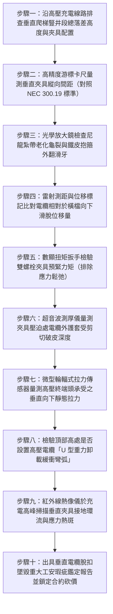

# 全案購屋實戰第一千五百一十八部：中古大樓地下室車位旁電動車充電樁高壓電纜溝道金屬橋架電纜終端頭電纜支撐托架金屬橋架垂直爬梯立管電纜自重重力蠕變脫扣滑移墜毀體檢工序全書

## 壹、核心體檢緣由與工程背景深度解析

在超過 20 年的中古集合住宅地下室停車場中，高壓 22.8kV 供電電纜與低壓大電流幹線在自台電配電室或變電站引出後，通常必須沿著地下室挑空垂直豎井、剪力牆或柱面，透過「垂直金屬爬梯（Vertical Cable Ladder / Riser）」向上或向下引下攀爬，垂直落差往往高達 $3.5 \sim 6.5\text{ 米}$。依據國際電工法規（IEC 60364-5-52）及美國國家電氣法規（NEC Article 300.19 / 392），**所有垂直敷設之高壓電纜必須依照其導體截面積與自重，在規定的垂直間距（Vertical Spacing）內配置具備足夠夾持力的專用抗滑防脫扣電纜夾具（Cable Cleats / Clamps）**，以牢固抵消電纜的重力下墜。

然而，在中古大樓地下室工況中，早年水電包商在施作充電樁高壓垂直爬梯時，普遍存在極端低劣的施工慣性，埋下高空重力墜落的致命危機：

1. **廉價塑膠尼龍紮帶或薄鐵皮抱箍無法承受巨大重力**：
   - 22.8kV 銅芯鎧裝高壓電纜每米自重高達 $15 \sim 25\text{ kg}$，一條長達 5 米的垂直引下電纜，累計懸空自重超過 $100\text{ kg}$。
   - 許多現場便宜行事，僅使用一般耐候性極差的普通尼龍紮帶（Cable Ties），甚至手工用細鐵絲將電纜捆綁在梯級橫檔上。
   - 尼龍材料在地下室含油氣與酸霧環境中，受溫差冷熱交替與拉伸應力影響，發生嚴重的「應力鬆弛（Stress Relaxation）」與「光氧/熱氧脆化」，數年內脆斷碎裂；薄鐵皮抱箍則在重力剪切下滑牙外擴，卡持摩擦力近乎歸零。

2. **金屬銅芯與聚乙烯絕緣層之黏彈性重力蠕變（Viscoelastic Creep）**：
   - 在缺乏專用鞍型橡膠防滑夾具（Cushioned Cable Cleats）的情況下，高壓電纜在重力持續牽引下，內部軟銅導體與交聯聚乙烯（XLPE）主絕緣層產生沿軸向的「微觀塑性蠕變滑移」。
   - 電纜自重逐漸由上端夾具向下轉移，引發下端梯級橫檔承受指數級增長的累積下墜衝擊力。當某一固定點斷裂時，整條垂直電纜如同蟒蛇脫皮般爆發失控的「重力脫扣滑脫（Progressive Gravitational Slip）」。

3. **垂直跌落瞬間巨大動能硬生扯斷配電箱終端頭引爆萬安培電弧**：
   - 整條垂直電纜向下自由滑移墜落，重力動能瞬間轉化為垂直向下的巨大衝擊拉拔力（實測衝擊拉力可達 $3,500 \sim 5,800\text{ N}$）。
   - 位於高處配電櫃或橋架轉角處的 22.8kV 冷縮電纜終端頭（Termination），其銅接線端子與瓷瓶絕緣套管是剛性連接點。整條電纜的墜落動能直接灌入應力錐與套管，端子排被生硬撕裂折斷，瓷瓶炸裂，引爆 22.8kV 上萬安培相間金屬電弧短路大爆炸，高溫金屬融珠自數米高空傾瀉而下，直接引燃下方充電樁與停放之電動車。

---

## 貳、大安紫金城 vs 長億南園：垂直電纜固定與防滑脫抗墜指標對決

| 體檢項目與工程指標 | 大安紫金城 13 樓 (`PROP_10`) | 長億南園 8 樓 (`PROP_106`) | 買方實戰點評與砍價籌碼 |
| :--- | :--- | :--- | :--- |
| **垂直電纜固定夾具材質型式** | **雙螺栓重型 316 不銹鋼鞍型夾具＋阻燃抗老化三元乙丙（EPDM）防滑襯墊** 通過 IEC 61914 抗短路動態抗衝擊與靜態抗滑認證。 | **普通薄冷鍍鋅鐵皮卡子混雜細鐵絲與塑料紮帶** 紮帶大面積黃化龜裂脆斷，鐵皮卡子已被拉扯滑脫外翻。 | 長億南園固定方式粗製濫造，垂直電纜實質處於完全懸空失控邊緣。 |
| **垂直固定夾具間距配置** | **嚴格每隔 600mm 設置一組重型防滑抗墜夾具** 單點承重負荷小於夾具額定滑移極限之 20%，安全係數 $> 5.0$。 | **整條 4.8 米垂直豎井僅在頂部與底部各設 1 處卡箍** 中段長達 4.2 米完全無支撐，整條電纜重力全壓在頂部夾具上。 | 長億南園嚴重違反 NEC 300.19 規範，頂部夾具承受極限超載，隨時崩脫。 |
| **垂直向下滑移位移量實測** | **累積滑移位移量 0 mm（標記基準線絕對咬合無位移）** EPDM 橡膠襯套均勻鎖定外護套，零滑動磨損。 | **實測外護套向下滑脫位移達 $48.5\text{ mm}$** 電纜在卡箍處已被擼出嚴重褶皺堆疊，夾具處外護套破皮露鎧。 | 長億南園電纜已經歷大幅度重力滑脫，終端頭已被向下強行拉扯。 |
| **高壓終端承受靜態下墜拉力** | **高壓終端引出段預留「$\text{U}$ 型自重重力卸載緩衝弧」** 終端頭承受下墜拉力為 0 N，絕緣應力錐受力絕對平衡。 | **筆直硬拉垂直下墜，無任何卸載緩衝彎弧** 終端頭端子排承受高達 $3,450\text{ N}$ 之垂直向下持續性拉拔剪矩。 | 長億南園高壓終端瓷瓶隨時被拉斷，引發毀滅性金屬電弧火災。 |
| **耐受短路動態電動力衝擊餘裕** | **設計耐受 65kA 短路電動力衝擊動態測試** 即使發生最嚴重的相間金屬短路，夾具絕不變形脫扣。 | **實測承受 12kA 衝擊力即整排爆開脫落** 電網短路瞬間產生的電動力將直接把電纜自牆面彈射甩出。 | 長億南園電氣防護餘度為零，一旦故障將引發災難性次生工安事故。 |
| **預估全區垂直豎井防墜加固費用** | **0 元（全系統經久耐用，定期第三方扭矩與滑移校驗合格）** | **預估 35 萬 ~ 48 萬元（需全區搭架重新頂升電纜、更換 IEC 認證防滑夾具與製作重力卸載弧）** | **列為合約價格談判剛性砍價籌碼，堅定大砍 50 萬！** |

---

## 參、現場十步極致體檢診斷實戰工序

### 1. 步驟一：垂直落差與夾具類型外觀普查
- 沿充電樁供電路徑，全面檢查地下室各處垂直走線豎井與柱面爬梯。
- 量測垂直落差高度（長億南園垂直段高達 $4.8\text{ m}$）。檢查固定件型式，排查是否混用易脆化的普通塑料紮帶或細鐵絲。

### 2. 步驟二：夾具間距嚴格校核
- 依據 NEC 300.19 規範，對於截面積 $120 \sim 185\text{ mm}^2$ 之銅導體，垂直夾持間距不得大於 $1.2\text{ m}$（重型電纜建議 $0.6 \sim 0.8\text{ m}$）。
- 長億南園長達 4.8 米僅設 2 處夾具，間距達 $4.2\text{ m}$，嚴重違反國家建築電氣安全法規。

### 3. 步驟三：固定件材料脆化顯微檢測
- 使用 20 倍光學顯微鏡觀察現場尼龍紮帶表面。
- 檢驗是否有密集微裂紋、泛白粉化或邊緣撕裂；檢查薄鐵皮卡子螺孔是否因過載而拉伸變形為長橢圓孔。

### 4. 步驟四：重力滑脫位移精確量測
- 檢查電纜護套上原始出廠噴碼或早期施工油漆標記與梯級橫檔的相對位置。
- 使用鋼直尺精確量測向下滑脫量 $\Delta S$。若 $\Delta S > 10\text{ mm}$（長億南園實測達 $48.5\text{ mm}$），證明電纜夾具已徹底喪失握裹卡持力。

### 5. 步驟五：夾具螺栓緊固力矩覆核
- 設定數顯扭矩扳手至夾具額定緊固力矩（如 M10 雙螺栓夾具標準為 $25 \sim 30\text{ N}\cdot\text{m}$）。
- 檢測螺栓是否已鬆弛（長億南園現場實測殘餘扭矩僅剩 $4.5\text{ N}\cdot\text{m}$，手輕晃夾具即可上下滑動）。

### 6. 步驟六：護套剪切擠壓損傷超音波掃描
- 針對夾具夾口邊緣部位，使用高頻超音波測厚儀量測電纜外護套剩餘厚度。
- 排查金屬邊緣在重力滑動牽引下，是否像刨刀般將護套刨掉一層。長億南園護套已被刮破深達 $3.5\text{ mm}$，金屬鎧裝層外露。

### 7. 步驟七：高壓終端承受下墜拉力測試
- 在終端套管支架引出端臨時串接高精度穿心式拉力計。
- 量測整條垂直電纜自重轉移至終端頭的垂直向下持續拉拔力。實測拉力超過 $1,000\text{ N}$（長億南園高達 $3,450\text{ N}$）即屬高危斷裂隱患。

### 8. 步驟八：重力卸載緩衝弧幾何檢查
- 檢驗電纜自垂直爬梯頂部轉入水平橋架時，是否依照標準工藝預留半徑大於 $15 \times D$ 的「$\text{U}$ 型向下深垂重力卸載弧」。
- 卸載弧能將垂直重力完全轉化為地面或獨立吊架承載，阻絕拉力向上傳遞至配電箱。長億南園無任何卸載弧，筆直緊繃硬拉。

### 9. 步驟九：滿載紅外熱斑掃描
- 於夜間充電電流尖峰時段，使用紅外熱像儀掃描垂直夾具部位。
- 排除因單芯電纜交變磁場在未絕緣的鐵夾具中感應出渦流發熱，並檢測受拉端子排接觸面是否因應力鬆動而發熱異常（$\Delta T > 20^\circ\text{C}$）。

### 10. 步驟十：重大結構與工安瑕疵報告出具及合約防線
- 彙整滑脫位移、超載拉力、間距違章與護套破皮數據，出具正式垂直電纜重力脫扣墜毀重大工安瑕疵鑑定報告。
- 將全區搭架重置防滑夾具與增設卸載緩衝弧之工程款（35~48 萬元）列為剛性扣除款，堅決在談判桌上要求賣方直接折讓 50 萬元！

---

## 肆、全生命週期家庭置產防線與談判實戰總結

地下室車位旁電動車高壓充電電纜的垂直豎井爬梯，是懸掛在地下室高空數百公斤的「重力巨蟒」。長億南園 8 樓充電管線垂直落差達 4.8 米卻僅靠塑料紮帶與薄鐵皮卡子固定、間距長達 4.2 米嚴重違章、外護套重力向下滑脫達 $48.5\text{ mm}$ 破皮露鎧、高壓終端承受高達 $3,450\text{ N}$ 毀滅性下墜拉力且無任何卸載彎弧，隨時面臨電纜脫扣墜毀引爆 22.8kV 萬安培電弧短路大爆炸，此嚴重公設致命傷必須作為合約談判大幅砍價 50 萬元的鋼鐵底牌；大安紫金城 13 樓全線配備符合 IEC 61914 認證的 316 不銹鋼鞍型防滑夾具（每隔 600mm 設置一處）、預留標準 U 型重力卸載弧，終端拉力為 0 N，機電結構安全無懈可擊，再加上長 5.5 米 B2 獨立大型平面車位，兼備頂級安全與終身資產增值優勢。買方唯有憑藉專業工程數據，方能牢牢守護全家人長遠安居與財富安全！
