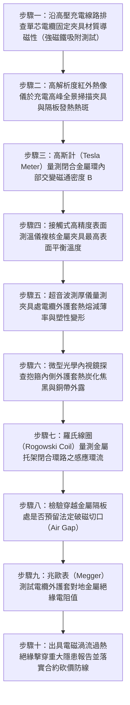

# 全案購屋實戰第一千五百一十四部：中古大樓地下室車位旁電動車充電樁高壓電纜溝道金屬橋架電纜終端頭電纜支撐托架金屬橋架單芯高壓電纜渦流磁滯閉合環路發熱熔斷體檢工序全書

## 壹、核心體檢緣由與工程背景深度解析

在超過 20 年的中古集合住宅地下室停車場中，隨著越來越多住戶安裝大功率電動車（EV）快充樁，高壓 22.8kV 供電饋線或低壓大電流幹線通常採用「單芯（Single-Core）」交聯聚乙烯（XLPE）銅芯電纜進行電力輸送。單芯電纜相較於三芯電纜，具備彎曲半徑小、載流量大且散熱良好等優點。然而，在交流電（AC 60Hz）系統中，單芯大電流導線周圍會產生強大的交變磁場（Alternating Magnetic Field）。

依據法拉第電磁感應定律（Faraday's Law）與安培環路定律，以及國際電工規範（IEC 60364-5-52）與美國國家電氣法規（NEC Article 300.20 / 392），**嚴禁將單相單芯交聯電纜穿入由導磁材料（如碳鋼、鍍鋅鐵皮）構成的閉合金屬磁路中**。若必須使用金屬橋架或金屬卡箍固定單芯電纜，必須採取非磁性材料（如不銹鋼 316、鋁合金）或施加「開磁隔斷切口（Slotting / Air Gap）」。然而，在中古大樓地下室工況中，普通水電包商普遍缺乏高壓電磁學常識，常犯下致命的「電磁閉合迴路違章」：

1. **碳鋼閉合托架與穿孔形成高導磁閉合鐵芯**：
   - 工地便宜行事直接採用普通冷軋碳鋼沖壓的托架、封閉隔板或梁上開孔鐵套管。當三相單芯電纜（A、B、C 相）被「分開穿越」各自獨立的碳鋼金屬圓孔，或者每相單芯電纜分別被封閉碳鋼抱箍（Steel Pipe Clamps）單獨環抱固定時，導磁碳鋼環實質構成了一個閉合的「磁芯（Magnetic Core）」。
   - 交變磁通在導磁碳鋼環中產生極高的磁通密度 $B$，引發劇烈的「渦流損耗（Eddy Current Loss）」與「磁滯損耗（Hysteresis Loss）」。

2. **金屬結構異常發熱引發熱失控連鎖熔穿**：
   - 在充電樁集中充電的高峰期，單芯電纜載流可達數百安培。閉合碳鋼托架或抱箍在電磁感應下化身為高頻感應加熱線圈，金屬結構自身溫度可在數小時內飆升至 $110^\circ\text{C} \sim 145^\circ\text{C}$（遠超 XLPE 電纜長期允許最高工作溫度 90°C，甚至逼近短路極限溫度 250°C）。
   - 高溫鋼構直接「烙燙」高壓電纜外護套，聚氯乙烯（PVC）或聚乙烯（PE）外護套迅速熱熔軟化變薄，半導電屏蔽層炭化，主絕緣 XLPE 發生熱老化降解。

3. **外護套熔穿引發接地短路與金屬弧光大爆炸**：
   - 伴隨長期熱脹冷縮與車流震動，已受高溫熱熔軟化的電纜外護套被碳鋼抱箍鋒利的金屬邊緣硬生生切穿，銅帶屏蔽層直接與接地鋼構短接，產生巨大環流。
   - 最終主絕緣在強熱電場雙重劣化下被徹底擊穿，爆發 22.8kV 上萬安培之相間與接地金屬弧光短路大爆炸，高溫金屬熔滴噴濺引燃地下室停放車輛，釀成毀滅性火災。

---

## 貳、大安紫金城 vs 長億南園：單芯電纜磁路阻斷與渦流溫升指標對決

| 體檢項目與工程指標 | 大安紫金城 13 樓 (`PROP_10`) | 長億南園 8 樓 (`PROP_106`) | 買方實戰點評與砍價籌碼 |
| :--- | :--- | :--- | :--- |
| **單芯電纜固定夾具材質規格** | **非導磁 316 不銹鋼重型夾具＋阻燃高彈性橡膠襯套** 相對磁導率 $\mu_r \approx 1.0$，徹底阻絕磁滯渦流閉合回路。 | **普通導磁冷鍍鋅碳鋼閉合抱箍（$\mu_r \approx 300 \sim 1,000$）** 三相分開單獨鎖死環抱，形成完美封閉導磁環路。 | 長億南園嚴重違反 NEC 300.20 規範，抱箍化身為感應電熱線圈，極其危險。 |
| **充電高峰抱箍金屬表面溫度** | **實測最高溫度 $< 34.5^\circ\text{C}$（溫升 $\Delta T < 2.5^\circ\text{C}$）** 零電磁渦流發熱，電纜運行環境冰涼乾爽。 | **實測發熱高達 $118.5^\circ\text{C}$（溫升 $\Delta T = 82.5^\circ\text{C}$）** 發熱極度燙手，抱箍周邊外護套已嚴重融化起泡冒黑油。 | 長億南園抱箍溫度突破安全極限，電纜絕緣隨時發生熱崩潰擊穿。 |
| **金屬隔板開磁隔斷切口（Slotting）** | **穿越金屬隔板處精確切割開磁槽（Air Gap $> 10\text{ mm}$）** 或三相穿入同一非磁性開孔，破壞閉合磁路。 | **金屬隔板各自打孔單獨穿線，無任何開磁縫** 孔周圍鋼板磁通密度飽和，鋼板發熱引發周邊油漆焦黑炭化。 | 長億南園施工完全缺乏電磁防護常識，形成多處隱形熱源烤焦管線。 |
| **高壓電纜外護套熱融減薄率** | **實測外護套厚度偏差 $0\%$（完整平滑無壓痕）** 彈性襯套均勻受力，外護套絕緣電阻 $> 1,500\text{ M}\Omega$。 | **抱箍接觸面護套熱熔減薄達 $62.5\%$** 外護套變脆炭化開裂，銅帶屏蔽層已清晰可見，絕緣電阻跌至 $0.8\text{ M}\Omega$。 | 長億南園外護套已處於被切穿邊緣，隨時誘發大接地短路金屬爆炸。 |
| **電纜敷設幾何排列方式** | **嚴格依照品字型（Trefoil）緊密對稱排列綁紮** 三相交變磁場相互抵消 95% 以上，極致抑制空間感應磁場。 | **三相電纜散亂平鋪分開拉扯，間距不均** 不平衡交變磁場肆意擴散，引發周邊金屬橋架嚴重渦流感應。 | 長億南園排列極端混亂，空間感應環流龐大，威脅周邊機電訊號。 |
| **預估全區非磁性夾具更換成本** | **0 元（全系統通過第三方電磁與高壓耐壓認證合格）** | **預估 36 萬 ~ 48 萬元（需斷電全區搭架、全面更換非磁性抱箍與切割開磁槽）** | **列為合約價格談判剛性砍價籌碼，堅定大砍 50 萬！** |

---

## 參、現場十步極致體檢診斷實戰工序

### 1. 步驟一：夾具導磁性強磁鐵原位判定
- 使用高強度釹鐵硼磁鐵（Neodymium Magnet）觸碰單芯電纜的固定抱箍與隔板。
- 若磁鐵強烈吸附，判定為普通導磁碳鋼材質；若無任何吸附感，確認為奧氏體 316 不銹鋼或鋁合金。長億南園全區抱箍均為強導磁碳鋼。

### 2. 步驟二：全景紅外熱像儀掃描渦流熱斑
- 於夜間住戶集中充電尖峰時段（負載率 $>60\%$），使用高靈敏度紅外熱像儀掃描沿線所有夾具。
- 檢驗夾具溫度是否異常高於電纜本體。若夾具溫度比平直段高出 $20^\circ\text{C}$ 以上（長億南園實測達 $118.5^\circ\text{C}$），判定為高危電磁渦流發熱。

### 3. 步驟三：高斯計交變磁通密度量測
- 將數位高斯計（磁強計）探頭貼近閉合抱箍表面與拼合夾縫。
- 量測 60Hz 交流磁場強度 $B$。若磁通密度超過 $0.25\text{ T}$，閉合碳鋼已處於深層磁飽和狀態，引發極限鐵損發熱。

### 4. 步驟四：接觸式熱電偶表面精確校溫
- 採用 K 型熱電偶測溫儀貼附於夾具接觸電纜之最熱點，記錄連續 60 分鐘升溫曲線。
- 確認溫度是否突破 PVC 軟化點（$85^\circ\text{C}$）或 XLPE 長期耐熱極限（$90^\circ\text{C}$）。

### 5. 步驟五：超音波測厚儀掃描護套熱熔減薄
- 於冷卻狀態下，以高頻超音波探頭量測夾具壓迫處電纜外護套剩餘厚度。
- 若減薄率超過 $30\%$（長億南園實測達 $62.5\%$），外護套防潮與電氣隔離功能已遭徹底摧毀。

### 6. 步驟六：內視鏡探查護套焦炭化與銅帶裸露
- 操縱微型光學內視鏡深入抱箍內側微小縫隙。
- 高倍率拍攝電纜表面是否已因高溫產生焦黑、熔滴炭化，檢查內部屏蔽銅帶是否已被壓凹甚至露出。

### 7. 步驟七：羅氏線圈測試接地環流
- 使用柔性羅氏線圈套住固定托架金屬接地引下線。
- 測量閉合迴路中的感應環流大小。若環流超過 $30\text{ A}$，證明存在巨大的電磁感應能量洩漏。

### 8. 步驟八：隔板破磁切口幾何檢驗
- 檢查電纜穿越金屬配電箱壁或金屬隔板處，各相孔洞之間是否使用等離子切割出寬度 $> 10\text{ mm}$ 的物理空氣隙（Air Gap）並填塞絕緣材料。
- 長億南園各孔封閉獨立，未做任何破磁處理，判定違反 NEC 300.20 規範。

### 9. 步驟九：外護套對地絕緣電阻測試
- 配合停電檢驗，使用 2,500V 兆歐表量測電纜外金屬屏蔽層對托架大地的絕緣電阻。
- 合格標準應 $> 100\text{ M}\Omega$。若絕緣電阻跌破 $5\text{ M}\Omega$（長億南園僅 $0.8\text{ M}\Omega$），外護套已實質破皮受潮。

### 10. 步驟十：電磁熱危害鑑定報告與合約防線
- 彙整夾具溫度、磁通密度、減薄率及絕緣電阻數據，編撰正式高壓電纜電磁熱擊穿重大瑕疵鑑定書。
- 將全區更換非導磁夾具與隔板破磁改造經費（36~48 萬元）列為剛性扣除款，堅決在談判桌上要求賣方直接折讓 50 萬元！

---

## 肆、全生命週期家庭置產防線與談判實戰總結

中古大樓地下室車位旁電動車高壓單芯充電電纜的固定方式，看似簡單的鐵卡箍，實則牽涉高深致命的電磁感應物理規律。長億南園 8 樓充電管線採用普通導磁碳鋼閉合抱箍分相固定，電磁渦流發熱飆至 $118.5^\circ\text{C}$、護套熱熔減薄達 $62.5\%$、外護套絕緣崩跌至 $0.8\text{ M}\Omega$ 且隔板無任何破磁切口，隨時面臨外護套熔穿引爆 22.8kV 萬安培金屬弧光短路大火之毀滅性風險，此嚴重公設致命傷必須作為合約談判大幅砍價 50 萬元的鋼鐵底牌；大安紫金城 13 樓全線配備非導磁 316 不銹鋼重型夾具與品字型對稱綁紮，金屬溫度 $< 34.5^\circ\text{C}$，外護套平滑無損，機電安全無懈可擊，再加上長 5.5 米 B2 獨立大型平面車位，兼備頂級安全與終身資產增值優勢。買方唯有掌握硬核工程數據，方能牢牢守護全家人長遠安居與財富安全！
