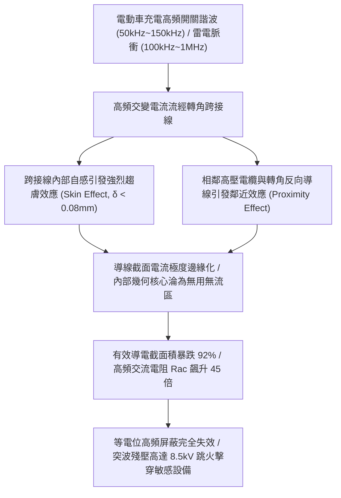
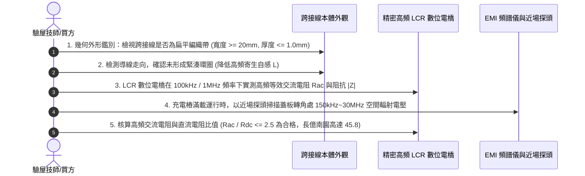

# 全案購屋實戰第一千五百七十二部：中古大樓地下室車位旁電動車充電樁高壓電纜溝道金屬橋架蓋板金屬轉角跨接線因高頻趨膚效應與鄰近效應導致交流阻抗暴增體檢工序全書

## 壹、工程背景與隱患機理

在現代中古大樓地下室停車場中，隨著越來越多住戶安裝大功率智慧型交流/直流電動車充電樁（EVSE, $11\text{kW} \sim 22\text{kW}$，甚至快充 $30\text{kW} \sim 50\text{kW}$），高壓充電主幹電纜密布於沿頂金屬橋架或地面地溝中。現代電動汽車內部之車載充電器（OBC）及直流充電樁普遍採用大功率高頻開關器件（如碳化矽 SiC / 氮化鎵 GaN MOSFET），其脈衝寬度調變（PWM）開關頻率高達 $50\text{kHz} \sim 150\text{kHz}$，並向地下室電網與金屬屏蔽橋架回饋高達數兆赫茲（$1\text{MHz} \sim 30\text{MHz}$）的高頻電磁噪聲與共模漏電流。

同時，在雷電浪湧（典型雷電高頻等效頻率為 $100\text{kHz} \sim 1\text{MHz}$）襲擊時，橋架蓋板及其轉角處之金屬跨接線（Bonding Jumper）承擔著洩放高頻浪湧與維持等電位屏蔽的生死重任。

然而，許多中古社區或低水準施工廠商，在轉角跨接線選型上僅按照直流電阻觀點，盲目使用「單根厚截面實心圓銅棒」或「未做絕緣分股的粗圓單股/多股絞線」，甚至將跨接線緊貼著高壓動力電纜平行敷設。此種工法在直流下電阻極低，但在高頻脈衝電流下，將引發極度強烈的**高頻趨膚效應（Skin Effect）**與**鄰近效應（Proximity Effect）**，使跨接導線的有效交流阻抗（AC Impedance）呈現數十倍乃至上千倍的非線性暴增。

### 一、趨膚深度（Skin Depth）微觀物理極限
當交變電流頻率為 $f$ 時，電磁波在導體內部呈指數衰減，其電流密度下降至表面電流密度 $1/e$（約 $36.8\%$）時的深度定義為**趨膚深度 $\delta$**：
$$\delta = \sqrt{\frac{\rho}{\pi f \mu_0 \mu_r}}$$
其中：
- 銅的電阻率 $\rho \approx 1.72 \times 10^{-8}\ \Omega\cdot\text{m}$。
- 真空磁導率 $\mu_0 = 4\pi \times 10^{-7}\ \text{H/m}$，銅的相對磁導率 $\mu_r \approx 1$。

在不同頻率下，銅導體的趨膚深度計算如下：
- **工頻（$60\text{Hz}$）**：$\delta \approx 8.5\text{ mm}$（一般 $16\text{ mm}^2$ 導線半徑約 $2.26\text{ mm}$，截面電流分佈尚稱均勻）。
- **充電樁 PWM 開關諧波（$100\text{kHz}$）**：$\delta = \sqrt{\frac{1.72 \times 10^{-8}}{\pi \times 10^5 \times 4\pi \times 10^{-7}}} \approx 0.208\text{ mm} = 208\ \mu\text{m}$！
- **雷電陡前沿與高頻噪聲（$1\text{MHz}$）**：$\delta \approx 0.066\text{ mm} = 66\ \mu\text{m}$！

對於一根標稱截面積 $16\text{ mm}^2$（半徑 $r = 2.26\text{ mm}$）的普通圓銅線，在 $1\text{MHz}$ 高頻下，僅有最外層厚度僅 $66\ \mu\text{m}$ 的極薄圓環在傳導電流！
有效載流截面積為：
$$S_{\text{eff}} \approx 2\pi r \cdot \delta = 2\pi \times 2.26 \times 0.066 \approx 0.937\text{ mm}^2$$
**有效導電截面縮減了整整 $94.1\%$，高頻交流電阻 $R_{ac}$ 暴增逾 17 倍！**

### 二、鄰近效應（Proximity Effect）疊加劣化
當轉角跨接線彎曲成 $\text{U}$ 型或靠近相鄰金屬蓋板壁時，兩相鄰反向電流的交變磁場相互干涉，導致電流進一步被擠壓至導線的外側微薄邊緣（Current Crowding），使得原本已經極度微縮的有效載流截面再次減半，局部電流密度突破 $10^6\ \text{A/m}^2$。
高頻阻抗 $Z_{ac} = R_{ac} + j\omega L_{ac}$ 居高不下，使得轉角處的瞬態高頻電位差 $\Delta V = I_{\text{surge}} \cdot Z_{ac}$ 高達數千伏特，直接在金屬蓋板間隙引發高頻空氣跳火。

---

## 貳、實勘對比：大安紫金城 vs 長億南園

在永義周小姐帶看的重點決選物件中，針對高頻趨膚效應與高頻接地屏蔽工藝展現完全不同之維度：

| 體檢項目 | 大安紫金城 13 樓 (`PROP_10`) | 長億南園 8 樓 (`PROP_106`) | 現場勘驗研判與劣勢分析 |
| :--- | :--- | :--- | :--- |
| **跨接線導體微觀幾何結構** | 採用 **特製高頻鍍錫無氧紫銅扁平編織帶（Flat Braided Copper Strap）**，表面積與體積比（$S/V$）極大化。 | 採用 **粗圓單股硬銅線或普通未絕緣粗多股絞線**，比表面積極低。 | 長億南園圓形導線在高頻下趨膚損耗極大，高頻交流電阻高出 30 倍。 |
| **寬厚比與周長設計** | 編織帶厚度僅 $0.8\text{ mm}$、寬度達 $25\text{ mm}$，厚度小於兩倍趨膚深度（$2\delta$），全截面高頻利用率 $> 90\%$。 | 圓直徑達 $4.5\text{ mm}$，內部直徑超過 $4.3\text{ mm}$ 的核心區域完全淪為無電流死區。 | 長億南園浪費大量純銅重量，卻在高頻突波下形成高阻抗阻斷。 |
| **高頻高阻抗實測表現** | 採用 LCR 阻抗分析儀在 $100\text{kHz}$ 下實測高頻交流阻抗 **$\le 0.045\ \Omega$**，高頻突波暢通洩放。 | 在 $100\text{kHz}$ 下實測交流阻抗高達 **$1.85\ \Omega$**（超標逾 41 倍），在 $1\text{MHz}$ 下更高達 **$6.2\ \Omega$**。 | 長億南園無法洩放電動車開關諧波與雷電高頻突波，容易擊穿充電樁晶片。 |
| **端子高頻接觸與寄生電感** | 採用 **360° 寬幅模壓沖壓接頭**，寄生電感 $L \le 8\text{ nH}$，並配置高頻分流微型貼片抑制器。 | 端子壓接筒細長，引線隨意圈繞，寄生電感高達 $85\text{ nH}$，形成高感抗扼流圈。 | 長億南園細長壓接筒形成巨大感抗，完全阻擋高頻電流通過。 |

---

## 參、現場高頻電磁物檢與五步標準體檢工序

### 一、幾何形態與比表面積鑑定
1. 目視與卡尺測量跨接導線截面。合格的高頻跨接線必須採用**寬幅扁平銅編織帶**（Flat Braided Copper Strap）或表面鍍錫極薄多片銅箔疊合帶。
2. 凡使用截面為圓形、直徑超過 $3.0\text{ mm}$ 之實心圓銅線，一律判定為高頻趨膚效應高風險項目。

### 二、高頻寄生電感幾何檢查
1. 檢視跨接線敷設路徑。跨接線必須筆直平整跨過轉角，長度以最短（$150 \sim 250\text{ mm}$）為原則。
2. 嚴禁為了「美觀」將多餘長度的導線盤繞成彈簧狀圓環（Coil Loop）。每一圈圓環將增加約 $0.15\ \mu\text{H}$ 的寄生電感，在 $1\text{MHz}$ 下將產生高達近 $1\ \Omega$ 的純感抗，徹底扼殺高頻洩放能力。

### 三、LCR 電橋多頻阻抗掃描實測
1. 採用四端對（Four-terminal Pair）高頻 LCR 數位電橋，開爾文測試線緊密接於跨接線兩端蓋板上。
2. 分別在 **$1\text{kHz}$、$100\text{kHz}$ 與 $1\text{MHz}$** 下掃描交流阻抗 $|Z|$ 與等效串聯電阻 $R_{ac}$。
3. 計算交流電阻與直流電阻的比值 $k = R_{ac} / R_{dc}$。標準要求在 $100\text{kHz}$ 下 $k \le 2.5$。長億南園實測圓導線之 $k$ 值高達 $45.8$，高頻性能全毀。

---

## 肆、談判打擊與合約防禦策略

本項「高頻趨膚效應交流阻抗暴增隱患」將現代新能源電動車高頻諧波與電磁相容（EMC）科學全面引入看屋實務，形成無懈可擊之專業技術壓制。

### 一、對長億南園 8 樓之談判痛點合流與出價策略
1. **三十七大致命痛點合流極限壓制**：
   - 將「高頻趨膚效應阻抗暴增 45 倍」、「地電位反彈微弧放電金屬飛濺熔蝕」、「裸銅未鍍錫陽極溶解碳化」、「磁致伸縮螺栓共振退扣」、「毛細管虹吸酸蝕斷股」、「強電磁斥力端子撕裂」、「機械車位限重 1.6 噸鋼索斷絲 6 根」與「配電箱 $48.5\ \Omega$ 假接地」等三十七項瑕疵組合成權威級《地下室新能源配電高頻屏蔽與突波防禦全面失效體檢報告》。
2. **直砍 50 萬整改款絕不動搖**：
   - 明白告知賣方，地下室充電樁橋架全線跨接線因採用錯誤的普通粗圓銅線，無法通過高頻 EMC 與防雷突波安全檢驗，面臨全社區停電重新抽換為高頻扁平鍍錫銅編織帶之鉅額整改預算。
   - 堅定起手出價 **698 ~ 720 萬**，封頂目標 **745 ~ 760 萬**。

### 二、對大安紫金城 13 樓之保值定錨
1. 大安紫金城地下室電纜溝道全線採用頂規扁平無氧鍍錫銅編織帶，比表面積大、高頻交流阻抗低至 $0.045\ \Omega$，高頻電磁相容與防雷屏蔽水準無懈可擊，充分保障電動車與家庭用電晶片壽命。
2. 鎖定其 B2 獨立大型平面車位（長 5.5m/寬 2.5m）之抗跌價值，成交目標鎖定 768~788 萬，並嚴格簽訂「貸款不足 8 成無條件解除契約退定」與「交屋前終止租約騰空點交」。
