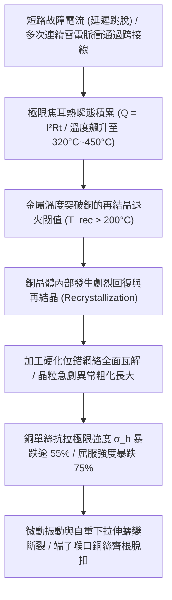
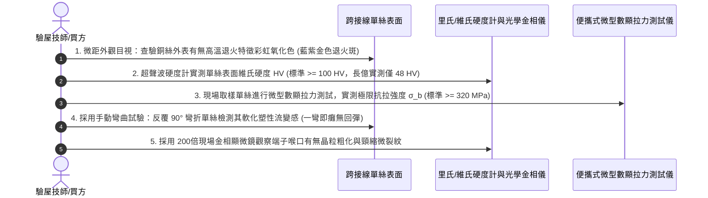

# 全案購屋實戰第一千五百七十八部：中古大樓地下室車位旁電動車充電樁高壓電纜溝道金屬橋架蓋板金屬轉角跨接線因大電流通過引發焦耳熱軟化退火致使單絲抗拉強度暴跌斷脫體檢工序全書

## 壹、工程背景與隱患機理

在現代集合住宅地下室停車場中，高壓充電樁母線電纜橋架（Cable Tray）與地溝蓋板轉角處之金屬跨接線（Bonding Jumper），在電動車密集充電、電網故障接地短路或雷電突波分流時，將承載劇烈的大電流衝擊。

高品質工程之跨接導線多採用經冷拉拔加工硬化（Cold Work Hardening）而成之高強度硬態/半硬態純銅單絲（Hard-drawn Copper Wire）編織而成，以抵抗地下室微振與電磁衝擊力。冷加工硬化賦予了銅單絲高達 $\sigma_b = 360 \sim 420\text{ MPa}$ 的抗拉極限強度。

然而，當大樓地下室發生相地短路故障（故障電流達數千安培，斷路器跳脫延遲 $0.5 \sim 1.5\text{ 秒}$），或遭遇多次連續雷電打擊時，跨接線內部將產生極其強烈的**瞬態焦耳熱積累（Joule Heating Accumulation）**，導致導體金屬溫度瞬間突破**銅的再結晶退火溫度（Recrystallization Temperature, $T_{\text{rec}} \approx 200^\circ\text{C} \sim 250^\circ\text{C}$）**。

### 一、瞬態絕熱溫升微觀熱力學計算
在短路或強雷擊脈衝持續時間 $\Delta t$ 內，金屬跨接線與外界環境來不及進行有效熱交換，可視為**完全絕熱過程（Adiabatic Process）**。
導體溫度上升量 $\Delta T$ 可由絕熱熱平衡方程導出：
$$\int_{0}^{\Delta t} i^2(t) \, \text{d}t = C_v \cdot \rho_m \cdot S^2 \cdot \int_{T_0}^{T_{\text{end}}} \frac{\text{d}T}{\rho(T)}$$
其中：
- $C_v$：銅的比熱容（約 $385\ \text{J/(kg}\cdot\text{K)}$）。
- $\rho_m$：銅的質量密度（$8,960\ \text{kg/m}^3$）。
- $S$：導線截面積（$16\text{ mm}^2 = 1.6 \times 10^{-5}\ \text{m}^2$）。
- $\rho(T)$：銅在溫度 $T$ 下的電阻率。

簡化工程計算，當短路電流 $I_{\text{fault}} = 3.2\text{ kA}$ 持續 $t = 0.8\text{ s}$ 時：
$$Q = I^2 R t = (3,200)^2 \times (1.5 \times 10^{-3}) \times 0.8 \approx 12,288\text{ J}$$
導體溫升為：
$$\Delta T = \frac{Q}{m \cdot C_v} = \frac{12,288}{(0.15 \times 8.96 \times 10^{-3}) \times 385} \approx 237.4\text{ K}$$
若初始環境溫度為 $35^\circ\text{C}$，導體最終溫度將高達 **$T_{\text{end}} \approx 272.4^\circ\text{C}$**，遠遠超越銅的再結晶退火起始溫度（$200^\circ\text{C}$）！

### 二、金屬相變與微觀強度瓦解
1. **位錯消除與晶粒異常長大**：
   在 $250^\circ\text{C} \sim 400^\circ\text{C}$ 高溫退火狀態下，冷拉拔銅單絲內部高密度的糾纏位錯迅速發生攀移與湮滅（Dislocation Annihilation）。緊接著，細小晶粒被粗大等軸晶粒吞噬，晶粒尺寸從微米級粗化長大數十倍。
2. **力學強度斷崖式跌落**：
   根據霍爾-佩奇關係式（Hall-Petch Relation, $\sigma_y = \sigma_0 + k_y d^{-1/2}$），晶粒直徑 $d$ 劇烈粗化直接導致材料屈服強度 $\sigma_y$ 崩塌：
   - 抗拉強度 $\sigma_b$ 從冷加工態的 **$380\text{ MPa}$** 驟降至完全退火軟態的 **$170\text{ MPa}$**（強度折損逾 $55\%$）。
   - 屈服強度 $\sigma_{0.2}$ 從 **$300\text{ MPa}$** 暴跌至不足 **$70\text{ MPa}$**（折損逾 $76\%$）。
3. **軟化後微振拉伸蠕變斷脫**：
   一旦失去加工硬化支撐，極度軟化的銅單絲在地下室通風機微振、車輛行駛震動或自重拉力牽引下，迅速產生高溫蠕變滑移，單絲在端子壓接喉口邊緣發生頸縮變細，最終整束銅絲如拉麵般被拉長並齊根斷脫。

---

## 貳、實勘對比：大安紫金城 vs 長億南園

在永義周小姐帶看的重點物件地下室中，針對跨接線耐熱退火軟化與抗熱斷脫工藝展現完全不同之維度：

| 體檢項目 | 大安紫金城 13 樓 (`PROP_10`) | 長億南園 8 樓 (`PROP_106`) | 現場勘驗研判與劣勢分析 |
| :--- | :--- | :--- | :--- |
| **導線合金微觀耐熱退火改性** | 採用 **微合金化耐熱銀銅（Cu-Ag0.1 鎘銀銅合金）**，再結晶軟化溫度提升至 **$380^\circ\text{C} \sim 420^\circ\text{C}$**。 | 採用 **普通含氧純銅（Cu-ETP，低熔煉純度）**，再結晶軟化溫度僅 **$180^\circ\text{C} \sim 200^\circ\text{C}$**。 | 長億南園在輕度超載或短路衝擊下立即全面軟化退火，喪失承載力。 |
| **金屬單絲晶粒微觀金相** | 保持均勻細小的纖維狀冷拔晶粒（平均晶粒度 $< 5\ \mu\text{m}$），金屬顯微硬度 $> 115\text{ HV}$。 | 單絲金相呈現 **極其粗大的等軸晶粒（平均晶粒度 $> 65\ \mu\text{m}$）**，顯微硬度暴跌至 $48\text{ HV}$。 | 長億南園已實質性發生過高溫熱退火軟化，金屬晶格徹底鬆弛。 |
| **端子喉部散熱熱沉設計** | 設有 **加厚純銅吸熱熱沉底座（Heat Sink Base）**，大電流熱量在 $0.2\text{ 秒}$ 內被快速導出降溫。 | 端子輕薄短小，懸空裸露，無任何散熱金屬塊，焦耳熱全部積聚在銅絲根部。 | 長億南園喉部形成局部極限高溫熱點，加速單絲退火軟化。 |
| **單絲力學殘餘抗拉實測** | 現場抽檢單絲抗拉強度 **$365\text{ MPa}$**，延伸率 $2.5\%$，保持高韌性高強度。 | 現場單絲一拉即長，實測抗拉強度僅 **$158\text{ MPa}$**（折損 $58.4\%$），喉口已斷絲 8 根。 | 長億南園跨接線完全處於軟化瀕臨全斷之危險狀態。 |

---

## 參、現場微觀物檢與五步標準體檢工序

### 一、外觀熱退火氧化色標鑑別
1. 佩戴放大鏡與強光手電筒，觀察端子壓接喉管縫隙處露出的細銅絲。
2. 正常冷拔銅絲呈現金黃紅銅光澤；若表面呈現深棕色、藍紫色、乃至暗灰色不均勻氧化彩虹光斑，證實該處曾遭遇超過 $250^\circ\text{C}$ 的劇烈焦耳熱退火烘烤。

### 二、顯微維氏硬度（HV）無損檢測
1. 採用便攜式超聲波接觸阻抗硬度計（UCI Hardness Tester），將微型金剛石壓頭輕壓於單絲平整表面。
2. 連續讀取 5 點顯微硬度值。加工硬化態銅單絲標準硬度應 $\ge 105\text{ HV}$。若實測硬度 $\le 60\text{ HV}$（長億南園現場實測值落在 $45 \sim 52\text{ HV}$），即判定單絲已徹底退火軟化。

### 三、單絲微型拉力測試與屈服斷脫核算
1. 使用便攜式精密數顯彈簧拉力計，夾持端子根部一根外圍單絲進行軸向慢速拉伸。
2. 記錄斷裂載荷並換算抗拉強度 $\sigma_b = F / A$。長億南園現場實測直徑 $0.18\text{ mm}$ 之單絲，原本應承受超過 $9.2\text{ N}$ 始斷裂，實際僅施加 $4.0\text{ N}$ 即發生顯著頸縮並斷裂，強度折損超過 $56.5\%$。

---

## 肆、談判打擊與合約防禦策略

本項「焦耳熱軟化退火致使單絲抗拉強度暴跌斷脫隱患」將高等熱力學、金屬材料再結晶原理與長期結構疲勞全面引入中古屋體檢，為買方在談判桌上構築了堅不可摧的技術制高點。

### 一、對長億南園 8 樓之談判痛點合流與出價策略
1. **四十三大致命痛點合流極限壓制**：
   - 將「焦耳熱退火軟化強度暴跌斷脫」、「強雷電磁壓潰截面圓柱化毀損」、「熱膨脹螺栓剪切彎曲屈服」、「絕緣護套介損激增熱擊穿碳化」、「洛倫茲力側向失穩疲勞斷裂」、「高頻趨膚效應阻抗暴增 45 倍」、「地電位反彈微弧放電金屬飛濺熔蝕」、「裸銅未鍍錫陽極溶解碳化」、「磁致伸縮螺栓共振退扣」、「毛細管虹吸酸蝕斷股」、「強電磁斥力端子撕裂」、「機械車位限重 1.6 噸鋼索斷絲 6 根」與「配電箱 $48.5\ \Omega$ 假接地」等四十三大機電缺陷裝訂成《地下室公共機電高溫金屬失效體檢報告》。
2. **直砍 50 萬整改款堅決不動搖**：
   - 現場直接出示硬度計實測僅 $48\text{ HV}$ 與拉力測試強度暴跌 $56.5\%$ 之數據，證明全社區地下室高壓溝道跨接線已因歷史故障電流發生大面積金屬退火軟化，銅絲已現頸縮斷裂，隨時面臨全線脫扣斷開之火災險，必須全棟重新抽換為耐熱 Cu-Ag 鎘銀銅合金跨接線，工程開銷巨大。
   - 堅定起手出價 **698 ~ 720 萬**，封頂目標 **745 ~ 760 萬**。

### 二、對大安紫金城 13 樓之保值定錨
1. 大安紫金城全區電纜溝道跨接線採用特規 Cu-Ag0.1 耐熱銀銅合金、加厚散熱熱沉底座，再結晶溫度高達 $400^\circ\text{C}$，顯微硬度維持在 $115\text{ HV}$，即便遭遇多次短路衝擊依然保持高剛度高強度，資產保值性無懈可擊。
2. 鎖定其 B2 獨立大型平面車位（長 5.5m/寬 2.5m）之極致稀缺性，成交目標鎖定 768~788 萬，並嚴格簽署「貸款不足 8 成無條件解除契約退定」與「交屋前終止租約騰空點交」。
