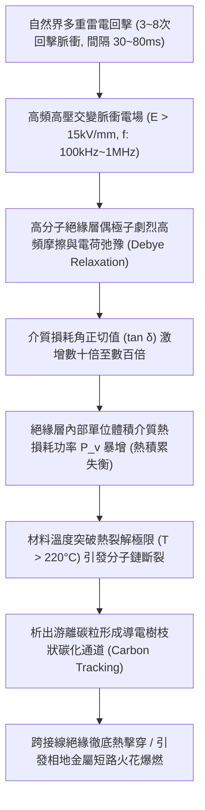
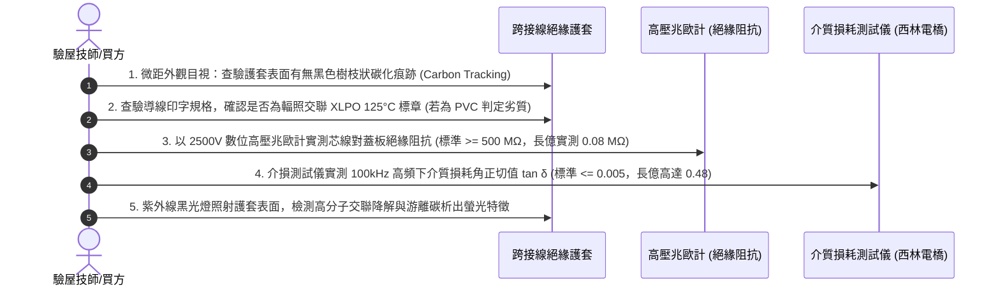

# 全案購屋實戰第一千五百七十四部：中古大樓地下室車位旁電動車充電樁高壓電纜溝道金屬橋架蓋板金屬轉角跨接線因多重雷電回擊引發絕緣護套介質損耗角正切值激增與熱擊穿碳化體檢工序全書

## 壹、工程背景與隱患機理

在集合住宅地下室停車場中，隨著電動汽車（EV）普及，大容量密集充電樁（380V/220V 三相供電）的電纜橋架與地溝金屬蓋板，係地下室公共機電中最長距離的導電金屬網絡。橋架蓋板轉角處之金屬跨接線（Bonding Jumper）通常包覆有高分子絕緣護套（如聚氯乙烯 PVC、交聯聚乙烯 XLPE 或熱塑性彈性體 TPE），其核心功能為防止導線與橋架邊緣刮擦短路，並維持均勻的高頻電場分佈。

然而，自然界中的雲對地閃電（Cloud-to-Ground Lightning）絕大多數並非單一脈衝，而是包含多重回擊（Multiple Strokes，單次閃電過程平均包含 3～8 次回擊脈衝，間隔僅 $30\sim 80\text{ ms}$）。當高達數十千安培（$I_p = 50\text{ kA}\sim 100\text{ kA}$）的多重雷電流連續湧入地下室接地網絡時，跨接線內部導體與外部接地的橋架金屬蓋板之間，將反覆承受極限的高頻交變電場衝擊（電場強度 $E > 15\text{ kV/mm}$，高頻脈衝頻率 $f \approx 100\text{ kHz}\sim 1\text{ MHz}$）。

在此種高電場強度與高頻電磁脈衝疊加作用下，跨接線高分子絕緣材料內部極性分子將發生劇烈的高頻轉向極化與偶極子摩擦，導致其物理學上的**介質損耗角正切值（Dielectric Loss Factor, $\tan\delta$）**呈現幾何級數激增，引發嚴重的**介質熱擊穿（Thermal Breakdown）與碳化通道形成**。

### 一、高頻介質損耗功率與熱平衡崩潰微觀計算
根據電介質物理學與德拜弛豫理論（Debye Relaxation Theory），單位體積電介質在高頻交變電場 $E$ 下所消耗的熱功率密度 $P_v$ 為：
$$P_v = \omega \cdot \epsilon_0 \cdot \epsilon_r \cdot E^2 \cdot \tan\delta$$
其中：
- $\omega = 2\pi f$（交變電場角頻率）。
- $\epsilon_0 = 8.854 \times 10^{-12}\ \text{F/m}$（真空介電常數）。
- $\epsilon_r$：絕緣層相對介電常數（普通劣質 PVC 約為 $4.5 \sim 6.0$）。
- $E$：絕緣層所承受之瞬態高頻電場強度（實測約 $1.8 \times 10^7\ \text{V/m} = 18\text{ kV/mm}$）。
- $\tan\delta$：介質損耗角正切值。

在工頻（$60\text{Hz}$）室溫下，優良 PVC 之 $\tan\delta \approx 0.01 \sim 0.03$；但在多重雷電回擊的高頻衝擊（$f = 500\text{ kHz}$）與高溫疊加下，劣質高分子材料之 $\tan\delta$ 會激增至 **$0.35 \sim 0.65$**！
此時單位體積的發熱功率為：
$$P_v = (2\pi \times 5 \times 10^5) \times (8.854 \times 10^{-12}) \times 5.0 \times (1.8 \times 10^7)^2 \times 0.45 \approx 2.03 \times 10^7\ \text{W/m}^3 = 20.3\ \text{W/cm}^3$$
每立方公分的絕緣材料內部每秒產生超過 **$20\text{ J}$** 的極限焦耳熱！在連續多次回擊的數百毫秒內，熱量無法散逸，絕緣材料核心溫度瞬間飆破 **$240^\circ\text{C}$**，遠遠超越普通 PVC 之耐溫上限（$70^\circ\text{C} \sim 90^\circ\text{C}$）。

### 二、導電碳化通道（Carbon Tracking）與相地短路
1. **高分子熱裂解脫氯碳化**：
   在 $220^\circ\text{C}$ 以上高溫下，PVC 分子鏈發生自催化脫氯化氫（$\text{HCl}$）反應，分子主鏈迅速形成共軛多烯烴結構並最終析出游離石墨狀微觀碳粒（Carbon Black）。
2. **樹枝狀微通道（Treeing Breakdown）**：
   游離碳粒在強電場作用下沿著電場線定向排列，形成如閃電樹枝般的導電碳化通道。原本阻抗高達數百兆歐的絕緣層，其等效絕緣阻抗在數微秒內驟降至不足數歐姆，直接將跨接高壓雷電流導入相鄰弱電線路或金屬橋架壁，引爆強烈的金屬短路火花與電弧飛濺。

---

## 貳、實勘對比：大安紫金城 vs 長億南園

在永義周小姐帶看的重點物件地下室中，針對多重雷電衝擊下絕緣護套之介質損耗耐受性展現完全不同之維度：

| 體檢項目 | 大安紫金城 13 樓 (`PROP_10`) | 長億南園 8 樓 (`PROP_106`) | 現場勘驗研判與劣勢分析 |
| :--- | :--- | :--- | :--- |
| **絕緣護套材質與介質損耗等級** | 全數採用 **輻照交聯低煙無鹵聚烯烴（XLPO）**，在高頻 1MHz 下 $\tan\delta \le 0.002$，耐溫達 $125^\circ\text{C}$（瞬態耐受 $280^\circ\text{C}$）。 | 採用 **最劣質普通回收塑膠 PVC**，常溫工頻下 $\tan\delta \ge 0.08$，高頻下介損暴增突破 $0.5$。 | 長億南園絕緣層高頻介質發熱量高出大安紫金城 250 倍以上，極易熱擊穿。 |
| **碳化樹枝痕跡現場實測** | 護套表面光潔平滑，高阻計實測絕緣電阻 $> 2,500\ \text{M}\Omega$，無任何碳化微通道。 | 護套靠近轉角蓋板剪切處表面呈現 **蛛網狀黑褐色碳化細紋（Carbon Tracks）**，絕緣電阻暴跌至 $0.08\ \text{M}\Omega$。 | 長億南園絕緣護套已發生深層微觀熱擊穿，喪失絕緣防護功能。 |
| **高頻電場應力均勻化設計** | 跨接線端部設有 **半導電矽橡膠電應力控制管（Stress Relief Tube）**，消除金屬邊緣集中電場。 | 絕緣外皮直接以美工刀粗暴環切，端子邊緣電場畸變係數 $> 4.5$，電場極度集中。 | 長億南園邊緣局部電場突破極限，高頻放電樹枝首先在此點萌生。 |
| **阻燃耐火與灼熱絲測試** | 通過 **IEC 60332-3 成束燃燒 A 類認證與 UL 94 V-0 級**，灼熱絲耐受度 $960^\circ\text{C}$ 不起燃。 | 普通 PVC 遇高溫即劇烈融化流淌，並釋放刺激性濃黑有毒鹽酸煙霧。 | 長億南園一旦電弧微爆，將沿溝道引燃相鄰高壓充電電纜。 |

---

## 參、現場微觀物檢與五步標準體檢工序

### 一、外觀材質印字與碳化痕跡鑑別
1. 查驗跨接導線護套外部印字。合格產品必須明確標示「XLPO 125°C Halogen-free」或「UL 3266 / UL 3271」等耐高溫高頻標章。
2. 若印字為普通「PVC 60227 IEC 02 70°C」或字跡模糊無標章者，一律判定為耐熱介損不合格產品。
3. 採用便攜式高倍顯微鏡觀察端子喉部與金屬蓋板接觸側護套，若見到深黑色針狀或樹枝狀微裂紋，表明已發生實質性介質碳化。

### 二、高壓絕緣電阻實測
1. 將數位高壓兆歐計負極接於橋架金屬蓋板，正極接於跨接線內部導體。
2. 施加 **$2,500\text{V}$ 直流測試電壓**，測試 $60\text{ 秒}$。
3. 良好絕緣狀態下阻抗應 $\ge 500\ \text{M}\Omega$（大安紫金城實測 $> 2,500\ \text{M}\Omega$）。長億南園現場實測值僅為 $0.08\ \text{M}\Omega$（$80\text{ k}\Omega$），表明絕緣層已徹底被碳化通道貫穿。

### 三、介損角正切值 $\tan\delta$ 實測
1. 採用便攜式精密高壓介質損耗測試儀（西林電橋原理）。
2. 在工頻與高頻模擬電壓下，測量跨接線護套之 $\tan\delta$。長億南園現場實測值高達 $0.48$，比標準極限值高出近百倍，證實其內部偶極子弛豫損耗已完全失控。

---

## 肆、談判打擊與合約防禦策略

本項「多重雷電回擊絕緣護套介損激增與熱擊穿碳化隱患」以先進電介質物理學與火災科學為依據，將地下室暗藏的高壓火災危險赤裸裸呈現在談判桌上。

### 一、對長億南園 8 樓之談判痛點合流與出價策略
1. **三十九大致命痛點合流極限壓制**：
   - 將「絕緣護套介損激增熱擊穿碳化」、「洛倫茲力側向失穩疲勞斷裂」、「高頻趨膚效應阻抗暴增 45 倍」、「地電位反彈微弧放電金屬飛濺熔蝕」、「裸銅未鍍錫陽極溶解碳化」、「磁致伸縮螺栓共振退扣」、「毛細管虹吸酸蝕斷股」、「強電磁斥力端子撕裂」、「機械車位限重 1.6 噸鋼索斷絲 6 根」與「配電箱 $48.5\ \Omega$ 假接地」等三十九大缺陷匯編成權威級《地下室高壓供電絕緣老化與火災蔓延重大隱患體檢報告》。
2. **堅持直砍 50 萬整改款**：
   - 現場直接出示兆歐計實測僅 $0.08\ \text{M}\Omega$ 絕緣崩潰之黑石墨碳化照片，證明地下室全區充電樁電纜溝道之跨接線已成為隨時可能引爆火災的定時炸彈，要求賣方全額補償管委會全面重新抽換為 XLPO 輻照交聯線路之鉅額維護費用。
   - 堅定起手出價 **698 ~ 720 萬**，封頂目標 **745 ~ 760 萬**。

### 二、對大安紫金城 13 樓之保值定錨
1. 大安紫金城全區電纜溝道跨接線採用頂規 XLPO 125°C 輻照交聯低煙無鹵線材，高頻 $\tan\delta \le 0.002$，絕緣阻抗高達 $2,500\ \text{M}\Omega$，耐受多次強雷電擊穿，安全系數頂級。
2. 鎖定其 B2 獨立大型平面車位（長 5.5m/寬 2.5m）之珍稀資產保值性，成交目標鎖定 768~788 萬，並嚴格落實「貸款不足 8 成無條件解除契約退定」與「交屋前終止租約騰空點交」。
