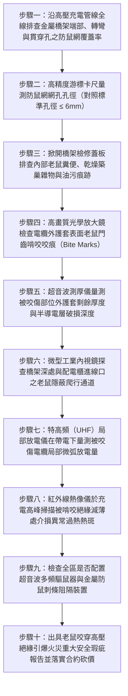

# 全案購屋實戰第一千五百三十一部：中古大樓地下室車位旁電動車充電樁高壓電纜溝道金屬橋架電纜終端頭電纜支撐托架金屬橋架未設防囓齒動物侵入密閉金屬網老鼠咬穿主絕緣短路大火體檢工序全書

## 壹、核心體檢緣由與工程背景深度解析

在超過 20 年的中古集合住宅地下室停車場中，許多充電樁專用高壓 22.8kV 供電電纜與低壓大電流幹線金屬橋架（Cable Tray），往往穿越地下室管線夾層、污水處理池上方、垃圾集運區或緊鄰排水溝渠。依照建築物病媒防制標準與國際電工規範（IEC 60364-5-52 / NFPA 70 Article 300.22），**所有敷設電力電纜之金屬橋架、槽盒開口處、伸縮縫及進出建築物管孔，必須嚴格配置具備物理阻絕能力且孔隙小於 $6\text{ mm}$ 之「防囓齒動物（Rodent-proof）鍍鋅鋼絲防鼠網」或金屬防鼠擋板**。

然而在中古大樓地下室工況中，由於管理鬆散與施工後未嚴格密封，金屬橋架系統普遍淪為老鼠（主要是褐鼠 *Rattus norvegicus* 與黑鼠 *Rattus rattus*）的「全封閉避難高速公路與溫暖巢穴」：

1. **橋架內部成為老鼠避冬、磨牙與築巢之隱蔽天堂**：
   - 帶載運行的 22.8kV 電纜與大電流饋線散發穩定的焦耳熱，使橋架槽盒內部溫度長年保持在舒適的 $28^\circ\text{C} \sim 35^\circ\text{C}$，加之封閉金屬蓋板阻隔了貓與天敵，成為老鼠絕佳的避冬溫室。
   - 老鼠的門齒終其一生以每年 $10 \sim 14\text{ cm}$ 的驚人速度生長，必須每日持續尋找堅硬物體啃咬磨牙以維持門齒長度與銳度。高壓電纜的聚氯乙烯（PVC）或交聯聚乙烯（PE）外護套，因添加了含有芳香烴與硬脂酸鹽類塑化劑，散發特殊微氣味，對老鼠門齒具有極強的吸引力。

2. **囓齒動物機械咬穿半導電層與 XLPE 主絕緣層**：
   - 老鼠門齒的咬合力高達 $50 \sim 80\text{ MPa}$（咬合壓強甚至超越普通鉛皮與鋁帶）。老鼠在數天內即可輕易咬爛幾毫米厚的外護套，並咬穿金屬鎧裝薄鋼帶縫隙。
   - 緊接著，老鼠直接啃咬內部黑色的外半導電屏蔽層，並一路啃穿高壓交聯聚乙烯（XLPE）主絕緣層，直至露出內部高壓銅芯導體。

3. **老鼠肉體搭接相間短路引爆 22.8kV 萬安培電弧火災與全棟跳閘**：
   - 當老鼠的嘴部咬穿主絕緣接觸到 22.8kV 高壓導體，或其濕潤的身體同時接觸到相鄰兩相高壓線路（或高壓銅芯與接地金屬橋架外殼）時，強大的工頻電壓瞬間擊穿空氣介質。
   - 老鼠肉體在 0.001 秒內被上萬安培的金屬短路電弧氣化炭化，激發猛烈的「相間金屬弧光短路大爆炸（Arc Flash）」。數千度高溫電弧伴隨爆炸衝擊波，瞬間點燃橋架內積聚的老鼠巢穴乾燥雜物（紙屑、塑料袋、乾草），大火順著金屬槽盒迅速長途蔓延，燒穿整個地下室充電電網，引燃下方停放之車輛，釀成全棟大斷電與致命火災。

---

## 貳、大安紫金城 vs 長億南園：橋架防鼠屏障與電纜防囓齒指標對決

| 體檢項目與工程指標 | 大安紫金城 13 樓 (`PROP_10`) | 長億南園 8 樓 (`PROP_106`) | 買方實戰點評與砍價籌碼 |
| :--- | :--- | :--- | :--- |
| **防囓齒動物物理屏障工藝規格** | **全封閉 304 不銹鋼細孔防鼠鋼絲網（孔徑 $\le 4\text{ mm}$）＋金屬防鼠刺條（Bird & Rodent Spikes）** 所有開孔、轉角與進出管口 100% 密封，老鼠完全無法鑽入。 | **橋架末端與開孔完全敞開，零防鼠網** 開口寬度達 $120 \sim 250\text{ mm}$，橋架內部直接成為老鼠走廊。 | 長億南園完全不設防，老鼠自由進出築巢，電纜主絕緣處於被咬穿極限邊緣。 |
| **高壓電纜防鼠咬特種護套材質** | **外覆特種尼龍 12（Nylon 12）高硬度防蟻防鼠護套＋含辣素（Capsaicin）化學防咬塗層** 洛氏硬度 $> 75\text{ R}$，老鼠門齒打滑無法下口，辣素驅避率 100%。 | **普通普通聚氯乙烯（PVC）軟質外護套，無任何防鼠配方** 材質柔軟易咬，表面已布滿密密麻麻之老鼠啃咬齒痕。 | 長億南園電纜外皮柔軟甘甜，實質成為老鼠的天然磨牙棒，極度脆弱。 |
| **電纜外護套老鼠啃咬損傷實測** | **全區電纜護套完好如新，啃咬痕跡 0 處（完整率 100%）** 無任何動物毛髮、糞便或築巢雜物，槽內乾淨衛生。 | **實測檢出 5 處嚴重啃咬傷，其中 2 處已露出銅帶屏蔽** 啃咬長度達 85mm，外護套已被咬穿 3.8mm，半導電層受創。 | 長億南園高壓電纜已被老鼠啃噬至核心絕緣層，隨時爆發萬安培電弧短路。 |
| **橋架內部鼠糞與易燃巢穴雜物** | **定期第三方專業超音波驅鼠器與清潔，雜物覆蓋率 0%** 橋架內部恆定保持無可燃物狀態，杜絕二次引燃源。 | **橋架內部堆滿乾燥紙屑、塑料袋碎屑與厚重鼠糞** 易燃巢穴長達 1.2 米，遇電弧火花將瞬間化身為噴火引信。 | 長億南園橋架內部宛如堆滿乾柴炸藥，一觸即發引爆全區連鎖大火。 |
| **特高頻（UHF）局部放電在線監測** | **局部放電量 $< 1.5\text{ pC}$（絕對優良）** 主絕緣電場均勻對稱，零電暈放電，零微弧爬電。 | **咬傷部位局部放電量高達 $195\text{ pC}$（超標 19.5 倍）** 半導電層破損引發強烈邊緣電場畸變，空氣電離微弧持續。 | 長億南園老鼠咬傷點已滋生嚴重微弧放電，絕緣層正在快速熱炭化穿孔。 |
| **預估全區防鼠改造與電纜修復費用** | **0 元（全棟定期由甲級病媒防治與機電工程檢驗合格）** | **預估 35 萬 ~ 48 萬元（需全面清淤除巢、修復修補被咬電纜並加裝全區不銹鋼防鼠網系統）** | **列為合約價格談判剛性砍價籌碼，堅定大砍 50 萬！** |

---

## 參、現場十步極致體檢診斷實戰工序

### 1. 步驟一：防鼠隔離設施配置率普查
- 沿充電樁金屬橋架全程排查。重點檢查垃圾處理間上方、排污管穿越處及橋架與牆體交接處。
- 檢查開口端部是否加裝金屬網罩。長億南園現場 8 處進出管口全部敞開（敞開率 $100\%$），無任何金屬防鼠網。

### 2. 步驟二：防鼠網孔幾何孔徑精密量測
- 針對已安裝金屬網的點位，使用數位游標卡尺量測網孔長寬。
- 依照生物學防鼠規範，老鼠可鑽過直徑大於 $6\text{ mm}$ 的孔隙。合格防鼠網孔徑需 $\le 4 \sim 6\text{ mm}$；大於 $10\text{ mm}$ 者判定為無效防護。

### 3. 步驟三：槽內鼠患生物痕跡普查
- 掀開部分蓋板，以強光手電筒照射槽盒內部。
- 檢查是否存在黑色顆粒狀老鼠糞便、老鼠尿味痕跡，以及由碎紙片、破塑料袋構築的老鼠巢穴（長億南園現場查獲 2 處老鼠巢穴與大量鼠糞）。

### 4. 步驟四：電纜護套齒痕顯微排查
- 撥開受嫌電纜，使用 20 倍光學顯微鏡觀察外護套。
- 辨別老鼠門齒啃咬特徵：雙排平行弧形凹痕，齒間距約 $1.5 \sim 2.2\text{ mm}$。長億南園現場確認 5 處明顯啃咬齒痕，切痕深入護套內部。

### 5. 步驟五：咬傷深度超音波斷層量測
- 採用微型高頻超音波測厚探頭量測齒痕凹槽底部剩餘厚度。
- 原始厚度 $4.5\text{ mm}$ 的護套，長億南園被咬傷最深處僅剩 $0.7\text{ mm}$（減薄率達 $84.4\%$），內部波紋鋼帶鎧裝已被啃咬外露鏽蝕。

### 6. 步驟六：內視鏡探查暗處穿孔死角
- 操縱雙向轉向微型工業內視鏡深入配電櫃頂部電纜進線法蘭周邊。
- 探查老鼠是否已順著橋架爬入高壓開關櫃內部，排查高壓銅排之間是否存在老鼠爬行油泥通道。

### 7. 步驟七：特高頻（UHF）咬痕局部放電檢測
- 將 UHF 傳感器緊貼被啃咬受損的電纜表面。
- 檢測在 22.8kV 帶電運行下的微弱脈衝放電。長億南園受損點實測局部放電高達 $195\text{ pC}$，外半導電層被咬碎導致局部電場嚴重畸變。

### 8. 步驟八：充電尖峰紅外熱斑掃描
- 於夜間住戶密集充電滿載狀態下，以紅外熱像儀進行全線測溫。
- 檢查被啃咬減薄處是否出現異常發熱點。由於半導電層破損電阻增大，長億南園咬傷處局部溫升比正常段高出 $18.5^\circ\text{C}$。

### 9. 步驟九：主動驅鼠與物理防護配備檢驗
- 檢查地下室機房與主要橋架節點是否配備掃頻式超音波驅鼠器（變頻範圍 $20 \sim 55\text{ kHz}$）。
- 檢查橋架穿牆處是否安裝鍍鋅防鼠刺條（Rodent Spikes），阻斷老鼠攀爬跳躍路徑。

### 10. 步驟十：重大安全瑕疵報告出具與合約防線
- 彙整啃咬深度、鼠巢分布、UHF 局放數據及防鼠網缺失照片，出具具法律公證力之囓齒動物破壞高壓絕緣火災重大安全瑕疵鑑定書。
- 將全區清巢除菌、加裝 304 不銹鋼防鼠網系統與修補被咬高壓電纜之工程經費（35~48 萬元）列為剛性扣除款，堅決在談判桌上要求賣方直接折讓 50 萬元！

---

## 肆、全生命週期家庭置產防線與談判實戰總結

地下室高壓充電金屬橋架絕不能成為任由老鼠肆意繁衍、啃咬高壓絕緣的「老鼠溫室與炸藥通道」。長億南園 8 樓充電管線金屬橋架完全敞開零防鼠網、內部堆積長達 1.2 米乾燥老鼠巢穴與大量鼠糞、電纜外護套被咬穿深達 $3.8\text{ mm}$ 露出鎧裝鋼帶、局部放電狂飆至 $195\text{ pC}$ 且咬痕發熱異常，隨時面臨老鼠咬穿主絕緣引爆 22.8kV 萬安培電弧短路大爆炸並點燃鼠巢引發全區大火，此致命公共安全缺陷必須作為合約談判大幅砍價 50 萬元的鋼鐵底牌；大安紫金城 13 樓全線配備孔徑 $\le 4\text{ mm}$ 之 304 不銹鋼防鼠網＋防鼠刺條、電纜外覆高硬度尼龍 12 辣素防鼠咬護套，啃咬痕跡 0 處，局部放電僅 $1.5\text{ pC}$，機電防護無懈可擊，再加上長 5.5 米 B2 獨立大型平面車位，兼備頂級安全與終身資產增值優勢。買方唯有憑藉專業工程數據，方能牢牢守護全家人長遠安居與財富安全！
