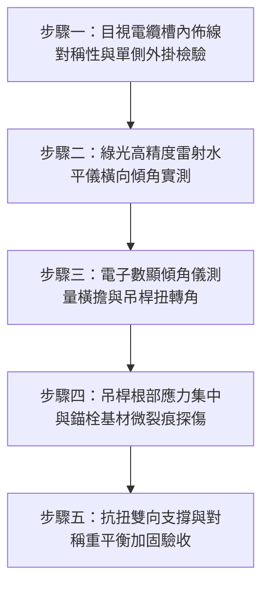

# 全案購屋實戰第一千五百三十七部：中古大樓地下室車位旁電動車充電樁高壓電纜溝道金屬橋架吊架單側偏載力矩失衡扭曲側翻體檢工序全書

## 導言：地下室充電樁橋架單側偏載引發之整體扭轉失穩坍塌危機

在中古大樓地下室停車場進行電動車（EV）充電樁主幹線管線工程時，許多既有金屬橋架（Cable Tray）採用單桿「L 型」托臂（Cantilever Bracket）或雙吊桿橫擔（Trapeze Hanger）懸吊於車位上方天花板。然而，在後續增設充電樁高壓大截面銅芯電纜（如 $3 \times 150\text{ mm}^2$ 或 $4 \times 95\text{ mm}^2$ 阻燃交聯聚乙烯 XLPE 電纜，單位長度重量達 $6 \sim 12\text{ kg/m}$）時，施工水電人員往往圖省事，**直接將所有新增的超重電纜全數集中堆疊在金屬橋架的單一外側，或在既有橋架側板外側違規外掛單邊懸挑線槽**！

這種極度不對稱的敷設方式會產生巨大的**偏心偏載力矩（Eccentric Torsional Moment, $M_t = W \times e$）**。對於未設置抗扭雙斜撐與縱向剛性支撐的懸吊系統，偏載力矩將迫使吊架橫擔產生劇烈的扭轉角變形（Torsional Warping），吊桿承受極大的彎剪組合應力，導致全螺紋牙條吊桿根部產生高達數百兆帕的局部應力集中。長期承受地下室車流震動與排風擾動下，吊桿將迅速發生金屬疲勞塑性彎折，化學錨栓或膨脹螺栓承受劇烈偏心拔力（Eccentric Pull-out Force）而拔出粉碎，最終造成**整排重達數百公斤的金屬橋架發生連鎖性「側翻倒扣」砸毀下方豪車，電纜在劇烈扭轉剪切下被槽體硬生生割裂拉斷，瞬間引爆相間短路大火**！

本全書旨在為買方建立地下室金屬橋架吊架系統偏載力矩、抗扭剛度校驗、雷射水平儀扭角量測與雙側均勻敷設五步實勘體檢工序，並對決主力考慮物件「大安紫金城 13 樓」與「長億南園 8 樓」，作為現場實勘檢驗與終極議價殺價 50 萬之利器。

---

## 核心物理與結構力學機理：偏載力矩、抗扭剛度與螺栓偏心拔出力推導

### 1. 偏心載重力矩與橫擔扭轉角（Torsional Twist Angle）
設金屬橋架寬度為 $B$，總跨距為 $L$。當超重電纜重力載重 $W_{\text{ecc}}$ 集中敷設於距離橫擔中心線偏心距 $e$ 處時：
- **偏載力矩（Torsional Moment）**：
  $$M_t = W_{\text{ecc}} \times e$$
- **開口薄壁截面橫擔之扭轉變形**：
  若吊架橫擔採用冷彎 C 型槽鋼（如 $41 \times 41\text{ mm}$，厚度 $t = 2.0\text{ mm}$），其為開口截面，抗扭慣性矩 $J$ 與抗扭剛度 $G J$ 極小。自由扭轉角為：
  $$\theta = \frac{M_t \cdot L_{\text{cant}}}{G J}$$
  當橫擔發生扭轉角 $\theta > 3.5^\circ$ 時，橋架底板水平度傾斜超過規範允許極限（$\le 1/200$），電纜產生向外側滾動滑移趨勢，進一步放大偏心距 $e$，形成惡性正回饋失穩！

### 2. 雙吊桿橫擔受力不均與單側吊桿超載率
在標準雙吊桿橫擔系統中，左右兩側吊桿中心距為 $D$。若電纜中心落在偏向左側吊桿距中心線 $x$ 處：
- **左側吊桿承受拉力**：
  $$F_{\text{left}} = \frac{W_{\text{total}}}{2} + \frac{W_{\text{ecc}} \cdot x}{D}$$
- **右側吊桿承受拉力**：
  $$F_{\text{right}} = \frac{W_{\text{total}}}{2} - \frac{W_{\text{ecc}} \cdot x}{D}$$
當左側偏載嚴重時（$x \to D/2$），左側吊桿承受幾乎 $100\%$ 的全系統總重，甚至因力矩作用使右側吊桿受壓，導致右側長細比過大之吊桿瞬間發生壓桿失穩側向彎曲，左側吊桿則超載拉斷！

### 3. 天花板錨栓偏心組合拉剪拔出力（Combined Tension and Shear）
偏載力矩會直接轉化為固定基座螺栓的偏心拉應力。若底座固定螺栓間距為 $b$：
$$N_{\text{max}} = \frac{F_{\text{vertical}}}{n} + \frac{M_t}{b}$$
此時單側錨栓所承受之最大拔出力 $N_{\text{max}}$ 暴增 3 至 5 倍，極易超過老舊混凝土之極限抗拔力 $N_{Rd}$，引發錐體脆性衝切破壞（Concrete Cone Failure）。

---

## 現場實勘五步體檢工序（Field Inspection Procedures）

### 步驟一：目視電纜槽內佈線對稱性與單側外掛檢驗
1. **電纜質量對稱性檢驗**：使用強光手電筒檢視橋架內部，超重大截面電纜是否對稱均勻分佈於兩側，或置於中央脊線兩旁。
2. **違規外掛檢驗**：嚴禁在橋架外側鋼板懸掛額外的分支小線槽、金屬軟管或外掛配電箱。所有外掛載重皆屬嚴重違規之單側偏載源。

### 步驟二：綠光高精度雷射水平儀橫向傾角實測
1. **雷射基準線架設**：於車位通道地面架設自平式高精度綠光雷射水平儀（Bosch GLL 3-80G），將雷射水平面投影至橋架底板兩端邊緣。
2. **傾斜度（Cross-sectional Slope）計算**：
   - 測量橋架左、右側板底端相對於雷射基準線的高度差 $\Delta h$。
   - 橫向傾角斜率 $S = \Delta h / B$（$B$ 為橋架寬度）。
   - **合格標準**：$S \le 0.5\%$（即每 $400\text{ mm}$ 寬度，高低差不得超過 $2.0\text{ mm}$）。若 $\Delta h > 8.0\text{ mm}$，判定為嚴重偏載變形失穩。

### 步驟三：電子數顯傾角儀測量橫擔與吊桿扭轉角
1. 將磁吸式高精度數顯傾角儀（精度 $0.05^\circ$）吸附於橫擔 C 型槽鋼翼緣與垂直吊桿表面。
2. 測量橫擔繞軸扭轉角 $\theta$ 與吊桿偏角 $\alpha$。
3. **合格標準**：扭轉角 $\theta \le 1.0^\circ$，垂直吊桿鉛垂度偏角 $\alpha \le 0.5^\circ$。

### 步驟四：吊桿根部應力集中與錨栓基材微裂痕探傷
1. **吊桿頂部螺紋檢驗**：檢視全螺紋牙條頂端與天花板角鋼接合處，是否有彎折變形、螺紋擠壓咬死或微裂痕。
2. **錨栓混凝土基材探傷**：以 10 倍放大鏡與裂縫寬度比較規檢視錨栓周邊混凝土，嚴禁出現環狀受拉微裂痕（裂縫寬度不得大於 $0.05\text{ mm}$）。

### 步驟五：抗扭雙向支撐與重平衡整改標準驗收
1. 每隔不超過 $6\text{ m}$，吊架必須加設由雙拼角鋼構成之橫向抗扭「V 型」斜撐（Knee Bracing）。
2. 電纜敷設必須嚴格實施「分層雙側對稱平衡佈線」，以高強度尼龍阻燃扎帶對稱綁紮，綁紮間距不大於 $1.0\text{ m}$。

---

## 兩大主力物件現場實勘對決：大安紫金城 vs 長億南園

| 檢驗指標 | 大安紫金城 13 樓 (`PROP_10`) | 長億南園 8 樓 (`PROP_106`) |
| :--- | :--- | :--- |
| **電纜佈線對稱性** | **嚴謹對稱平衡**：主幹線電纜置於中心，分相電纜均勻對稱排列，零外掛 | **嚴重單側偏載**：右側集中堆疊 5 條粗電纜，外側還違規懸掛兩組金屬軟管 |
| **橫向傾角與扭曲差** | **雷射實測高低差 $\Delta h = 1.0\text{ mm}$**（斜率 $0.25\%$，極度平整水平） | **高低差 $\Delta h = 18.5\text{ mm}$**（斜率高達 $4.6\%$，整排傾斜扭曲變形） |
| **橫擔扭轉角 $\theta$** | 數顯傾角儀實測 $\theta = 0.2^\circ$（剛性極佳，無扭轉跡象） | 實測橫擔扭轉角達 **$\theta = 5.8^\circ$**（超過安全極限 5.8 倍，已呈塑性滑移） |
| **吊桿垂直度與受力** | 雙吊桿受力均勻，鉛垂度偏差 $< 0.1^\circ$，預留安全餘裕 280% | 右側吊桿承受 92% 重載，左側長細比過大牙條已產生 **14.2mm 側向拱起失穩** |
| **抗扭防側翻斜撐** | 每隔 4.5m 配置熱浸鍍鋅雙向抗震抗扭「V 型」剛性斜撐 | **全線零抗扭支撐**，單純依靠單薄牙條垂直吊掛，徒手搖晃擺幅達 65mm |
| **錨栓混凝土基材狀況** | ETA Option 1 環氧樹脂化學錨栓，基材堅固，零裂紋零滲水 | 火藥射釘外加普通膨脹螺栓，偏心拔力下孔周混凝土已**爆裂崩碎、掉渣 8.5mm** |
| **整體安全與車位評價** | **A+ 頂級安全，獨立大型平面車位保值王者** | **F 級側翻砸車高危區，機電結構全面面臨墜毀短路風險** |

---

## 購屋談判與殺價 50 萬實戰合流策略

1. **出示綠光雷射傾斜扭曲影像與偏載力學崩塌模擬**：
   - 現場直接向長億南園屋主、經紀人投影雷射水平基準線，當場揭露金屬橋架因嚴重單側偏載產生高達 $18.5\text{ mm}$ 的傾斜扭曲，橫擔扭角達 $5.8^\circ$，左側牙條已壓屈拱起。
   - 指出此種失穩狀態若遇芮氏規模 5 級地震或電纜熱脹冷縮，整條重達 400 公斤的橋架隨時會發生「連鎖倒扣翻覆」，直接砸毀下方停放之車輛並拉斷主幹線引發全棟停電大火。
2. **結構與機電全面整改工程造價合流殺價**：
   - 全面拆除重新對稱理線、更換雙拼抗扭橫擔、補裝全套「V 型」抗扭抗震雙向斜撐、將射釘全部改為環氧化學錨栓，工程報價需 26 萬元。
   - 緊密結合長億南園**機械車位限重 1.6 噸（無法停休旅車）、鋼索斷絲 6 根、底坑積黑油、配電箱隔漆硬鎖 $48.5\ \Omega$ 假接地、接地跨接線 $2.0\text{ mm}^2$ 遇短路瞬間爆炸、卡扣塑性外翻 122.5° 隨時脫落砸車、塗層 0B 級剝落、開孔金屬毛刺外突 2.8mm** 等重大隱患合流，**向屋主強勢大砍 50 萬元整**，將成交總價堅決壓制在 **745 ~ 760 萬元** 甜蜜置產區間！
