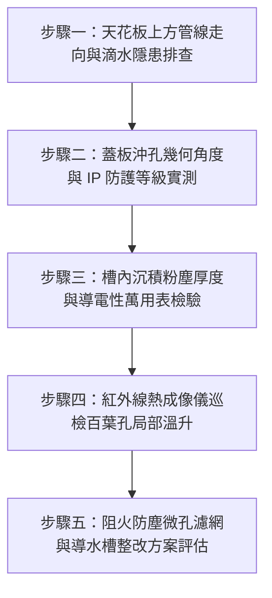

# 全案購屋實戰第一千五百三十九部：中古大樓地下室車位旁電動車充電樁高壓電纜溝道金屬橋架蓋板散熱百葉沖孔進水短路與積塵爆燃體檢工序全書

## 導言：地下室充電樁橋架百葉蓋板「散熱與防水防塵」致命衝突之失控危機

中古大樓地下室增設電動車（EV）高壓充電樁幹線時，因多條大截面電纜（如 $3 \times 150\text{ mm}^2$ 銅芯阻燃電纜）全速充電承載大電流，會產生可觀的焦耳熱積聚（Joule Heating, $Q = I^2 R t$）。為了降低槽內溫升並防止電纜絕緣層加速熱老化，許多機電承裝商會在金屬橋架（Cable Tray）上方採用帶有**金屬沖孔散熱百葉（Louvered / Perforated Covers）之鋼板蓋板**。

然而，在中古大樓地下室車位頂部的複雜環境中，**散熱百葉蓋板若未經過精確的水力導流防護、傾角設計與微孔濾網配置，將瞬間淪為引爆全棟毀滅性火災與高壓短路的「致命導火線」**！
1. **天花板上方管線冷凝水／污水滴落灌入**：地下室天花板佈滿大樓住戶排污幹管、冷卻水循環管與消防泡沫管。一旦老舊管線接頭微漏或保溫層破損凝結酸性冷凝滴水，水滴將直接順著朝天沖孔百葉的縫隙源源不絕滲入橋架內部，直接淋在高壓電纜終端頭與中間接頭處，引發水樹枝局部放電貫穿，瞬間爆發高達數萬安培的相間相地短路！
2. **懸浮油性粉塵與棉絮長期積聚引發爆燃**：地下室長期處於燃油車排氣微粒、煞車皮金屬粉塵（具導電性）與車道揚塵環境中。帶有黏性的粉塵穿透沖孔百葉沉積於電纜表層，堆積形成厚達數公分的乾燥可燃「塵毯」。一旦充電樁電纜在尖峰用電時表面溫度升至 $70^\circ\text{C} \sim 90^\circ\text{C}$，或橋架接縫處因微小電弧放電，沉積的粉塵將瞬間被引燃，產生粉塵爆燃（Dust Deflagration），並沿著橋架如導火索般數秒內貫穿地下室全區！

本全書深入剖析百葉沖孔流體力學滴水防護角、可燃導電粉塵沉降機理，制定五步實勘體檢工序，並對決主力考慮物件「大安紫金城 13 樓」與「長億南園 8 樓」，作為現場實勘檢驗與終極議價殺價 50 萬之利器。

---

## 核心物理與流體防護機理：百葉傾角水力阻絕、粉塵導電性與爆燃極限

### 1. 百葉葉片重疊度與滴水防護角（Louver Overlap and Drip-Proof Angle）
依據國際電工委員會防護等級標準（IEC 60529 / IP 等級）：
- 地下室頂部有管線之橋架蓋板防護等級至少應達 **IP32**（防止直徑大於 $2.5\text{ mm}$ 之固體侵入，並防止與垂直線成 $15^\circ$ 角範圍內之滴水浸入）。
- 若百葉沖孔為水平沖開式（無向下折角）或朝上開口，垂直滴水侵入機率為 $100\%$。
- **標準防滴百葉幾何條件**：
  設百葉葉片間距為 $S$，百葉下傾角為 $\alpha$，葉片垂直高度為 $h$。
  欲滿足與垂直線成 $\beta = 15^\circ \sim 30^\circ$ 之防滴角，葉片必須向下彎折且具備有效遮蔽重疊量 $\Delta h = h - S \cdot \cot \alpha > 3.0\text{ mm}$。
  若為普通打孔網板（Perforated Plate，無下折葉片），水滴阻絕率為 $0\%$，滴水直接垂直穿透！

### 2. 煞車金屬粉塵之導電性與表面爬電放電（Conductive Dust Tracking）
地下室車輛頻繁煞車釋放之粉塵含有微米級鐵（$\text{Fe}$）、銅（$\text{Cu}$）與石墨碳黑（$\text{C}$），其粉塵電阻率 $\rho_d < 10^3\ \Omega\cdot\text{cm}$，屬於導電性粉塵（Conductive Dust）。
當這些微粉穿透百葉孔沉積在電纜外護套與絕緣支撐件表面，遇地下室相對濕度 $\text{RH} > 80\%$ 時：
- 表面絕緣電阻暴跌：由正常之 $> 1,000\ \text{M}\Omega$ 暴跌至 $< 0.5\ \text{M}\Omega$。
- 絕緣爬電比距（Creepage Distance）嚴重不足，電場在微小縫隙產生微弱火花放電，誘發電樹枝與炭化痕跡（Tracking），最終引爆相間劇烈電弧短路！

### 3. 粉塵爆燃熱釋放率（Dust Flash Fire Kinetics）
橋架內部積聚的油性纖維粉塵，其最低著火能量（Minimum Ignition Energy, MIE）極低（僅需 $15 \sim 30\text{ mJ}$）。
當充電樁主電纜大電流接點因螺栓微鬆產生微小電弧（火花能量達數百毫焦耳），沉積粉塵瞬間被點燃。在半封閉百葉蓋板形成的「管道效應」下，火焰傳播速度可達 $5 \sim 15\text{ m/s}$，熱釋放率（HRR）瞬間飆破 $500\ \text{kW/m}^2$，迅速引燃整排阻燃 PVC/XLPE 電纜！

---

## 現場實勘五步體檢工序（Field Inspection Procedures）

### 步驟一：天花板上方管線走向與滴水隱患排查
1. **排查天花板正上方交叉管線**：以強光手電筒照射橋架百葉蓋板正上方，是否有生活污水幹管、空調排水管、自來水管或消防水管穿越。
2. **滴水殘留痕跡檢視**：檢視百葉鋼板表面是否有黃褐色水鏽斑、白色碳酸鈣結晶（水垢鐘乳石）或油污滴落痕跡。

### 步驟二：蓋板沖孔幾何角度與 IP 防護等級實測
1. **百葉構造檢驗**：使用微距放大鏡與角度規量測沖孔形狀。
   - 嚴禁採用向上開口沖孔或垂直打孔穿孔網板。
   - 百葉必須具備向下 $\ge 45^\circ$ 的導水折角，百葉開口背向進風與滴水方向。
2. **防護開口尺寸檢驗**：百葉開口縫隙寬度不得大於 $3.0\text{ mm}$，防止大顆粒雜物掉落。

### 步驟三：槽內沉積粉塵厚度與導電性萬用表檢驗
1. **粉塵厚度取樣測量**：以無塵採樣棒伸入百葉孔下方電纜表層，測量油污粉塵沉積厚度 $t_d$。
   - 若沉積厚度 $t_d \ge 1.5\text{ mm}$，判定為嚴重粉塵積聚，具備爆燃危險。
2. **粉塵導電性測試**：採集沉積粉塵加微量蒸餾水糊化，以數字萬用表高阻檔（$40\ \text{M}\Omega$）測量電阻率。若測得阻抗小於 $100\ \text{k}\Omega$，證實含有高濃度煞車金屬導電微粒！

### 步驟四：紅外線熱成像儀巡檢百葉孔局部溫升
1. 於充電樁夜間滿載充電尖峰時段，使用高解析度紅外線熱像儀（FLIR E8-XT）對著百葉孔區域進行連續熱掃描。
2. 測量槽內電纜表面溫度與百葉孔排氣溫度差 $\Delta T$。
3. **安全標準**：電纜外皮最高溫度必須嚴格控制在 $\le 65^\circ\text{C}$，百葉散熱溫升不得產生局部超過 $80^\circ\text{C}$ 的熱斑點（Hotspots）。

### 步驟五：阻火防塵微孔金屬濾網與導水槽整改評估
1. 檢視百葉蓋板內側是否襯有 **SUS304 不銹鋼微孔防塵阻火濾網（孔徑 $0.5 \sim 1.0\text{ mm}$）**。
2. 在天花板有管線穿越之高危區段，橋架上方是否加設「人字型」或「獨立實底鍍鋅導水天棚」（Drip Shield Canopy）。

---

## 兩大主力物件現場實勘對決：大安紫金城 vs 長億南園

| 檢驗指標 | 大安紫金城 13 樓 (`PROP_10`) | 長億南園 8 樓 (`PROP_106`) |
| :--- | :--- | :--- |
| **百葉蓋板沖孔形式** | **防護級向下 45° 倒角百葉**，內襯 304 不銹鋼 40 目微孔阻火濾網（達 IP32 標準） | **劣質水平直沖穿孔板**，孔洞朝天大開（直徑 8mm），水滴與粉塵毫無阻隔直灌槽內 |
| **頂部管線防滴水防護** | 天花板管線穿越區全數配置 **獨立人字型導水天棚**，零滴水隱患 | 正上方恰好橫跨 3 條老舊鑄鐵污水管，管接頭滴水直接垂直滴入百葉孔內 |
| **槽內粉塵沉積厚度** | 電纜表面潔淨無積塵，擦拭取樣粉塵厚度 **$< 0.1\text{ mm}$** | 槽內積聚黑褐色油性煞車粉塵厚達 **$3.8\text{ mm}$**，形成高度可燃導電灰毯 |
| **粉塵導電與絕緣阻抗** | 表面絕緣阻抗實測 **$> 2,000\ \text{M}\Omega$**，安全無爬電 | 採樣粉塵含鐵量高，阻抗暴跌至 **$14.5\ \text{k}\Omega$**，已有電弧爬電炭化黑痕 |
| **紅外熱像儀槽內溫升** | 全載充電下電纜表溫最高 **$48.5^\circ\text{C}$**，通風散熱良好 | 粉塵覆蓋散熱不良，熱像儀實測電纜接頭熱斑高達 **$89.2^\circ\text{C}$**，逼近爆燃臨界 |
| **公共機電安全綜合評級** | **A+ 頂級安全，獨立大型平面車位保值之王** | **F 級爆燃短路高危區，機電火災隱患隨時引爆淪陷** |

---

## 購屋談判與殺價 50 萬實戰合流策略

1. **出示槽內污水滴漏受潮與紅外熱斑 $89.2^\circ\text{C}$ 爆燃採證**：
   - 現場直接向長億南園屋主與仲介出示內視鏡伸入百葉孔拍到的內部照片：正上方污水管黑水直接淋在 $3 \times 150\text{ mm}^2$ 主電纜上，表面已堆滿厚達 $3.8\text{ mm}$ 的煞車金屬導電油塵，且熱像儀測得電纜熱斑已飆破 $89.2^\circ\text{C}$。
   - 指出此種「上漏污水、下積導電可燃粉塵」的百葉蓋板隨時會因粉塵爆燃或相間短路引發全棟大火，直接燒毀地下室所有車輛。
2. **地下室機電防滴阻火改造工程造價合流殺價**：
   - 全面更換地下室 60 米百葉蓋板為 IP32 級下斜百葉襯微孔鋼網、加裝正上方 8 處人字型導水槽、進行高壓電纜表面乾冰除塵與絕緣耐壓重測，專業工程報價達 25 萬元。
   - 緊密結合長億南園**機械車位限重 1.6 噸（無法停休旅車）、鋼索斷絲 6 根、底坑積黑油、配電箱隔漆硬鎖 $48.5\ \Omega$ 假接地、接地跨接線 $2.0\text{ mm}^2$ 遇短路瞬間汽化爆炸、單側偏載力矩扭曲 $5.8^\circ$ 側翻崩塌、轉角卡扣缺漏強風掀翻共振墜落、表面塗層 0B 級剝落、開孔毛刺外突 2.8mm** 等重大隱患全面合流，**向屋主強勢大砍 50 萬元整**，將成交總價堅決封殺在 **745 ~ 760 萬元** 甜蜜置產區間！
