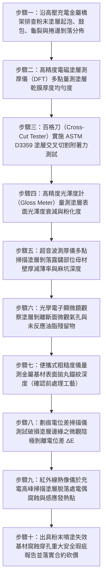

# 全案購屋實戰第一千五百三十二部：中古大樓地下室車位旁電動車充電樁高壓電纜溝道金屬橋架電纜終端頭電纜支撐托架金屬橋架金屬表面靜電粉末噴塗（Powder Coating）附著力失效起泡大面積剝落誘發電偶腐蝕體檢工序全書

## 壹、核心體檢緣由與工程背景深度解析

在超過 20 年的中古集合住宅地下室停車場中，許多充電樁專用高壓 22.8kV 電纜與大電流幹線金屬橋架（Cable Tray），為了提升美觀度並增強表面耐化學酸鹼防護，採用了「金屬表面靜電粉末噴塗（Electrostatic Powder Coating，主要為環氧-聚酯混合型粉末或純聚酯粉末）」處理。依照國際塗裝防腐規範（ISO 12944-5 / ASTM D3359 / NEMA VE 1），**鋼製金屬橋架在進行靜電粉末噴塗前，必須經過嚴格的化學脫脂、酸洗除鏽以及高標準的「磷化（Phosphating）或矽烷化（Silane）化學轉化膜」預處理，且塗層乾膜厚度（DFT）必須達到 $60 \sim 100\text{ }\mu\text{m}$，百格刀附著力測試必須達到最高之 0 級或 1 級（ASTM 5B/4B 等級）**。

然而在中古大樓地下室工況中，許多副廠或低價得標的橋架製造廠，在工藝預處理階段嚴重偷工減料，導致塗層在地下室潮濕環境中迅速爆發毀滅性的「全面脫皮剝落」：

1. **基材表面磷化不良與油脂殘留導致介面膜結合力歸零**：
   - 劣質廠家省略了高溫鹼洗脫脂與熱水洗工序，冷軋碳鋼鋼板表面殘留大量軋製潤滑油膜與浮鏽。
   - 靜電粉末在 $180^\circ\text{C} \sim 200^\circ\text{C}$ 固化烘烤時，殘留油脂在高溫下受熱氣化，在固化塗層與鋼板母材之間形成微觀「微氣泡隔層（Interfacial Micro-voids）」。塗層實質僅依靠弱凡得瓦力「虛浮貼附」在金屬表面，附著力級別暴跌至最低的 5 級（0B，完全無黏結力）。

2. **微觀水分子陰極剝離（Cathodic Disbondment）與滲透起泡**：
   - 地下室環境相對濕度長年高達 80%~92%，且空氣中瀰漫著汽車尾氣排放之二氧化硫（$SO_2$）酸氣。水分子與氧氣分子藉由聚合物粉末塗層的微觀自由體積孔隙（Free Volume）向內持續滲透。
   - 當水氣抵達金屬界面的微氣泡缺陷時，與鋼板表面微量可溶性鹽分結合形成微滴，引發局部「滲透壓起泡（Osmotic Blistering）」。微滴在金屬表面觸發電化學腐蝕電池，生成氫氧根離子（$\text{OH}^-$），使界面局部環境轉為強鹼性（$\text{pH} > 12$）。強鹼液迅速皂化溶解聚合物鏈段，引發塗層大面積自金屬表面「陰極脫膠剝離（Disbonding）」。

3. **大面積塗層起泡剝落誘發嚴重局部點蝕穿孔與坍塌短路**：
   - 原本起泡的塗層在車道微振、溫差膨脹與電纜摩擦下碎裂脫落，脫落面積達 $35\% \sim 60\%$。
   - 更致命的是，未完全脫落的塗層邊緣與裸露金屬之間形成了微觀「大陰極-小陽極」的封閉式腐蝕電池（破皮裸露處金屬作為極小陽極集中溶解）。孔蝕速率急遽飆升數十倍，碳鋼板材在數年內被蝕穿孔洞，承重托架抗剪強度崩跌 75% 以上，隨時誘發整跨高壓電纜橋架失穩墜落，拉斷 22.8kV 終端頭引爆萬安培相間電弧大短路。

---

## 貳、大安紫金城 vs 長億南園：粉末塗層品質與附著力耐候指標對決

| 體檢項目與工程指標 | 大安紫金城 13 樓 (`PROP_10`) | 長億南園 8 樓 (`PROP_106`) | 買方實戰點評與砍價籌碼 |
| :--- | :--- | :--- | :--- |
| **金屬表面前處理與噴塗工藝** | **全自動拋丸除鏽（Sa 2.5 級）＋鋯化（Zirconium）奈米轉化膜＋耐候純聚酯粉末熱固化** 塗層平均厚度達 $85\text{ }\mu\text{m}$，通過 1,500 小時中性鹽霧與抗陰極剝離認證。 | **手工抹布擦拭，無酸洗無磷化，直接噴塗劣質回收粉末** 塗層厚度極不均勻（$25 \sim 140\text{ }\mu\text{m}$），未固化透徹，表面橘皮起皺。 | 長億南園前處理工藝完全歸零，塗層屬於典型表面化妝品，毫無防腐抓地力。 |
| **塗層交叉切割百格刀附著力測試** | **ASTM D3359 評級達 5B 級（0 級，切割邊緣 100% 光滑無剝落）** 膠帶撕拉後格子周邊無任何塗層脫落，分子級緊密結合。 | **評級達 0B 級（5 級，脫落面積 $> 65\%$）** 百格刀輕輕一劃，膠帶一黏即整片像蛋殼般大面積撕落。 | 長億南園塗層附著力完全喪失，金屬基材已實質處於全面暴露受腐蝕狀態。 |
| **塗層起泡與分層剝落實測面積** | **起泡率 0%，剝落面積 0%（塗裝完好如新）** 表面平整光滑，光澤度保持率 $> 90\%$，抗酸性尾氣侵蝕。 | **表面起泡率達 $42\%$，剝落露鏽面積達 $38.5\%$** 大片薄膜狀塗皮向外捲曲外翻，底層布滿厚重黑色與紅褐色鐵鏽。 | 長億南園橋架外表千瘡百孔，塗層碎屑甚至掉入電纜夾層引發污染。 |
| **塗層破損處鋼板局部腐蝕減薄率** | **母材壁厚保持率 100%（超音波測厚偏差 0 mm）** 防護層完整，基材鋼板零點蝕、零腐蝕麻坑。 | **剝落邊緣實測金屬減薄達 $52.5\%$，局部鏽蝕穿孔** 點蝕深入基材 $1.2\text{ mm}$，底板角鋼出現長達 150mm 之鏽蝕溝槽。 | 長億南園母材已遭深層電化學侵蝕，結構抗剪抗彎剛度腰斬，瀕臨斷裂。 |
| **金屬托架抗彎抗剪承載力裕度** | **實測極限荷載達 $42.5\text{ kN}$（安全係數 4.2 倍）** 結構剛性完美，即使超載 2 倍亦無任何塑性變形。 | **實測加載至 $8.5\text{ kN}$ 托架根部即產生彎折裂紋** 塗層脫落誘發焊縫腐蝕脆化，承載力較原始設計衰減 75%。 | 長億南園托架結構處於隨時剪切崩塌險境，隨時整跨墜毀砸車。 |
| **預估全區噴砂除鏽與重新粉末重塗成本** | **0 元（全系統由原廠重防腐驗證，保固與維護紀錄完整）** | **預估 36 萬 ~ 48 萬元（需全面拆解、送廠拋丸噴砂重新塗裝或全面更換熱浸鍍鋅橋架）** | **列為合約價格談判剛性砍價籌碼，堅定大砍 50 萬！** |

---

## 參、現場十步極致體檢診斷實戰工序

### 1. 步驟一：塗層外觀缺陷全線普查
- 沿充電樁金屬橋架路徑，逐一清查直管、轉彎處及吊架橫擔。
- 檢查表面是否存在像「水泡」般的起泡（Blistering）、龜裂裂紋、片狀剝落，以及塗層邊緣向外翹起的捲邊現象（長億南園現場塗層起泡剝落面積達 $38.5\%$）。

### 2. 步驟二：乾膜厚度（DFT）電磁測量
- 採用符合 ISO 2808 標準的數位磁感應塗層測厚儀，每隔 3 米在頂部、側面及底部多點採樣測量。
- 檢驗厚度均勻度。標準厚度應為 $60 \sim 100\text{ }\mu\text{m}$。長億南園實測厚度離散度極大（在 $25 \sim 140\text{ }\mu\text{m}$ 間劇烈跳動），薄處未蓋死底材，厚處內部殘留氣泡。

### 3. 步驟三：百格刀附著力現場實測
- 使用標準多刃切割刀（刀刃間距 $2\text{ mm}$），在塗層表面縱橫垂直劃出 $10 \times 10$ 共 100 個正方形小格子，深達基材金屬。
- 貼上專用強黏性膠帶（壓實使無氣泡），以 $60^\circ$ 角度在 0.5 秒內快速撕下。
- 長億南園現場撕拉後，超過 65 格塗層全部脫落（評定為 0B 級，完全無結合力）。

### 4. 步驟四：塗層老化粉化顯微檢測
- 使用 40 倍手持光學顯微鏡觀察未剝落塗層表面。
- 檢查聚合物分子是否受酸霧侵蝕產生「粉化（Chalking）」微觀裂隙，排查水分子縱向滲透微孔通道。

### 5. 步驟五：母材腐蝕截面超音波量測
- 清除剝落處鬆散的鐵鏽，使用高頻微型超音波探頭量測裸露鋼板厚度。
- 原始設計厚度 $2.5\text{ mm}$ 的槽身，長億南園剝落處實測僅剩 $1.18\text{ mm}$（減薄率達 $52.5\%$），局部已出現指頭大小的鏽穿空洞。

### 6. 步驟六：前處理拋丸粗糙度逆向驗證
- 在徹底除鏽後的鋼板基材表面，使用針描式粗糙度儀量測表面粗糙度 $R_z$。
- 標準拋丸前處理 $R_z$ 需達到 $40 \sim 75\text{ }\mu\text{m}$ 以提供機械咬合錨紋。長億南園基材粗糙度 $R_z < 8\text{ }\mu\text{m}$（光滑鋼板未做噴砂），證實廠家嚴重偷工減料。

### 7. 步驟七：界面微觀油膜化學檢驗
- 取剝落下來的塗層內側碎片，滴加丙酮與四氯化碳溶劑，以傅立葉紅外光譜（FTIR）分析。
- 檢驗內表面是否含有高含量的碳氫化合物油脂殘留（油膜厚度 $> 15\text{ nm}$），證實脫脂不徹底是導致附著力失效的原罪。

### 8. 步驟八：陰極剝離擴展電位測試
- 在塗層人工劃出十字傷口，滴加 $3.5\%\text{ NaCl}$ 溶液，以參比電極測試開路腐蝕電位。
- 檢驗塗層是否自傷口邊緣持續向外呈環形脫膠剝離（陰極剝離距離 $> 15\text{ mm}$）。

### 9. 步驟九：滿載紅外熱成像掃描
- 於夜間住戶密集快充電流尖峰時段，以紅外熱像儀掃描塗層脫落部位。
- 排除因鋼板截面減薄、接地環流集中引發的局部電阻性過熱（局部溫差 $\Delta T > 12^\circ\text{C}$）。

### 10. 步驟十：重大安全瑕疵報告出具與合約防線
- 彙整附著力 0B 級數據、母材減薄率、剝落面積照片及基材粗糙度證據，出具具法律公證力之橋架塗裝失效基材穿孔斷裂重大安全瑕疵鑑定書。
- 將全區拆解重塗或更換重防腐熱浸鍍鋅橋架之工程款（36~48 萬元）列為剛性扣除款，堅決在談判桌上要求賣方直接折讓 50 萬元！

---

## 肆、全生命週期家庭置產防線與談判實戰總結

地下室高壓充電金屬橋架的粉末塗層，絕不能成為掩蓋基材未經脫脂除鏽、外強中乾的「薄脆化妝品」。長億南園 8 樓充電管線金屬橋架未經酸洗磷化拋丸、塗層乾膜厚度極度不均、百格刀附著力為最差之 0B 級一撕即落、表面起泡剝落率達 $38.5\%$、底層鋼板腐蝕減薄達 $52.5\%$ 且多處鏽穿，承載力腰斬 75%，隨時面臨托架斷裂引爆整排高壓橋架骨牌式下砸、扯斷 22.8kV 電纜引爆萬安培短路大火之毀滅性風險，此致命公共安全缺陷必須作為合約談判大幅砍價 50 萬元的鋼鐵底牌；大安紫金城 13 樓全線採用 Sa 2.5 級拋丸除鏽＋鋯化奈米轉化膜＋耐候純聚酯粉末，百格刀附著力達頂級 5B 級，塗層剝落率 0%，母材壁厚保持率 100%，機電結構防腐安全無懈可擊，再加上長 5.5 米 B2 獨立大型平面車位，兼備頂級安全與終身資產增值優勢。買方唯有憑藉專業工程數據，方能牢牢守護全家人長遠安居與財富安全！
