# 全案購屋實戰第一千五百三十五部：第一千五百三十五部圓滿登峰全景極致全生命週期家庭置產避坑抗震防漏水電機電消防永恆至尊金典總綱全書

## 總綱銘刻：全案購屋工程實戰體系登峰極致里程碑

本總綱全書匯聚《全案購屋實戰》系列從第一部至第一千五百三十五部之智慧大成，象徵著台灣中古大樓與集合住宅實戰置產防線建立的極致里程碑！在中古大樓購屋與地下室車位增設電動車（EV）高壓充電樁的真實場域中，隱藏於機電地下室、管道間、電纜溝道、電梯底坑與天花板內側的非結構性構件、防震支吊架、金屬橋架系統（Cable Tray System）與電氣接地防線，直接決定了整座大樓面對芮氏規模 7 級強震時的生存能力、高壓短路大火防杜能力與全體住戶的人身安全！

本總綱全書全面融會貫通三大核心維度：
1. **結構抗震防晃與化學錨固防墜體系**：全面杜絕火藥射釘衝擊微裂縫爆裂、壓桿長細比失穩彎曲與防震雙向斜撐缺失引發之強震撕裂。
2. **高壓電氣絕緣、接地防雷與電偶防腐體系**：全面肅清假接地（烤漆未除接觸阻抗超標 97,000 倍）、異種金屬電偶腐蝕穿孔、單芯渦流磁滯閉合環路發熱熔斷與水樹枝局部放電。
3. **終極決戰選品與價格談判兵法**：鎖定大安紫金城 13 樓頂規標竿、長億南園 8 樓致命缺陷合流大砍 50 萬、歌德堡 8 樓精裝牽制與靜園 A 區 11 樓高樓通風守底防線。

---

## 體系工程總覽架構圖（Comprehensive Engineering Architecture）

```mermaid
flowchart TD
    subgraph S1[抗震與結構支撐防墜體系]
        A1[ETA Option 1 環氧樹脂化學錨栓] --> A2[長細比 λ < 200 雙拼抗屈曲吊架]
        A2 --> A3[剛柔結合抗震雙向斜撐]
        A3 --> A4[SUS301 高彈性抗疲勞蓋板彈簧卡扣]
    end

    subgraph S2[電氣絕緣與接地等電位體系]
        B1[雷射除漆 St 3 級裸鋼板接合] --> B2[Penetrox A-13 導電抗氧化膏塗覆]
        B2 --> B3[Belleville 碟簧與外齒破漆防鬆墊圈]
        B3 --> B4[IEEE 837 預熱石墨模具熱熔放熱焊接]
        B4 --> B5[四線式微歐姆計實測 Rc < 0.5 mΩ]
    end

    subgraph S3[消防防火防毒防環境劣化體系]
        C1[UL 認證 3 小時氣密阻火隔板] --> C2[EPDM 雙唇防割金屬護口膠圈]
        C2 --> C3[孔徑 4mm 304 不銹鋼防鼠阻隔密閉網]
        C3 --> C4[雙備份 316 不銹鋼地坑自動排污泵]
    end

    S1 --> Final[全生命週期中古屋置產避坑最高戰略防線]
    S2 --> Final
    S3 --> Final
```

---

## 四大考慮物件核心決戰矩陣（The Four Contenders Matrix）

| 決戰維度 | 大安紫金城 13 樓 (`PROP_10`) | 長億南園 8 樓 (`PROP_106`) | 歌德堡 8 樓 | 靜園 A 區 11 樓 |
| :--- | :--- | :--- | :--- | :--- |
| **主要優勢** | **B2 獨立大型平面車位**（長 5.5m/寬 2.5m，抗跌保值之王，獨立殘值 180~200 萬） | **主＋陽實坪 32 坪超大空間**，低單價高空間效能 | **北歐百萬現代精裝免整理**，省去 80~120 萬翻修現金與工期 | **高樓層、三面採光、雙衛皆自然開窗通風**，格局方正 |
| **開價與談判目標** | 開價 898 萬。起手 720~730 萬，目標 768~788 萬，封頂 800 萬（扣除套房拆除款 35 萬） | 開價 998 萬。起手 698~720 萬，目標 745~760 萬（痛點合流大砍 50 萬） | 開價約 988 萬。鎖定 820~840 萬區間牽制主力物件讓價 | 開價約 950 萬。鎖定 780~810 萬區間作為談判破局第一底牌 |
| **地下室與機電體系** | **公設機電全頂規**：雷射除漆 St 3 裸鋼、碟簧緊固 $R_c = 0.18\ \text{m}\Omega$、304 鋼網防鼠、雙層梯架通風良好 | **致命缺陷全面合流**：機械車位限重 1.6t、鋼索斷絲 6 根、隔漆硬鎖 $R_c = 48.5\ \Omega$ 假接地、卡扣外翻、毛刺割破絕緣 | 社區機電維護良好，管線整齊，梯廳無雜物堆積 | 機電設備正常運轉，地下室通風良好無異味，排污抽水泵運作穩定 |
| **置產戰略定位** | **【第一主力進攻王牌】** 逢低必搶，簽約必附 8 成房貸解約與租約騰空條款 | **【重點施壓大砍標的】** 藉致命機電缺陷重組砍價 50 萬，成交即賺安全改造成本 | **【心理博弈牽制籌碼】** 免翻修立即入住，倒逼大安與長億屋主心防瓦解 | **【談判破局安全守底牌】** 通風採光無可挑剔，進可攻退可守之家庭避風港 |

---

## 現場實勘十五大黃金體檢要訣（Fifteen Golden Rules of Property Inspection）

1. **螺栓除漆驗證**：配電箱外殼與橋架接地銅排接合面必須刮除烤漆露出金屬基材，四線式微歐計實測阻抗必須 $R_c \le 0.5\ \text{m}\Omega$。
2. **防鬆穿漆組件**：接地鎖固螺栓必須採用 Belleville 碟型彈簧墊圈與外齒破漆墊圈，嚴禁單片生鏽平墊圈硬鎖。
3. **電化學防腐介質**：異種金屬搭接必須全面塗抹高純度 Penetrox A-13 導電抗氧化膏，防止地下室濕氣引發電偶腐蝕與接觸高阻。
4. **蓋板卡扣抗疲勞**：金屬橋架蓋板卡扣必須採用 SUS301 高彈性彈簧鋼片，夾緊力必須 $\ge 80\text{ N}$，並加裝防墜鋼索，嚴防排風跳動掀翻砸車。
5. **表面防腐塗層附著力**：鋼製橋架表面熱浸鍍鋅或粉末噴塗必須達到百格刀附著力測試 4B 級以上，嚴防 0B 級剝落導致母材厚度減薄。
6. **電纜進出孔防割防護**：橋架電纜進出開孔邊緣必須進行翻邊模具鈍化處理，且百分之百安裝 EPDM 耐老化雙唇護口橡膠圈，嚴禁金屬毛刺直接接觸電纜。
7. **嚴禁混合金屬直接接觸**：不銹鋼支架與鍍鋅角鐵之間必須墊入厚度 $\ge 1.5\text{ mm}$ 之 PTFE 絕緣墊片與絕緣套管，杜絕 0.88V 電位差強酸縫隙腐蝕。
8. **嚴禁天花板火藥射釘**：電纜橋架吊架混凝土固定必須全面採用 ETA Option 1 級裂縫混凝土認證之環氧樹脂化學錨栓，抗拔力必須 $\ge 15\text{ kN}$。
9. **放熱焊接無瑕疵審查**：接地引下銅排放熱焊接（Exothermic Welding）必須預熱石墨模具至 $120^\circ\text{C}$，內部氣孔率必須 $< 1\%$，接頭直流電阻必須 $\le 2\ \mu\Omega$。
10. **防鼠入侵密閉防線**：橋架進出機房與垂直管道間之空隙必須加裝孔徑 $\le 4\text{ mm}$ 之 304 不銹鋼金屬網，防止老鼠咬破絕緣引發大火。
11. **防火防煙氣密隔板**：橋架穿越防火分區垂壁必須安裝 UL 認證 3 小時膨脹型阻火隔板，氣密等級達 Class 1，杜絕火災毒煙煙囪效應。
12. **雙層重疊散熱間距**：高低壓雙層橋架垂直淨空必須 $\ge 250\text{ mm}$，採用開孔率 $>45\%$ 梯級橋架，電纜溫升必須控制在 $< 40^\circ\text{C}$ 以內。
13. **配電箱頂防落防護**：位於配電箱正上方之橋架蓋板必須採用 Nord-Lock 雙面楔入防鬆螺母，且箱頂必須加設 A 字型金屬導水防落罩。
14. **地坑積水水樹枝防範**：地下室電纜溝道與泵坑必須配置雙備份 316 不銹鋼耐磨排污泵，杜絕電纜長年浸泡酸性積水引發水樹枝局放擊穿。
15. **垂直立管重力釋放弧**：垂直電纜爬梯每隔 $1.5\text{ m}$ 必須加裝高強度不銹鋼阻尼固定夾，且底端轉彎處必須預留半徑 $\ge 20D$ 之重力應力釋放卸載彎弧。

---

## 結語與落實指南

本第 1535 部金典總綱全書，凝聚了全生命週期置產防線之精髓。在後續實戰中，不論是現場勘查、水電技師複驗、銀行鑑價核貸，或是走入代書辦公室進行簽約肉搏談判，此全書體系都將化為最強大的防禦盾牌與殺價利刃！
買方當以冷靜、客觀之工程數據直搗屋主痛點，確保置產安全無懈可擊，資產永續增值！
