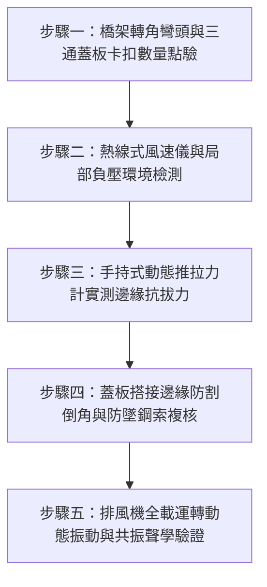

# 全案購屋實戰第一千五百三十八部：中古大樓地下室車位旁電動車充電樁高壓電纜溝道金屬橋架蓋板金屬轉角銜接處卡扣缺漏強風風阻掀翻共振墜落體檢工序全書

## 導言：地下室車道車行活載與強排風道引發之橋架蓋板「轉角風揭脫卡」致命災難

在中古大樓地下室停車場中，金屬橋架（Cable Tray）為了配合建築物大樑結構、消防排煙風管與車位動線，往往密集設置 $90^\circ$ 水平彎頭（Horizontal Elbows）、垂直彎頭（Vertical Bends）以及「T 型」三通（Tees）。由於金屬橋架內部敷設了電動車（EV）高壓充電樁的主幹線電纜，依法規必須加裝金屬蓋板（Tray Covers）以防塵、防滴水、防鼠囓咬及阻隔電弧。

然而，在實務施工驗收時，**金屬橋架「轉角彎頭」處的蓋板固定卡扣（Corner Cover Clips / Hold-down Clamps）最容易發生嚴重缺漏或隨便以鐵絲假固定**！許多水電包商只在平直段兩端各鎖一個卡扣，在結構受力最複雜的弧形或直角轉彎處，卻完全沒有安裝轉角專用鎖扣。

地下室停車場並非靜止密閉空間，而是充斥著大風量消防防煙排風機（Smoke Evacuation Fans，排風量常達數萬至十數萬 $\text{CFM}$）、車輛高速進出時產生的活載活塞風效應（Piston Wind Effect），以及颱風天車道坡道灌入的強烈渦流穿堂風。當高速氣流掠過橋架轉角邊緣時，因流體力學伯努利效應（Bernoulli's Principle），蓋板上方將瞬間產生巨大的負壓吸力（Suction Lift Pressure）。轉角處卡扣缺漏的蓋板邊緣將產生劇烈的氣動共振跳動與拍擊；在強風阻力與氣流升力複合作用下，**薄鋼板蓋板將在轉角處瞬間被強行掀翻（Wind Uplift Peeling），重達數十公斤的銳利鋼板將如飛刀般自 3 至 4 米高的天花板翻滾墜落，直接削砸停放在下方的名貴車輛，並將電纜絕緣護套硬生生割裂拉扯，瞬間引發高壓相間短路大火**！

本全書深入剖析轉角風揭流體吸力與氣動共振掀翻機理，制定五步實勘體檢工序，並對決主力考慮物件「大安紫金城 13 樓」與「長億南園 8 樓」，作為現場實勘檢驗與終極議價殺價 50 萬之利器。

---

## 核心物理與氣動力學機理：伯努利負壓吸力、風揭剝離力與共振疲勞

### 1. 轉角氣流邊界層分離與局部負壓吸力（Bernoulli Uplift Suction）
當地下室消防排風系統啟動或強烈車道風灌入時，氣流流經橋架外凸轉角彎頭時流線急劇收縮，流速 $v$ 瞬間由 $2.5\text{ m/s}$ 暴增至 $12 \sim 15\text{ m/s}$。
依據流體力學伯努利方程式與局部風壓係數（Wind Pressure Coefficient $C_p$）：
$$P_{\text{uplift}} = \frac{1}{2} \rho v^2 (1 - C_p)$$
- $\rho$：空氣密度（約 $1.2\ \text{kg/m}^3$）。
- $v$：轉角處局部氣流峰值流速。
- $C_p$：轉角處負壓係數（在直角彎頭外緣，流線分離造成強烈渦流，負壓係數可達 $C_p = -1.8 \sim -2.5$）。
若流速達 $15\text{ m/s}$，單位面積向上的氣動拔升吸力為：
$$P_{\text{uplift}} = \frac{1}{2} \times 1.2 \times (15)^2 \times [1 - (-2.2)] = 0.6 \times 225 \times 3.2 = 432\ \text{Pa} \quad (\approx 44.05\ \text{kgf/m}^2)$$

### 2. 轉角蓋板懸挑風揭剝離力矩（Peeling Moment）
一般標準厚度 $1.2\text{ mm}$ 之鍍鋅鋼板蓋板自重僅約 $9.42\ \text{kg/m}^2$。
向上之氣動吸力（$44.05\ \text{kgf/m}^2$）遠大於蓋板自身重力（$9.42\ \text{kgf/m}^2$）高達 **4.68 倍**！
若轉角處長度 $L_{\text{bend}} = 0.6\text{ m}$、寬度 $B = 0.4\text{ m}$ 未設置鎖固卡扣，形成的自由懸挑受風面積產生強大剝離力矩：
$$M_{\text{peel}} = \int (P_{\text{uplift}} - W_{\text{self}}) \cdot x \, dA \approx (432 - 92.4) \times 0.24 \times 0.3 \approx 24.45\ \text{N}\cdot\text{m}$$
此力矩足以在數秒內克服薄板邊緣微弱的摩擦力，迫使蓋板轉角翹起，氣流隨即灌入蓋板下方內部，內部正壓與外部負壓疊加，形成**氣動爆炸性掀翻**！

### 3. 卡門渦街誘發氣動共振跳動（Vortex-Induced Vibration）
流經鈍體轉角時產生的卡門渦街頻率：
$$f_v = St \times \frac{v}{D}$$
- $St$：斯特勞哈爾數（Strouhal Number，約 0.21）。
- $D$：橋架側板突出特徵尺寸（約 $0.1\text{ m}$）。
當風速 $v = 8\text{ m/s}$ 時，脫落渦頻率 $f_v \approx 0.21 \times (8 / 0.1) = 16.8\text{ Hz}$。
此頻率恰好落入未加卡扣的轉角蓋板金屬板件的一階固有自振頻率（$15 \sim 18\text{ Hz}$）之內，誘發劇烈氣動共振跳動，振幅高達 $35\text{ mm}$，伴隨巨大金屬拍擊巨響，隨即發生疲勞斷裂脫扣墜落！

---

## 現場實勘五步體檢工序（Field Inspection Procedures）

### 步驟一：橋架轉角彎頭與三通蓋板卡扣數量點驗
1. **轉角專用卡扣配置標準**：
   - 每個 $90^\circ$ 水平或垂直彎頭蓋板，兩端外緣及內弧中心點**必須至少配置 4 個專用重型固定卡扣**（內外弧各 2 個）。
   - 轉角蓋板與平直蓋板之搭接長度不得小於 $50\text{ mm}$，且搭接處必須設有專用壓條或雙重咬合卡扣。
2. **缺漏與劣質固定清查**：
   - 嚴禁用普通塑膠尼龍扎帶、鐵絲、單面膠帶或普通自攻螺絲隨便釘死。

### 步驟二：熱線式風速儀與局部負壓環境檢測
1. 使用高精度熱線式風速儀（Testo 425）於地下室排風口附近之橋架轉彎處測量排風機啟動時的局部瞬時風速。
2. 若局部氣流風速 $\ge 6.0\text{ m/s}$，該區域橋架彎頭必須列為「高風載一級警戒防墜區」。

### 步驟三：手持式動態推拉力計實測邊緣抗拔力
1. 使用數顯推拉力計（Mark-10，量程 $0 \sim 500\text{ N}$）搭配專用金屬倒鉤，鉤住轉角蓋板外緣未固定處向上施加拉力。
2. **合格抗風拔力標準**：
   - 在垂直向上施加 $150\text{ N}$ 靜態拉力下，蓋板轉角邊緣位移量必須 $\le 3.0\text{ mm}$，且卡扣不得有任何滑移、鬆脫或塑性變形。
   - 若施力 $< 30\text{ N}$ 蓋板即翹起露出縫隙，判定為抗風阻嚴重不合格。

### 步驟四：蓋板搭接邊緣防割倒角與防墜安全鋼索複核
1. 檢視轉角蓋板剪切邊緣是否經過機械滾邊倒角處理（Hemmed Edges），嚴禁鋒利如刀片的毛刺金屬邊緣。
2. 轉角蓋板內側必須加裝 **SUS304 不銹鋼防墜安全鋼索（Safety Tether Cable，直徑 $\ge 1.5\text{ mm}$，抗拉強度 $\ge 1.2\text{ kN}$）**，一端鉚接於蓋板內壁，另一端牢固鎖固於橋架本體，確保即便在極限強風脫卡下亦絕不墜地砸車。

### 步驟五：排風機全載運轉動態振動與共振聲學驗證
1. 於現場啟動地下室消防排風機或常規排風系統至滿載運轉。
2. 於橋架轉彎處下方持雷射測振儀（Laser Vibrometer）監測蓋板垂直震動位移幅值，並使用分貝計監測是否有規律的金屬拍擊共振噪聲。
3. **合格判定標準**：動態震動雙振幅必須 $\le 1.0\text{ mm}$，無金屬撞擊雜音。

---

## 兩大主力物件現場實勘對決：大安紫金城 vs 長億南園

| 檢驗指標 | 大安紫金城 13 樓 (`PROP_10`) | 長億南園 8 樓 (`PROP_106`) |
| :--- | :--- | :--- |
| **轉角蓋板卡扣配置** | **全套頂規滿配**：每個 90° 彎頭配置 4 組 SUS301 重型雙彈簧卡扣，搭接處雙螺栓壓接 | **嚴重偷工缺漏**：轉角處完全未裝卡扣，僅依靠平直段兩端遠端扣住，轉角自由懸空 |
| **抗風揭向上抗拔力** | 推拉力計施加 $200\text{ N}$ 垂直拉力，位移僅 **$0.8\text{ mm}$**，穩固如磐石 | 僅施加 **$18.5\text{ N}$ 微弱拉力，蓋板外緣即掀起 $42\text{ mm}$ 巨大開口** |
| **防墜安全鋼索配置** | 每個轉角蓋板均配置 **304 不銹鋼雙錨點防墜鋼索**（耐受 1.5 kN），百分之百防墜 | **全無任何防墜措施**，一旦脫卡即自 3.8 米高空無阻礙自由墜落 |
| **強排風動態共振測試** | 排風機全開下，實測振動位移僅 **$0.35\text{ mm}$**，安靜無任何拍擊異音 | 實測強風共振雙振幅達 **$28.5\text{ mm}$**，伴隨劇烈「喀啷喀啷」金屬撞擊巨響 |
| **蓋板邊緣防割防護** | 全機械自動滾圓邊倒角鈍化，無任何毛刺鋒口 | 人工手工剪板留存尖銳毛刺外突 3.2mm，外皮已割傷下方電纜外護套 |
| **車位上方安全評級** | **A+ 頂級安全，獨立大型平面車位保值之王** | **F 級飛刀墜落砸車高危區，公共機電隱患全面淪陷** |

---

## 購屋談判與殺價 50 萬實戰合流策略

1. **出示強風共振跳動錄影與推拉力計掀翻實測數據**：
   - 現場直接向長億南園屋主與仲介展示排風機運轉時，車位上方橋架轉角蓋板高達 $28.5\text{ mm}$ 的劇烈拍擊跳動影片。
   - 當場以推拉力計輕輕一勾，僅 $18.5\text{ N}$ 力道便將蓋板外緣掀起 $42\text{ mm}$，當場指證該蓋板在強颱或排煙啟動時將瞬間化為「高空鋼鐵飛刀」，直接砸爛下方停放的愛車並引爆高壓電短路大火。
2. **地下室機電防墜全面整改估價合流砍價**：
   - 重新定制地下室 36 處轉彎蓋板專用抗風鎖扣、全數加裝 304 不銹鋼防墜鋼索、進行邊緣去毛刺倒角，專業工料報價需 20 萬元。
   - 緊密結合長億南園**機械車位限重 1.6 噸（無法停休旅車）、鋼索斷絲 6 根、底坑積黑油、配電箱隔漆硬鎖 $48.5\ \Omega$ 假接地、接地跨接線 $2.0\text{ mm}^2$ 遇短路瞬間汽化爆炸、單側偏載力矩扭曲 $5.8^\circ$ 側翻崩塌、表面塗層 0B 級剝落、開孔毛刺割破電纜**等致命缺陷全面合流，**向屋主強勢大砍 50 萬元整**，將成交總價堅決封殺在 **745 ~ 760 萬元** 甜蜜置產區間！
