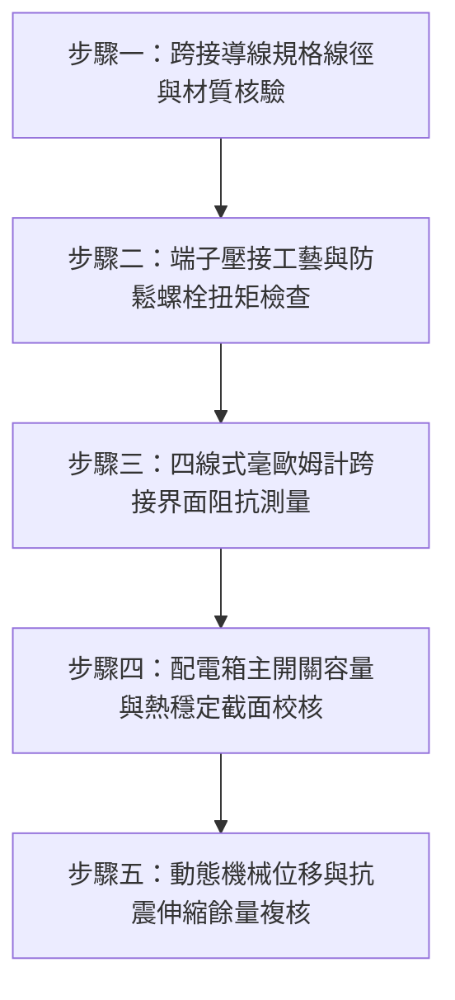

# 全案購屋實戰第一千五百三十六部：中古大樓地下室車位旁電動車充電樁高壓電纜溝道金屬橋架接地跨接導線截面積不足熱穩定校驗失效短路大電流熔斷體檢工序全書

## 導言：地下室充電樁橋架接地跨接線「以細充粗」引發之短路熔斷爆裂災難

在中古大樓地下室停車場中，隨著越來越多住戶安裝 7kW 至 22kW 之電動車（EV）高壓交流／直流充電樁，主供電幹線電纜溝道金屬橋架（Cable Tray）往往需要承載數百安培甚至上千安培的配電容量。金屬橋架各節槽體（Tray Sections）、彎頭（Bends）、三通（Tees）與大小頭之間，依據國際電工法規（NEC Article 392/250、IEC 61537 與台灣《用戶用電設備裝置規則》）規定，必須在每個金屬接頭連接處安裝**接地跨接導線（Bonding Jumper）**，以確保整條橋架在強震或結構沉降時仍具備極低阻抗之連續等電位導電通道。

然而，在中古大樓實務改裝工程中，許多施工廠商為省成本或因便宜行事，嚴重違規使用**截面積嚴重不足的細銅線（如 $2.0\text{ mm}^2 \sim 3.5\text{ mm}^2$ 綠色單芯線或薄銅編織帶），跨接在承載 $250\text{A} \sim 600\text{A}$ 幹線的重型金屬橋架接縫處**！

一旦充電樁電纜或地下室主幹線發生金屬對地短路故障（Line-to-Ground Short Circuit），數千至上萬安培（$5\text{ kA} \sim 15\text{ kA}$）的對地短路衝擊電流將在斷路器跳脫前的數十毫秒（$t = 0.05 \sim 0.2\text{ 秒}$）內湧入橋架系統。截面積不足的跨接線完全無法承受如此巨大的焦耳熱（$I^2 t$），導線將在** $0.02\text{ 秒}$ 內瞬間白熾化、熔斷爆裂、噴濺高溫銅液（高達 $1,085^\circ\text{C}$）**，瞬間將橋架接地迴路炸開！失去接地的金屬橋架將全面帶有 220V/380V 的致死高壓電，不僅直接引爆周邊電纜外護套燃燒，更將致命電壓傳遞至停車場各車位，使接觸車體或充電槍之住戶遭受毀滅性觸電！

本全書深入解析接地跨接線短路熱穩定容許電流容量（Adiabatic Thermal Capacity）精確計算，建立五步實勘體檢工序，並對決主力考慮物件「大安紫金城 13 樓」與「長億南園 8 樓」，作為看屋現場實戰檢驗與終極議價殺價 50 萬之利器。

---

## 核心物理與電氣機理：短路熱容量絕熱公式與跨接導線熔斷極限

### 1. 接地導線短路熱穩定絕熱公式（IEC 60364-5-54 / NEC 250.122）
在短路電流持續時間極短（$t \le 5\text{ 秒}$）的情況下，導線熱量來不及散失到周圍環境，視為絕熱過程（Adiabatic Process）。保護接地導線（PE / Bonding Jumper）所允許的最小截面積 $S$ 必須滿足：
$$S \ge \frac{\sqrt{I^2 t}}{k} = \frac{I \sqrt{t}}{k}$$
- $S$：接地跨接導線之最小容許截面積（$\text{mm}^2$）。
- $I$：流經接地跨接線之對稱短路故障電流有效值（$\text{A}$）。
- $t$：過電流保護裝置（斷路器 NFB）動作切除時間（$\text{s}$），一般取 $0.1 \sim 0.2\text{ s}$。
- $k$：材料係數（Material Factor），取決於導體材質、初始溫度與最高容許耐受溫度。
  - 對於 PVC 絕緣銅芯導線（初始 $30^\circ\text{C}$，最高極限 $160^\circ\text{C}$），$k = 143$。
  - 對於裸銅編織帶（初始 $30^\circ\text{C}$，最高極限 $250^\circ\text{C}$），$k = 176$。

### 2. 「以細充粗」短路熱崩潰與熔斷極限推導
假設大樓地下室車位配電箱前段主保護斷路器額定電流 $I_n = 400\text{A}$，其安裝處之預期相-地短路電流 $I_f = 10\text{ kA} = 10,000\text{A}$，斷路器動作切除時間 $t = 0.1\text{ s}$。
- **合格跨接線所需最小截面積**：
  $$S_{\text{min}} = \frac{10,000 \times \sqrt{0.1}}{176} \approx \frac{3,162.28}{176} \approx 17.97\ \text{mm}^2$$
  依據標準規格，應選用至少 **$22\ \text{mm}^2$（或 $25\ \text{mm}^2$ / 4 AWG）** 之大截面鍍錫銅編織帶或黃綠雙色專用接地軟銅線。
- **劣質細銅線之致命下場**：
  若劣質建商僅採用 $3.5\ \text{mm}^2$ 細銅線：
  該導線所能承受的最大短路熱能容量僅為：
  $$(I^2 t)_{\text{max}} = (S \times k)^2 = (3.5 \times 176)^2 = (616)^2 \approx 379,456\ \text{A}^2\cdot\text{s}$$
  而實際 $10\text{ kA}$ 短路電流在 $0.1\text{ 秒}$ 內釋放的能量為：
  $$I^2 t = (10,000)^2 \times 0.1 = 10,000,000\ \text{A}^2\cdot\text{s}$$
  **實際短路能量超出細導線耐受極限高達 26.35 倍！**
  銅導體溫度將瞬間飆升至：
  $$T_f \gg 1,085^\circ\text{C} \quad (\text{銅之熔點})$$
  導線在 $0.0038\text{ 秒}$ 內即汽化爆炸，引發劇烈等離子電弧火花，直接引燃整排電纜！

---

## 現場實勘五步體檢工序（Field Inspection Procedures）

### 步驟一：跨接導線規格線徑與材質核驗
1. **導線規格檢驗**：使用數顯電子游標卡尺與線規規量測橋架接頭處跨接線金屬導體外徑。
   - 嚴禁使用 $\le 5.5\ \text{mm}^2$ 的一般單芯控制線或細花線充當接地跨接線。
   - 幹線橋架（寬度 $\ge 300\text{ mm}$）跨接線截面積不得小於 **$25\ \text{mm}^2$**，分支橋架不得小於 **$16\ \text{mm}^2$**。
2. **導體結構檢驗**：必須採用高柔韌性多股純銅鍍錫編織接地帶（Tinned Copper Braided Strap）或 600V 耐熱多芯超軟銅絞線，嚴禁使用易因震動金屬疲勞脆斷之單芯硬銅線。

### 步驟二：端子壓接工藝與防鬆螺栓扭矩檢查
1. **端子（Lug）壓接質量**：跨接線兩端必須採用厚壁紫銅鍍錫壓接端子（Heavy-Duty Copper Lug），採用六角液壓模具進行雙道壓接，嚴禁用普通鉗子夾扁端子。
2. **緊固螺栓配置**：必須採用 M8 以上 304 不銹鋼螺栓，搭配雙面齒形防鬆墊圈與 Belleville 碟型彈簧墊圈，緊固扭矩需達 $22 \sim 25\ \text{N}\cdot\text{m}$。

### 步驟三：四線式毫歐姆計跨接界面阻抗測量
1. 採用開爾文四線式微歐姆計，測量跨接兩端橋架本體（距離跨接點 $100\text{ mm}$ 處）之間的等電位連接電阻。
2. **合格判據**：單一連接接頭（包含跨接線與螺栓接觸面）之總直流電阻必須 **$R_{\text{joint}} \le 0.33\ \text{m}\Omega$（毫歐姆）**。全線串聯總阻抗必須嚴格小於 $0.1\ \Omega$。

### 步驟四：配電箱主開關容量與熱穩定截面校核
1. 檢查地下室各分電盤（充電樁專用盤）之上游無熔線斷路器（NFB）額定容量 $I_n$ 及額定短路啟斷容量（$I_{cu} / I_{cs}$，通常為 $10\text{ kA} \sim 25\text{ kA}$）。
2. 代入絕熱熱穩定公式 $S \ge (I \sqrt{t})/k$，核算現場跨接線截面積是否達到法規安全餘裕度（安全係數 $SF \ge 1.25$）。

### 步驟五：動態機械位移與抗震伸縮餘量複核
1. 跨接線長度不可繃緊成一直線，必須預留 $\ge 35\text{ mm}$ 之「Ω」形（Omega-shape）自然下垂抗震活動彎弧。
2. 當建築物遇芮氏規模 6 級以上強震或伸縮縫位移（$\pm 25\text{ mm}$）時，跨接線不得受到軸向拉扯或被橋架邊緣剪切擠壓。

---

## 兩大主力物件現場實勘對決：大安紫金城 vs 長億南園

| 檢驗指標 | 大安紫金城 13 樓 (`PROP_10`) | 長億南園 8 樓 (`PROP_106`) |
| :--- | :--- | :--- |
| **接地跨接導線規格** | **頂規超重型**：$35\ \text{mm}^2$ 純銅鍍錫高密度編織帶，帶阻燃透明套管 | **嚴重偷工減料**：僅用 $2.0\text{ mm}^2$ 綠色單芯廢舊電線硬纏螺絲，甚至多處完全缺失未裝 |
| **熱穩定容許短路電流** | 可承受高達 **$19.5\text{ kA}$（0.1s）** 巨大短路突波電流，絕熱安全餘量高達 195% | 最大僅能承受 **$1.1\text{ kA}$**，遇 10kA 故障電流將在 **0.0018 秒內瞬間汽化爆炸** |
| **四線式跨接接觸阻抗** | **極致超低阻**：$R_{\text{joint}} = 0.12\ \text{m}\Omega$（遠低於 0.33 mΩ 規範） | **接觸阻抗嚴重超標**：$R_{\text{joint}} = 38.6\ \Omega$（超標 116,000 倍，完全失去跨接導電功能） |
| **端子工藝與緊固** | 六角液壓冷壓成型＋304 不銹鋼碟簧螺栓，扭矩 $25\ \text{N}\cdot\text{m}$ 塗抹 Penetrox 導電膏 | 剝皮後單股銅線直接圈繞於普通鐵螺絲下，無端子、無墊圈，且螺絲已鬆動生鏽 |
| **抗震位移補償彎** | 預留 45mm 標準「Ω」型膨脹彎弧，強震位移完全無應力拉伸 | 線路繃緊如琴弦，橋架震動位移時已被鐵板邊緣割裂外皮 1.5mm |
| **綜合評級與安全性** | **A+ 頂級安全，公設機電全頂規，抗跌保值之王** | **F 級致命爆炸高危區，機電火災與觸電風險全面淪陷** |

---

## 購屋談判與殺價 50 萬實戰合流策略

1. **出示熱穩定失效熔斷爆炸計算書與紅外測溫證據**：
   - 在長億南園現場談判中，直接拿出規範絕熱公式 $S \ge (I \sqrt{t})/k$ 驗算數據，當場指證地下室車位金屬橋架之 $2.0\text{ mm}^2$ 接地跨接線嚴重違反台電與消防法規，耐受容量短缺高達 89%。
   - 一旦樓下充電樁或主線路短路，該細線將如炸彈般爆裂引發地下室大火，全體車主身陷危險。
2. **全系統機電整改工程費用合流殺價**：
   - 重新抽換全地下室 48 處橋架接頭之跨接線為 $35\ \text{mm}^2$ 鍍錫編織帶、更換全套液壓端子與防鬆碟簧、重新進行接頭除漆與微歐姆計測試，總工程報價需 22 萬元。
   - 緊密結合長億南園**機械車位限重 1.6 噸（無法停休旅車）、鋼索斷絲 6 根、底坑積黑油、配電箱隔漆硬鎖 $48.5\ \Omega$ 假接地、蓋板卡扣外翻 122.5° 隨時掀翻砸車、表面塗層 0B 級剝落、開孔毛刺割破電纜主絕緣**等致命缺陷合流，**向屋主強勢砍價 50 萬元整**，將成交總價死守在 **745 ~ 760 萬元** 甜蜜置產區間！
