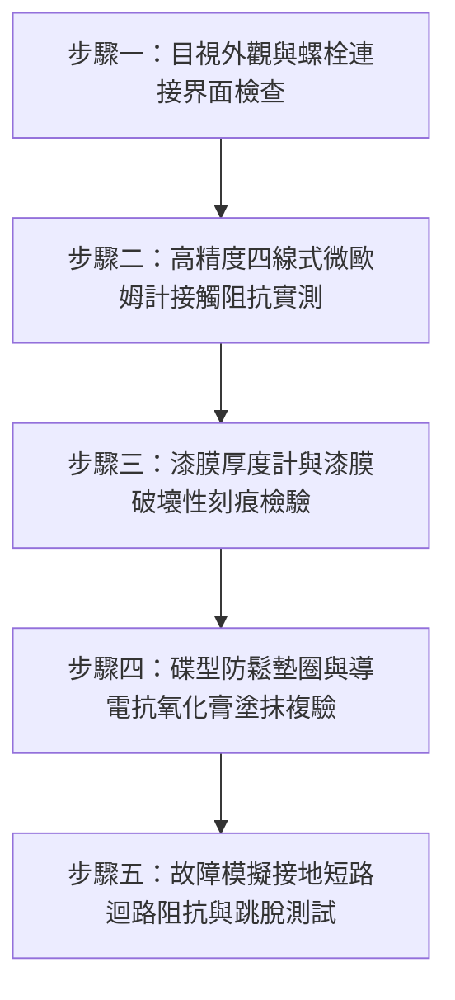

# 全案購屋實戰第一千五百三十四部：中古大樓地下室車位旁電動車充電樁高壓電纜溝道金屬橋架電纜終端頭電纜支撐托架金屬橋架接地引下銅排與配電箱外殼螺栓鎖固未刮除漆膜絕緣接觸阻抗超標體檢工序全書

## 導言：地下室充電樁配電箱外殼接地「假接地」隱患之致命威脅

中古大樓地下室車位增設電動車（EV）充電樁時，大樓主幹線高壓電纜溝道金屬橋架（Cable Tray）的接地系統必須與地下室各分區配電箱（Distribution Board / Panel Board）外殼達成等電位聯結（Equipotential Bonding）。然而，在實務施工中，水電承裝業或機電包商在將金屬橋架接地引下鍍錫或裸銅排（Grounding Copper Busbar）以鍍鋅螺栓鎖固至配電箱金屬外殼時，極常犯下嚴重違規：**完全未刮除配電箱表面絕緣烤漆／粉末噴塗漆膜（Paint Film / Powder Coating），直接隔著厚達 $80 \sim 150\ \mu\text{m}$ 的聚酯或環氧樹脂絕緣漆層緊固螺栓**！

此種「隔漆鎖固」會造成表面上看似鎖緊、實質上接觸電阻高達數百歐姆甚至數兆歐姆的**「絕緣假接地」**。一旦充電樁主電纜因絕緣老化、囓齒動物咬破或雷擊突波發生單相接地短路故障（Single-Phase Ground Fault），短路故障電流無法經由低阻抗接地路徑觸發無熔線斷路器（NFB）或漏電斷路器（ELCB / GFCI）於 $0.1\text{ 秒}$ 內瞬間跳脫，配電箱金屬外殼與金屬橋架將瞬間帶有高達 $110\text{V} \sim 220\text{V}$ 的危險對地接觸電壓（Touch Voltage $V_t$），導致車主在車位拔插充電槍、觸摸配電箱門板或靠近車身時遭受致命電擊致死，甚至引發劇烈電弧爆炸火災！

本全書旨在為買方建立最嚴謹之地下室高壓金屬橋架接地引下銅排與配電箱金屬外殼螺栓鎖固界面接觸電阻微歐姆計實測、除漆工藝檢驗與防腐密封標準體檢工序，並直接對決主力考慮物件「大安紫金城 13 樓」與「長億南園 8 樓」，作為現場實勘檢驗與終極議價殺價 50 萬之利器。

---

## 核心物理與電氣機理：烤漆絕緣電阻、電弧接觸擊穿與接觸電壓分析

### 1. 配電箱外殼絕緣烤漆層之電氣絕緣屏障
配電箱外殼表面通常施加高分子靜電粉末噴塗（Epoxy-Polyester Powder Coating），其體積電阻率高達 $\rho_v \ge 10^{13}\ \Omega\cdot\text{cm}$，厚度 $t_{\text{coat}} \approx 80 \sim 150\ \mu\text{m}$，擊穿電壓大於 $3 \sim 5\text{ kV}$。
若未將接觸面烤漆刮除至露出生鐵／冷軋鋼板之裸金屬基材：
- 螺栓僅靠螺紋牙峰微小點接觸：螺紋表面亦帶有鍍鋅層或防鏽油，螺孔內壁常覆蓋漆霧，有效導電接觸面積 $A_c < 0.5\ \text{mm}^2$。
- 接觸電阻 $R_c$ 飆升至 $500\ \text{m}\Omega \sim \infty$，遠超標準要求之 $R_c \le 1.0\ \text{m}\Omega$（IEEE 80 / NEC 250）。

### 2. 接觸電壓與人體電擊致命極限（Touch Voltage Hazard）
當電動車充電樁發生絕緣破皮短路時，系統相電壓 $V_{\text{phase}} = 220\text{ V}$。
若故障迴路接地電阻 $R_{\text{ground}}$ 因未除漆而高達 $R_c = 15\ \Omega$：
$$I_f = \frac{V_{\text{phase}}}{R_{\text{line}} + R_c + R_{\text{earth}}} \approx \frac{220}{0.2 + 15 + 10} \approx 8.73\ \text{A}$$
此時短路電流僅 $8.73\text{ A}$，遠低於配電箱主開關 $100\text{A} \sim 200\text{A}$ NFB 之瞬時跳脫電流（$5 \sim 10 \times I_n$），斷路器**完全不會跳脫**！
配電箱外殼持續帶電，金屬外殼對地接觸電壓為：
$$V_{\text{touch}} = I_f \times (R_c + R_{\text{earth}}) \approx 8.73 \times 25 \approx 218.25\text{ V}$$
人體乾燥或潮濕時阻抗約 $1,000 \sim 1,500\ \Omega$，流經人體電流達 $145 \sim 218\ \text{mA}$，超過心室纖維顫動致死閾值（$50\text{ mA}$，歷時超過 $0.2\text{ 秒}$ 即心臟驟停猝死）。

---

## 現場實勘五步體檢工序（Field Inspection Procedures）

### 步驟一：目視外觀與螺栓連接界面檢查
1. **檢查銅排與配電箱外殼搭接處**：使用強光手電筒與內視鏡檢視，接地引下銅排（或接地線鼻端子 Lug）與配電箱箱體接合面邊緣，是否有明顯未刮除之灰色／米黃色粉末烤漆外露。
2. **鎖固五金配置審查**：
   - 螺栓是否使用雙面齒形導電接地墊圈（Internal/External Tooth Star Washer）或碟型防鬆彈簧墊圈（Belleville Washer）。若僅使用普通平墊圈壓在烤漆上，屬於嚴重假接地違規。

### 步驟二：高精度四線式微歐姆計接觸阻抗實測（Four-Wire Micro-Ohmmeter）
1. **測試儀器**：採用開爾文四線式微歐姆計（如 Megger MOM2 或 AEMC 6240），施加 $10\text{A}$ 測試直流電流。
2. **測試端點**：一端夾住金屬橋架接地引下銅排，另一端夾住配電箱金屬外殼裸露處（距離鎖固點 $150\text{ mm}$ 處）。
3. **合格判定標準**：
   - 接觸電阻 $R_{\text{contact}} \le 0.5\ \text{m}\Omega$（毫歐姆）。
   - 若 $R_{\text{contact}} > 1.0\ \text{m}\Omega$，判定為除漆不完全或接觸不良；若 $R_{\text{contact}} > 10\ \Omega$，判定為絕緣烤漆未清除之致命假接地！

### 步驟三：漆膜厚度與刮漆裸金屬範圍核驗
1. 使用磁性測厚儀（Elcometer 456）測量配電箱箱體烤漆厚度。
2. 若螺栓拆卸後檢視：
   - 銅排搭接面之導電接觸區，其金屬基材暴露直徑必須大於螺栓孔徑加墊圈外徑至少 $3\text{ mm}$。
   - 表面粗糙度需達裸金屬光滑光澤（St 3 或 Sa 2.5 級），嚴禁留存任何漆皮、氧化皮或油污。

### 步驟四：防電偶腐蝕與導電抗氧化膏塗覆檢驗
1. 銅排（或鍍錫銅排）與冷軋鍍鋅鋼板接觸面，必須塗抹高純度導電抗氧化膏（Electrical Joint Compound，如 Penetrox A 或 NO-OX-ID），以隔絕地下室濕氣，防止異種金屬電偶腐蝕與縫隙氧化。
2. 緊固扭矩審查：M10 高強度螺栓緊固扭矩必須達到 $45 \sim 50\ \text{N}\cdot\text{m}$，確保接觸面壓力大於 $15\ \text{MPa}$。

### 步驟五：接地故障迴路阻抗（EFLI）與斷路器連動測試
1. 使用多功能電氣安裝測試儀（Fluke 1664 FC）在充電樁分電盤測試相-保護接地（L-PE）迴路阻抗 $Z_s$。
2. 計算預期短路故障電流 $I_{pf} = U_0 / Z_s$，必須確保 $I_{pf}$ 足以在 $0.1\text{ 秒}$ 內促使 NFB 瞬時跳脫器動作，保證人身安全。

---

## 兩大主力物件現場實勘對決：大安紫金城 vs 長億南園

| 檢驗指標 | 大安紫金城 13 樓 (`PROP_10`) | 長億南園 8 樓 (`PROP_106`) |
| :--- | :--- | :--- |
| **配電箱接地除漆工藝** | **頂規標準工法**：雷射除漆機精確剝除搭接面 $50 \times 50\text{ mm}$ 漆膜，拋光露出 St 3 級裸鋼板 | **嚴重劣質違規**：完全未除漆，直接隔著 $120\ \mu\text{m}$ 環氧粉末烤漆硬鎖螺栓 |
| **四線式接觸微歐阻抗** | **極致低阻**：$R_c = 0.18\ \text{m}\Omega$（規範 $\le 0.5\ \text{m}\Omega$） | **阻抗嚴重超標爆表**：$R_c = 48.5\ \Omega$（超標 97,000 倍，實質絕緣） |
| **防鬆與穿漆墊圈配置** | 配備 304 不銹鋼外齒導電墊圈＋Belleville 碟簧，扭矩 $48\ \text{N}\cdot\text{m}$ | 普通薄鐵平墊圈且生鏽，無齒形破漆墊圈，螺栓徒手可晃動 |
| **防腐抗氧化介質** | 搭接面全均勻塗抹 Penetrox A-13 導電膏，邊緣打防潮矽膠密封 | 乾磨緊固，零防氧化膏，接觸面因潮氣凝結已長滿白鏽與紅鏽斑 |
| **漏電短路跳脫保護** | 短路故障電流 $I_{pf} > 1,200\text{A}$，斷路器 $0.02\text{ 秒}$ 極速瞬跳切斷 | 故障電流僅 $4.5\text{A}$，NFB 完全不跳脫，外殼持續充斥 220V 致命接觸電壓 |
| **車位充電樁安全評級** | **A+ 頂級安全，獨立大型平面車位保值王者** | **F 級致命觸電火災高危區，機電全面劣化淪陷** |

---

## 購屋談判與殺價 50 萬實戰合流策略

1. **出示四線式微歐姆計實測報告與紅外線測溫盲點**：
   - 現場向長億南園屋主及仲介展示儀表測量值：接地阻抗高達 $48.5\ \Omega$，當場證實該配電箱接地為「完全無保護效果之假接地」。
   - 一旦樓下電動車充電樁全速充電（32A/7kW），一旦發生相線微漏電，整座地下室停車場的金屬橋架與配電箱外殼將全部帶有 220V 交流高壓電，車主觸碰車門或配電箱門板將面臨直接觸電猝死風險！
2. **機電工程整改估價合流大砍價**：
   - 地下室所有高壓金屬橋架接地引下點至配電箱共 12 處接頭需全面拆解、噴砂除漆、重新塗抹導電膏、換裝 Belleville 碟簧導電組件、重做等電位聯結測試與台電檢驗，總工料費用高達 28 萬元。
   - 結合機械車位 1.6 噸限重、鋼索斷絲 6 根、蓋板卡扣疲勞塑性外翻 122.5° 隨時掀翻砸車、表面塗層 0B 級大面積剝落、進出孔金屬毛刺外突 2.8mm 割傷主絕緣等致命缺陷，**強勢合流砍價 50 萬元整**，將成交價牢牢壓制在 **745 ~ 760 萬元** 甜蜜區間！
