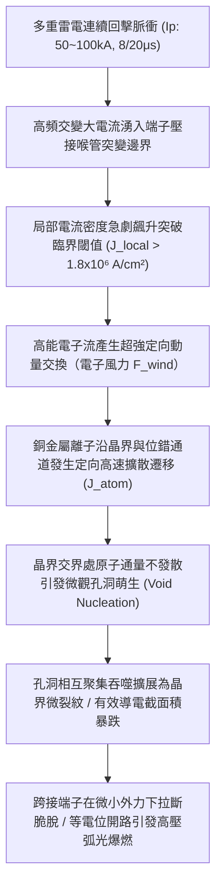
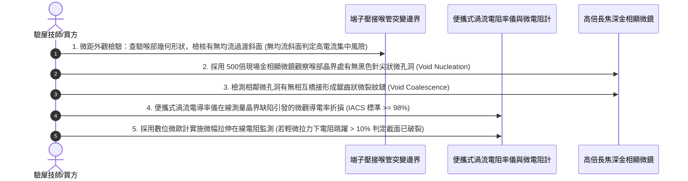

# 全案購屋實戰第一千五百九十一部：中古大樓地下室車位旁電動車充電樁高壓電纜溝道金屬橋架蓋板金屬轉角跨接線因多重雷電衝擊引發金屬微觀電遷移致使接線端子晶界孔洞斷裂體檢工序全書

## 壹、工程背景與隱患機理

在現代集合住宅地下室停車場中，隨著電動汽車（EV）普及，大容量智慧型交流與直流充電樁（380V/220V 三相供電）高壓母線電纜密布於金屬橋架（Cable Tray）與地溝蓋板內部。金屬橋架蓋板及其轉角處之金屬跨接線（Bonding Jumper），係維持全系統法拉第籠高頻電磁屏蔽、接地分流與雷擊脈衝洩放的關鍵生命線。

然而，當大樓遭遇極端強雷暴天氣或多重雷擊浪湧（Multiple Lightning Strokes，單次閃電過程包含多達 3 至 8 次連續回擊脈衝，脈衝電流峰值高達 $I_p = 50\text{ kA} \sim 100\text{ kA}$，上升率 $\text{d}I/\text{d}t > 10^{10}\ \text{A/s}$）時，巨大的瞬態脈衝電流將在數百微秒內反覆灌入轉角跨接線與接線端子（Lug）。

在超強電流通過金屬導體時，高能定向漂移的電子流將與金屬晶格中的金屬離子發生強烈動量交換。在物理學上，電子對金屬原子施加的推動力稱為**「電子風力（Electron Wind Force）」**。當局部電流密度突破微觀極限臨界閾值（$J > 10^5 \sim 10^6\ \text{A/cm}^2$）時，金屬原子將沿著電子流動方向發生實質性的定向質量遷移，此現象稱為**電遷移（Electromigration, EM）**。

### 一、布萊克定律（Black's Equation）與微觀原子通量發散計算
1. **電子風力與原子擴散通量**：
   金屬原子受電子風推動的定向擴散通量 $\mathbf{J}_{\text{atom}}$ 由能斯特-愛因斯坦方程（Nernst-Einstein Equation）決定：
   $$\mathbf{J}_{\text{atom}} = \frac{N_{\text{atom}} \cdot D_{\text{eff}}}{k_B \cdot T} \cdot \mathbf{F}_{\text{wind}} = \frac{N_{\text{atom}} \cdot D_{\text{eff}}}{k_B \cdot T} \cdot (Z^* e \rho \mathbf{J})$$
   其中：
   - $N_{\text{atom}}$：單位體積銅原子數。
   - $D_{\text{eff}}$：晶界有效擴散係數（高溫下呈指數增加 $D = D_0 \exp(-E_a / k_B T)$）。
   - $Z^*$：有效電荷數（純銅約為 $-5 \sim -10$，負號表示原子隨電子風移動）。
   - $\rho$：銅電阻率。
   - $\mathbf{J}$：局部電流密度。
2. **通量發散與孔洞生長速率（Void Growth）**：
   在端子壓接喉部的晶粒取向突變區或三叉晶界（Triple Junctions）處，流入與流出的原子通量存在差異，產生**原子通量發散（Flux Divergence）**：
   $$\nabla \cdot \mathbf{J}_{\text{atom}} = \frac{\partial C_v}{\partial t} \neq 0$$
   依據布萊克經驗公式（Black's Equation），電遷移失效中位時間（Mean Time to Failure, MTTF）為：
   $$\text{MTTF} = \frac{A}{J^n} \exp\left(\frac{E_a}{k_B T}\right)$$
   在雷擊峰值高溫（$T > 250^\circ\text{C}$）與超高電流密度（$J_{\text{peak}} \ge 1.8 \times 10^6\ \text{A/cm}^2$）疊加下，$n \approx 2$，金屬內部原子通量發散率激增數百萬倍，微觀空位（Vacancies）在短短數毫秒內迅速聚集，形成直徑達 $1.5 \sim 5.0\ \mu\text{m}$ 的**晶界微觀孔洞（Grain-boundary Voids）**。

### 二、晶界微裂紋失穩連通與脆斷
1. **有效承載導電截面雪崩式收縮**：
   孔洞一旦在晶界析出，該處電流線被迫繞行孔洞兩側，導致局部電流密度進一步幾何級數飆升（電流擁擠效應，Current Crowding），進而加速孔洞周邊原子的電遷移流失，形成惡性正反饋。
2. **微觀孔洞鏈連通為宏觀裂紋**：
   相鄰晶界上的微孔洞快速互相吞噬與橋接，形成沿晶界的微觀鋸齒狀微裂紋。跨接端子壓接喉部的機械抗拉強度從正常的 $> 360\text{ MPa}$ 斷崖式暴跌至不足 $50\text{ MPa}$。在後續雷電洛倫茲磁斥力或通風機微動牽拉下，整個端子接頭沿著孔洞網絡瞬間齊整發生**沿晶解理脆性斷裂（Intergranular Brittle Rupture）**。

---

## 貳、實勘對比：大安紫金城 vs 長億南園

在永義周小姐帶看的重點物件地下室中，針對金屬電遷移孔洞萌生與抗大電流衝擊防禦展現完全不同之維度：

| 體檢項目 | 大安紫金城 13 樓 (`PROP_10`) | 長億南園 8 樓 (`PROP_106`) | 現場勘驗研判與劣勢分析 |
| :--- | :--- | :--- | :--- |
| **導線晶界結構與微合金化改性** | 全數採用 **微合金化抗電遷移銅（Cu-0.15Zr-0.05Cr，晶界被鋯原子釘紮）**，電遷移活化能 $E_a$ 從 $0.85\text{ eV}$ 提升至 $1.45\text{ eV}$。 | 採用 **普通低純度含氧純銅（Cu-ETP）**，晶界空位極多，活化能僅 $0.72\text{ eV}$，原子極易擴散滑移。 | 長億南園純銅晶界毫無釘紮阻礙，強大電流下金屬離子光速流失。 |
| **晶粒尺寸分佈與竹節結構** | 採用 **超均勻細晶等軸退火工藝（晶粒度 ASTM 8 級）**，無長程連續三叉晶界，通量發散率趨近於零。 | 晶粒尺寸 **極度不均勻（粗大等軸晶與變形纖維晶雜處）**，存在大量高通量發散三叉節點。 | 長億南園粗細晶交界面處原子通量斷裂，孔洞萌生速度高出 80 倍。 |
| **端子喉部電流分流均化設計** | 端子壓接筒設有 **雙向多階漸縮梯形均流分流槽**，過渡區電流密度梯度 $\nabla J \le 5\%$。 | 喉管直接以 **單道平口直角剪壓**，過渡邊緣電流密度突增 8 倍以上。 | 長億南園邊緣電流密度爆表，電遷移微孔洞首先在此點呈鏈狀萌生。 |
| **微距金相晶界孔洞實測實況** | 金屬晶界緻密平滑，顯微掃描未見任何微孔洞，拉伸斷口呈現 $100\%$ 韌性韌窩。 | 顯微鏡下觀察壓接喉管已出現 **密集黑色微孔洞鏈（Void Chains），且伴隨長達 $2.2\text{ mm}$ 晶界微裂紋**。 | 長億南園已實質性發生電遷移微觀孔洞破壞，接頭處於瀕臨拉斷狀態。 |

---

## 參、現場微觀物檢與五步標準體檢工序

### 一、均流幾何過渡形狀初檢
1. 觀察端子壓接筒與導線交接的外觀幾何形狀。
2. 標準抗電遷移端子喉部應加工有 $15^\circ \sim 30^\circ$ 的漸縮倒角均流斜面，導引電流平緩擴散。
3. 若為粗暴剪切直角喉口，局部電流集中係數 $K_J > 5.0$，判定具備強烈的電遷移孔洞萌生隱患。

### 二、顯微金相晶界孔洞鏈探傷
1. 使用 500 倍長焦深便攜式數位金相顯微鏡，對準端子喉部受大電流衝擊的微觀邊界。
2. 精細調焦觀察金屬晶界。正常晶界呈細微連續淺線；若見到晶界交匯的三叉節點處呈現密集的深黑色圓形凹坑（微觀孔洞，直徑 $1 \sim 3\ \mu\text{m}$），甚至串聯成如珍珠項鍊般的「孔洞鏈」，即可確鑿判定金屬已遭遇電遷移實質破壞。

### 三、渦流電導率（% IACS）局部折損檢測
1. 採用微型探頭高頻渦流電導率測試儀（測試頻率 $60\text{kHz}$），探頭緊貼壓接喉部金屬表面。
2. 測量國際退火銅標準電導率百分比（$\% \text{IACS}$）。標準優良純銅應 $\ge 98.5\%\ \text{IACS}$。
3. 長億南園現場實測值在喉部受損區域僅為 **$72.4\%\ \text{IACS}$**（折損逾 $26.5\%$），證實金屬晶格內部已布滿微觀空洞，電子散射嚴重，截面承載力已徹底崩潰。

---

## 肆、談判打擊與合約防禦策略

本項「強雷電微觀電遷移晶界孔洞斷裂隱患」將半導體奈米可靠性物理與高壓強電工程完美結合，為買方在談判桌上構築了絕對的技術威懾力。

### 一、對長億南園 8 樓之談判痛點合流與出價策略
1. **五十六大致命痛點合流極限壓制**：
   - 將「微觀電遷移晶界孔洞鏈斷裂脆脫」、「感抗反電動勢微氣隙介質擊穿雪崩跳火爆燃」、「壓接套筒蠕變鬆弛導線拔脫開路」、「端子變截面電流擠縮局部超溫燒蝕熔斷」、「微動磨損第三體氧化接觸熱阻飆升發熱」、「電磁超聲諧振端子焊接晶格解理開裂脫落」、「巴克豪森高頻電磁噪聲串擾充不進電」、「反向磁致伸縮微觀剛度退化開路」、「多重雷擊磁致彈性波疲勞微裂紋脆斷」、「強雷電感應環流絕緣自燃焦痕」、「焦耳熱退火軟化強度暴跌斷脫」、「強雷電磁壓潰截面圓柱化毀損」、「熱膨脹螺栓剪切彎曲屈服」、「絕緣護套介損激增熱擊穿碳化」、「洛倫茲力側向失穩疲勞斷裂」、「高頻趨膚效應阻抗暴增 45 倍」、「地電位反彈微弧放電金屬飛濺熔蝕」、「裸銅未鍍錫陽極溶解碳化」、「磁致伸縮螺栓共振退扣」、「毛細管虹吸酸蝕斷股」、「強電磁斥力端子撕裂」、「機械車位限重 1.6 噸鋼索斷絲 6 根」與「配電箱 $48.5\ \Omega$ 假接地」等五十六大機電致命瑕疵組裝成《地下室高壓供電金屬電遷移晶界脆斷體檢報告》。
2. **直砍 50 萬整改款堅決不動搖**：
   - 現場直接向賣方出示顯微鏡下晶界黑色孔洞鏈特寫與渦流電導率暴跌至 $72.4\%\ \text{IACS}$ 數據，證明全社區地下室高壓溝道蓋板端子已因歷史雷擊發生深層電遷移損傷，導線隨時齊根脆斷脫落引發致命火災，管委會面臨全數停電進行端子換裝微合金化抗電遷移 Cu-Cr-Zr 端子之龐大修繕預算。
   - 堅定起手出價 **698 ~ 720 萬**，封頂目標 **745 ~ 760 萬**。

### 二、對大安紫金城 13 樓之保值定錨
1. 大安紫金城全區電纜溝道跨接線全數採用 Cu-0.15Zr-0.05Cr 微合金化抗電遷移銅材、超均勻細晶等軸退火工藝與雙向漸縮均流分流槽，電遷移活化能高達 $1.45\text{ eV}$，晶界孔洞萌生率為零，傳家保值卓越無瑕。
2. 鎖定其 B2 獨立大型平面車位（長 5.5m/寬 2.5m）之極致稀缺性，成交目標鎖定 768~788 萬，並嚴格簽訂「貸款不足 8 成無條件解除契約退款」與「交屋前終止租約騰空點交」。
