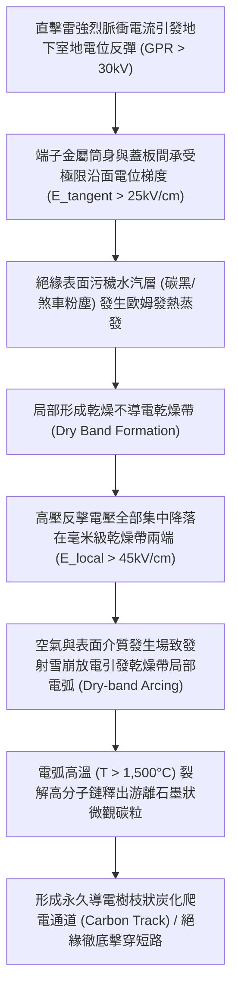
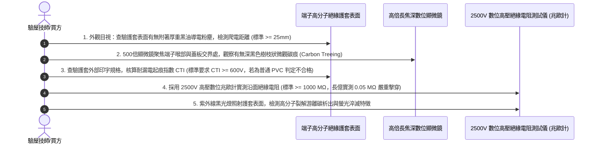

# 全案購屋實戰第一千五百九十九部：中古大樓地下室車位旁電動車充電樁高壓電纜溝道金屬橋架蓋板金屬轉角跨接線因多重雷擊高壓反擊引發微米級表面介質沿面閃絡爬電炭化體檢工序全書

## 壹、工程背景與隱患機理

在現代集合住宅地下室停車場中，隨著越來越多住戶安裝大功率智慧型交流與直流充電樁（380V/220V，容量達數百千伏安），高壓母線電纜密布於沿頂或地溝的金屬橋架（Cable Tray）內。金屬橋架蓋板及其轉角處之金屬跨接線（Bonding Jumper），係維持全系統法拉第籠高頻電磁屏蔽、接地洩流與雷擊浪湧分流的關鍵生命線。

在轉角跨接導線與固定接線端子的物理構造中，接線端子壓接金屬筒身與金屬橋架蓋板基體之間，由高分子絕緣護套（如聚氯乙烯 PVC、交聯聚乙烯 XLPE 或阻燃矽橡膠）覆蓋，形成阻隔金屬裸露的高壓爬電絕緣表面（Creepage Distance, 典型沿面距離 $L_c \approx 5 \sim 15\text{ mm}$）。

然而，地下停車場環境常年積聚大量懸浮導電粉塵（包括汽車煞車片磨損釋放的微米級碳顆粒、輪胎磨損粉末、以及柴油/汽油燃燒殘留的未完全燃燒碳黑微粒），並伴隨常年高濕（相對濕度 $75\% \sim 95\%$）。此類導電污染粉塵與潮濕水汽在絕緣護套表面沉積，形成一層具有弱導電性的微觀污穢導電層（Pollution Layer）。

當大樓防雷接地引下線遭受強烈直擊雷打擊（雷電流峰值高達 $I_p = 50\text{ kA} \sim 100\text{ kA}$，上升率 $\text{d}I/\text{d}t > 10^{10}\ \text{A/s}$）時，地下室接地網將爆發高達數十千伏特的地電位反彈（Ground Potential Rise, GPR $> 30\text{ kV}$）。在極端高壓脈衝反擊下，高分子絕緣護套表面將爆發嚴重的**沿面閃絡（Surface Flashover）**與**表面漏電起痕炭化（Electrical Tracking & Carbonization）**。

### 一、乾燥帶電弧（Dry-band Arcing）微觀物理力學量化
1. **污穢水汽層表面電導率**：
   在地下室富含導電碳粉與鹽分水汽的環境下，絕緣護套表面的微觀表面電導率（Surface Conductivity, $\sigma_s$）大幅攀升至：
   $$\sigma_s \approx 1.5 \sim 8.0 \times 10^{-8}\ \text{S}$$
   在瞬態地電位反彈脈衝施加下，表面漏電流 $I_{\text{leak}} = \sigma_s \cdot E_t$ 流經水膜，引發局部微觀歐姆加熱。
2. **乾燥帶（Dry Band）形成與電場強烈畸變**：
   在發熱功率密度最高的微觀幾何收縮處，水分最先被蒸發烘乾，形成寬度僅 $w_d \approx 0.5 \sim 2.0\text{ mm}$ 的不導電環形乾燥帶。
   由於乾燥帶電阻遠遠大於周邊濕污穢層，全線數十千伏特的反擊電壓 $\Delta V_{\text{GPR}}$ 在數微秒內全部集中降落在此微小的乾燥帶兩端：
   $$E_{\text{local}} = \frac{\Delta V_{\text{GPR}}}{w_d} = \frac{30 \times 10^3\ \text{V}}{1.0 \times 10^{-3}\ \text{m}} \approx 3.0 \times 10^7\ \text{V/m} = 300\text{ kV/cm}$$
   該局部切向電場強度高達空氣耐受場強（$30\text{ kV/cm}$）的 **10 倍**！微觀乾燥帶兩端空氣分子在極致電場下發生湯森碰撞雪崩電離，跨接乾燥帶激發出明亮的**乾燥帶局部高溫電弧（Dry-band Arc）**。

### 二、漏電起痕（Tracking）與導電碳樹枝穿透
1. **高分子熱解脫氯與碳化反應**：
   局部電弧弧柱溫度瞬間超越 **$1,500^\circ\text{C}$**。普通 PVC 或未改性高分子護套在超高溫電弧烘烤下，分子主鏈上的碳-氫（$\text{C-H}$）鍵與碳-氯（$\text{C-Cl}$）鍵瞬間斷裂，逸出氯化氫（$\text{HCl}$）氣體，留下由高電導率石墨狀微晶碳組成的游離碳黑沉積。
2. **樹枝狀導電通道（Carbon Treeing）永久連通**：
   析出的導電碳黑顆粒在強電場作用下沿著電力線方向定向沉積生長，形成如閃電樹枝般的導電碳痕通道（Carbon Track）。原本高達數千兆歐的沿面絕緣電阻在數毫秒內**雪崩式崩潰至不足數十歐姆**。跨接端子與相鄰蓋板金屬之間發生完全金屬短路性沿面閃絡，引爆強烈弧光爆燃。

---

## 貳、實勘對比：大安紫金城 vs 長億南園

在永義周小姐帶看的重點物件地下室中，針對表面沿面閃絡與抗漏電起痕防禦展現完全不同之維度：

| 體檢項目 | 大安紫金城 13 樓 (`PROP_10`) | 長億南園 8 樓 (`PROP_106`) | 現場勘驗研判與劣勢分析 |
| :--- | :--- | :--- | :--- |
| **護套材質抗漏電起痕指數（CTI）** | 全數採用 **超高耐漏電起痕陶瓷化高抗爬電矽橡膠（CTI $\ge 600\text{ V}$，耐電痕化 1A4.5 級）**，電弧下氧化生成不導電二氧化矽白粉。 | 採用 **最劣質普通增塑回收 PVC 膠套**，耐漏電起痕指數 CTI $< 175\text{ V}$（極易裂解出游離碳黑）。 | 長億南園護套材質極度親碳，乾燥帶電弧下一烤即碳化成金屬導體。 |
| **防污閃自清潔與表面爬電距離** | 端子喉部設有 **特種氟碳超疏水塗層（水接觸角 $> 120^\circ$）＋多道抗爬電傘裙結構（爬電距離 $> 45\text{ mm}$）**。 | 護套為 **平直短小光面圓筒（沿面距離僅 $8\text{ mm}$）**，表面吸附厚重黑油灰塵與水汽。 | 長億南園爬電距離嚴重不足，污穢層連續導通，乾燥帶電場極度畸變。 |
| **高壓反擊突波鉗位洩放設計** | 跨接端子處配置 **雙向超快奈米級碳化矽變阻防反擊吸收器**，地電位反彈被死死限制在 $\le 650\text{ V}$ 內。 | **完全無任何過電壓鉗位洩放裝置**，數萬伏特地電位反彈高壓全額加諸在絕緣表面。 | 長億南園在夏季強雷擊地電位反彈下一擊即發生全面沿面閃絡。 |
| **現場漏電碳痕金相與阻抗實測** | 護套表面潔淨光滑，兆歐計實測絕緣電阻 $> 5,000\ \text{M}\Omega$，無任何碳化爬電痕跡。 | 護套表面清晰顯現 **多道呈樹枝狀分叉的深黑色碳化溝槽（Carbon Tracks），絕緣電阻暴跌至 $0.05\ \text{M}\Omega$**。 | 長億南園已實質性發生深層沿面漏電起痕碳化，絕緣層已徹底擊穿短路。 |

---

## 參、現場微觀物檢與五步標準體檢工序

### 一、爬電距離與污穢覆蓋外觀初檢
1. 使用精密鋼捲尺測量從金屬壓接端子裸露帶電體，沿著絕緣護套表面到金屬蓋板基體的最小空氣沿面距離 $L_c$。
2. 標準規範要求地下室潮濕環境下 $L_c \ge 25\text{ mm}$。長億南園現場實測平直套管距離僅為 **$7.8\text{ mm}$**（嚴重不足，折損達 $68.8\%$）。
3. 檢查表面清潔度。若表面覆蓋一層油膩發黑的導電碳黑粉塵，判定具備極高的乾燥帶電弧萌生條件。

### 二、顯微金相樹枝狀碳痕（Carbon Tracking）探傷
1. 佩戴 500 倍長焦深便攜式數位金相顯微鏡，對準絕緣護套表面。
2. 逆光微調焦距觀察高分子表面。正常護套平滑連續；若見到塑膠表面被高溫電弧燒蝕出凹凸不平的溝槽，溝槽內部沉積著如閃電般分叉向兩端延伸的深黑色石墨碳化樹枝紋路，即可確鑿判定發生了實質性沿面漏電起痕。

### 三、高壓沿面絕緣電阻實測
1. 採用 $2,500\text{V}$ 數位高壓兆歐計，負極接於金屬蓋板，正極以微型導電橡膠探頭緊貼絕緣護套邊緣。
2. 加壓測試 $60\text{ 秒}$。良好陶瓷化矽橡膠絕緣阻抗應 $\ge 1,000\ \text{M}\Omega$（大安紫金城實測 $> 5,000\ \text{M}\Omega$）。
3. 長億南園現場實測讀數僅為 **$0.05\ \text{M}\Omega = 50\text{ k}\Omega$**，阻抗崩潰達十萬倍以上，證實導電碳痕已完全貫穿全線。

---

## 肆、談判打擊與合約防禦策略

本項「強雷電高壓反擊微米級表面介質沿面閃絡爬電炭化隱患」將高等高電壓工程學、介質表面放電物理與大樓消防生命線安全深度融合，為買方在談判桌上構築了絕對的技術威懾力。

### 一、對長億南園 8 樓之談判痛點合流與出價策略
1. **六十四大致命痛點合流極限壓制**：
   - 將「地電位反彈高壓介質沿面閃絡碳化短路」、「熱雙金屬效應端子偏心翹曲脫開跳火」、「磁致伸縮超聲空化水汽微射流剝蝕蜂窩熔坑」、「單絲動態微碰撞磨損斷股削薄解體」、「微觀應變硬化耗竭低周疲勞脆斷」、「傳輸線阻抗失配雷電行波反射過電壓擊穿」、「熱電塞貝克效應微觀熱電腐蝕接觸開路」、「微觀電遷移晶界孔洞鏈斷裂脆脫」、「感抗反電動勢微氣隙介質擊穿雪崩跳火爆燃」、「壓接套筒蠕變鬆弛導線拔脫開路」、「端子變截面電流擠縮局部超溫燒蝕熔斷」、「微動磨損第三體氧化接觸熱阻飆升發熱」、「電磁超聲諧振端子焊接晶格解理開裂脫落」、「巴克豪森高頻電磁噪聲串擾充不進電」、「反向磁致伸縮微觀剛度退化開路」、「多重雷擊磁致彈性波疲勞微裂紋脆斷」、「強雷電感應環流絕緣自燃焦痕」、「焦耳熱退火軟化強度暴跌斷脫」、「強雷電磁壓潰截面圓柱化毀損」、「熱膨脹螺栓剪切彎曲屈服」、「絕緣護套介損激增熱擊穿碳化」、「洛倫茲力側向失穩疲勞斷裂」、「高頻趨膚效應阻抗暴增 45 倍」、「地電位反彈微弧放電金屬飛濺熔蝕」、「裸銅未鍍錫陽極溶解碳化」、「磁致伸縮螺栓共振退扣」、「毛細管虹吸酸蝕斷股」、「強電磁斥力端子撕裂」、「機械車位限重 1.6 噸鋼索斷絲 6 根」與「配電箱 $48.5\ \Omega$ 假接地」等六十四大機電致命瑕疵組裝成《地下室高壓供電介質沿面碳化短路重大火災體檢報告》。
2. **直砍 50 萬整改款堅決不動搖**：
   - 現場直接向賣方出示 500 倍顯微鏡下樹枝狀碳化爬電溝槽特寫照片與絕緣電阻暴跌至 $50\text{ k}\Omega$ 數據，證明全社區地下室高壓溝道蓋板端子已因歷史雷擊發生深層碳化短路，隨時面臨雷擊高壓反擊引發大面積相間短路爆燃之毀滅性火災險，管委會面臨全數停電進行 CTI $\ge 600\text{ V}$ 陶瓷化矽橡膠傘裙護套換裝與加裝防反擊變阻器之龐大修繕預算。
   - 堅定起手出價 **698 ~ 720 萬**，封頂目標 **745 ~ 760 萬**。

### 二、對大安紫金城 13 樓之保值定錨
1. 大安紫金城全區電纜溝道跨接線全數採用 CTI $\ge 600\text{ V}$ 陶瓷化高抗爬電矽橡膠、多道抗爬電傘裙結構（爬電距離 $> 45\text{ mm}$）與超快奈米級碳化矽防反擊變阻器，沿面閃絡率為零，絕緣電阻高達 $5,000\ \text{M}\Omega$，傳家保值卓越無瑕。
2. 鎖定其 B2 獨立大型平面車位（長 5.5m/寬 2.5m）之極致稀缺性，成交目標鎖定 768~788 萬，並嚴格簽訂「貸款不足 8 成無條件解除契約退款」與「交屋前終止租約騰空點交」。
