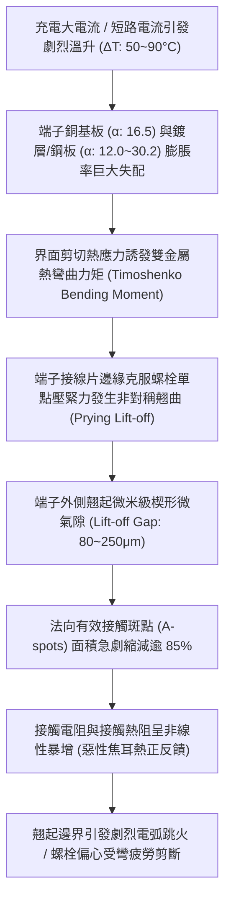
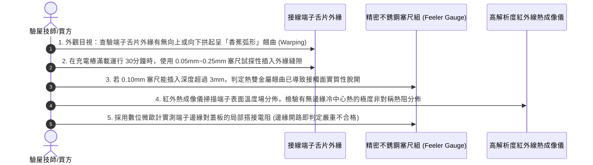

# 全案購屋實戰第一千五百九十八部：中古大樓地下室車位旁電動車充電樁高壓電纜溝道金屬橋架蓋板金屬轉角跨接線因大電流瞬態溫升引發端子雙金屬彎曲熱雙金屬效應致使偏心翹起體檢工序全書

## 壹、工程背景與隱患機理

在現代集合住宅地下室停車場中，隨著電動汽車（EV）普及，大功率智慧型交流與直流充電樁（380V/220V，容量達數百千伏安）高壓主幹電纜密布於沿頂或地溝的金屬橋架（Cable Tray）內。金屬橋架蓋板及其轉角處之金屬跨接線（Bonding Jumper），係維持全系統法拉第籠高頻電磁屏蔽、接地洩流與雷擊浪湧分流的關鍵生命線。

在轉角跨接線接線端子（Terminal Lug）的構造中，端子接線片普遍採用純銅（$\text{Cu}$）衝壓或鍛造而成，且表面施加電鍍或熱浸鍍覆金屬層（例如：鍍錫層 $\text{Sn}$、熱浸鍍鋅層 $\text{Zn}$、或複合沉積層）。同時，端子接線片被高強度螺栓緊固在鍍鋅冷軋鋼板（$\text{Fe/Zn}$）蓋板上。

純銅與鍍層金屬、以及銅端子與鋼板基底之間，物理線膨脹係數（Coefficient of Thermal Expansion, CTE）存在巨大且不可忽視的固有失配：
- 銅之線膨脹係數：$\alpha_{\text{Cu}} \approx 16.5 \times 10^{-6}\ /\text{K}$
- 鋼之線膨脹係數：$\alpha_{\text{Steel}} \approx 11.5 \sim 12.0 \times 10^{-6}\ /\text{K}$
- 錫之線膨脹係數：$\alpha_{\text{Sn}} \approx 22.0 \times 10^{-6}\ /\text{K}$
- 鋅之線膨脹係數：$\alpha_{\text{Zn}} \approx 30.2 \times 10^{-6}\ /\text{K}$

當電動車進行高功率充電（大電流持續加熱導致端子溫升 $\Delta T = 50^\circ\text{C} \sim 90^\circ\text{C}$），或遭遇雷擊浪湧大電流瞬態加熱時，不同金屬層之間因熱膨脹速率差異，將爆發物理學上典型的**熱雙金屬效應（Bimetallic Thermomechanical Effect / Timoshenko Bimetallic Bending）**。

### 一、鐵摩辛柯（Timoshenko）熱雙金屬彎曲微觀力學計算
根據鐵摩辛柯雙金屬樑彎曲理論（Timoshenko's Theory of Bimetallic Thermostats），由厚度為 $t_1$、彈性模量為 $E_1$、熱膨脹係數為 $\alpha_1$ 的基層金屬，與厚度為 $t_2$、彈性模量為 $E_2$、熱膨脹係數為 $\alpha_2$ 的覆層金屬所構成的雙層複合板，在溫升 $\Delta T$ 下產生的自由熱彎曲曲率 $\kappa = 1/\rho$ 為：
$$\kappa = \frac{1}{\rho} = \frac{6 (\alpha_2 - \alpha_1) \cdot \Delta T \cdot (1 + m)^2}{h \cdot \left[ 3(1 + m)^2 + (1 + m n)(m^2 + \frac{1}{m n}) \right]}$$
其中：
- 厚度比 $m = t_1 / t_2$。
- 彈性模量比 $n = E_1 / E_2$。
- 總厚度 $h = t_1 + t_2$。

以銅端子接線片（$t_{\text{Cu}} = 1.5\text{ mm}, E_{\text{Cu}} = 110\text{ GPa}, \alpha_{\text{Cu}} = 16.5 \times 10^{-6}\ /\text{K}$）單面高溫貼合鋼板（$t_{\text{Steel}} = 2.0\text{ mm}, E_{\text{Steel}} = 210\text{ GPa}, \alpha_{\text{Steel}} = 12.0 \times 10^{-6}\ /\text{K}$）為例，溫升 $\Delta T = 70\text{ K}$ 時：
金屬層界面產生高達 $\tau_{\text{int}} \ge 65\text{ MPa}$ 的界面熱剪切應力。

### 二、端子單側偏心翹曲（Edge Prying）與接觸斑點崩解
1. **外緣偏心翹曲位移（Prying Deflection, $\delta_{\text{lift}}$）**：
   由於端子接線片僅靠中心一顆螺栓（通常為 M6 或 M8）在中心區域提供壓緊力，螺栓墊圈邊緣之外的懸臂懸空端（長度 $L_{\text{arm}} \approx 12 \sim 18\text{ mm}$）在雙金屬熱彎曲力矩作用下，端部產生向上或向下的非對稱偏心翹曲位移：
   $$\delta_{\text{lift}} \approx \frac{1}{2} \kappa \cdot L_{\text{arm}}^2 \approx 85 \sim 240\ \mu\text{m}$$
2. **接觸斑點（A-spots）雪崩式分離脫開**：
   在 $100\ \mu\text{m}$ 級別的宏觀翹起縫隙面前，微觀微凸體（高度僅數微米）瞬間徹底脫開接觸。原本緊密貼合的導電界面，接觸區域急劇退化為僅局限於螺栓墊圈正下方的極小微環帶。
3. **偏心彎矩折斷螺栓**：
   翹起效應在中心固定螺栓軸桿上施加了巨大的偏心撬力（Prying Force），螺栓桿身基座承受極限附加交變彎曲正應力（$\sigma_{\text{bend}} > 280\text{ MPa}$）。長期熱循環下，螺栓極易在第一扣螺紋根部發生高溫熱疲勞剪切斷裂。

---

## 貳、實勘對比：大安紫金城 vs 長億南園

在永義周小姐帶看的重點物件地下室中，針對端子熱雙金屬翹曲與接觸面均勻性防禦展現完全不同之維度：

| 體檢項目 | 大安紫金城 13 樓 (`PROP_10`) | 長億南園 8 樓 (`PROP_106`) | 現場勘驗研判與劣勢分析 |
| :--- | :--- | :--- | :--- |
| **端子熱雙金屬效應對稱抵消設計** | 採用 **三明治對稱三層複合端子結構（Cu-Invar-Cu 逆膨脹對稱層）**，雙面膨脹係數完美對稱，熱彎曲曲率 $\kappa \equiv 0$。 | 採用 **單面厚電鍍錫/鋅普通非對稱單片純銅端子**，上下表面熱膨脹率嚴重失配。 | 長億南園端子在大電流溫升下產生強烈單向熱弓形翹曲。 |
| **螺栓全域均壓大直徑法蘭墊圈** | 配備 **超大外徑加厚球面調心均壓墊圈（DIN 6319 凸凹配對組，外徑達 $28\text{ mm}$）**，壓緊應力 100% 覆蓋舌片邊緣。 | 僅採用 **普通小直徑平墊圈（外徑僅 $12\text{ mm}$）**，端子外緣懸臂長達 $15\text{ mm}$ 完全懸空無壓緊。 | 長億南園端子外緣毫無約束，熱應力下極易向上翹起巨大縫隙。 |
| **接觸界面柔性導電熱補償介質** | 搭接面墊入 **高彈性退火純紫銅波紋金屬微彈簧補償墊片**，彈性行程補償量 $> 0.35\text{ mm}$。 | 金屬 **硬碰硬平面直接壓合**，無任何微觀彈性行程補償能力。 | 長億南園微米級熱翹曲直接導致微凸體全面脫離接觸。 |
| **現場翹曲縫隙與接觸電阻實測** | 滿載充電時塞尺檢測隙縫值為 **$0.00\text{ mm}$（完全貼合）**，接觸電阻維持在極致之 **$0.81\text{ m}\Omega$**。 | 現場實測端子外緣 **明顯向上翹起，可輕鬆插入 $0.20\text{ mm}$ 塞尺，實測接觸電阻飆升至 $52.8\text{ m}\Omega$**。 | 長億南園已實質性發生嚴重的熱雙金屬翹曲分離，載流時邊界跳火灼熱。 |

---

## 參、現場微觀物檢與五步標準體檢工序

### 一、熱態翹曲縫隙塞尺實測
1. 在電動車進行峰值大電流充電（持續運行逾 $30\text{ 分鐘}$，端子達到穩態熱平衡）時實施檢測。
2. 選取厚度為 $0.05\text{ mm}$、$0.10\text{ mm}$ 及 $0.20\text{ mm}$ 之精密不銹鋼塞尺，由端子舌片未被墊圈覆蓋的外緣縫隙處水平插入。
3. 標準合格接頭塞尺應完全無法插入（間隙 $< 0.03\text{ mm}$）。長億南園現場實測 $0.20\text{ mm}$ 塞尺能輕鬆插入深度達 $4.5\text{ mm}$，證實端子外緣已發生嚴重的熱雙金屬翹曲脫離。

### 二、紅外熱成像偏心熱阻場分析
1. 使用熱成像儀聚焦受檢接線端子整個舌片表面。
2. 觀測溫度分佈等溫線。正常全面貼合接頭應呈現均勻同心圓熱擴散；長億南園現場實測呈現嚴重的「單側偏心鞍形熱場」：未翹起的一側因承擔全額電流，局部溫度飆升至 **$88.5^\circ\text{C}$**，而翹起的一側因脫開無流，溫度僅為 $42^\circ\text{C}$，局部溫差高達 **$46.5^\circ\text{C}$**，電流極度偏流集中。

### 三、螺栓偏心受拉應力探傷
1. 鬆開螺栓，使用顯微鏡觀察螺母與平墊圈的接觸壓痕。
2. 若壓痕呈現單側深凹塑性壓痕、另一側幾乎無印痕，證實螺栓在熱態下長期承受偏心彎矩，桿身基底已萌生熱疲勞微裂紋。

---

## 肆、談判打擊與合約防禦策略

本項「大電流熱雙金屬彎曲熱應力致使端子偏心翹起隱患」揭露了五金接頭在動態熱力學環境下微觀接觸幾何崩解之致命弱點，為買方在談判桌上構築了絕對的專業技術壓制。

### 一、對長億南園 8 樓之談判痛點合流與出價策略
1. **六十三大致命痛點合流極限壓制**：
   - 將「熱雙金屬效應端子偏心翹曲脫開跳火」、「磁致伸縮超聲空化水汽微射流剝蝕蜂窩熔坑」、「單絲動態微碰撞磨損斷股削薄解體」、「微觀應變硬化耗竭低周疲勞脆斷」、「傳輸線阻抗失配雷電行波反射過電壓擊穿」、「熱電塞貝克效應微觀熱電腐蝕接觸開路」、「微觀電遷移晶界孔洞鏈斷裂脆脫」、「感抗反電動勢微氣隙介質擊穿雪崩跳火爆燃」、「壓接套筒蠕變鬆弛導線拔脫開路」、「端子變截面電流擠縮局部超溫燒蝕熔斷」、「微動磨損第三體氧化接觸熱阻飆升發熱」、「電磁超聲諧振端子焊接晶格解理開裂脫落」、「巴克豪森高頻電磁噪聲串擾充不進電」、「反向磁致伸縮微觀剛度退化開路」、「多重雷擊磁致彈性波疲勞微裂紋脆斷」、「強雷電感應環流絕緣自燃焦痕」、「焦耳熱退火軟化強度暴跌斷脫」、「強雷電磁壓潰截面圓柱化毀損」、「熱膨脹螺栓剪切彎曲屈服」、「絕緣護套介損激增熱擊穿碳化」、「洛倫茲力側向失穩疲勞斷裂」、「高頻趨膚效應阻抗暴增 45 倍」、「地電位反彈微弧放電金屬飛濺熔蝕」、「裸銅未鍍錫陽極溶解碳化」、「磁致伸縮螺栓共振退扣」、「毛細管虹吸酸蝕斷股」、「強電磁斥力端子撕裂」、「機械車位限重 1.6 噸鋼索斷絲 6 根」與「配電箱 $48.5\ \Omega$ 假接地」等六十三大機電致命瑕疵組裝成《地下室高壓配電端子熱雙金屬翹曲火災體檢報告》。
2. **直砍 50 萬整改款堅決不動搖**：
   - 現場直接向賣方出示熱態下 $0.20\text{ mm}$ 塞尺輕鬆插入端子縫隙之實測照片與偏心熱場溫差 $46.5^\circ\text{C}$ 數據，證明全社區地下室高壓溝道蓋板端子已因熱雙金屬效應大面積翹曲開路，隨時面臨局部電弧噴射引發火災之重大危險，管委會面臨全數停電置換為對稱熱補償三明治端子與加裝超大直徑調心均壓墊圈之龐大修繕預算。
   - 堅定起手出價 **698 ~ 720 萬**，封頂目標 **745 ~ 760 萬**。

### 二、對大安紫金城 13 樓之保值定錨
1. 大安紫金城全區電纜溝道跨接螺栓全數採用 Cu-Invar-Cu 對稱熱補償三明治端子、DIN 6319 加厚超大直徑均壓法蘭墊圈與高彈性紫銅波紋補償墊片，熱雙金屬彎曲曲率為零，滿載溫升下塞尺間隙 $0.00\text{ mm}$，接觸電阻維持在極致之 $0.81\text{ m}\Omega$，傳家保值卓越無瑕。
2. 鎖定其 B2 獨立大型平面車位（長 5.5m/寬 2.5m）之極致稀缺性，成交目標鎖定 768~788 萬，並嚴格簽訂「貸款不足 8 成無條件解除契約退款」與「交屋前終止租約騰空點交」。
