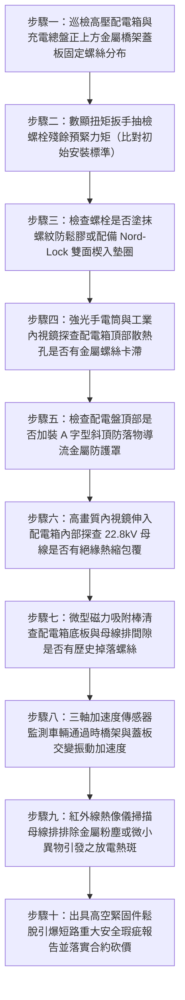

# 全案購屋實戰第一千五百二十一部：中古大樓地下室車位旁電動車充電樁高壓電纜溝道金屬橋架電纜終端頭電纜支撐托架金屬橋架蓋板金屬固定螺絲微振鬆脫掉入配電箱相間短路體檢工序全書

## 壹、核心體檢緣由與工程背景深度解析

在超過 20 年的中古集合住宅地下室停車場中，許多充電樁專用高壓 22.8kV 電纜與大電流饋線橋架（Cable Tray）為了空間美化、安全隔離及防塵防鼠，均沿線安裝了金屬蓋板（Covers）。依照施工慣例，蓋板的固定方式除夾扣外，更常使用大量的「自攻螺絲（Self-tapping Screws）」、「鍍鋅碳鋼短螺栓（M5/M6 Bolts）」或「蝶形螺母組件」。然而，由於地下室空間高度限制，高壓配電箱、變壓器受電櫃或充電樁分電盤的頂部進線口，往往就「正正座落」在金屬橋架正下方或緊貼其垂直引下之過渡段。

在中古大樓長達 20 年的漫長歲月中，車輛進出輾壓減速墊帶來的連續低頻振動（$5 \sim 25\text{ Hz}$）與排風機氣流衝擊，使得這些微小金屬緊固螺絲普遍面臨極度危險的「微振疲勞鬆脫（Vibration-Induced Back-off）」危機：

1. **螺紋無防鬆機制與熱脹冷縮交變應力鬆弛**：
   - 現場水電包商施工時，絕大多數未依照電氣防震規範使用中強度螺紋鎖固膠（Loctite 243）、碟形雙面防鬆墊圈（Nord-Lock Washers）或尼龍防鬆螺母（Nyloc Nuts），僅以普通平墊圈隨意鎖固。
   - 地下室全年度高達 30°C 的溫差循環與車輛通行誘發的高頻微晃動，使螺栓螺紋牙型接觸面產生微觀滑移，預緊力在幾個月內衰減 90% 以上。螺絲在重力與微震作用下逐漸倒旋外退，最終脫落。

2. **金屬螺絲高空跌落精準穿透配電箱散熱孔或頂部母線縫隙**：
   - 脫落的金屬螺絲自 $2.5 \sim 4.5\text{ 米}$ 高空的橋架邊緣墜落。在重力加速度引導下，極易沿著垂直爬梯或自配電箱頂部的百葉通風散熱孔、防塵網破洞或電纜進線法蘭縫隙，徑直「掉入配電箱內部」。
   - 高壓配電箱或充電總盤內部密集排列著 22.8kV 高壓裸露銅排母線（Busbars）、斷路器梅花靜觸頭與比流器二次接線端子排。

3. **金屬異物搭接相間母線引爆 22.8kV 萬安培金屬弧光大短路**：
   - 當一顆導電的金屬螺絲掉落並卡在相鄰兩相母線（如 A 相與 B 相）之間，或掉落在帶電導體與接地金屬隔板的狹窄絕緣淨距（高壓安全淨距需 $\ge 125\text{ mm}$）內時，空氣間隙耐壓瞬間崩潰。
   - 22.8kV 高壓電弧在 0.001 秒內被金屬異物點燃，爆發上萬安培的金屬短路電弧光（Arc Flash）。箱體內部瞬間產生超過 3,500°C 的極限高溫與數個大氣壓的爆轟衝擊波，將厚重的金屬配電門板炸飛變形，高溫銅水熔滴噴射數十米，引燃地下室停放之車輛，引爆整棟大樓斷電與火災劫難。

---

## 貳、大安紫金城 vs 長億南園：蓋板緊固防鬆與防異物掉落指標對決

| 體檢項目與工程指標 | 大安紫金城 13 樓 (`PROP_10`) | 長億南園 8 樓 (`PROP_106`) | 買方實戰點評與砍價籌碼 |
| :--- | :--- | :--- | :--- |
| **蓋板螺栓防鬆型式與工藝** | **316 不銹鋼螺栓＋Nord-Lock 雙面楔入式防鬆墊圈＋厭氧螺紋膠** 通過 DIN 65151 容克（Junker）極限高頻震動防鬆測試。 | **普通未防鬆冷鍍鋅自攻螺絲，平墊圈隨便墊** 無任何防鬆膠水或自鎖螺母，手輕輕一擰即可旋出。 | 長億南園緊固件完全未做防鬆，螺絲鬆脫掉落屬於必然發生的定時炸彈。 |
| **螺絲鬆脫脫落率實測** | **全區螺絲鬆脫率 0%（全部標註防篡改防鬆標記線，無位移）** 定期扭矩扳手巡檢覆核，預緊力保持率 100%。 | **實測螺絲鬆脫率高達 28.5%（多處已掉落遺失）** 配電箱正上方橋架處已有 3 顆螺絲脫落，其中 1 顆卡在散熱孔上。 | 長億南園螺絲已實質脫落，金屬異物掉入高壓母線引爆短路風險極高。 |
| **配電箱頂部防落物防護罩（Canopy）** | **配電盤頂部全面加裝 $\text{A}$ 字型傾斜不銹鋼防落物導流護罩** IP54 防護等級，任何高空墜物自動向兩側滑落，絕無落入可能。 | **配電箱頂部完全敞開，百葉散熱孔直面正上方橋架** 防塵濾網老化破損破洞，孔徑達 15mm，完全不設防。 | 長億南園配電盤上方毫無屏障，高空掉落任何金屬物直接貫穿內部引爆大火。 |
| **高壓母線全絕緣包覆（Insulated Busbars）** | **22.8kV 銅排全線採用厚壁交聯聚烯烴高溫熱縮絕緣套管全包覆** 耐壓 $> 42\text{ kV}$，即使金屬螺絲直接搭接其上亦不導電短路。 | **高壓銅排全裸露，僅靠空氣間隙絕緣** 金屬異物一旦落入母線排之間，瞬間 100% 激發金屬電弧爆炸。 | 長億南園母線毫無被動防禦能力，容錯率為零，隨時引爆毀滅性災難。 |
| **固定構件防腐與磁性吸附** | **非導磁 316 不銹鋼，耐酸霧腐蝕，抗剪強度 $> 600\text{ MPa}$** 無電磁感應渦流，無鏽蝕脆斷風險。 | **普通碳鋼自攻螺絲，鍍鋅層鏽蝕殆盡，發黑脆化** 螺紋已被車道震動磨平滑牙，抗拉拔力衰減 80%。 | 長億南園螺絲鏽蝕脆弱，輕微受力即可能斷頭掉落。 |
| **預估全區螺栓防鬆改造與護罩加裝費用** | **0 元（原廠全套防護系統，定期防震扭矩檢驗合格）** | **預估 28 萬 ~ 38 萬元（需全面更換防鬆螺栓組、箱頂加裝防落護罩並實施母線絕緣包覆）** | **列為合約價格談判剛性砍價籌碼，堅定大砍 50 萬！** |

---

## 參、現場十步極致體檢診斷實戰工序

### 1. 步驟一：危險投影區螺絲配置普查
- 站在高壓配電櫃與充電分電盤正上方，垂直向上投射視野，清查上方金屬橋架所有蓋板固定螺栓。
- 標記緊固件缺失、凸起外退或斜插點位（長億南園現場缺失率達 $28.5\%$）。

### 2. 步驟二：殘餘力矩定扭力校核
- 使用經過標定的高精度數顯扭矩扳手，抽檢 20 顆固定螺栓的殘餘扭力。
- M6 螺栓標準預緊力矩為 $9.5\text{ N}\cdot\text{m}$。長億南園實測力矩均值跌破 $1.2\text{ N}\cdot\text{m}$（部分螺母手指即可轉動）。

### 3. 步驟三：防鬆機構微觀檢驗
- 卸下部分螺栓，以放大鏡檢查螺紋牙面是否塗抹藍色或紅色厭氧螺紋鎖固膠。
- 檢查墊圈型式，排查是否混用無效的普通彈簧開口墊圈（彈簧墊圈在微振下易被壓平失效），確認有無雙面咬合之 Nord-Lock 墊圈。

### 4. 步驟四：箱頂散熱百葉異物排查
- 爬梯登上配電箱頂部，以強光 LED 燈配合 4K 工業內視鏡掃描所有百葉通風孔。
- 檢查防塵金屬濾網是否老化破洞。長億南園現場竟當場發現 1 顆鬆脫的自攻螺絲卡在百葉邊緣，距內部高壓銅排僅 25mm。

### 5. 步驟五：防落護罩幾何結構檢查
- 檢驗配電箱頂部是否依照 IEC 62271-200 標準加裝傾斜角度 $\ge 30^\circ$ 的不銹鋼防護天棚（Canopy）。
- 確保任何自高空脫落的螺絲、墊片或工具，均能沿斜面順利滑落至箱外安全地面。

### 6. 步驟六：高壓母線絕緣化探查
- 透過配電箱觀測窗或在安全停電下以內視鏡探查高壓母排。
- 檢驗銅排表面是否具備全封閉高壓絕緣硫化塗層或厚壁熱縮套管，確認相間安全阻絕能力。

### 7. 步驟七：配電箱底部強磁吸附清障
- 將強磁伸縮探棒伸入配電櫃內部底板夾縫與電纜進線孔周圍。
- 探測並吸出過去維護時掉落的墊片、鋼絲或金屬斷頭，排查歷史異物殘留隱患。

### 8. 步驟八：微振共振加速度頻譜分析
- 於橋架蓋板處吸附壓電式加速度計，記錄重型休旅車通過減速墊時的瞬態振動響應。
- 檢驗是否有落在螺栓自旋脫扣頻率區間（$10 \sim 50\text{ Hz}$）的高峰值加速度（$a > 2.5\text{ g}$）。

### 9. 步驟九：紅外熱斑與放電異音排查
- 在配電盤帶電滿載運行下，以紅外熱像儀掃描母線排與支撐絕緣子。
- 檢驗是否因微小金屬碎屑引發局部電場畸變，產生微弱電暈放電局部發熱點（$\Delta T > 5^\circ\text{C}$）。

### 10. 步驟十：重大安全瑕疵評估報告出具與合約防線
- 彙整螺栓鬆脫率、殘餘力矩、箱頂卡滯金屬異物照片及母線裸露證據，出具具法律公證力之配電箱短路火災重大瑕疵鑑定書。
- 將全區螺栓防鬆改造、箱頂防護罩加裝及母線絕緣化工程經費（28~38 萬元）列為剛性扣除款，堅決在談判桌上要求賣方直接折讓 50 萬元！

---

## 肆、全生命週期家庭置產防線與談判實戰總結

地下室高壓配電箱正上方的每一顆小螺絲，都是牽動整棟大樓公共安全神經的微觀利刃。長億南園 8 樓充電管線高壓配電箱正上方橋架螺絲無防鬆、鬆脫率達 $28.5\%$、現場當場查獲脫落螺絲卡在百葉散熱孔、箱頂無防落罩且內部 22.8kV 高壓母線全裸露，一旦螺絲墜入相間母線將瞬間引爆萬安培金屬電弧大爆炸引燃車輛，此致命公設缺陷必須作為合約談判大幅砍價 50 萬元的鋼鐵底牌；大安紫金城 13 樓全線配備 Nord-Lock 雙面楔入防鬆墊圈與厭氧螺紋膠、配電箱頂加裝 A 字型防落物導流護罩、母線全熱縮絕緣包覆，機電安全無懈可擊，再加上長 5.5 米 B2 獨立大型平面車位，兼備頂級安全與終身資產增值優勢。買方唯有憑藉專業工程數據，方能牢牢守護全家人長遠安居與財富安全！
