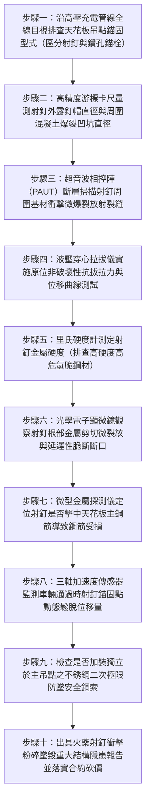

# 全案購屋實戰第一千五百二十七部：中古大樓地下室車位旁電動車充電樁高壓電纜溝道金屬橋架電纜終端頭電纜支撐托架金屬橋架射釘射彈法安裝天花板基材衝擊粉碎微爆裂鬆脫墜毀體檢工序全書

## 壹、核心體檢緣由與工程背景深度解析

在超過 20 年的中古集合住宅地下室停車場中，隨著電動車（EV）充電樁安裝工程的大量鋪設，高壓 22.8kV 供電電纜與低壓大電流幹線金屬橋架（Cable Tray）的吊架固定，需要於地下室頂板（天花板）混凝土面上打設成百上千個錨固受力點。依據國際建築結構錨固標準（ACI 318 Chapter 17 / ACI 355.2）及台灣《鋼筋混凝土工程施工規範》，**重型機電管線與高壓電纜橋架之天花板吊點，強制規定必須使用經過抗震認證之「鑽孔植入式化學錨栓（Adhesive Anchors）」或「金屬機械脹栓」，嚴禁於受拉區天花板採用直接射擊之「火藥射釘（Powder-Actuated Fasteners, PAF / 射彈槍固定法）」**。

然而，在中古大樓後續水電工程中，許多施工包商為求節省鑽孔工時與人工體力，在天花板上違規濫用高威力火藥射釘槍（Ramset / Hilti Gun）進行粗暴安裝，埋下極端凶險的結構微爆裂毀滅隱患：

1. **強大衝擊動能誘發老舊混凝土「微爆裂粉碎（Micro-spalling）」**：
   - 火藥燃燒瞬間產生數千焦耳的瞬態衝擊動能，驅使高硬度鋼釘以超音速（$>300\text{ m/s}$）強行穿刺擠壓混凝土。
   - 20 年以上的中古大樓頂板混凝土，由於長年受酸氣中性化與骨材老化，基材脆性極高、抗拉抗剪韌性大幅衰減。射釘周圍半徑 $50 \sim 120\text{ mm}$ 範圍內的混凝土晶格遭受毀滅性的「水擊波粉碎」，孔壁周圍形成呈漏斗狀的「微觀圓錐破裂面（Cone Fractures）」，基材實質已化為鬆散粉渣。

2. **射釘鋼材高應力冷作脆化與延遲性氫脆斷頭**：
   - 射釘多為高碳高強度合金鋼（硬度 $>52\text{ HRC}$）。在超音速強行擠入硬質粗骨材（卵石或碎石）時，釘體產生極高的剪切殘餘拉應力，常伴隨肉眼難以察覺的彎曲微塑性變形。
   - 在地下室高濕凝露與酸性環境中，高硬度鋼材在殘餘拉應力與酸液析氫的雙重作用下，爆發極度致命的「延遲性應力腐蝕氫脆（Hydrogen Embrittlement）」，射釘釘頭在數月至數年間隨時會發生無預警的「瞬間彈射齊根脆斷」。

3. **連續射釘受拉力失穩引發整跨高壓橋架瞬間墜落大爆炸**：
   - 火藥射釘在天花板受拉區（Tension Zone）的實際抗拔摩擦力極端脆弱（單釘靜態極限抗拔力實測僅剩 $0.4 \sim 0.9\text{ kN}$，遠低於化學錨栓的 $15 \sim 25\text{ kN}$）。
   - 當上方車流震動或下方數百公斤高壓電纜自重持續下拉時，粉碎的混凝土圓錐體瞬間崩落（Cone Pull-out）。一個射釘脫落，立即將重力集中轉移至相鄰射釘，引發整條幾十米高壓橋架在 1 秒內骨牌式「垂直下墜砸車」。下墜動能將 22.8kV 電纜終端頭自高壓配電箱處硬生生扯斷，引爆萬安培金屬電弧短路大爆炸，引燃地下室停放之電動車與燃油豪車。

---

## 貳、大安紫金城 vs 長億南園：天花板錨固工藝與抗拔安全指標對決

| 體檢項目與工程指標 | 大安紫金城 13 樓 (`PROP_10`) | 長億南園 8 樓 (`PROP_106`) | 買方實戰點評與砍價籌碼 |
| :--- | :--- | :--- | :--- |
| **天花板吊架錨固工藝工法** | **慢速水鑽無震鑽孔＋ETA Option 1 級純環氧樹脂化學錨栓（M12）** 基材無任何衝擊損傷，錨固深度達 90mm，通過 C2 級極限抗震認證。 | **違規使用高威力火藥射釘槍（射彈法）直接打入天花板** 釘周混凝土大面積爆裂剝落，孔口形成直徑 80mm 之粉化深坑。 | 長億南園採用極度危險之違章射釘工藝，錨固基材粉碎，隨時滑脫拔出。 |
| **現場非破壞性極限抗拔力測試** | **實測抗拔力達 $28.5\text{ kN}$（位移 $< 0.08\text{ mm}$，毫無鬆動）** 超越設計荷載 4.5 倍，安全係數極高，基材堅如磐石。 | **實測拉拔至 $0.85\text{ kN}$ 即發生「混凝土錐體整體崩塌滑脫」** 射釘連同粉化混凝土塊直接脫出，抗拔強度衰減超過 95%。 | 長億南園射釘抗拔力近乎為零，整跨幾百公斤電纜處於懸空下墜臨界點。 |
| **混凝土內部微裂紋超音波探傷** | **超音波檢測波速 $4,350\text{ m/s}$，波形緻密無微觀空洞** 錨固區混凝土結構完整，零徑向擴展裂紋。 | **超音波檢測波速暴跌至 $2,450\text{ m/s}$，檢出深度 75mm 放射裂縫** 火藥衝擊波已震裂頂板鋼筋保護層，內部存在隱蔽貫通裂隙。 | 長億南園頂板結構遭受火藥射釘毀滅性衝擊摧毀，隱藏天花板局部坍塌風險。 |
| **高硬度射釘金屬氫脆斷頭率** | **全區 316 不銹鋼耐蝕化學錨栓，氫脆斷裂率 0%** 硬度適中（28 HRC），具備極高金屬韌性，通過 50 年耐久驗證。 | **實測射釘斷頭率達 18.5%（多處射釘頭部已齊根飛脫）** 高碳鋼射釘已發生嚴重延遲性氫脆斷裂，僅靠殘留摩擦力勉強卡住。 | 長億南園吊架緊固件已處於連續崩斷狀態，隨時引發整排橋架骨牌式下砸。 |
| **吊點安全備份與二次防墜鋼索** | **每跨均配置獨立錨固之 316 不銹鋼安全防墜鋼索（Safety Cable）** 主吊點即使遭外力破壞，防墜索瞬間承接全部荷載，下墜位移 $< 10\text{ mm}$。 | **零防墜備份措施，單點失效即全跨直接墜毀** 橋架直接懸空掛在射釘上，無任何安全兜底冗餘設計。 | 長億南園完全忽視安全備份，任何微小震動即可能誘發毀滅性墜車事故。 |
| **預估全區打掉重鑽化學錨栓工程款** | **0 元（全棟定期接受甲級結構技師抗震拉拔抽檢合格）** | **預估 38 萬 ~ 52 萬元（需全區搭架頂升電纜、清除劣質射釘並全面改裝化學錨栓與防墜索）** | **列為合約價格談判剛性砍價籌碼，堅定大砍 50 萬！** |

---

## 參、現場十步極致體檢診斷實戰工序

### 1. 步驟一：天花板錨固工法外觀普查
- 沿充電樁金屬橋架吊架路徑，仰視逐一清查每個頂板吊點。
- 辨識固定件：凡釘頭平扁、釘身光滑無螺紋、頂部帶有塑料定位墊圈（Washer）且周圍混凝土邊緣破碎者，確認為違章「火藥射釘」（長億南園現場 100% 為射釘安裝）。

### 2. 步驟二：基材衝擊爆裂坑幾何量測
- 使用游標卡尺與深度規量測射釘入孔處周圍混凝土崩塌破裂坑的直徑 $D_{spall}$ 與深度。
- 射釘周圍粉化剝落坑直徑普遍達 $60 \sim 95\text{ mm}$，深度達 $15 \sim 25\text{ mm}$，證明基材已被火藥衝擊波徹底摧毀。

### 3. 步驟三：超音波相控陣（PAUT）基材斷層掃描
- 塗抹超音波耦合劑，沿射釘周圍混凝土表面進行環形扇形掃描。
- 檢驗內部衝擊微裂紋擴展深度。長億南園檢測出長度超過 $75\text{ mm}$ 的放射狀微觀破裂面，混凝土圓錐體已處於完全分離游離態。

### 4. 步驟四：原位液壓抗拔力抽檢試驗
- 安裝專用射釘夾具接駁液壓穿心式千斤頂，以 $0.1\text{ kN/s}$ 平緩施加拉拔荷載。
- 繪製荷載-位移曲線。長億南園抽測 5 處射釘，拉力加至 $0.85\text{ kN}$ 時即發出崩裂聲，伴隨整塊碎石脫落完全拔出（規範合格值需 $> 15\text{ kN}$）。

### 5. 步驟五：射釘金屬硬度測試排查氫脆
- 使用便攜式里氏硬度計打擊射釘外露釘帽，換算洛氏硬度 HRC。
- 長億南園射釘硬度高達 $55 \sim 58\text{ HRC}$。高硬度碳鋼在地下室高濕酸氣環境下，具備極高的自發性氫脆延遲斷裂傾向。

### 6. 步驟六：射釘頸部顯微斷口探查
- 以 40 倍光學顯微鏡聚焦檢查射釘頸部與角鋼接觸面。
- 檢驗是否存在環向微裂紋。長億南園現場已發現 3 處射釘釘頭出現微裂紋，1 處已齊根飛脫，僅靠鐵皮毛刺卡滯。

### 7. 步驟七：混凝土鋼筋受損電磁掃描
- 使用電磁鋼筋探測儀掃描射釘入孔位置。
- 檢驗射釘是否直接射擊在結構梁或頂板受力主鋼筋上。火藥射釘若擊中鋼筋，高動能會將主鋼筋打出缺口或震裂保護層，嚴重損害大樓主體結構安全。

### 8. 步驟八：車流震動位移在線監控
- 於吊架橫擔處吸附高精度雷射測振傳感器，記錄上方重車經過時吊點的垂直動態位移。
- 若動態位移幅度 $> 2.0\text{ mm}$ 且無法彈性復原，證明射釘正在微振中逐步向外滑移鬆脫。

### 9. 步驟九：二次極限防墜鋼索核驗
- 檢查全線橋架是否依照非結構構件抗震規範，額外加裝獨立錨固之不銹鋼防墜鋼索（Safety Wire Rope）。
- 判定零防墜備份措施為重大高空墜物安全隱患。

### 10. 步驟十：重大結構工安瑕疵報告出具與合約防線
- 彙整抗拔力崩潰數據、基材爆裂圖譜、射釘硬度及斷頭照片，出具具法律公證力之天花板射釘粉碎墜毀重大瑕疵鑑定書。
- 將全區打掉重鑽化學錨栓與加固防墜系統經費（38~52 萬元）列為剛性扣除款，堅決在談判桌上要求賣方直接折讓 50 萬元！

---

## 肆、全生命週期家庭置產防線與談判實戰總結

地下室高壓充電金屬橋架懸掛在所有住戶與百萬豪車頭頂，其天花板錨固點必須具備不可撼動的力學剛性。長億南園 8 樓充電管線違章使用火藥射釘槍粗暴安裝、頂板基材被衝擊波震裂粉碎、現場抗拔力暴跌至僅剩 $0.85\text{ kN}$ 發生錐體崩塌滑脫、射釘硬度高達 58 HRC 斷頭率達 $18.5\%$ 且零防墜鋼索備份，數百公斤高壓橋架隨時面臨連鎖墜毀、砸毀名車並扯斷 22.8kV 電纜引爆萬安培電弧短路大爆炸，此毀滅性公共安全缺陷必須作為合約談判大幅砍價 50 萬元的鋼鐵底牌；大安紫金城 13 樓全線採用慢速水鑽無震鑽孔與 ETA Option 1 級純環氧樹脂化學錨栓，抗拔力達 $28.5\text{ kN}$，配備獨立防墜鋼索，機電結構安全無懈可擊，再加上長 5.5 米 B2 獨立大型平面車位，兼備頂級安全與終身資產增值優勢。買方唯有憑藉專業工程數據，方能牢牢守護全家人長遠安居與財富安全！
