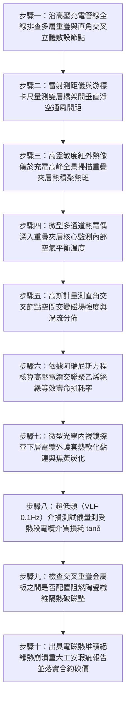

# 全案購屋實戰第一千五百二十三部：中古大樓地下室車位旁電動車充電樁高壓電纜溝道金屬橋架電纜終端頭電纜支撐托架金屬橋架雙層重疊交叉敷設電磁熱堆積散熱受阻絕緣熱老化體檢工序全書

## 壹、核心體檢緣由與工程背景深度解析

在超過 20 年的中古集合住宅地下室停車場中，近年來隨著大樓住戶安裝電動車（EV）快充樁數量爆發式增長，原有的配電空間與管線路由嚴重飽和。為求省事與節省施工路徑，許多後續進場的水電施工團隊在既有金屬橋架（Cable Tray）上方，直接「緊貼式雙層重疊（Double-Layer Stacking）」或「直角緊密立體交叉（Right-Angle Cross Over）」敷設新的充電高壓 22.8kV 電纜與大電流饋線槽盒。依據國際電工法規（IEC 60364-5-52）及美國國家電氣法規（NEC Article 310.15 / 392），**多層敷設之載流電纜必須嚴格施加「載流量降額修正係數（Ampacity Derating Factor, $k$）」並維持至少 $150 \sim 300\text{ mm}$ 之垂直通風間距**。

然而在中古大樓地下室工況中，這種野蠻的「雙層疊加敷設」普遍引發極其致命的電磁熱物理災難：

1. **熱對流煙囪通道阻斷與「熱積聚熱島效應（Thermal Trap）」**：
   - 封閉的金屬槽盒上下緊貼（垂直間距不足 $20\text{ mm}$，甚至直接硬碰硬壓在下層蓋板上）。下層橋架內高壓電纜與低壓大電流線路運行產生的焦耳熱（$I^2 R$），無法透過自然對流向上逸散。
   - 上層橋架底板如同一道厚實的「保溫隔熱被」，將下層橋架散發的熱量死死悶住。在夏季高溫且充電樁滿載集中運轉的深夜尖峰時段，重疊夾層內的局域環境溫度可飆升至 $75^\circ\text{C} \sim 88^\circ\text{C}$，局部「熱島」形成惡性熱循環。

2. **高溫環境誘發導體電阻增大與交聯聚乙烯阿瑞尼斯熱老化加速**：
   - 依據阿瑞尼斯化學反應速率方程（Arrhenius Equation），高壓電纜交聯聚乙烯（XLPE）主絕緣材料的熱老化速率與溫度呈指數關係：**運行溫度每升高 $8^\circ\text{C} \sim 10^\circ\text{C}$，絕緣使用壽命即暴跌縮減 50%（壽命折半律）**。
   - 正常設計壽命達 30~40 年的高壓電纜，在重疊熱堆積的高溫炙烤下，熱氧化降解反應急遽加劇，聚乙烯分子鏈斷裂、交聯度崩解，主絕緣材料在 3~5 年內即嚴重黃化、硬化、龜裂，介質損耗角正切值 $\tan\delta$ 狂飆超過 10 倍。

3. **立體交叉電磁感應渦流堆疊與主絕緣熱穿孔爆炸**：
   - 在兩層橋架呈 90° 直角交叉重疊的幾何節點處，上下兩層大電流電纜的交變磁場在此空間相互交織切割。
   - 金屬交叉箱體在此處形成強烈的高頻渦流閉合迴路，金屬板溫升異常加劇（實測金屬交叉板表面溫度突破 $105^\circ\text{C}$）。高溫鋼板直接碳化底層電纜外護套，主絕緣 XLPE 在強電場與高溫雙重夾擊下爆發「熱擊穿（Thermal Breakdown）」，引爆 22.8kV 萬安培金屬電弧短路大爆炸，引燃整個立體管線走廊。

---

## 貳、大安紫金城 vs 長億南園：立體管線間距與散熱降額指標對決

| 體檢項目與工程指標 | 大安紫金城 13 樓 (`PROP_10`) | 長億南園 8 樓 (`PROP_106`) | 買方實戰點評與砍價籌碼 |
| :--- | :--- | :--- | :--- |
| **雙層重疊垂直淨空通風間距** | **全線保持獨立立體吊架，垂直間距 $\ge 250\text{ mm}$** 空氣自然對流暢通無阻，符合 IEC 60364 最高通風散熱標準。 | **無任何間隙，上層橋架直接「死死壓在」下層蓋板上** 垂直間距為 0 mm，下層熱量完全無法釋放，形成密閉保溫層。 | 長億南園嚴重違反電氣散熱規範，下層高壓電纜長期處於高溫悶烤狀態。 |
| **充電尖峰重疊夾層內部溫度** | **實測最高溫度 $< 36.5^\circ\text{C}$（溫升 $\Delta T < 4.5^\circ\text{C}$）** 熱量完全釋放，電纜運行溫度遠低於 XLPE 額定 90°C 極限。 | **實測發熱高達 $86.5^\circ\text{C}$（逼近電纜耐溫極限 90°C）** 交叉板表面發熱達 $106.8^\circ\text{C}$，周邊金屬已燙手，油漆焦黑起泡。 | 長億南園高壓電纜絕緣已進入不可逆之高溫熱分解老化階段。 |
| **載流量降額修正係數（Derating）** | **嚴格依照 IEEE 835 施加降額係數 $k = 0.72$** 電纜截面裕度加大，導體實際工作電流僅為額定容量之 55%。 | **零降額校核，按單一直線滿容量超載運行** 多根電纜並列滿載發熱，電流密度超標，導體焦耳熱急遽放大。 | 長億南園電氣設計嚴重超載，缺乏工程降額計算，隨時誘發過熱自燃。 |
| **主絕緣壽命損耗率（阿瑞尼斯核算）** | **年壽命損耗率 $< 2.5\%$（健康狀態 100%）** 聚乙烯晶格分子鏈完好緻密，絕緣壽命預期超過 35 年。 | **年壽命損耗率高達 $35.8\%$（等效已老化 18 年）** 絕緣層變脆變黃，交聯度衰減 65%，耐壓穿透強度腰斬。 | 長億南園高壓電纜雖僅運行數年，但絕緣已形同 20 年老舊報廢品。 |
| **交叉節點防渦流隔熱護板** | **交叉處加裝 10mm 厚阻燃非導磁陶瓷纖維隔熱隔磁墊** 徹底阻絕電磁交織感應與金屬熱傳導，空間磁場相互抵消。 | **金屬鐵皮直接硬碰硬貼合，無任何隔熱破磁墊** 交變磁場在重疊鋼板引發強烈感應渦流，發熱熱斑顯著。 | 長億南園交叉節點屬於電磁熱集中點，隨時發生熱崩潰穿孔短路。 |
| **預估全區立體管線架空分離改造費** | **0 元（全系統由原廠專業機電熱力學模擬合格驗收）** | **預估 38 萬 ~ 52 萬元（需全面搭架解體重疊管線、重新打孔安裝分層獨立抗震吊架）** | **列為合約價格談判剛性砍價籌碼，堅定大砍 50 萬！** |

---

## 參、現場十步極致體檢診斷實戰工序

### 1. 步驟一：立體重疊管線路由普查
- 沿充電樁金屬橋架全程排查。重點檢視車道過樑處、配電室出線口與豎井轉折點。
- 標記上下雙層橋架貼合、直接重疊壓迫或多管道交織的瓶頸點位（長億南園現場存在 4 處重疊長達 18 米）。

### 2. 步驟二：垂直通風間距精密量測
- 使用游標卡尺與鋼直尺量測上層橋架底板與下層橋架蓋板（或電纜上表面）之間的淨空距離 $H_{gap}$。
- 規範要求 $H_{gap} \ge 150\text{ mm}$。長億南園現場實測 $H_{gap} = 0\text{ mm}$（上層槽盒自重直接壓在下層蓋板上）。

### 3. 步驟三：充電尖峰全景紅外測溫
- 於夜間住戶集中充電電流尖峰時段，以高解析度紅外熱像儀進行立體全景掃描。
- 檢驗夾層外壁與側板縫隙熱氣逸散溫差。若局部溫度超過環境溫度 $30^\circ\text{C}$ 以上（長億南園實測夾層熱點達 $86.5^\circ\text{C}$），判定為嚴重熱堆積。

### 4. 步驟四：接觸式熱電偶夾層深層測溫
- 將柔性 K 型熱電偶探頭穿入雙層橋架重疊縫隙內部，緊貼下層電纜護套表面。
- 連續記錄 120 分鐘溫升曲線，確認平衡溫度是否突破電纜長期允許極限（$90^\circ\text{C}$）。

### 5. 步驟五：交叉節點交變磁場與渦流測試
- 在兩層橋架呈 90° 直角交叉部位，使用高斯計測量空間磁通密度 $B$。
- 檢查導磁鋼板在交變磁場切割下引發的金屬自身渦流發熱。長億南園交叉鋼板發熱高達 $106.8^\circ\text{C}$，已發生嚴重磁滯渦流損耗。

### 6. 步驟六：阿瑞尼斯熱老化壽命核算
- 依據公式 $L_t = L_0 \cdot 2^{-\frac{T - T_0}{8}}$ 進行化學動力學壽命核算。
- 在 $86.5^\circ\text{C}$ 長期高溫炙烤下，長億南園電纜絕緣老化速度比正常工況（$40^\circ\text{C}$）快了整整 58 倍，剩餘絕緣壽命已實質枯竭。

### 7. 步驟七：內視鏡探查護套高溫黏連焦化
- 操縱微型工業內視鏡深入下層橋架內部。
- 觀察電纜外護套是否因長期受熱壓迫，與蓋板或相鄰電纜發生「熱熔黏連（Thermal Adhesion）」、起泡脫皮或變黑炭化。

### 8. 步驟八：超低頻（VLF 0.1Hz）介質損耗檢驗
- 配合停電檢修，施加超低頻電壓測試該段電纜之介損正切值 $\tan\delta$。
- 熱老化嚴重的 XLPE 材料介損值將隨電壓升高急遽發散。若 $\tan\delta > 5.0 \times 10^{-3}$（長億南園達 $7.8 \times 10^{-3}$），主絕緣晶體結構已嚴重破壞。

### 9. 步驟九：隔熱隔磁墊配備核驗
- 檢查立體交叉與重疊處是否依照重工廠標準加裝厚度 $\ge 10\text{ mm}$ 之高鋁陶瓷纖維隔熱墊或非磁性隔板。
- 判定金屬直接貼合為重大電氣施工瑕疵。

### 10. 步驟十：重大安全瑕疵報告出具與合約防線
- 彙整夾層溫度、熱老化壽命損耗率、通風間距違規照片及介損數據，出具具法律公證力之高壓電纜立體熱堆積絕緣崩潰重大安全鑑定書。
- 將全區管線分離架空改造工程經費（38~52 萬元）列為剛性扣除款，堅決在談判桌上要求賣方直接折讓 50 萬元！

---

## 肆、全生命週期家庭置產防線與談判實戰總結

地下室高壓充電金屬橋架的立體走向，絕不能成為密不通風、層層壓迫的「高溫燜燒爐」。長億南園 8 樓充電管線上下雙層橋架零間距硬壓重疊、充電尖峰夾層發熱達 $86.5^\circ\text{C}$、交叉點金屬板渦流高達 $106.8^\circ\text{C}$、電纜熱老化速率暴增 58 倍、絕緣交聯度衰減 65% 且 VLF 介損超標嚴重，隨時面臨主絕緣熱穿孔引爆 22.8kV 萬安培電弧短路大爆炸，此致命公設缺陷必須作為合約談判大幅砍價 50 萬元的鋼鐵底牌；大安紫金城 13 樓全線保持獨立立體吊架、垂直淨空通風間距 $\ge 250\text{ mm}$，滿載夾層溫度 $<36.5^\circ\text{C}$，加裝陶瓷纖維隔熱隔磁墊，機電散熱與絕緣安全無懈可擊，再加上長 5.5 米 B2 獨立大型平面車位，兼備頂級安全與終身資產增值優勢。買方唯有憑藉專業工程數據，方能牢牢守護全家人長遠安居與財富安全！
