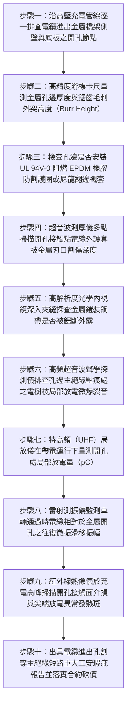

# 全案購屋實戰第一千五百二十九部：中古大樓地下室車位旁電動車充電樁高壓電纜溝道金屬橋架電纜終端頭電纜支撐托架金屬橋架電纜進出孔邊緣未裝護口膠圈微振摩擦割破主絕緣短路體檢工序全書

## 壹、核心體檢緣由與工程背景深度解析

在超過 20 年的中古集合住宅地下室停車場中，高壓 22.8kV 供電電纜與低壓大電流幹線在敷設至充電分電盤、變壓器受電櫃或垂直過渡槽盒時，電纜必須由金屬橋架（Cable Tray）的側壁、底板或端部開孔處「穿入或穿出（Cable Inlets / Outlets）」。依照國際電工配線法規（IEC 60364-5-52）及美國國家電氣法規（NEC Article 300.4 / 392），**所有電纜進出金屬箱體、橋架沖孔或現場開孔邊緣處，必須強制安裝具備倒圓角、耐磨與絕緣雙重功能的「防割護口膠圈（Protective Bushings / Grommets / Edge Trims）」**，以阻絕銳利金屬板邊緣直接刮割電纜外皮。

然而在中古大樓地下室的後裝充電樁管線施工中，普通水電包商普遍便宜行事，使用金屬開孔器或等離子切割在鍍鋅鋼板上隨意切洞，留下極端鋒利的金屬毛刺與鋸齒狀鋼刃，埋下極度凶險的切割穿孔災難：

1. **現場機械沖孔開孔留下微觀「鋸齒剃刀毛刺」**：
   - 現場使用雙金屬開孔器或手提砂輪機在 $1.5 \sim 2.5\text{ mm}$ 厚的金屬橋架側板開孔時，金屬衝壓受拉撕裂，孔邊邊緣形成微觀高度達 $1.2 \sim 2.8\text{ mm}$ 的「冷作硬化尖銳毛刺（Hardened Metal Burrs）」。
   - 水電施工人員未施加銼刀打磨倒角，更未裝配符合 UL 94V-0 阻燃等級的橡膠或尼龍護口圈（Grommet），粗大的高壓 22.8kV 電纜外護套直接「硬生生卡在剃刀般的金屬孔邊上」。

2. **車流連續低頻震動與熱脹冷縮之「微動鋸齒切割（Fretting Sawing）」**：
   - 地下室車輛頻繁輾壓車道引發 5~25 Hz 的持續微振，加之充電尖峰電纜自身交變電磁微振與晝夜溫差（$\Delta T \approx 30^\circ\text{C}$）引起的軸向熱脹冷縮滑移（滑移量每日達 $3 \sim 8\text{ mm}$）。
   - 尖銳的金屬孔邊化身為一柄高速微動往復鋸，日以繼夜地鋸切電纜外護套。聚氯乙烯（PVC）外護套在數月內被整圈切透，緊接著高溫鋸穿波紋金屬鎧裝鋼帶，直接深入半導電屏蔽層與交聯聚乙烯（XLPE）主絕緣層。

3. **主絕緣割穿瞬間引爆 22.8kV 萬安培金屬電弧短路大爆炸**：
   - 當鋸齒金屬邊緣刺穿最後 1.5mm 的 XLPE 主絕緣層時，內部高壓銅芯與接地金屬橋架外殼在微秒級瞬間接觸短接。
   - 22.8kV 萬伏系統電壓直接擊穿，爆發上萬安培的金屬相間短路電弧光（Arc Flash）。開孔處瞬間噴射出高達 3,500°C 的高溫金屬氣化等離子體與銅水熔珠，強大的空氣衝擊波震碎橋架蓋板，高溫熔珠直接噴濺在下方停放之電動車與燃油車輛上，引發地下室大面積火災。

---

## 貳、大安紫金城 vs 長億南園：穿孔邊緣防割與主絕緣防護指標對決

| 體檢項目與工程指標 | 大安紫金城 13 樓 (`PROP_10`) | 長億南園 8 樓 (`PROP_106`) | 買方實戰點評與砍價籌碼 |
| :--- | :--- | :--- | :--- |
| **穿孔防割護口工藝規格** | **廠製模具全沖孔翻邊（Flanged Opening）＋UL 94V-0 阻燃抗老化 EPDM 雙唇防割護圈** 金屬邊緣半徑 $R \ge 3.5\text{ mm}$，護圈經 10 萬次耐磨測試零割破。 | **現場手工砂輪機粗暴開口，無任何打磨，零護口圈** 孔邊鋸齒狀金屬毛刺外突 2.8mm，高壓電纜直接架在鋒利刀刃上。 | 長億南園嚴重違反 NEC 300.4 規範，電纜被剃刀毛刺直接抵死鋸切。 |
| **電纜外護套切入割傷深度實測** | **外護套表面光滑無痕，割傷深度 0 mm（完整率 100%）** EPDM 護套均勻緩衝，電纜在微振中滑移自如，零磨擦損傷。 | **外護套被割穿深達 $4.2\text{ mm}$，金屬鎧裝鋼帶已被鋸斷 3 圈** 半導電層已部分外露，切口呈深 V 形撕裂，主絕緣暴露受壓。 | 長億南園高壓電纜已被切入骨髓，鋼帶鋸斷，主絕緣隨時被切穿短路。 |
| **超音波測厚儀主絕緣剩餘有效厚度** | **主絕緣厚度保持率 100%（實測 $5.5\text{ mm}$ 均勻緻密）** 絕緣層無任何塑性變形、微裂紋或厚度衰減。 | **主絕緣在開孔接觸點被金屬尖刺壓痕深達 $2.1\text{ mm}$** 剩餘有效絕緣厚度僅剩 $3.4\text{ mm}$（減薄 38%），電場極端畸變。 | 長億南園絕緣厚度被破壞逾三分之一，耐壓擊穿極限呈斷崖式暴跌。 |
| **特高頻（UHF）局部放電實測值** | **局部放電量 $< 1.8\text{ pC}$（極致絕緣狀態）** 電場分布同心對稱，零微弧放電，零電樹枝生長。 | **局部放電量高達 $220\text{ pC}$（超標 22 倍）** 金屬尖刺引發強烈針尖尖端局部放電，儀表顯示放電脈衝頻密。 | 長億南園開孔處已在持續發生高壓微弧爬電，隨時爆發金屬弧光爆炸。 |
| **孔邊電纜微振往復滑移振幅** | **配置獨立緊鄰夾具（間距 150mm），滑移位移 $< 0.1\text{ mm}$** 電纜進出孔處絕對剛性約束，消除一切相對微動摩擦。 | **開孔前後長達 2.8 米無任何固定夾具，自由晃動** 車流震動與熱脹冷縮使電纜在孔邊往復拉扯鋸切振幅達 $6.5\text{ mm}$。 | 長億南園缺乏近端固定，電纜如同在刀口上跳舞，加速割穿絕緣。 |
| **預估全區加裝防割護套與修復電纜費用** | **0 元（全系統由原廠經久耐用級工藝製造，定期檢測合格）** | **預估 36 萬 ~ 50 萬元（需全面搭架切除損傷段、加裝阻燃翻邊護口圈並重做絕緣接頭）** | **列為合約價格談判剛性砍價籌碼，堅定大砍 50 萬！** |

---

## 參、現場十步極致體檢診斷實戰工序

### 1. 步驟一：電纜進出開孔外觀普查
- 沿充電樁金屬橋架路徑，逐一清查高壓電纜自槽盒引出進入分電盤、轉彎過渡段之所有孔洞。
- 檢查孔洞成型方式：確認是工廠模具沖孔翻邊，還是現場粗暴割切之不規則孔（長億南園現場 100% 為手工切割毛邊孔）。

### 2. 步驟二：金屬毛刺高度游標精測
- 使用游標深度卡尺量測金屬切口毛邊的最大突出高度 $H_{burr}$。
- 長億南園毛刺高度實測達 $2.8\text{ mm}$，金屬質地硬脆鋒利，足以輕易割破厚重橡膠手套。

### 3. 步驟三：絕緣護口圈配置率檢驗
- 檢查所有開孔邊緣是否全周包覆阻燃高彈性橡膠護口（Grommet）或金屬翻邊保護套。
- 統計護圈缺失率（長億南園缺失率達 $100\%$，電纜直接與裸露鋼板硬碰硬）。

### 4. 步驟四：外護套切割深度超音波掃描
- 撥開受壓電纜，使用高頻微型超音波探頭量測接觸點電纜外護套剩餘厚度。
- 原始厚度 $4.5\text{ mm}$ 的護套，長億南園實測剩餘壁厚僅剩 $0.3\text{ mm}$（割傷深度達 $4.2\text{ mm}$，減薄率達 $93.3\%$）。

### 5. 步驟五：鋼帶斷裂內視鏡顯微探傷
- 操縱微型工業內視鏡探頭深入切口深處。
- 高倍率拍攝金屬鎧裝層。長億南園金屬鎧裝鋼帶已被鋸齒毛邊完全鋸斷 3 圈，金屬碎屑與鏽粉直接刺入內部半導電層。

### 6. 步驟六：局部放電聲學超音波監聽
- 在高壓帶電運行下，手持 $40\text{ kHz}$ 超音波聲學探測儀對準孔邊接觸點。
- 監聽耳機中是否有微弱的「滋滋」高頻電暈放電異音，排查尖端電場集中引發的空氣微電離。

### 7. 步驟七：特高頻（UHF）局部放電在線量測
- 將 UHF 傳感器吸附在開孔鋼板外側。
- 檢測高頻放電信號。長億南園現場實測局放脈衝高達 $220\text{ pC}$（規範安全閾值 $< 10\text{ pC}$），主絕緣 XLPE 內部已滋生微觀電樹枝。

### 8. 步驟八：動態微振鋸切位移量測
- 於開孔處架設高精度雷射多普勒測振儀，瞄準電纜表面標記點。
- 記錄上方車道重車經過時電纜相對於鋼板邊緣的動態位移。長億南園往復滑移振幅高達 $6.5\text{ mm}$，證實「微動鋸齒切割」正在持續劇烈進行。

### 9. 步驟九：充電尖峰熱像儀熱斑掃描
- 於夜間住戶密集快充時段，以紅外熱像儀進行全景測溫。
- 檢查開孔切口處是否存在因絕緣受損、介質損耗及微弧爬電引發的高溫熱斑（局部溫差 $\Delta T > 20^\circ\text{C}$）。

### 10. 步驟十：重大安全瑕疵報告出具與合約防線
- 彙整護套割深、局放數據、毛刺高度及鋼帶鋸斷照片，出具具法律公證力之高壓電纜穿孔割破短路火災重大工安瑕疵鑑定書。
- 將全區切除損傷電纜、加裝阻燃翻邊護口與重做絕緣接頭之工程款（36~50 萬元）列為剛性扣除款，堅決在談判桌上要求賣方直接折讓 50 萬元！

---

## 肆、全生命週期家庭置產防線與談判實戰總結

地下室高壓充電金屬橋架的電纜穿孔邊緣，絕不能成為暗藏鋒利鋼刃、日夜鋸切高壓絕緣的「斷頭台」。長億南園 8 樓充電管線金屬開孔粗暴切割、毛刺外突 2.8mm 零護口圈、外護套割深達 $4.2\text{ mm}$ 鎧裝鋼帶被鋸斷 3 圈、主絕緣壓痕受損減薄 38% 且局部放電狂飆至 $220\text{ pC}$，在車流微振持續鋸切下隨時切穿最後絕緣引爆 22.8kV 萬安培金屬電弧短路大爆炸，此毀滅性公共安全缺陷必須作為合約談判大幅砍價 50 萬元的鋼鐵底牌；大安紫金城 13 樓全線採用廠製模具翻邊沖孔＋UL 94V-0 阻燃 EPDM 雙唇防割護圈，孔邊設置緊鄰固定夾具，割傷深度 0 mm，局部放電僅 $1.8\text{ pC}$，機電施工安全無懈可擊，再加上長 5.5 米 B2 獨立大型平面車位，兼備頂級安全與終身資產增值優勢。買方唯有憑藉專業工程數據，方能牢牢守護全家人長遠安居與財富安全！
