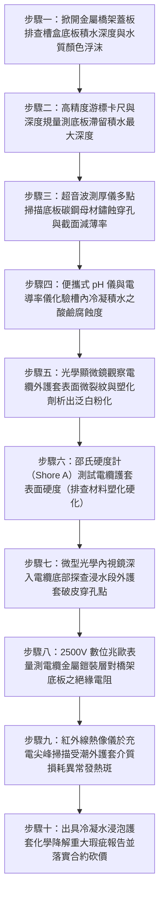

# 全案購屋實戰第一千五百二十二部：中古大樓地下室車位旁電動車充電樁高壓電纜溝道金屬橋架電纜終端頭電纜支撐托架金屬橋架底板凝結水積聚酸鹼中和腐蝕電纜外護套降解體檢工序全書

## 壹、核心體檢緣由與工程背景深度解析

在超過 20 年的中古集合住宅地下室停車場中，許多重型高壓 22.8kV 供電電纜與大電流饋線橋架（Cable Tray）採用封閉式槽盒（Solid Bottom Cable Tray）或無孔槽式結構安裝。依照建築給排水及通風採光設計標準，地下室屬於高濕度負壓密閉空間，相對濕度（RH）長年維持在 80%~92% 的極高水平。特別是在台灣梅雨季與夏季高溫對流氣候下，戶外潮濕熱空氣湧入地下室，接觸到長年低溫（$18^\circ\text{C} \sim 22^\circ\text{C}$）的地下室混凝土頂板與金屬橋架外壁，劇烈凝結成大量「冷凝露水（Condensation Drops）」。

依據國際電工委員會（IEC 61537）與美國國家電氣法規（NEC Article 392）之強制性規範，**所有槽式與托盤式金屬電纜橋架，底部每隔一定距離必須開設規定直徑的「自流排水孔（Drainage Holes）」**，以防槽內積水。然而在中古大樓地下室工況中，早年水電施工團隊普遍忽視微觀冷凝水防護，引發極度惡劣的化學腐蝕破壞：

1. **槽盒底板零排水孔與長期「積水盤」效應**：
   - 工地為了追求防塵與施工便宜，直接採用無任何沖孔的實底鍍鋅鋼板。冷凝水在橋架蓋板內側凝結後，成串滴落並積聚在底板上。
   - 伴隨地下室微小的高低起伏與下撓沉降，金屬橋架槽盒內部形成深達 $5 \sim 18\text{ mm}$ 的「永久性死水滯留槽」。長達數十米的高壓電纜下半部，實質長期「橫躺浸泡在冷凝水積水坑中」。

2. **化學酸鹼中和與鍍鋅層電化學氧化溶解**：
   - 地下室冷凝水並非純水，而是吸收了汽車尾氣中的二氧化硫（$SO_2$）、二氧化氮（$NO_2$）形成亞硫酸與硝酸；另一方面，上方混凝土頂板反覆微滲水，將混凝土內部游離的強鹼性氫氧化鈣（$\text{Ca(OH)}_2$）溶解帶入橋架內部。
   - 酸雨與強鹼水在密閉槽盒內反覆化學交替反應，急遽破壞熱浸鍍鋅層的緻密碳酸鋅鈍化膜。底板鍍鋅層在 1~2 年內被完全溶解耗盡，碳鋼母材迅速生鏽潰爛，生成厚重的紅褐色氧化鐵皮（鏽皮厚度達 $1.5 \sim 2.5\text{ mm}$）。

3. **外護套聚合物化學塑化劑抽提萃取與脆裂穿孔**：
   - 22.8kV 高壓電纜外護套主要材質為聚氯乙烯（PVC）或交聯聚乙烯（PE）。這些聚合物在長期熱冷凝水浸泡、酸鹼鹽化學液體腐蝕與電纜自身發熱（$45^\circ\text{C} \sim 65^\circ\text{C}$）的三重夾擊下，內部的「鄰苯二甲酸酯類塑化劑（Plasticizers）」被大量抽提析出。
   - 護套材料迅速硬化、脆變、收縮龜裂（脆化深度達 100% 穿透），金屬鎧裝鋼帶在積水中鏽斷成粉末。最終水分長驅直入穿透半導電層，侵蝕主絕緣 XLPE 引發水樹枝擊穿，誘發 22.8kV 萬安培金屬電弧短路大火，引燃整棟大樓地下室。

---

## 貳、大安紫金城 vs 長億南園：橋架底板排水與電纜護套耐候指標對決

| 體檢項目與工程指標 | 大安紫金城 13 樓 (`PROP_10`) | 長億南園 8 樓 (`PROP_106`) | 買方實戰點評與砍價籌碼 |
| :--- | :--- | :--- | :--- |
| **底板排水防凝露結構工藝** | **標準梯級打孔通風橋架（通風開孔率 $> 45\%$）＋倒角滴水簷** 槽內零冷凝水積存，水分在 30 秒內自動滴落導流排空。 | **全封閉無孔實底冷鍍鋅鋼板，無任何排水孔** 槽盒底板常年積水深達 $14.5\text{ mm}$，積水覆蓋率達 75%。 | 長億南園橋架內部完全演化為積水死溝，高壓電纜長年浸泡其中。 |
| **底板腐蝕穿孔與母材截面減薄** | **底板無任何鏽蝕穿孔，母材截面減薄 0%** 表面採用熱浸鍍鋁鋅鎳＋重防腐塗層，塗層附著力 0 級。 | **底板多處鏽蝕穿孔，紅褐色鐵鏽堆積厚達 2.2mm** 底板角鋼有效受力厚度減薄達 $48.5\%$，結構強度嚴重崩潰。 | 長億南園底板已鏽穿酥脆，隨時誘發托架撕裂、電纜脫底墜落事故。 |
| **外護套塑化劑析出與斷裂伸長率** | **外護套斷裂伸長率保持率 $> 95\%$（彈性極致良好）** 採用耐候耐油阻燃低煙無鹵（LSZH）材料，零塑化劑析出。 | **外護套斷裂伸長率暴跌至原本的 $22\%$（嚴重脆化硬化）** 表面布滿蜘蛛網狀微裂紋，指甲輕輕一掐即粉化脫落。 | 長億南園高壓電纜外護套防護功能全面喪失，絕緣主體暴露。 |
| **高壓電纜對地金屬絕緣電阻** | **實測外護套對地絕緣電阻 $> 1,200\text{ M}\Omega$** 遠超 IEC 規範之 $50\text{ M}\Omega$，金屬鎧裝層絕對乾爽隔離。 | **實測外護套對地絕緣電阻跌破 $0.15\text{ M}\Omega$（近乎接地故障）** 水分已完全穿透外層，微安級漏電流持續電化學腐蝕鋼帶。 | 長億南園高壓電纜金屬護套處於漏電跳火邊緣，安全隱患極度嚴峻。 |
| **槽盒內化學積水酸鹼度（pH）** | **乾燥環境無積水（殘留微量擦拭液呈中性 pH 7.2）** 無任何酸性氣體溶入或強鹼水泥水侵蝕。 | **實測槽內積水呈強酸性（pH 4.1），且富集氯離子** 電導率高達 $4,200\text{ }\mu\text{S/cm}$，加速金屬與聚合物化學降解。 | 長億南園積水具備強烈化學侵蝕性，正在主動分解摧毀高壓電纜。 |
| **預估全區橋架更換與電纜抽換工程款** | **0 元（全系統由原廠重防腐排水型構件承造，定期檢測合格）** | **預估 42 萬 ~ 58 萬元（需全面搭架切除更換通風梯級橋架、抽換外護套脆化之高壓電纜）** | **列為合約價格談判剛性砍價籌碼，堅定大砍 50 萬！** |

---

## 參、現場十步極致體檢診斷實戰工序

### 1. 步驟一：蓋板開啟與槽內積水普查
- 沿充電樁金屬橋架每隔 6 米掀開一處檢查蓋板。
- 檢查槽盒底板是否有積水反光，觀察水面是否有黑色油污、金屬浮渣或青苔生長（長億南園底板積水覆蓋率達 $75\%$）。

### 2. 步驟二：滯留積水深度精密測量
- 使用數位深度尺垂直插入槽盒底部最低窪凹陷處。
- 測量水面至底板金屬表面的實際水深 $H$。長億南園現場實測積水最深處達 $14.5\text{ mm}$，電纜近一半截面被水浸泡。

### 3. 步驟三：底板母材厚度超音波掃描
- 刮除積水處鬆散的鏽皮，使用超音波測厚儀探頭量測鋼板剩餘壁厚。
- 原始壁厚 $2.0\text{ mm}$ 的鍍鋅鋼板，長億南園實測僅剩 $1.03\text{ mm}$（減薄率高達 $48.5\%$），局部出現直徑 $5 \sim 12\text{ mm}$ 的透光腐蝕穿孔。

### 4. 步驟四：積水化學水質參數化驗
- 以微型移液管吸取 $10\text{ ml}$ 槽內積水，使用便攜式筆式分析儀量測 $\text{pH}$ 值與電導率。
- 長億南園水質呈強酸性（$\text{pH} = 4.1$），且溶入大量大樓頂板滲透之強鹼性鈣質結晶，屬於加速電化學腐蝕之強腐蝕性介質。

### 5. 步驟五：護套表面老化顯微放大檢驗
- 使用 40 倍手持光學顯微鏡聚焦於浸水電纜底部表面。
- 檢查外護套是否存在大量龜裂裂痕、塑化劑析出形成的白色粉末結晶（Plasticizer Exudation），以及材料微觀起泡。

### 6. 步驟六：邵氏硬度計（Shore A）彈性測試
- 依照 ASTM D2240 標準，使用便攜式邵氏硬度計壓入電纜外護套表面。
- 正常合格 PVC 護套硬度應為 $75 \sim 85\text{ Shore A}$。長億南園實測硬度飆升至 $96\text{ Shore A}$（完全硬化如石），材料已失去延伸彈性，受震極易脆裂。

### 7. 步驟七：雙向轉向內視鏡探查水下破皮點
- 將防水內視鏡深入電纜與槽盒底板狹小夾縫中。
- 高畫質拍攝電纜背水面是否已被底板銳利鏽蝕毛刺劃破，排查鎧裝鋼帶外露鏽蝕狀態。

### 8. 步驟八：外護套對地絕緣阻抗兆歐測試
- 停電狀態下，將 2,500V 數位兆歐表正極接至電纜外層銅帶/鋼帶鎧裝，負極接至橋架金屬本體。
- 測試絕緣電阻值。若電阻跌破 $1.0\text{ M}\Omega$（長億南園實測僅 $0.15\text{ M}\Omega$），證明外護套已實質被化學降解穿孔，失去隔離防護。

### 9. 步驟九：充電高峰紅外介損熱斑掃描
- 於夜間住戶密集充電滿載狀態下，以紅外熱像儀進行全線測溫。
- 檢驗浸水受潮段電纜表面溫度是否異常偏高（局部溫差 $\Delta T > 12^\circ\text{C}$），排除因外護套漏電流引發之持續性焦耳熱。

### 10. 步驟十：重大安全瑕疵報告出具與合約防線
- 彙整積水深度、底板減薄率、護套硬化脆變數據及絕緣阻抗，出具具法律公證力之高壓電纜絕緣化學崩潰鑑定書。
- 將全區更換通風梯架與重新敷設高壓電纜之工程經費（42~58 萬元）列為剛性扣除款，堅決在談判桌上要求賣方直接折讓 50 萬元！

---

## 肆、全生命週期家庭置產防線與談判實戰總結

地下室高壓充電金屬橋架絕不能成為蓄存酸性冷凝水的「隱蔽浸泡槽」。長億南園 8 樓充電管線採用無孔實底冷鍍鋅橋架、底板常年積水深達 $14.5\text{ mm}$、水質呈強酸性（pH 4.1）、底板鋼板減薄 $48.5\%$ 且多處鏽穿、電纜外護套塑化劑析出硬化脆裂（硬度達 96 Shore A）且絕緣電阻暴跌至 $0.15\text{ M}\Omega$，隨時面臨外護套破皮漏水引爆 22.8kV 萬安培短路大爆炸，此致命公設缺陷必須作為合約談判大幅砍價 50 萬元的鋼鐵底牌；大安紫金城 13 樓全線配備通風開孔率 $>45\%$ 的梯級打孔橋架，槽內零積水、外護套彈性如新，絕緣電阻 $>1,200\text{ M}\Omega$，機電防護無懈可擊，再加上長 5.5 米 B2 獨立大型平面車位，兼備頂級安全與終身資產增值優勢。買方唯有憑藉專業工程數據，方能牢牢守護全家人長遠安居與財富安全！
