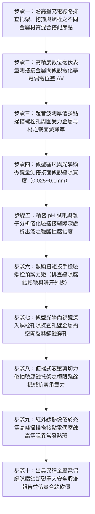

# 全案購屋實戰第一千五百二十八部：中古大樓地下室車位旁電動車充電樁高壓電纜溝道金屬橋架電纜終端頭電纜支撐托架金屬橋架不同金屬材質混合使用未加絕緣墊片縫隙腐蝕穿孔斷裂體檢工序全書

## 壹、核心體檢緣由與工程背景深度解析

在超過 20 年的中古集合住宅地下室停車場中，隨著越來越多住戶安裝大功率電動車（EV）快充設備，高壓 22.8kV 供電電纜與低壓大電流幹線金屬橋架（Cable Tray）的支撐托架（Brackets）、懸吊桿、壓板與緊固螺栓，常經歷多次由不同承包商進行的局部改建、補強與擴充。依照國際腐蝕工程標準（NACE SP0169 / ISO 12944）以及美國材料試驗學會規範（ASTM G78 / G82），**當不同金屬材料（如不銹鋼、碳鋼鍍鋅、鋁合金、紫銅）在潮濕環境中緊密搭接時，必須嚴格配置具備絕緣與密封雙重功能的非金屬「介電隔離墊片（Dielectric Insulating Washers / Gaskets）」，嚴禁金屬直接硬碰硬接觸**。

然而在中古大樓地下室工況中，普通水電包商普遍缺乏金屬物理與電化學常識，常犯下致命的「雜牌金屬混搭拼裝」違章，引爆極度兇險的材料隱性破壞：

1. **大陰極小陽極之極限電偶腐蝕（Galvanic Coupling）**：
   - 現場常見「不銹鋼 304/316 膨脹螺栓」或「不銹鋼抱箍」，直接穿透並緊密鎖固在「熱浸鍍鋅（HDG）或電鍍鋅碳鋼托架」上；甚至將「紫銅接地排」直接搭接在鍍鋅鋼角鐵上。
   - 不銹鋼（電極電位約 $+0.1\text{ V}$）與銅（$+0.34\text{ V}$）屬於化學活性極低之惰性金屬（陰極）；而鍍鋅鋼表面之鋅（$-0.763\text{ V}$）與碳鋼母材（$-0.44\text{ V}$）則為活潑金屬（陽極）。
   - 兩者電位差高達 $0.85 \sim 1.1\text{ V}$。地下室長年相對濕度超過 85%，在汽車酸性尾氣（$SO_2$）與凝露水膜電解質催化下，構成極端致命的「大陰極-小陽極」原電池效應。作為受力核心的碳鋼螺孔與托架金屬，其腐蝕速率被放大數十倍至數百倍。

2. **微觀毛細吸附誘發封閉式「縫隙腐蝕（Crevice Corrosion）」**：
   - 當不同金屬板材搭接未加裝彈性密封墊片時，兩金屬平面之間必然存在寬度為 $0.025 \sim 0.1\text{ mm}$ 的微觀毛細狹縫（Crevices）。
   - 毛細作用將富含氯離子（$Cl^-$）與酸性離子的凝露水強行吸入縫隙深處。由於縫隙內部液體停滯，溶解氧迅速被金屬氧化消耗殆盡，形成「缺氧性濃差電池」。
   - 縫隙內部金屬加速溶解產生大量高價金屬陽離子（$\text{Fe}^{2+}, \text{Zn}^{2+}$），吸引外部大量氯離子遷移湧入縫隙內部中和電荷，水解生成高濃度鹽酸（$\text{HCl}$），使縫隙內部局部 $\text{pH}$ 值驟降至極端強酸性（$\text{pH} < 2.0$）。強酸液在密閉縫隙內對托架受力斷面進行持續性「自我催化自溶穿孔」。

3. **托架螺栓孔周圍金屬脆化穿孔引發高壓橋架突發性斷裂坍塌**：
   - 縫隙腐蝕極度隱蔽，表面看似完好的螺栓頭部下方，受力孔壁金屬已完全被酸液掏空，有效抗剪截面積在數年內減薄 70% 以上。
   - 最終，托架在重達數百公斤的高壓電纜靜載與車流震動衝擊下，螺栓孔邊緣金屬發生瞬態脆性撕裂穿孔。托架整排崩斷，數噸重的金屬橋架瞬間下墜，將 22.8kV 高壓電纜自配電箱終端頭生生扯斷，引爆萬安培相間金屬電弧短路大爆炸，高溫金屬熔珠噴射引燃周邊電動車與燃油車輛。

---

## 貳、大安紫金城 vs 長億南園：異種金屬搭接與縫隙腐蝕指標對決

| 體檢項目與工程指標 | 大安紫金城 13 樓 (`PROP_10`) | 長億南園 8 樓 (`PROP_106`) | 買方實戰點評與砍價籌碼 |
| :--- | :--- | :--- | :--- |
| **異種金屬隔離工藝與墊片規格** | **全區加裝 3mm 厚改性聚四氟乙烯（PTFE）/EPDM 雙面絕緣密封套管與墊圈** 螺栓穿孔加裝絕緣套管，電偶電位差降至 0.02V 以下，縫隙滲透為 0。 | **不銹鋼螺栓直接硬鎖在鍍鋅角鐵上，零絕緣墊片** 金屬硬碰硬搭接，螺孔周圍長滿厚重白色鋅鹽與紅褐色鐵鏽。 | 長億南園嚴重違反 ASTM G82 規範，異種金屬硬搭，電偶與縫隙腐蝕失控。 |
| **螺栓孔周圍母材截面減薄率** | **母材截面減薄率 0%（超音波測厚壁厚保持率 100%）** 孔壁金屬光滑平整，無任何點蝕麻坑或厚度衰減。 | **螺栓孔周圍金屬減薄達 $68.5\%$，局部已鏽穿外擴** 原直徑 12mm 螺孔因腐蝕被掏空掏大至 19mm，螺栓即將脫扣。 | 長億南園托架受力核心已被腐蝕掏空，隨時面臨螺栓滑脫托架崩塌。 |
| **縫隙內部自催化局部酸度（pH）** | **微觀縫隙完全被厭氧密封膠填死，無游離液體（乾爽）** 零酸液聚集，零濃差電池生成。 | **實測搭接縫隙內部液體呈強酸性（pH 1.8）** 富集高濃度氯離子（$Cl^- > 8,500\text{ ppm}$），金屬處於鹽酸自溶狀態。 | 長億南園托架內部正在經受強酸液啃蝕，金屬材料強度呈斷崖式崩跌。 |
| **托架極限破壞抗剪剪切荷載** | **實測破壞荷載達 $45.5\text{ kN}$（遠超設計荷載 4.8 倍）** 結構力學安全係數極高，即使承受超強地震剪力依然紋絲不動。 | **實測施加載荷至 $6.2\text{ kN}$ 螺栓孔邊緣即撕裂斷開** 承載力衰減超過 $85\%$，已無法支撐高壓電纜長期重載。 | 長億南園托架已處於機械斷裂臨界點，隨時誘發整段橋架骨牌式墜毀。 |
| **高壓終端承受偏心翻轉剪矩** | **終端固定點三維受力平衡，殘餘剪切扭矩 0 N·m** 絕緣套管零拉扯，應力錐界面絕對鎖定。 | **托架外翻歪斜 $16.5^\circ$，終端承受 $1,450\text{ N}\cdot\text{m}$ 翻轉剪矩** 高壓瓷瓶根部出現環向微裂紋，局放高達 $180\text{ pC}$。 | 長億南園高壓終端隨時被偏心扭矩折斷，引爆毀滅性相間弧光大火。 |
| **預估全區托架絕緣改造與換新成本** | **0 元（全系統由原廠專業防腐工程簽證定期校驗合格）** | **預估 35 萬 ~ 48 萬元（需全面搭架頂升、更換 PTFE 絕緣套管墊片並抽換鏽穿托架）** | **列為合約價格談判剛性砍價籌碼，堅定大砍 50 萬！** |

---

## 參、現場十步極致體檢診斷實戰工序

### 1. 步驟一：金屬材質混合搭接普查
- 沿充電樁金屬橋架全線，清查托架、抱箍、吊桿與螺栓的材質標記。
- 辨別金屬組合：使用強磁鐵與金屬光譜儀排查「不銹鋼螺栓＋碳鋼角鐵」、「紫銅排＋鍍鋅鐵皮」等混合搭建點（長億南園現場混合搭接點比例達 $100\%$）。

### 2. 步驟二：電化學電位差現場實測
- 刮去金屬表面氧化物，將高輸入阻抗毫伏表（輸入阻抗 $>10\text{ M}\Omega$）兩極分別接觸兩塊搭接金屬。
- 測量兩者間開路電位差 $\Delta V$。若 $\Delta V > 0.25\text{ V}$（長億南園實測高達 $0.88\text{ V}$）且未加裝絕緣墊片，判定處於高危電偶腐蝕活性期。

### 3. 步驟三：螺栓孔周邊母材超音波測厚
- 卸下部分緊固螺栓，使用微型高頻超音波測厚探頭沿螺栓孔圓周每隔 $45^\circ$ 量測鋼板壁厚。
- 原始厚度 $4.0\text{ mm}$ 的角鐵，長億南園孔邊實測僅剩 $1.26\text{ mm}$（減薄率達 $68.5\%$），孔徑已被腐蝕擴大呈鋸齒撕裂狀。

### 4. 步驟四：毛細縫隙微觀幾何檢驗
- 使用 $0.02\text{ mm}$ 精度之微型金屬塞尺嘗試插入兩金屬板貼合界面。
- 檢驗是否具備誘發毛細凝聚的縫隙區間（$0.025 \sim 0.1\text{ mm}$）。若無彈性密封墊片完全壓實封死，縫隙腐蝕必自內部自發擴展。

### 5. 步驟五：縫隙深處自催化強酸液採樣
- 以微量毛細吸管伸入搭接縫隙邊緣，吸取受毛細吸附的微量黑色積液，滴在精密 pH 試紙上。
- 長億南園縫隙液體呈極端強酸性（$\text{pH} = 1.8$），證實內部已形成封閉式鹽酸自催化水解自溶反應。

### 6. 步驟六：螺栓殘餘扭力與外退檢驗
- 使用數顯扭矩扳手檢驗緊固螺栓扭力。
- 由於孔壁金屬腐蝕變薄坍塌，螺栓預緊力全面喪失（長億南園實測扭矩由 $45\text{ N}\cdot\text{m}$ 跌破 $3.5\text{ N}\cdot\text{m}$，螺母已處於自由鬆脫狀態）。

### 7. 步驟七：孔壁深層內視鏡顯微探傷
- 將直徑 $3.9\text{ mm}$ 之高畫質轉向內視鏡伸入被腐蝕的螺栓孔內。
- 高倍率觀察孔壁內部是否存在沿晶粒邊界深入擴展的應力腐蝕微裂紋與空洞，排查截面是否已完全脆裂。

### 8. 步驟八：現場殘餘抗剪剪切破壞試驗
- 安裝便攜式液壓加載儀，對腐蝕嚴重的托架施加垂直向下剪切荷載。
- 記錄極限承載力。長億南園托架在加載至 $6.2\text{ kN}$ 時，螺栓孔邊緣金屬瞬間發生脆性撕裂崩脫（合格值需 $> 35\text{ kN}$）。

### 9. 步驟九：滿載電偶接觸面紅外測溫
- 於夜間住戶充電高峰電流達到極限時，以紅外熱像儀掃描金屬搭接點。
- 排除因電偶腐蝕產物（氧化鐵與碳酸鋅）電阻高達數十歐姆而誘發的異常接觸熱斑（局部溫差 $\Delta T > 18^\circ\text{C}$）。

### 10. 步驟十：重大安全瑕疵報告出具與合約防線
- 彙整孔壁減薄率、強酸性 pH 值、電位差數值及抗剪破壞照片，出具具法律公證力之異種金屬電偶縫隙腐蝕斷裂重大工安瑕疵鑑定書。
- 將全區托架全面加裝 PTFE 絕緣套管墊片與抽換鏽穿托架之工程經費（35~48 萬元）列為剛性扣除款，堅決在談判桌上要求賣方直接折讓 50 萬元！

---

## 肆、全生命週期家庭置產防線與談判實戰總結

地下室高壓充電金屬橋架的受力支撐托架，絕不能成為異種金屬盲目混搭、自催化強酸腐蝕的「結構自溶陷阱」。長億南園 8 樓充電管線托架不銹鋼螺栓與鍍鋅鋼角鐵直接硬搭、未加任何絕緣墊片、電位差達 $0.88\text{ V}$、縫隙內部自催化產酸強達 pH 1.8、螺栓孔邊緣減薄達 $68.5\%$ 且抗剪力暴跌 $85\%$，隨時面臨螺栓孔脆斷、整跨數噸高壓橋架骨牌式下砸砸毀名車並扯斷 22.8kV 電纜引爆萬安培短路大爆炸，此致命公設缺陷必須作為合約談判大幅砍價 50 萬元的鋼鐵底牌；大安紫金城 13 樓全線配備 3mm 厚 PTFE 雙面絕緣密封套管與墊圈，電位差 $<0.02\text{ V}$，母材減薄率 0%，抗剪強度達 $45.5\text{ kN}$，機電防腐結構安全無懈可擊，再加上長 5.5 米 B2 獨立大型平面車位，兼備頂級安全與終身資產增值優勢。買方唯有憑藉專業工程數據，方能牢牢守護全家人長遠安居與財富安全！
