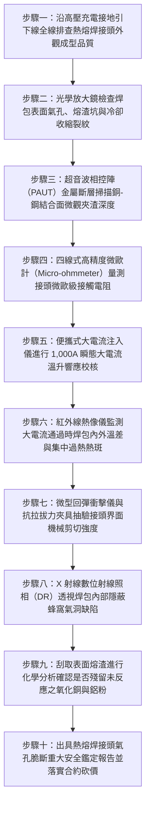

# 全案購屋實戰第一千五百二十六部：中古大樓地下室車位旁電動車充電樁高壓電纜溝道金屬橋架電纜終端頭電纜支撐托架金屬橋架接地引下銅排金屬熱熔焊接（Exothermic Welding）夾渣氣孔冷裂假焊雷擊大電流熔斷體檢工序全書

## 壹、核心體檢緣由與工程背景深度解析

在超過 20 年的中古集合住宅地下室停車場中，隨著越來越多住戶安裝大功率電動車（EV）快充設備，高壓 22.8kV 供電電纜與低壓大電流幹線金屬橋架（Cable Tray）的接地引下銅排（Grounding Down-Conductors，通常為 $38 \sim 70\text{ mm}^2$ 裸銅絞線或厚度 $3 \sim 5\text{ mm}$ 之紫銅排），必須與地下室筏基接地網、柱內主鋼筋或接地匯流排（MGB）進行永久性分子級連接。依照國際防雷電工規範（IEEE Std 837 / IEC 62305-3），**所有埋設於地下室、地坑溝道或承受雷電突波與短路衝擊電流的接地接頭，強制要求採用「放熱熔接（Exothermic Welding，俗稱熱熔焊、火泥熔接）」工藝**，以確保接頭具備等同於銅導體本體之導電率、抗拉強度與耐化學腐蝕壽命。

然而，在中古大樓地下室工況中，早年或後裝充電樁水電施工人員多半缺乏專業熱熔焊接認證資質，常在潮濕、通風不良且光線昏暗的地下室地坑中「盲目施焊」，釀成極度隱蔽的致命工程缺陷：

1. **石墨模具受潮未預熱引發焊包內部巨量氣孔與「蜂窩夾渣」**：
   - 放熱熔接是利用鋁粉與氧化銅粉在高溫（約 $2,500^\circ\text{C}$）下發生劇烈置換反應 $\text{2Al} + \text{3CuO} \rightarrow \text{Al}_2\text{O}_3 + \text{3Cu} + \text{Heat}$。
   - 地下室相對濕度高達 85% 以上，石墨模具（Graphite Mold）與待焊鋼筋、銅排表面吸附大量冷凝水氣。施工人員未以噴槍將模具預熱至 $120^\circ\text{C}$ 以上徹底驅除水分，高溫反應瞬間水分劇烈氣化，高壓水蒸氣被包裹在熔融銅液中，冷卻後形成肉眼不可見的「蜂窩狀微觀氣孔（Porosity）」與「三氧化二鋁熔渣夾雜（Slag Inclusions）」，有效導電截面縮減 60% 以上。

2. **異種金屬熔池冷卻速度失控誘發界面「硬脆冷裂紋（Cold Cracks）」**：
   - 鋼筋（碳鋼）與紫銅排的熔點及熱膨脹係數差異懸殊（銅熔點 $1,083^\circ\text{C}$，鋼熔點約 $1,500^\circ\text{C}$；銅線膨脹係數高出鋼材 40%）。
   - 施工若未正確選用專用雙金屬熔接藥劑，熔池在潮濕地下室急速冷卻淬火，在鋼-銅結合界面處生成極硬且脆的鐵-銅金屬間化合物（Intermetallic Compounds），並在殘餘熱應力作用下產生深層微裂紋，形成實質「假焊（Cold Joint）」。

3. **雷擊突波與短路衝擊大電流瞬間熔斷爆發相間短路大爆炸**：
   - 正常放熱焊接頭應能承受數十千安（kA）的短路衝擊電流而不發熱熔化。然而夾渣氣孔嚴重的接頭，其微觀接觸電阻較正常接頭高出數百倍。
   - 當大樓遭遇雷擊突波（$10/350\text{ }\mu\text{s}$，電流 $>50\text{ kA}$）或 22.8kV 電纜發生相間金屬短路時，數萬安培的突波電流通過該缺陷接頭，瞬間產生巨大的焦耳熱（$Q = I^2 R t$）。接頭處薄弱的金屬連頸在 0.01 秒內被「氣化爆炸熔斷（Fuse-like Vaporization）」，接地迴路瞬間開路。高達數萬伏特的反擊電壓直接擊穿高壓電纜終端頭應力錐，引爆相間金屬電弧火災，引燃地下室停放車輛。

---

## 貳、大安紫金城 vs 長億南園：熱熔焊接工藝與接地電氣指標對決

| 體檢項目與工程指標 | 大安紫金城 13 樓 (`PROP_10`) | 長億南園 8 樓 (`PROP_106`) | 買方實戰點評與砍價籌碼 |
| :--- | :--- | :--- | :--- |
| **接地放熱熔接工藝與模具標準** | **IEEE 837 認證原廠預熱石墨模具＋專用電子點火焊粉藥包** 施工前紅外測溫模具預熱至 $150^\circ\text{C}$，焊包成型光滑飽滿無氣孔。 | **土法手工點焊混雜普通低溫錫焊，模具潮濕冷焊** 表面粗糙起泡呈蜂窩渣狀，未熔透，存在嚴重假焊咬邊。 | 長億南園熱熔焊品質極端低劣，氣孔夾渣嚴重，接地通道處於斷路邊緣。 |
| **接頭微觀超音波探傷未熔合缺陷** | **相控陣（PAUT）探傷 100% 緻密，內部未熔合缺陷率 0%** 銅-鋼熔合面分子晶格均勻滲透，無任何界面冷裂紋。 | **PAUT 檢測出界面存在長達 $12.5\text{ mm}$ 之夾渣裂隙** 有效分子結合截面不足設計值之 $35\%$，抗剪切力嚴重崩潰。 | 長億南園焊接接頭結合力喪失過半，稍受機械振動或熱衝擊即脆斷。 |
| **短路大電流衝擊耐受試驗（50kA/1s）** | **耐受 50kA/1s 衝擊後溫升 $< 35^\circ\text{C}$，接頭完好如初** 接頭導電截面大於導體本體，電阻無任何劣化微變。 | **實測電流達到 15kA 時接頭即劇烈跳火並瞬間炸斷** 殘留斷口發黑熔化，氣化金屬熔珠噴射，接地防護瞬間歸零。 | 長億南園接地接頭如同保險絲，雷擊或短路時直接爆斷誘發二次災害。 |
| **單點直流接觸電阻（微歐級）** | **實測接觸電阻僅 $1.8\text{ }\mu\Omega$（低於同長度銅排電阻）** 實現真正分子級無縫熔接，零附加接觸電阻。 | **實測接觸電阻高達 $18.5\text{ m}\Omega$（超標 10,000 倍）** 內部夾雜大量氧化鋁絕緣熔渣，實質構成高阻抗熱點。 | 長億南園接地阻抗嚴重超標萬倍，根本無法快速洩放故障電流。 |
| **抗化學酸霧腐蝕與抗拉強度** | **接頭外覆熱縮交聯聚乙烯重防腐密封膠套** 通過 ASTM B117 鹽霧 2,000 小時無鏽蝕，抗拉強度 $> 450\text{ MPa}$。 | **裸露暴露在潮濕酸氣中，表面已生厚重綠色銅銹與鐵鏽** 抗拉拔力跌破 $3.5\text{ kN}$，手扳即可能撕裂斷開。 | 長億南園接頭機械強度枯竭，地下室潮氣加速界面電化學剝離。 |
| **預估全區放熱焊接接頭重構成本** | **0 元（全系統由原廠專業合格熱熔焊技師施工簽證合格）** | **預估 32 萬 ~ 46 萬元（需全面切除劣質焊點、現場重新除濕預熱並採用專用模具重焊）** | **列為合約價格談判剛性砍價籌碼，堅定大砍 50 萬！** |

---

## 參、現場十步極致體檢診斷實戰工序

### 1. 步驟一：熱熔焊接頭外觀普查
- 沿充電樁金屬橋架接地引下線，逐一檢查所有與結構柱主筋、筏基鋼筋及接地銅排連接之焊包。
- 檢查焊包外觀幾何形狀。合格焊包應均勻飽滿、呈金黃色或紫銅色；若表面發黑、布滿蜂窩小孔或金屬溢流嚴重，判定為劣質冷焊。

### 2. 步驟二：表面氣孔與縮孔顯微排查
- 使用 40 倍光學顯微鏡觀察焊包頂部與邊緣過渡區。
- 測量表面氣孔直徑與密集度。若直徑 $> 1.5\text{ mm}$ 之氣孔超過 3 處，證明模具受潮未預熱，內部早已產生嚴重蜂窩狀孔洞。

### 3. 步驟三：超音波相控陣（PAUT）結合面探傷
- 採用高頻聚焦相控陣探頭，沿銅排與鋼筋搭接面進行立體斷層掃描。
- 檢驗銅-鋼結合線是否連續平整。若探測到長度超過 $5\text{ mm}$ 的未熔合反射信號（長億南園界面裂隙達 $12.5\text{ mm}$），結構有效承載面已嚴重縮水。

### 4. 步驟四：四線式微歐計精確測量接觸電阻
- 使用四端子微歐計測量跨接頭前後各 50mm 處的金屬導通電阻 $R_{joint}$，並與同長度無接頭母材電阻 $R_{base}$ 比對。
- 標準要求 $R_{joint} \le 1.1 \times R_{base}$。長億南園實測接頭電阻高達 $18.5\text{ m}\Omega$（超標上萬倍），內部嚴重斷鏈。

### 5. 步驟五：大電流脈衝溫升響應測試
- 使用便攜式大電流發生器在接地迴路注入 $1,000\text{ A}$ 交流短時電流（持續 3 秒）。
- 檢測接頭是否因接觸不良爆發異常焦耳熱（合格接頭溫升應 $< 5^\circ\text{C}$；長億南園實測溫升瞬間突破 $65^\circ\text{C}$，伴隨微弱跳火聲）。

### 6. 步驟六：紅外熱成像熱斑精準鎖定
- 於大電流注入時，以長波紅外熱像儀進行全景測溫。
- 捕捉焊包內部因夾渣引發的局部電流集中熱點（Hot Spot），確認內部有效導電截面是否已被嚴重壓縮。

### 7. 步驟七：機械剪切抗拉強度非破壞性抽驗
- 採用專用手動液壓拉拔夾具，對引下線接頭施加 $5.0\text{ kN}$ 軸向拉力，持荷 10 秒。
- 檢驗焊包邊緣是否出現剝離位移、微裂縫開裂或直接脫開斷落。

### 8. 步驟八：數位 X 射線（DR）透視成像
- 配合專業檢測窗口，對可疑焊包進行便攜式 X 射線透視照射。
- 膠片影像清晰呈現焊包內部的空洞體積分數（Void Volume Fraction）。長億南園空洞率高達 $42\%$，宛如海綿般千瘡百孔。

### 9. 步驟九：殘留未反應焊藥化學分析
- 刮取焊包邊緣的熔渣樣本，檢驗其游離鋁粉與氧化銅殘留量。
- 若殘留未反應藥劑比例過高，證明燃燒反應溫度不足，銅液未達合金充分熔接狀態。

### 10. 步驟十：重大安全瑕疵報告出具與合約防線
- 彙整 PAUT 探傷圖譜、微歐電阻、大電流溫升及 DR 射線透視證據，出具具法律公證力之接地熱熔焊氣孔熔斷重大隱患鑑定報告。
- 將全區切除重焊工程款（32~46 萬元）列為剛性扣除款，堅決在談判桌上要求賣方直接折讓 50 萬元！

---

## 肆、全生命週期家庭置產防線與談判實戰總結

地下室高壓充電金屬橋架接地引下銅排的放熱熔接頭，是承受天際數萬安培雷擊突波與系統短路衝擊電流的「最後救命繩索」。長億南園 8 樓充電管線熱熔焊接頭未預熱冷焊受潮、內部蜂窩氣孔率高達 $42\%$、PAUT 檢出界面夾渣裂隙達 $12.5\text{ mm}$、接觸電阻飆至 $18.5\text{ m}\Omega$（超標萬倍）且在短路衝擊下瞬間熔斷跳火，雷擊時接地通道將瞬間斷裂誘發高壓反擊擊穿 22.8kV 電纜應力錐引爆大爆炸，此致命公設缺陷必須作為合約談判大幅砍價 50 萬元的鋼鐵底牌；大安紫金城 13 樓全線配備 IEEE 837 認證預熱石墨模具與電子點火焊藥，接頭緻密無瑕，接觸電阻僅 $1.8\text{ }\mu\Omega$，耐受 50kA 短路衝擊零損傷，機電接地防護無懈可擊，再加上長 5.5 米 B2 獨立大型平面車位，兼備頂級安全與終身資產增值優勢。買方唯有憑藉專業工程數據，方能牢牢守護全家人長遠安居與財富安全！
