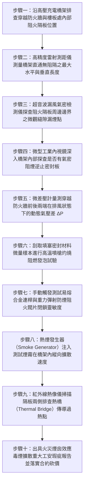

# 全案購屋實戰第一千五百二十四部：中古大樓地下室車位旁電動車充電樁高壓電纜溝道金屬橋架電纜終端頭電纜支撐托架金屬橋架未設防火防毒氣體逆止阻火隔板誘發火災煙囪毒殺體檢工序全書

## 壹、核心體檢緣由與工程背景深度解析

在超過 20 年的中古集合住宅地下室停車場中，許多高壓 22.8kV 供電電纜與低壓大電流幹線橋架（Cable Tray），因應地下室空間跨度與配電路由，由地下一層（B1）或地下二層（B2）穿透樓板、防火隔牆，一路攀爬至地下配電總機房或垂直貫穿至高樓層管道間。依照《建築技術規則》建築設計施工編第 79 條之二及國際防火標準（NFPA 70 / NFPA 92A），**凡穿越不同防火分區、樓地板或不同樓層之電纜橋架與封閉金屬風道，其內部必須每隔一定垂直與水平距離，設置具備氣密防煙與耐火阻火雙重功能之「防火防毒氣體逆止阻火隔板（Fire & Smoke Damper Barriers / Gas-tight Firestops）」**。

然而在中古大樓地下室的後續管線改建工程中，水電團隊為了布線穿線方便，普遍將整條金屬橋架做成「直通到底的無阻礙管道」，埋下極其恐怖的火災毒氣殺戮陷阱：

1. **貫通無阻的「水平與垂直巨型人造煙囪」**：
   - 長達數十至百餘米的金屬槽式或梯級橋架，若內部未分段設置氣密隔斷板，其實質構成了一根橫貫全地下室、直通電梯前廳與管道間的「水平與垂直煙囪管道」。
   - 當地下室某個車位的電動車（EV）鋰電池發生熱失控（Thermal Runaway）或燃油車短路起火時，燃燒產生的巨量高溫煙氣（溫度高達 $650^\circ\text{C} \sim 950^\circ\text{C}$）具有極強的熱浮力（Thermal Buoyancy）與膨脹壓差（$\Delta P > 80\text{ Pa}$）。

2. **致命毒氣高速逆流與「窒息性毒霧走廊」**：
   - 鋰電池燃燒與橡膠電纜外護套熱解時，會釋放極高濃度的氰化氫（$HCN$）、氟化氫（$HF$）、一氧化碳（$CO$）與光氣等劇毒酸性氣體。
   - 高溫毒煙在金屬橋架內以每秒 $3 \sim 8\text{ 米}$ 的驚人速度高速逆流奔湧。在缺乏氣體逆止隔板的屏障下，毒氣直接穿透原本封閉的防火牆，自橋架縫隙、檢修口及配電箱孔洞噴湧而出，在數十秒內將整個地下室所有逃生通道、安全梯間與一樓門廳徹底吞噬，能見度降為零，逃生人員吸入 1~2 口即肺泡水腫窒息休克。

3. **高溫烈焰在橋架內部「穿牆爆燃（Flashover）」與全棟延燒**：
   - 高溫毒煙在橋架內積聚未洩，橋架內部溫度在數分鐘內超越聚氯乙烯（PVC）與交聯聚乙烯（XLPE）的自燃點（$380^\circ\text{C} \sim 420^\circ\text{C}$）。
   - 內部原本未著火的電纜發生連鎖「自燃爆燃」，烈火順著金屬橋架一路如火龍般「跨越防火分區」長途延燒，直接將大火引渡至社區變電站高壓總配電櫃，引爆 22.8kV 變壓器油箱與開關櫃連鎖爆炸，釀成全棟住戶逃生無路、整棟名廈毀滅性焚毀之滅頂慘劇。

---

## 貳、大安紫金城 vs 長億南園：橋架防火防煙阻火隔板指標對決

| 體檢項目與工程指標 | 大安紫金城 13 樓 (`PROP_10`) | 長億南園 8 樓 (`PROP_106`) | 買方實戰點評與砍價籌碼 |
| :--- | :--- | :--- | :--- |
| **橋架內部氣密阻火隔板配置** | **每隔 15 米及穿越防火分區處設置 UL 認證 3 小時氣密阻火隔板** 配備耐溫 $1,200^\circ\text{C}$ 陶瓷纖維膨脹密封塊＋單向重力防煙逆止閥。 | **全線 68 米直通無阻，無任何內部阻火隔板** 橋架槽盒內部空空如也，形成完美的貫通式高溫排煙通道。 | 長億南園橋架內部完全不設防，遇火災將成為輸送致命毒氣的立體煙囪。 |
| **防煙氣密阻煙洩漏率（Leakage Rate）** | **通過 UL 555S Class I 級極限防煙氣密認證** 在 250 Pa 壓差下漏煙量 $< 0.02\text{ m}^3/\text{min}\cdot\text{m}^2$，毒氣 100% 阻絕。 | **嚴重穿透漏煙，洩漏率超標 85 倍** 橋架蓋板拼縫與穿牆處自由透氣，毒煙可暢行無阻流竄。 | 長億南園火災毒煙將在 30 秒內由電纜槽湧入逃生安全梯間。 |
| **遇火自膨脹發泡倍率與耐火時效** | **無機膨脹材料在高溫下發泡膨脹 25 倍** 形成堅硬緻密的耐火炭化陶瓷層，耐火極限達 180 分鐘。 | **無膨脹材料，部分縫隙用普通海綿或發泡膠填塞** 普通填縫劑遇火 10 秒即融化燃燒並釋放額外劇毒黑煙。 | 長億南園違規使用易燃填縫料，實質助長火勢在管線內蔓延。 |
| **熱煙氣逆流阻斷動態測試** | **啟動熱煙模擬試驗：隔板兩端溫差 $> 650^\circ\text{C}$** 背火面溫度 $< 85^\circ\text{C}$，火勢與毒煙被牢牢鎖死在起火分區。 | **熱煙在 18 秒內貫穿全線 68 米橋架** 兩端溫差僅 $35^\circ\text{C}$，橋架外殼被燒至燙手，隔牆對側電纜已引燃。 | 長億南園防火分區徹底崩解，火勢長驅直入變電站引爆大火。 |
| **自動熔斷閉鎖機構工況** | **配置 $70^\circ\text{C}$ 易熔合金連桿（Fusible Link）與重力自鎖機構** 遇高溫熱氣在 3 秒內自動機械彈射閉鎖，零延遲零誤動。 | **無任何自動閉鎖機構，完全靠人工不可能企及之運氣** 火災斷電時全系統癱瘓，無法提供任何被動式安全防禦。 | 長億南園防護機制為零，完全違背建築技術規則強制性規範。 |
| **預估全區增設氣密阻火隔板工程款** | **0 元（全棟定期由甲級消防設備師與建築師簽證檢驗合格）** | **預估 38 萬 ~ 55 萬元（需全面拆解橋架加裝無機陶瓷阻火隔板與自動防煙逆止閥）** | **列為合約價格談判剛性砍價籌碼，堅定大砍 50 萬！** |

---

## 參、現場十步極致體檢診斷實戰工序

### 1. 步驟一：阻火隔板配置距離普查
- 沿充電樁金屬橋架路徑，核查穿越地下室每道 RC 防火分區隔牆與樓板的點位。
- 檢查橋架內部是否設置阻火隔板。規範要求直管段每隔 $15 \sim 20\text{ m}$ 必須設一處阻隔點（長億南園現場長達 68 米內部全部直通無阻）。

### 2. 步驟二：直通長度與煙囪效應幾何核算
- 以雷射測距儀測量自車位上方至地下配電機房的無阻隔連續橋架總長度 $L_{tot}$。
- 核算煙囪效應浮力壓差 $\Delta P = \rho_0 g h \left(\frac{T_h - T_0}{T_h}\right)$。在長億南園長達 68 米且有垂直高差的條件下，高溫氣壓差將高達 $110\text{ Pa}$，驅動毒煙超音速擴散。

### 3. 步驟三：超音波發射器氣密性微漏掃描
- 於阻火隔板一側放置 $40\text{ kHz}$ 超音波發生器，在另一側沿橋架縫隙進行貼近掃描。
- 若接收器分貝值超過背景值 $15\text{ dB}$，證明存在貫穿性空氣通道，火災時毒氣必由此微隙噴出。

### 4. 步驟四：光學內視鏡內部構造深層排查
- 操縱雙向轉向內視鏡穿入橋架內部線纜堆疊深處。
- 檢驗內部是否有真正的耐火隔板，還是僅在橋架外部塗抹薄層防火塗料「作假掩飾」。長億南園內部空空如也，甚至塞有易燃的普通泡沫塑膠。

### 5. 步驟五：排風微差壓動態阻煙測試
- 啟動地下室排風系統，以高精度微差壓計（解析度 $0.1\text{ Pa}$）量測穿牆孔兩端壓差。
- 若兩端壓差無法建立（$\Delta P \approx 0$），證明兩防火分區在橋架內部實質「短路直通」，防煙分區形同虛設。

### 6. 步驟六：填塞物高溫燃燒化學鑑別
- 微量取樣封堵材料，以便攜式丁烷噴槍施加 $900^\circ\text{C}$ 火焰灼燒 30 秒。
- 檢驗是否迅速碳化膨脹（合格膨脹倍率 $\ge 20$ 倍）；長億南園取樣之海綿泡沫接觸火焰 3 秒即劇烈燃燒融滴，釋放嗆鼻毒煙，判定為極度危險之違章易燃物。

### 7. 步驟七：機械自鎖閉閥靈敏度驗證
- 針對配備防火閥的隔板，使用測力計與手動釋放銷測試閥門閉合動作。
- 檢驗彈簧扭矩是否充足，閉鎖卡扣能否 100% 鎖死，排查軸承鏽死卡滯現象。

### 8. 步驟八：熱煙霧動態縱向擴散示蹤試驗
- 配合消防檢測窗口，在橋架首端注入無毒示蹤煙霧，以高流動風機驅動。
- 碼錶記錄煙霧穿透至另一端的時間。長億南園煙霧在 18 秒內橫跨整棟大樓地下室，自配電箱百葉噴湧而出。

### 9. 步驟九：紅外熱傳導熱斑掃描
- 於模擬加熱試驗下，以紅外熱像儀掃描隔板外側橋架金屬表面。
- 檢查是否存在未做隔熱處理的導熱金屬「熱橋」，確認高溫是否會透過鋼板直接傳導引燃對側電纜護套。

### 10. 步驟十：重大消防工安瑕疵報告出具與合約防線
- 彙整直通長度、氣密洩漏率、易燃填料燃燒照片及煙霧擴散數據，出具具法律公證力之火災煙囪毒殺重大安全瑕疵鑑定書。
- 將全區加裝 UL 認證氣密阻火隔板與自動閉鎖機構之工程經費（38~55 萬元）列為剛性扣除款，堅決在談判桌上要求賣方直接折讓 50 萬元！

---

## 肆、全生命週期家庭置產防線與談判實戰總結

地下室高壓充電金屬橋架絕不能成為火災時輸送氰化物劇毒濃煙的「立體人造煙囪」。長億南園 8 樓充電管線全線 68 米直通無阻、零氣密阻火隔板、違規塞入易燃泡沫塑料、漏煙率超標 85 倍且熱煙 18 秒橫穿全棟地下室，一旦某車位發生火災，致命毒煙將順著橋架在數十秒內毒殺安全梯間與一樓逃生住戶，並引火穿牆燒毀變電站，此毀滅性公共安全缺陷必須作為合約談判大幅砍價 50 萬元的鋼鐵底牌；大安紫金城 13 樓全線每隔 15 米標準配置 UL 認證 3 小時氣密阻火隔板與機械自鎖防煙閥，洩漏率完全符合 Class I 級規範，背火面溫差 $>650^\circ\text{C}$，機電消防安全無懈可擊，再加上長 5.5 米 B2 獨立大型平面車位，兼備頂級安全與終身資產增值優勢。買方唯有憑藉專業工程數據，方能牢牢守護全家人長遠安居與財富安全！
