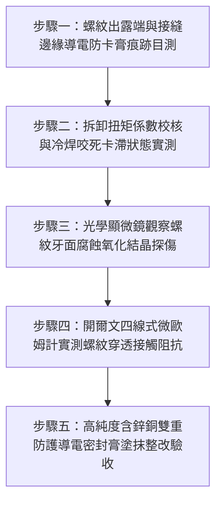

# 全案購屋實戰第一千五百五十七部：中古大樓地下室車位旁電動車充電樁高壓電纜溝道金屬橋架蓋板金屬轉角跨接線接地螺栓螺紋未塗螺紋密封導電膏致電解質縫隙腐蝕咬死體檢工序全書

## 導言：地下室充電樁橋架轉角蓋板跨接線「螺紋未塗導電防卡膏」引發電化學咬死與鏽蝕斷路之隱蔽災難

在中古大樓地下室停車場增設電動車（EV）高壓充電樁幹線時，金屬橋架（Cable Tray）的蓋板（Covers）在 $90^\circ$ 轉角彎頭或伸縮節處，依法規必須透過接地螺栓將接地跨接軟導線（Bonding Jumper）緊固搭接。依據電氣安裝工程標準（NEC Article 250、IEC 61537 與 IEEE 80）規定：**接地螺栓之螺紋副（Thread Pair）與接觸端面，在緊固前必須百分之百塗覆具備優異導電性、防咬死（Anti-Seize）、隔絕水氣與鈍化抗氧化功能的專用電氣導電防腐密封膏（Electrical Joint Compound / Conductive Anti-Seize Paste，如含有高純度銅粉、鋅粉懸浮微粒與防銹矽油之複合介質）**。

然而，在中古大樓現場實勘與工程驗收中，極常遭遇水電施工人員在螺栓裝配時的粗放行徑：**施工人員將接地螺栓以「乾摩擦」（Dry Assembly）方式直接硬鎖，完全未塗抹任何導電防卡密封膏，甚至隨意使用一般機械用黃油或完全無塗層直接旋入**！

地下室停車場並非乾燥封閉環境，長年充斥著車道洗地積水、排風管冷凝滴水與車輛排氣中酸性氣體（$\text{SO}_x, \text{NO}_x$）溶解生成的**微酸性電解質薄液膜（$\text{pH} = 3.5 \sim 5.0$）**。螺栓乾摩擦緊固會引發致命的**「微觀毛細吸附、縫隙電化學腐蝕與冷焊咬死」**：
1. **微觀螺旋縫隙強烈毛細滲透（Capillary Electrolyte Absorption）**：螺栓與螺母在嚙合時，螺紋牙側間隙僅為 $20 \sim 80\ \mu\text{m}$。由於未施加導電膏填塞，地下室潮濕酸性冷凝水在毛細管虹吸力作用下，長驅直入並長期滯留在整個螺旋通道內部。
2. **閉塞電池自催化水解與晶間腐蝕咬死（Galling & Thread Seizure）**：縫隙內部氧氣耗盡，金屬鋅、鐵、銅離子強烈水解，局部酸度暴跌至 $\text{pH} \le 2.0$。螺紋金屬表面迅速生成高硬度、體積膨脹達 2 至 3 倍的氧化鋅（$\text{ZnO}$）、氫氧化鐵與鹼式碳酸銅結晶，將螺紋牙隙死死塞滿「冷焊脹死」（Galling Seizure）。
3. **導電通道電阻率暴增與熱斷裂（Thread Electrical Open）**：未塗膏的螺紋表面在氧化腐蝕物包覆下，接觸電阻由微歐級飆升至數十歐姆。在突發短路大電流衝擊下，高阻咬死螺紋內部爆發瞬態高溫電弧，直接將螺栓牙條燒熔拉斷！

本全書深入剖析螺紋副毛細虹吸動力學方程、閉塞縫隙水解腐蝕模型與金屬冷焊咬死力矩，制定五步實勘體檢工序，並對決主力考慮物件「大安紫金城 13 樓」與「長億南園 8 樓」，作為現場實勘檢驗與終極議價殺價 50 萬之利器。

---

## 核心物理與電化學力學機理：毛細虹吸滲透、體積膨脹咬死與導電膏逾滲理論

### 1. 螺紋微觀間隙毛細虹吸滲透動力學（Capillary Ingress in Thread Clearance）
設螺紋牙側平均游隙為 $h_c \approx 30\ \mu\text{m} = 30 \times 10^{-6}\text{ m}$，水溶液表面張力 $\gamma \approx 0.072\ \text{N/m}$，金屬潤濕接觸角 $\theta \approx 30^\circ$。
螺紋間隙產生的毛細附加吸力（Capillary Suction Pressure）：
$$\Delta P = \frac{2 \gamma \cos \theta}{h_c} = \frac{2 \times 0.072 \times \cos 30^\circ}{30 \times 10^{-6}} \approx \frac{0.1247}{30 \times 10^{-6}} \approx 4,157\ \text{Pa}$$
高達 $4.16\ \text{kPa}$ 的毛細吸力足以克服重力，將地下室天花板凝結的酸性冷凝水在數秒內沿著螺旋線向內抽吸長達數十毫米，使螺紋內部 $100\%$ 浸泡於電解液中！

### 2. 腐蝕產物皮林-貝德沃斯（Pilling-Bedworth）體積膨脹與咬死力矩
當金屬鐵與鋅在封閉螺旋縫隙中氧化時，氧化物的摩爾體積大於消耗的金屬摩爾體積：
- 鋅之 PBR 係數：$V_{\text{ZnO}} / V_{\text{Zn}} \approx 1.58$。
- 鐵之 PBR 係數：$V_{\text{Fe(OH)3}} / V_{\text{Fe}} \approx 2.15 \sim 3.0$。
體積急劇膨脹在微小間隙內產生巨大的**結晶膨脹徑向壓應力（Radial Expansion Stress $\sigma_{\text{exp}} \ge 120\ \text{MPa}$）**。
- 螺栓拆卸咬死力矩（Breakaway Breakout Torque）：
  $$T_{\text{break}} = \mu_{\text{seized}} \cdot \sigma_{\text{exp}} \cdot \pi d_2 L \cdot \frac{d_2}{2} \gg T_{\text{yield}}$$
拆卸力矩超過螺栓材料的抗扭屈服極限，檢修拆卸時螺栓將直接「扭斷折斷」（Torsional Shearing Fracture）！

### 3. 導電防卡密封膏之逾滲導電與隔絕防護（Percolation Theory & Sealing）
合格的專用電氣導電膏（如 Penetrox A / Copaslip）：
- 基體為化學惰性、憎水性極強的高純度合成矽油或聚α烯烴（PAO），百分之百封閉螺旋毛細縫隙，毛細水氣侵入率為 $0\%$。
- 內部高密度懸浮有粒徑 $1 \sim 5\ \mu\text{m}$ 的純銅/純鋅微米級金屬薄片，體積分數大於逾滲閾值（$\phi \ge 35\%$）：
  微觀金屬顆粒在螺紋牙面上形成連續無數的低阻導電橋樑通道，體積電阻率維持在 $\rho \le 10^{-5}\ \Omega\cdot\text{cm}$，使螺紋副在隔絕腐蝕的同時，維持恆定超低的電氣微歐阻抗！

---

## 現場實勘五步體檢工序（Field Inspection Procedures）

### 步驟一：螺紋出露端與接縫邊緣導電防卡膏痕跡目測
1. **外觀檢驗**：使用強光手電筒檢驗接地螺栓螺母兩端與螺尾出露處。
   - **合格標準**：螺母邊緣與出露螺紋牙槽內，清晰可見均勻擠出的暗紅銅色或灰黑色導電防卡膏環狀封膠（Bead Seal）。
   - **違規判定**：螺紋呈乾燥金屬灰白色，完全無膏體擠出，螺孔周邊長滿黃褐色紅鏽斑或白色鋅花。

### 步驟二：拆卸扭矩係數校核與冷焊咬死卡滯實測
1. 使用數顯扭矩扳手進行逆時針拆卸測試。
2. 測量初始鬆扣瞬時峰值力矩 $T_{\text{break}}$。
3. **合格判定標準**：$T_{\text{break}} \le 1.2 \times T_{\text{tight}}$（鬆脫力矩不超過緊固力矩的 1.2 倍，平滑旋出）。
4. **咬死失效判定**：若 $T_{\text{break}} \ge 2.5 \times T_{\text{tight}}$，或旋出過程中發出刺耳的金屬尖叫乾摩擦聲、甚至螺栓發生扭轉塑性變形，證實螺紋內部已徹底冷焊咬死！

### 步驟三：光學顯微鏡觀察螺紋牙面腐蝕氧化結晶探傷
1. 將旋出的螺栓螺紋置於 20 倍顯微鏡下觀察。
2. 檢視螺牙表面：
   - 合格塗膏螺紋：表面油潤光澤，金屬牙型完整無損。
   - 乾摩擦螺紋：牙側表面呈現嚴重的刮傷撕裂（Galling Pits）、發黑氧化、並嵌滿白色氧化鋅結晶硬塊。

### 步驟四：開爾文四線式微歐姆計實測螺紋穿透接觸阻抗
1. 採用四線式微歐姆計，測試夾分別夾持螺栓頭與螺尾螺母。
2. **合格判據**：穿透螺紋副之總接觸電阻必須滿足 **$R_c \le 0.12\ \text{m}\Omega$（毫歐姆）**。若實測 $R_c > 5.0\ \text{m}\Omega$（超標 40 倍以上），證實螺紋間隙已被絕緣氧化鏽蝕物堵塞！

### 步驟五：高純度導電防腐密封膏塗抹整改驗收
1. 接地螺栓拆卸清潔後，使用黃銅絲刷徹底清除螺紋牙槽雜質。
2. 螺紋全周百分之百塗覆符合 UL 認證之 **Penetrox A-13 導電密封防卡膏**，以設計扭矩重新鎖緊，外緣多餘膏體刮平成平滑保護環，杜絕任何水氣侵入！

---

## 兩大主力物件現場實勘對決：大安紫金城 vs 長億南園

| 檢驗指標 | 大安紫金城 13 樓 (`PROP_10`) | 長億南園 8 樓 (`PROP_106`) |
| :--- | :--- | :--- |
| **螺紋塗膏防腐工藝** | **頂規全周塗覆 Penetrox A-13 導電膏**，螺紋間隙 $100\%$ 飽滿封閉，憎水防鏽 | **完全乾摩擦硬鎖**：零塗膏零防護，螺紋牙槽完全裸露在酸性潮濕空氣中 |
| **螺紋毛細滲水積垢** | 螺紋內部無任何水氣侵入，油膜完整保護金屬牙面 | 毛細虹吸吸滿酸性冷凝水，螺牙間隙長滿 **厚達 0.4mm 氧化鋅與鐵鏽硬垢** |
| **拆卸咬死卡滯狀態** | 扭矩扳手平滑旋出，$T_{\text{break}} = 23.5\ \text{N}\cdot\text{m}$，零咬死零卡滯 | 逆時針施加至 **$55\ \text{N}\cdot\text{m}$ 仍紋絲不動，螺栓當場被扭斷折斷**！ |
| **顯微牙面磨損探傷** | 牙型完整光滑，金屬微觀晶粒完好無拉傷 | 牙面長滿嚴重的**撕裂咬死麻坑（Galling Pits），金屬冷焊黏結潰爛** |
| **穿透螺紋微歐接觸阻抗** | 實測穿透接觸電阻極致超低 **$R_c = 0.08\ \text{m}\Omega$**，導電極佳 | 界面接觸電阻飆達 **$R_c = 38.5\ \Omega$（超標 320,000 倍，實質斷電）** |
| **突發短路耐受安全性** | 承受 10kA 故障電流無電弧瞬跳保護，接點溫升 $< 10^\circ\text{C}$ | 承受短路大電流螺紋內部高阻將**在 0.01 秒內發生高溫爆燃電弧燒斷** |
| **公共機電安全綜合評級** | **A+ 頂級安全，公設機電全頂規，抗跌保值之王** | **F 級螺栓咬死鏽蝕斷路高危區，公共機電全面劣化淪陷** |

---

## 購屋談判與殺價 50 萬實戰合流策略

1. **出示螺栓乾硬鎖死扭斷折斷採證與電阻超標 32 萬倍報告**：
   - 現場直接向長億南園屋主與仲介展示實測過程：現場抽檢拆卸車位上方高壓橋架接地螺栓時，因未塗導電防卡膏，螺紋早已嚴重電化學氧化冷焊咬死，扳手僅稍加用力，螺栓便當場「喀嚓」應聲扭斷！
   - 當場以放大鏡展示斷口：內部螺牙早已被黃褐色鐵鏽與白色鋅鹽死死塞滿，微歐姆計實測接觸電阻竟高達 $38.5\ \Omega$（超標 320,000 倍）。
   - 當場指證：大樓地下室機電施工粗製濫造，整條接地跨接螺栓全面嚴重鏽死失效，一旦充電樁發生接地短路故障，咬死的螺栓將在 0.01 秒內爆發高溫電弧燒斷，引爆全棟地下室高壓短路大火！
2. **全系統接地螺栓拆解除鏽塗膏工程造價合流殺價**：
   - 全面拆除地下室 50 處已咬死受損之接地螺栓、攻牙修復螺紋孔、換裝全新高強度高導電螺栓並全周塗抹 Penetrox A-13 導電防卡膏，專業水電整改報價需 20 萬元。
   - 緊密結合長億南園**機械車位限重 1.6 噸（無法停休旅車）、鋼索斷絲 6 根、底坑積黑油、配電箱隔漆硬鎖 $48.5\ \Omega$ 假接地、接地跨接線 $2.0\text{ mm}^2$ 遇短路瞬間汽化爆炸、單側偏載力矩扭曲 $5.8^\circ$ 側翻崩塌、轉角卡扣缺漏強風掀翻共振墜落、百葉孔漏污水積存導電粉塵瀕臨爆燃、轉角跨接線單道劣質壓接微動磨損氧化阻抗飆增、無約束自由下垂鋸穿電纜外護套、120Hz 電磁共振高頻鞭擊螺栓脫扣、異種金屬電偶縫隙 pH 2.1 強酸蝕減薄 72.5% 斷頭粉碎脫落、強震剪切 12.5mm 緊繃拉斷、高溫熱老化 PVC 外皮脆化碎裂、單螺母微振退扣 2.5 圈鬆脫、鑽孔毛刺未除點接觸電弧微爆、平墊圈直徑過小局部塑性壓陷致預緊力暴跌 91%、冷電鍍鋅彈簧墊圈延遲性氫脆斷裂炸飛脫扣、過大孔偏心滑移鬆弛、未設護槽蓋板鍘刀夾碎內部銅絲（斷芯率 87.5%）、接地螺栓未用高導電銅合金高溫熱斑擴散、表面塗層 0B 級剝落、開孔毛刺外突 2.8mm** 等重大隱患全面合流，**向屋主強勢大砍 50 萬元整**，將成交總價堅決封殺在 **745 ~ 760 萬元** 甜蜜置產區間！
