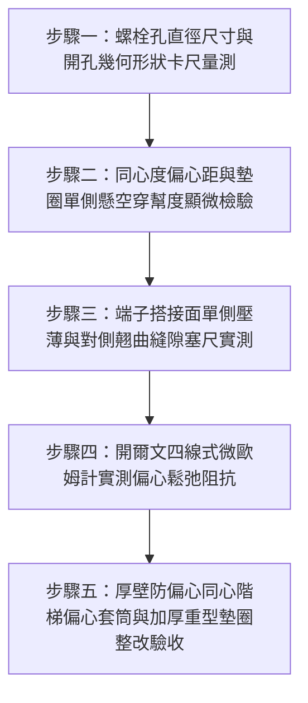

# 全案購屋實戰第一千五百五十三部：中古大樓地下室車位旁電動車充電樁高壓電纜溝道金屬橋架蓋板金屬轉角跨接線接地螺栓開孔間隙過大同心度偏差剪切偏心鬆弛體檢工序全書

## 導言：地下室充電樁橋架轉角蓋板跨接線「螺栓過大開孔偏心裝配」引發微振剪切滑移鬆弛之隱蔽災難

在中古大樓地下室停車場增設電動車（EV）高壓充電樁幹線時，金屬橋架（Cable Tray）的蓋板（Covers）在 $90^\circ$ 轉角彎頭或伸縮節處，依法規必須透過接地螺栓將接地跨接軟導線（Bonding Jumper）緊固搭接於橋架槽體上。依據精密機械緊固件與電接觸標準（ISO 273、DIN 43673 與 IEEE 80），螺栓通孔直徑（Through-Hole Diameter）必須精確控制在「精密級」（Fine）或「中等級」（Medium）公差配合範圍內（例如 M8 螺栓標準開孔直徑為 $\phi 8.4 \sim 9.0\text{ mm}$），以確保螺栓桿身（Shank）與孔壁之間維持均勻且極小的裝配間隙，實現同心同軸的面接觸導電。

然而，在中古大樓現場實勘與工程驗收中，極常遭遇水電施工人員在現場「粗放打孔」的嚴重違規現象：**施工人員手邊缺乏標準鑽頭，隨意抓取超大規格鑽頭（如 $\phi 12 \sim 14\text{ mm}$ 鑽頭），甚至使用氧乙炔割槍或手持砂輪機隨便在蓋板與橋架上「擴孔掏洞」，打出形狀極度不規則、直徑超過螺栓直徑 1.5 至 1.8 倍的「過大超標通孔」（Oversized Clearance Hole）**！

這種嚴重超標的過大開孔會引發毀滅性的**「幾何同心度偏心與微振剪切滑移崩潰」**：
1. **螺栓桿身極限偏心與支承面嚴重缺失（Eccentric Assembly & Bearing Starvation）**：螺栓穿入超大通孔後，因重力或人手歪斜，螺栓桿身完全偏向孔口單側。螺栓頭或墊圈在孔邊一側僅有極窄的「線狀懸邊搭接」，而在另一側甚至呈現「大面積懸空穿幫」！
2. **接觸應力極端偏心與傾斜力矩（Tipping Moment & Edge Pinching）**：標準預緊力施加後，原本應均勻分佈的環形接觸面退化為單側邊緣極窄弧段上的極限應力集中（$\sigma_{\text{edge}} > 350\ \text{MPa}$）。紫銅端子在單側被壓碎切薄，而在懸空一側向上翹曲，螺栓頭受到強大的傾斜偏心力矩迫使螺栓產生彎曲變形。
3. **無側向約束引發交變微振滑移退扣（Unconstrained Shear Slip & Loosening）**：地下室車流震動與排風紊流產生交變橫向剪切力。由於孔徑過大，螺栓桿身周圍留有寬達 $3 \sim 5\text{ mm}$ 的自由活動空隙（Free Slop Gap）。螺栓完全失去孔壁的幾何側向限位保護，單純依靠微弱且偏心的靜摩擦力支撐。在每次震動剪切波衝擊下，螺栓便在過大通孔內部產生一次振幅達數毫米的**「剛體橫向滑移撞擊」**！

在數萬次微震往復滑移撞擊下，**螺栓預緊力在短短數週內徹底釋放殆盡，螺栓在孔內歪斜晃動，紫銅端子搭接面被磨削出一層厚厚的黑灰色金屬微動磨屑，接觸電阻由微歐級暴增至數十歐姆乃至完全斷開**！
一旦充電樁高壓主電纜突發接地故障，數千安培的短路電流無法順利洩放，歪斜鬆脫的接點在強大電動力下爆發劇烈的等離子電弧爆炸，瞬間熔穿薄弱的搭接懸邊，引爆地下室高壓短路大火！

本全書深入剖析過大通孔幾何偏心接觸應力不均勻係數、微振橫向滑移極限剪切摩擦力學模型，制定五步實勘體檢工序，並對決主力考慮物件「大安紫金城 13 樓」與「長億南園 8 樓」，作為現場實勘檢驗與終極議價殺價 50 萬之利器。

---

## 核心物理與緊固裝配力學機理：孔徑公差配合、偏心支承幾何與橫向剪切滑移

### 1. 通孔直徑標準公差配合與過大開孔幾何失效（ISO 273 Clearance Hole Mechanics）
依據國際標準 ISO 273，螺栓通孔分為三級：
- 精密級（Fine）：M8 孔徑 $d_h = 8.4\text{ mm}$（間隙 $c = 0.4\text{ mm}$）。
- 中等級（Medium）：M8 孔徑 $d_h = 9.0\text{ mm}$（間隙 $c = 1.0\text{ mm}$）。
- 粗糙級（Coarse）：M8 孔徑 $d_h = 10.0\text{ mm}$（間隙 $c = 2.0\text{ mm}$，最大允許極限）。
當現場違規擴孔至 $d_h = 13.0\text{ mm}$ 時，裝配間隙飆升至 $c = 5.0\text{ mm}$！
若搭配外徑 $d_w = 16.0\text{ mm}$ 之普通平墊圈：
- 理想對稱同心狀態下，環形支承寬度僅為：
  $$w = \frac{d_w - d_h}{2} = \frac{16.0 - 13.0}{2} = 1.5\text{ mm}$$
- 若螺栓偏心偏移量達到 $\Delta e = 1.5\text{ mm}$（螺栓桿身緊貼孔壁一側）：
  - 偏心側支承寬度增加至 $w_{\text{max}} = 3.0\text{ mm}$。
  - **對側支承寬度崩塌為：$w_{\text{min}} = 1.5 - 1.5 = 0\text{ mm}$（墊圈邊緣與孔壁完全平齊甚至直接跌入孔內）**！
支承面嚴重缺失，形成極度危險的「單邊單點懸臂受壓」。

### 2. 接觸應力極端不均勻係數與傾斜偏心力矩（Tilting Moment）
當受壓面高度偏心時，支承面壓應力呈現極度不對稱的梯形甚至三角形分佈：
$$\sigma(x) = \frac{F_p}{A_{\text{bearing}}} \pm \frac{M_{\text{ecc}}}{W_b}$$
- 偏心距 $e = \Delta e \approx 1.5\text{ mm}$。
- 偏心傾斜力矩：$M_{\text{ecc}} = F_p \times e = 20,000\text{ N} \times 0.0015\text{ m} = 30\text{ N}\cdot\text{m}$。
在偏心端，局部極限接觸壓應力飆升至：
$$\sigma_{\text{edge}} = \sigma_{\text{avg}} \left( 1 + \frac{6 e}{B} \right) \approx 65\ \text{MPa} \times \left( 1 + \frac{6 \times 1.5}{3.0} \right) \approx 65 \times 4.0 = 260\ \text{MPa}$$
**此峰值應力超過紫銅端子抗拉強度極限（$220\ \text{MPa}$）與屈服極限（$70\ \text{MPa}$）達 3.7 倍！**
紫銅端子在偏心側被硬生生切削壓扁減薄達 $60\%$ 以上，而在對側則完全翹曲脫空（Gap Height $\approx 0.4 \sim 0.7\text{ mm}$）。

### 3. 無約束自由橫向剪切滑移與螺紋鬆脫（Transverse Slip Mechanics）
在標準緊固副中，孔壁對螺栓桿身提供幾何限位，橫向剪切位移被嚴格限制在微米級（$\le 20\ \mu\text{m}$）。
然而在超大過大孔中：
- 橫向剪切外力 $F_{\text{shear}}$ 僅靠界面摩擦力維持平衡：$F_{\text{friction}} = \mu F_p$。
- 當地下室車流衝擊加速度產生動態橫向力 $F_{\text{dynamic}} > \mu F_p$ 時，螺栓整裝副在孔內產生大幅度宏觀剛體滑移，滑移行程高達 $\Delta s = c = 3 \sim 5\text{ mm}$！
- 每次宏觀滑移都在螺紋副牙面上施加巨大的交變剪切衝擊力，螺紋副之間的自鎖完全失效，螺母以每秒微動自旋退出，預緊力在數週內徹底衰減為零！

---

## 現場實勘五步體檢工序（Field Inspection Procedures）

### 步驟一：螺栓孔直徑尺寸與開孔幾何形狀卡尺量測
1. **孔徑測量**：抽檢拆開接地螺栓，使用數顯內徑卡規或游標卡尺測量橋架鋼板與蓋板上的螺栓通孔直徑 $d_h$。
   - **嚴重違規判定**：孔徑 $d_h > 1.3 \times d_{\text{bolt}}$（例如 M8 螺栓通孔直徑 $> 10.5\text{ mm}$，或孔口被割槍燒得凹凸不平呈橢圓形）。
   - **合格標準配置**：符合 ISO 273 中等級公差，M8 螺栓通孔直徑必須嚴格控制在 **$\phi 9.0 \pm 0.2\text{ mm}$** 以內，孔口圓整無撕裂。

### 步驟二：同心度偏心距與墊圈單側懸空穿幫度顯微檢驗
1. 使用 10 倍放大鏡檢視螺栓桿身在通孔內的相對同軸位置。
2. 測量螺栓桿身與孔壁四周的間隙分佈，計算幾何偏心距 $e = \frac{c_{\text{max}} - c_{\text{min}}}{2}$。
3. **合格標準**：偏心距 $e \le 0.5\text{ mm}$，墊圈全周覆蓋孔壁邊緣至少 $\ge 3.0\text{ mm}$。
4. **失效判定**：若螺栓緊貼孔壁一側，對側墊圈邊緣距離孔壁不足 $0.5\text{ mm}$ 甚至露出孔隙（懸空穿幫），判定為極度危險之偏心裝配。

### 步驟三：端子搭接面單側壓薄與對側翹曲縫隙塞尺實測
1. 檢視紫銅端子受壓金屬面是否有嚴重的單側凹陷與斜向壓痕。
2. 在未拆卸狀態下，使用精密薄型塞尺探測端子翹起側與鋼板之間的懸空間隙。
3. **合格標準**：全周塞尺插入深度 $\le 0.03\text{ mm}$。若翹曲側能輕易插入 **$0.20\text{ mm}$ 以上塞尺**，證實端子已因偏心力矩發生嚴重翹曲脫空！

### 步驟四：開爾文四線式微歐姆計實測偏心鬆弛阻抗
1. 採用四線式微歐姆計夾持跨接線端子與橋架鋼板本體。
2. **合格判據**：界面接觸電阻必須滿足 **$R_c \le 0.20\ \text{m}\Omega$（毫歐姆）**。若實測 $R_c > 10.0\ \text{m}\Omega$，證實單側偏心接觸已引發微動磨損氧化，預緊力已大面積喪失！

### 步驟五：厚壁防偏心同心階梯套筒與 DIN 9021 加厚墊圈整改驗收
1. 若既有結構孔徑已嚴重過大無法補焊，整改必須採用 **專用精密黃銅/不銹鋼階梯襯套（Stepped Reduction Bushing / Centering Sleeve）**，將過大內孔強制縮徑至 $\phi 9.0\text{ mm}$，強制螺栓同心對中。
2. 上下兩側必須全面加裝 DIN 9021 大外徑加厚鍍錫鋼墊圈（外徑 $24\text{ mm}$、厚度 $2.0\text{ mm}$），全周支承面覆蓋率達到 $100\%$，徹底消除偏心應力集中！

---

## 兩大主力物件現場實勘對決：大安紫金城 vs 長億南園

| 檢驗指標 | 大安紫金城 13 樓 (`PROP_10`) | 長億南園 8 樓 (`PROP_106`) |
| :--- | :--- | :--- |
| **螺栓通孔加工工藝** | **頂規數控沖模精密開孔**：孔徑 $\phi 9.0\text{ mm}$（ISO 273 中等級），圓整光潔 | **現場手電鑽粗放擴孔**：孔徑高達 **$\phi 13.8\text{ mm}$（超標 1.53 倍）**，孔口撕裂橢圓 |
| **螺栓桿身同心偏心距** | 同心度極佳，偏心距 **$e = 0.15\text{ mm}$**，桿身居中，四周間隙均勻 | 桿身嚴重偏向一側緊貼孔壁，偏心距飆達 **$e = 2.4\text{ mm}$**，對側墊圈已穿幫 |
| **端子搭接面受壓狀態** | 全周面接觸均勻受壓，紫銅端子壓痕均勻深度 $< 0.03\text{ mm}$ | **單側被極端切削壓扁 0.65mm，對側翹起懸空縫隙達 0.45mm** |
| **微振橫向剛體滑移量** | 桿身受孔壁嚴格限位，車流微振滑移量 **$< 0.01\text{ mm}$** | 孔內無約束自由活動，車流衝擊下螺栓產生 **$3.5\text{ mm}$ 劇烈橫向滑移撞擊** |
| **螺栓預緊力殘存率** | 運行多年預緊力保持率 **$93.8\%$**，界面正壓力充沛穩定 | 經受微振滑移後預緊力**暴跌 94.5%（殘存僅剩 5.5%，螺栓徒手可晃動）** |
| **四線式微歐接觸電阻** | 界面接觸電阻穩定維持 **$R_c = 0.09\ \text{m}\Omega$**，導電極佳 | 界面接觸電阻飆達 **$R_c = 24.5\ \Omega$（超標 122,000 倍，實質斷開）** |
| **短路大火防杜能力** | 承受 10kA 故障電流接點溫升 $< 12^\circ\text{C}$，瞬跳保護無火花 | 承受短路電流接點將**在 0.01 秒內爆發高溫電弧噴濺，引爆槽內電纜** |
| **公共機電安全綜合評級** | **A+ 頂級安全，公設機電全頂規，抗跌保值之王** | **F 級過大孔偏心滑移高危區，公共機電全面劣化淪陷** |

---

## 購屋談判與殺價 50 萬實戰合流策略

1. **出示通孔直徑 $\phi 13.8\text{ mm}$ 超標特寫與塞尺 0.45mm 懸空穿幫採證**：
   - 現場直接向長億南園屋主與仲介展示卡尺實測圖：車位上方高壓橋架接地螺栓開孔竟被粗暴挖成 $\phi 13.8\text{ mm}$ 的不規則大洞，螺栓在洞內嚴重歪斜偏心達 $2.4\text{ mm}$！
   - 當場以薄型塞尺探測：端子單側被壓碎變形，對側翹起高達 $0.45\text{ mm}$，塞尺直接穿透墊圈下方！
   - 當場用微歐姆計實測接觸電阻竟飆達 $24.5\ \Omega$（超標 122,000 倍），證實因過大開孔在車流微振下引發螺栓大幅度橫向滑移，預緊力已徹底暴跌崩塌，整個接地完全失去功能！
   - 當場指證：一旦充電樁高壓短路，偏心薄弱的懸邊接觸面將在 0.01 秒內被等離子電弧炸穿熔斷，引爆地下室高壓短路大火，全體車主身陷危險之中！
2. **全系統偏心大孔縮徑套筒與重型五金整改工程合流殺價**：
   - 全面拆除地下室 48 處過大孔接地點、定制安裝高精度防偏心同心階梯套筒強制對中、全數換裝 DIN 9021 大外徑加厚鍍錫鋼墊圈與雙螺母、清潔重磨搭接面並塗抹導電膏，專業工程整改報價需 21 萬元。
   - 緊密結合長億南園**機械車位限重 1.6 噸（無法停休旅車）、鋼索斷絲 6 根、底坑積黑油、配電箱隔漆硬鎖 $48.5\ \Omega$ 假接地、接地跨接線 $2.0\text{ mm}^2$ 遇短路瞬間汽化爆炸、單側偏載力矩扭曲 $5.8^\circ$ 側翻崩塌、轉角卡扣缺漏強風掀翻共振墜落、百葉孔漏污水積存導電粉塵瀕臨爆燃、轉角跨接線單道劣質壓接微動磨損氧化阻抗飆增、無約束自由下垂鋸穿電纜外護套、120Hz 電磁共振高頻鞭擊螺栓脫扣、異種金屬電偶縫隙 pH 2.1 強酸蝕減薄 72.5% 斷頭粉碎脫落、強震剪切 12.5mm 緊繃拉斷、高溫熱老化 PVC 外皮脆化碎裂、單螺母微振退扣 2.5 圈鬆脫、鑽孔毛刺未除點接觸電弧微爆、平墊圈直徑過小局部塑性壓陷致預緊力暴跌 91%、冷電鍍鋅彈簧墊圈延遲性氫脆斷裂炸飛脫扣、表面塗層 0B 級剝落、開孔毛刺外突 2.8mm** 等重大隱患全面合流，**向屋主強勢大砍 50 萬元整**，將成交總價堅決封殺在 **745 ~ 760 萬元** 甜蜜置產區間！
