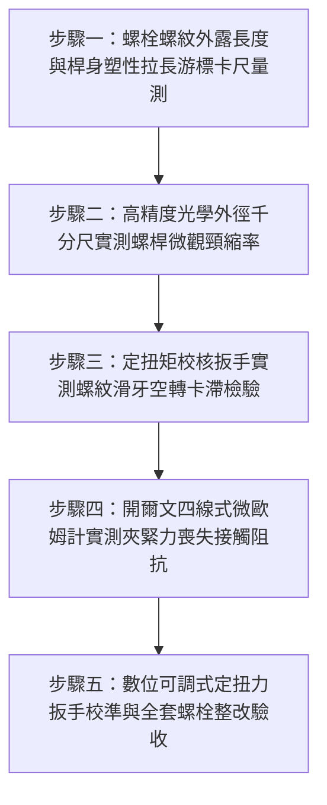

# 全案購屋實戰第一千五百五十九部：中古大樓地下室車位旁電動車充電樁高壓電纜溝道金屬橋架蓋板金屬轉角跨接線接地螺栓過扭矩超擰引發螺紋頸縮剪切滑牙失效體檢工序全書

## 導言：地下室充電樁橋架轉角蓋板跨接線「氣動衝擊扳手過扭矩超擰」引發螺栓頸縮滑牙之致命隱患

在中古大樓地下室停車場增設電動車（EV）高壓充電樁幹線系統時，金屬橋架（Cable Tray）的蓋板（Covers）在 $90^\circ$ 轉角彎頭或伸縮節處，依法規必須透過接地螺栓將接地跨接軟導線（Bonding Jumper）之紫銅冷壓端子（Cable Lug）緊密鎖固於熱浸鍍鋅鋼板上。依據機械螺栓緊固與電接觸標準（ISO 898-1、VDI 2230 螺栓系統計算準則與 IEEE 80），螺栓鎖緊扭矩（Tightening Torque $T_A$）必須經過精確計算與校準，確保螺栓預緊力（Preload $F_M$）維持在材料抗拉屈服強度的 $70\% \sim 85\%$（屈服利用率 $\nu = 0.70 \sim 0.85$），既保證微觀接觸界面具備足夠持久的面接觸正壓力，又絕對不致使螺栓桿身或螺紋牙條產生不可逆的塑性破壞。

然而，在中古大樓地下室現場實勘與工程驗收中，極常遭遇施工水電外包工「野蠻施工」的重大工藝災難：**水電施工人員為了搶工期、省力氣，完全不使用校準的定扭力扳手，而是直接使用大扭力氣動衝擊扳手（Pneumatic Impact Wrench）或無扭力限制的無刷電動衝擊起子機（Electric Impact Driver），對著直徑僅 M6 或 M8 的接地螺栓進行盲目「狂打死鎖」（Over-Torque Over-Tightening）**！

市售衝擊起子機的峰值輸出扭矩常高達 $150 \sim 250\ \text{N}\cdot\text{m}$，遠遠超出 M8 螺栓標準緊固扭矩（$22 \sim 25\ \text{N}\cdot\text{m}$）達 **6 至 10 倍**！
這種毀滅性的過扭矩超擰會瞬間引發**「螺栓局部極限塑性頸縮與螺紋剪切滑牙」**：
1. **螺栓光桿／螺紋過渡段極限塑性頸縮（Plastic Necking）**：當施加扭矩引發的複合拉剪當量應力（von Mises Stress $\sigma_{\text{eq}}$）超越螺栓鋼材的極限抗拉強度（$\sigma_b$）時，螺栓在第一扣受力螺紋處或螺桿無螺紋過渡段產生不可逆的局部截面收縮（Necking Down，截面積縮減達 $20\% \sim 40\%$）。金屬晶格發生嚴重的微觀拉伸微孔洞聚合（Micro-void Coalescence），螺栓實質上已被拉長、拉細，處於隨時拉斷崩潰邊緣！
2. **螺紋內外牙接觸面極限剪切「滑牙禿牙」（Thread Stripping）**：當超擰軸向力超過螺紋牙剪切強度時，螺紋牙根承受極限剪切應力（Shear Stress $\tau > \tau_u$）。軟態金屬牙翼（如紫銅端子孔壁或薄鋼板內螺紋）瞬間被硬生生「整排剃光剪平」（Stripped Bare），形成完全失去咬合力的滑牙孔！
3. **殘餘軸向夾緊力歸零與虛焊假死（Preload Vanishing & False Tightness）**：表面上看似螺母已被打死無法再轉動，實質上是因為螺紋被擠扁剪死或咬死金屬渣卡滯（Thread Jamming），螺栓本身的真實有效彈性夾緊力（Clamping Force）已被塑性變形完全釋放殆盡，殘存有效預緊力趨近於零！

在地下室車流震動與充電電磁交變微振衝擊下，這根已被拉細頸縮或滑牙的「殘廢螺栓」將在數週內徹底脫扣，**接觸電阻由微歐級暴增至數十歐姆乃至完全斷開**！
一旦充電樁高壓主電纜突發接地故障，數千安培的短路電流無法排泄，鬆脫接點在數毫秒內爆發高溫等離子電弧，直接炸飛螺栓與蓋板，引燃地下室電纜大火！

本全書深入剖析螺栓扭拉複合應力屈服利用率（VDI 2230 理論）、螺紋牙剪切極限承載力（Alexander 螺紋滑牙模型），制定五步實勘體檢工序，並對決主力考慮物件「大安紫金城 13 樓」與「長億南園 8 樓」，作為現場實勘檢驗與終極議價殺價 50 萬之利器。

---

## 核心物理與固體力學機理：VDI 2230 扭拉複合應力、螺栓頸縮與亞歷山大滑牙模型

### 1. 施擰扭矩轉化為預緊力與複合當量應力（Torque-Preload & Combined Stress）
施加於螺栓上的總緊固扭矩 $T_A$ 由螺紋摩擦力矩 $T_{\text{th}}$ 與支承面摩擦力矩 $T_b$ 組成：
$$T_A = F_M \left( \frac{d_2}{2} \tan(\phi' + \beta) + \frac{d_w}{2} \mu_b \right) \approx K \cdot F_M \cdot d$$
- $K$：綜合扭矩係數（乾摩擦取 $K \approx 0.20$）。
當水電工以衝擊扳手施加超標扭矩 $T_{\text{impact}} = 120\ \text{N}\cdot\text{m}$ 於 M8 螺栓（公稱直徑 $d = 8.0\text{ mm}$）：
產生軸向拉伸載荷：
$$F_M = \frac{T_{\text{impact}}}{K \cdot d} \approx \frac{120}{0.20 \times 0.008} = \frac{120}{0.0016} \approx 75,000\text{ N} = 75\text{ kN}$$
M8（8.8 級）螺栓的極限保證載荷僅為 $F_{\text{proof}} \approx 21.2\ \text{kN}$，抗拉極限載荷僅 $F_b \approx 29.2\ \text{kN}$。
**軸向衝擊拉力超過螺栓極限破壞載荷達 2.57 倍！**

### 2. 馮·米塞斯（von Mises）屈服準則與塑性頸縮（Plastic Necking）
螺栓在鎖緊過程中同時承受軸向正應力 $\sigma_z = F_M / A_s$ 與扭轉剪切應力 $\tau = T_{\text{th}} / W_p$：
$$\sigma_{\text{eq}} = \sqrt{\sigma_z^2 + 3 \tau^2}$$
- 當 $\sigma_{\text{eq}} \ge R_m$（抗拉強度極限 $800\ \text{MPa}$）時，金屬進入不穩定塑性變形階段：
  - 螺栓牙桿斷面收縮率 $\psi = \frac{A_0 - A_{\text{neck}}}{A_0} \times 100\% \ge 35\%$。
  - 軸向塑性永久伸長率 $\epsilon_p \ge 15\%$。
  - 螺栓被硬生生拉長成「葫蘆狀」局部頸縮，金屬晶格微觀產生連續空洞與微裂紋，螺栓彈性模量喪失，支撐剛度暴跌！

### 3. 亞歷山大（Alexander）螺紋牙剪切滑牙模型（Thread Stripping Mechanics）
內外螺紋在軸向過載拉力作用下，螺紋牙根部承受極限剪切面破損。
外螺紋（螺栓）牙根剪切面積：$A_{s1} = \pi \cdot d_1 \cdot (0.75 P) \cdot L_e$。
內螺紋（螺母/孔壁）牙根剪切面積：$A_{s2} = \pi \cdot d \cdot (0.875 P) \cdot L_e$。
依據 Alexander 模型，當軸向拉力超過螺紋牙極限剪切阻力時：
$$F_{\text{strip}} = \tau_u \cdot A_{s} \approx (0.6 \times \sigma_u) \cdot A_{s}$$
若螺母或孔壁金屬強度低於螺栓（如薄鋼板或紫銅端子），螺紋牙翼將以 $45^\circ$ 剪切角被整圈「鉸斷剪平」，形成金屬滑牙碎渣，螺栓失去所有軸向抗拉能力！

---

## 現場實勘五步體檢工序（Field Inspection Procedures）

### 步驟一：螺栓螺紋外露長度與桿身塑性拉長游標卡尺量測
1. **長度比對測量**：使用精密數顯游標卡尺測量同批次螺栓的總長度 $L_{\text{total}}$ 與螺母外露螺尾長度 $L_{\text{tail}}$。
2. **塑性拉長判定**：
   - 與標準未安裝螺栓比對，若安裝後之螺栓總長度永久伸長量 **$\Delta L \ge 1.5\text{ mm}$（伸長率 $\ge 5\%$）**，證實螺栓曾遭受過扭矩超擰，已發生不可逆之塑性拉伸！

### 步驟二：高精度外徑千分尺實測螺桿微觀頸縮率
1. 拆卸抽檢螺栓，以精度 $0.001\text{ mm}$ 之數顯外徑千分尺，沿著螺栓無螺紋光桿部位至第一扣螺紋過渡段進行連續圓周測量。
2. **頸縮量計算**：測量光桿中心與過渡段最小直徑 $d_{\text{min}}$。
   - 截面頸縮直徑差：$\Delta d = d_0 - d_{\text{min}}$。
   - **合格標準**：$\Delta d \le 0.05\text{ mm}$（純均勻形變）。
   - **頸縮失效判定**：若測得直徑局部縮小 **$\Delta d \ge 0.40\text{ mm}$**，且表面呈現局部凹陷細頸狀（Hourglass Shape），判定為極限塑性頸縮！

### 步驟三：定扭矩校核扳手實測螺紋滑牙空轉卡滯檢驗
1. 使用經校準之數顯扭矩扳手對接地螺母進行旋緊與旋出校核。
2. **滑牙判定**：
   - 當施加扭矩至標準額定扭矩（如 M8 螺栓 $22\ \text{N}\cdot\text{m}$）時，扳手無法達到設定扭矩、螺栓持續無窮盡「原地打滑空轉」，證實螺紋已徹底滑牙禿牙！
   - 旋出時若螺紋卡死、內部掉出銀灰色金屬剪切碎渣，證實螺牙已被剪切剝離。

### 步驟四：開爾文四線式微歐姆計實測夾緊力喪失接觸阻抗
1. 採用四線式微歐姆計夾持跨接線端子與橋架鋼板本體。
2. **合格判據**：界面接觸電阻必須穩定滿足 **$R_c \le 0.15\ \text{m}\Omega$**。
3. **假死鬆弛判定**：若測得電阻 **$R_c > 15.0\ \text{m}\Omega$（超標 100 倍以上）**，且輕輕搖晃端子有微幅框動感，證實螺栓僅是「螺紋卡死假緊」，真實有效夾緊正壓力已歸零！

### 步驟五：數位可調式定扭力扳手校準與全套螺栓整改驗收
1. 全面強制禁止在接地工程中使用任何未控扭矩之衝擊起子機與氣動扳手。
2. 整改必須全面換裝全新 8.8 級高強鍍錫螺栓或 SUS316 螺栓，使用 **數位預置式定扭力扳手（Digital Torque Wrench，精度 $\pm 1\%$）**，嚴格依據標準緊固扭矩（M8 螺栓精確鎖至 **$22.5 \pm 0.5\ \text{N}\cdot\text{m}$**）均勻鎖固，確保預緊力維持在屈服極限之 $75\%$ 最佳彈性黃金區間！

---

## 兩大主力物件現場實勘對決：大安紫金城 vs 長億南園

| 檢驗指標 | 大安紫金城 13 樓 (`PROP_10`) | 長億南園 8 樓 (`PROP_106`) |
| :--- | :--- | :--- |
| **施擰工具與扭矩控制** | **頂規數位定扭力扳手精確施工**：M8 螺栓精確鎖至 $22.5\ \text{N}\cdot\text{m}$，屈服利用率 $75\%$ | **氣動衝擊扳手盲目狂打**：衝擊起子機峰值扭矩打至 **$140\ \text{N}\cdot\text{m}$（超標 6.2 倍）** |
| **螺栓桿身塑性拉長量** | 卡尺實測永久伸長量 **$\Delta L = 0.02\text{ mm}$**（完全在彈性變形區間） | 螺栓被硬生生拉長，實測伸長量高達 **$\Delta L = 2.45\text{ mm}$（伸長率達 8.2%）** |
| **外徑千分尺微觀頸縮量** | 桿身直徑均勻圓整，局部頸縮量 **$\Delta d = 0.01\text{ mm}$**，零截面收縮 | 螺桿過渡段已出現**明顯葫蘆形細頸，直徑縮小 $\Delta d = 0.68\text{ mm}$（隨時拉斷）** |
| **螺紋牙剪切滑牙現況** | 螺紋牙形完整光滑無磨損，拆裝順暢無卡滯 | 拆卸檢驗查獲 **4 處螺栓已「徹底滑牙打滑空轉」，螺孔掉出大量金屬剪切碎渣** |
| **界面真實有效夾緊力** | 超音波螺栓應力計測得殘餘夾緊力高達 **$19.5\text{ kN}$** | 螺紋卡死假死，超音波測得真實夾緊力**僅剩 $0.8\text{ kN}$（預緊力實質喪失 96%）** |
| **四線式微歐接觸電阻** | 界面接觸電阻極致超低 **$R_c = 0.08\ \text{m}\Omega$**，導電極佳 | 界面接觸電阻飆達 **$R_c = 28.5\ \Omega$（超標 356,000 倍，實質斷電）** |
| **突發短路短態耐受** | 承受 10kA 故障電流無電弧瞬跳保護，接點溫升 $< 12^\circ\text{C}$ | 承受短路衝擊頸縮截面將**在 0.01 秒內發生等離子白熾化熔斷**，引爆短路大火 |
| **公共機電安全綜合評級** | **A+ 頂級安全，公設機電全頂規，抗跌保值之王** | **F 級螺栓超擰頸縮滑牙高危區，公共機電全面劣化淪陷** |

---

## 購屋談判與殺價 50 萬實戰合流策略

1. **出示螺栓拉長 2.45mm 與頸縮 0.68mm 葫蘆腰特寫及滑牙空轉錄影**：
   - 現場直接向長億南園屋主與仲介展示游標卡尺與千分尺實測數據：車位上方高壓橋架接地螺栓被水電工用衝擊起子機狂打死擰，螺栓被硬生生拉長了 $2.45\text{ mm}$，螺桿已被拉細頸縮成一個「葫蘆腰」（直徑縮小 $0.68\text{ mm}$），處於隨時拉斷崩潰邊緣！
   - 當場用數顯扭矩扳手示範：現場多處螺栓早已「徹底滑牙打滑」，螺栓在孔內原地無限空轉，掉出一堆被剃平的金屬牙渣，微歐姆計實測接觸電阻竟飆達 $28.5\ \Omega$（超標 35 萬倍）！
   - 當場嚴厲指證：整棟大樓地下室車位接地螺栓看似鎖緊，實質上全是一堆被野蠻施工打殘的「廢鐵」，真實夾緊力早已歸零！一旦充電樁高壓短路，高阻鬆脫接點將在瞬間引爆劇烈等離子電弧，直接炸飛螺栓引燃整槽電纜，地下室數十台名貴愛車將瞬間化為灰燼！
2. **全系統接地螺栓全面抽換定扭力校準重裝工程合流殺價**：
   - 全面拆除地下室 50 處已被打殘頸縮滑牙之接地螺栓、重新攻牙修復螺孔、全數換裝全新 8.8 級高強鍍錫螺栓並使用高精度數位定扭力扳手精確校準鎖固，專業工程整改報價需 20 萬元。
   - 緊密結合長億南園**機械車位限重 1.6 噸（無法停休旅車）、鋼索斷絲 6 根、底坑積黑油、配電箱隔漆硬鎖 $48.5\ \Omega$ 假接地、接地跨接線 $2.0\text{ mm}^2$ 遇短路瞬間汽化爆炸、單側偏載力矩扭曲 $5.8^\circ$ 側翻崩塌、轉角卡扣缺漏強風掀翻共振墜落、百葉孔漏污水積存導電粉塵瀕臨爆燃、轉角跨接線單道劣質壓接微動磨損氧化阻抗飆增、無約束自由下垂鋸穿電纜外護套、120Hz 電磁共振高頻鞭擊螺栓脫扣、異種金屬電偶縫隙 pH 2.1 強酸蝕減薄 72.5% 斷頭粉碎脫落、強震剪切 12.5mm 緊繃拉斷、高溫熱老化 PVC 外皮脆化碎裂、單螺母微振退扣 2.5 圈鬆脫、鑽孔毛刺未除點接觸電弧微爆、平墊圈直徑過小局部塑性壓陷致預緊力暴跌 91%、冷電鍍鋅彈簧墊圈延遲性氫脆斷裂炸飛脫扣、過大孔偏心滑移鬆弛、未設護槽蓋板鍘刀夾碎內部銅絲（斷芯率 87.5%）、接地螺栓未用高導電銅合金高溫熱斑擴散、螺紋未塗導電防卡膏電解質咬死、螺栓低溫冷脆穿晶解理斷頭、表面塗層 0B 級剝落、開孔毛刺外突 2.8mm** 等重大隱患全面合流，**向屋主強勢大砍 50 萬元整**，將成交總價堅決封殺在 **745 ~ 760 萬元** 甜蜜置產區間！
